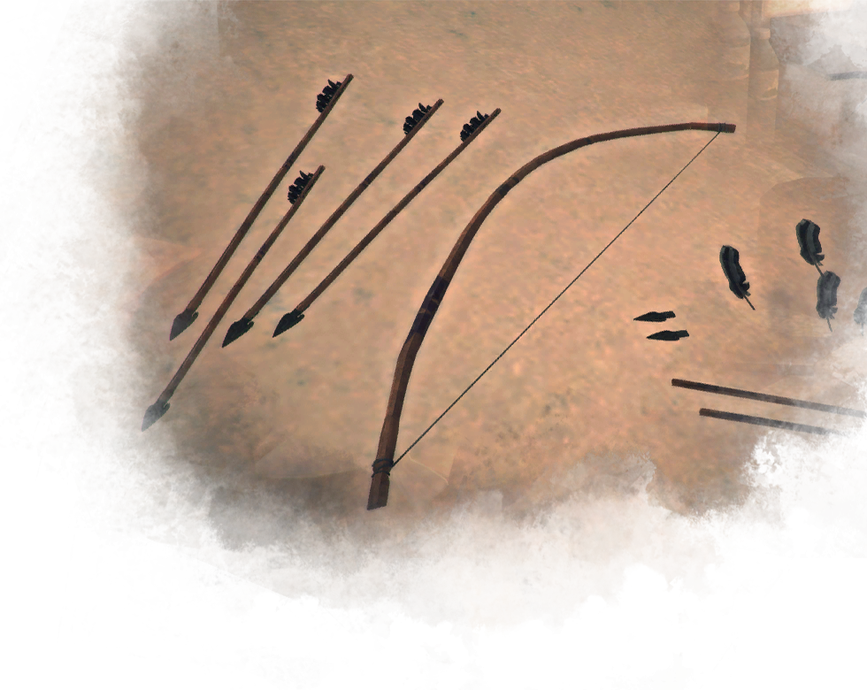

# Archery

**Contents**

- [Overview](#Overview)
- [Equipment](#Equipment)
- [Survival Bow](#Survival_Bow)
- [Survival Bow Variants](#Survival_Bow_Variants)
- [Simple Arrow](#Simple_Arrow)
- [Fire Hardened Arrow](#Fire_Hardened_Arrow)
- [Manufactured Arrow](#Manufactured_Arrow)
- [Hunting](#Hunting)
- [Critical Hits](#Critical_Hits)
- [Bleeding](#Bleeding)
- [Skill levels](#Skill_levels)

<table class="infobox">
<caption>Archery</caption>
<colgroup>
<col style="width: 50%" />
<col style="width: 50%" />
</colgroup>
<tbody>
<tr>
<td colspan="2"><figure>

<figcaption>Archery_background.png</figcaption>
</figure></td>
</tr>
<tr>
<td>
Release
</td>
<td>
<a href="./The%20Long%20Dark%20%E2%80%94%20Early%20Access%20Changelog.md#0.364" class="wikilink" title="Vigilant Trespass (v0.364)">Vigilant Trespass (v0.364)</a>
</td>
</tr>
<tr>
<td>
Date
</td>
<td>
23 September 2016
</td>
</tr>
</tbody>
</table>

 **Archery** is a Survival <a href="./Skills.md" class="wikilink" title="Skill">Skill</a> that involves the use of a <a href="./Survival%20Bow.md" class="wikilink" title="Survival Bow">Survival Bow</a> to hunt <a href="./Wildlife.md" class="wikilink" title="Wildlife">Wildlife</a>.

Archery's ability to deal ranged damage means that a player can attack animals (and especially predators) from positions of relative safety.

## Overview

Archery requires some practice to use effectively and several factors should be taken into consideration with its use:

- *Draw speed:* the draw speed for a Survival Bow is a lot slower than aiming the <a href="./Hunting%20Rifle.md" class="wikilink" title="Hunting Rifle">Hunting Rifle</a> (in particular fast variants like <a href="./Vaughn%27s%20Rifle.md" class="wikilink" title="Vaughn&#39;s Rifle">Vaughn's Rifle</a>)
- *Horizontal sway:* when drawn, the bow will sway from left to right, affecting the arrow's flight path accordingly. When it tilts to the right or left, the arrow will fly a bit to the right or left of the centre of your aim. The sway increases if the player is <a href="./Fatigue.md" class="wikilink" title="tired">tired</a>.
- *Vertical targeting:* an arrow's flight trajectory forms an arc. Farther targets may require aiming higher.
- *Arrow flight speed:* arrows fly much slower than bullets, so the target's movement should be taken into consideration.
- *Usability:*the bow, unlike the rifle, cannot be fired while crouched until the player reaches Archery skill Level 5.
- *Variants:* bows and arrows both have variants that will affect damage type, available targets, resources used for crafting or trading and much more.

## Equipment

### Survival Bow

The Survival Bow is a crafted weapon used to fire Arrows (<a href="./Simple%20Arrow.md" class="wikilink" title="Simple Arrows">Simple Arrows</a> and <a href="./Fire%20Hardened%20Arrow.md" class="wikilink" title="Fire-hardened Arrows">Fire-hardened Arrows</a> are crafted while <a href="./Manufactured%20Arrow.md" class="wikilink" title="Manufactured Arrows">Manufactured Arrows</a> are <a href="./Trader.md" class="wikilink" title="traded">traded</a> for and can't be harvested). There is no aid to aiming or aim-down-sight like on the firearms, and the survivor must estimate when aiming. Bow condition will degrade about 1-2% per shot based on skill and cannot be repaired. However, the Survival Bow can be crafted at any point and there are loose spawns to be found in many regions (except on <a href="./Interloper.md" class="wikilink" title="Interloper">Interloper</a> and <a href="./Misery.md" class="wikilink" title="Misery">Misery</a>).

- Arrows are retrievable; hitting soft targets such as snow will leave the arrow sticking out where it hit the snow, whereas arrows shot at hard surfaces like ice, rocks or metal will send the arrow flying around and bouncing, which can make them harder to find (their thin model makes them nearly invisible from even short distances, forcing the player to look around for where they may have bounced to).
- Arrows will loose condition every time they are shot, not from the shooting itself but from hitting its target. Arrows at low condition will eventually break, leaving behind a broken arrow model that can be retrieved and broken down to its bare components (except for the Manufactured Arrow)
- Arrows may be collected all at once by left-clicking on animal carcasses or collected one-by-one my left-clicking directly on the arrow model itself (this can be done while the animal is alive, at great risk to the player).
- The arrow type can be changed by pressing "R" while the Survival Bow is used.

### Survival Bow Variants

There are three Bow variants:

- <a href="./Bushcraft%20Bow.md" class="wikilink" title="Bushcraft Bow">Bushcraft Bow</a> (crafted item once its recipe has been obtained from the Trader)
- <a href="./Sport%20Bow.md" class="wikilink" title="Sport Bow">Sport Bow</a> (does not appear in <a href="./Interloper.md" class="wikilink" title="Interloper">Interloper</a>/<a href="./Misery.md" class="wikilink" title="Misery">Misery</a>)
- <a href="./Woodwright%27s%20Bow.md" class="wikilink" title="Woodwright&#39;s Bow">Woodwright's Bow</a> (does not appear in Interloper/Misery)

### Simple Arrow

<a href="./Simple%20Arrow.md" class="wikilink" title="Simple Arrows">Simple Arrows</a> are reusable, craftable, harvestable ammunition. Simple Arrows instantly kill Rabbit and Ptarmigan, and deal high damage (comparable to the Hunting Rifle) to big game with a high rate of Blood Loss on the body part struck (with Head, Neck and Torso being the best targets). Blood Loss from Simple Arrow hits is lethal (except to <a href="./Moose.md" class="wikilink" title="Moose">Moose</a>), though large game (such as <a href="./Bear.md" class="wikilink" title="Black Bear">Black Bear</a>) may take hours and run long distances before death.

*(though its frequency is hard to identify, there is a bug where a Bear hit with an arrow can stop bleeding and go back to its usual route. The bug is more prone to triggering after a scene change, like loading into an interior location.)*

Simple Arrows take 4% condition damage when striking snow, 24% when striking an animal, 30% when striking wood, and 55% when striking metal or ice. Simple Arrows become <a href="./Broken%20Arrow.md" class="wikilink" title="Broken Arrows">Broken Arrows</a> at 0% condition, which may be harvested for one <a href="./Arrowhead.md" class="wikilink" title="Arrowhead">Arrowhead</a> and two <a href="./Crow%20Feather.md" class="wikilink" title="Crow Feathers">Crow Feathers</a>.

Simple Arrows persist in the world and may be retrieved later, even if stuck in an animal carcass which decays completely.

### Fire Hardened Arrow

Fire Hardened Arrows function similarly to Simple Arrows, are much easier to craft (only requiring five <a href="./Stick.md" class="wikilink" title="Sticks">Sticks</a> and five Crow Feather and any fire source, rather than <a href="./Green%20Birch%20Sapling.md" class="wikilink" title="birch saplings">birch saplings</a> and <a href="./Forge.md" class="wikilink" title="forging">forging</a>), but will only kill <a href="./Rabbit.md" class="wikilink" title="Rabbits">Rabbits</a> and <a href="./Ptarmigan.md" class="wikilink" title="Ptarmigans">Ptarmigans</a>. They do not injure larger animals, but can cause them to flee if striking/landing near an animal undetected, or have a chance of scaring a charging <a href="./Wolf.md" class="wikilink" title="Wolf">Wolf</a>. Simple Arrows cause Morale damage to <a href="./Timberwolf.md" class="wikilink" title="Timberwolf Packs">Timberwolf Packs</a> engaged with the player.

Fire Hardened Arrows take 7% condition damage when striking snow, 47% when striking an animal, 59% when striking wood, and 100% when striking metal or ice (they may still survive hard impacts if at full condition). Fire Hardened Arrows become <a href="./Broken%20Fire%20Hardened%20Arrow.md" class="wikilink" title="Broken Fire Hardened Arrows">Broken Fire Hardened Arrows</a> at 0% condition, which may be harvested for one Crow Feather.

Fire Hardened Arrows stick into terrain and Rabbit/Ptarmigan, but fall to the ground (broken or not) when striking other animals.

### Manufactured Arrow

A significant upgrade from the Simple Arrow, <a href="./Manufactured%20Arrow.md" class="wikilink" title="Manufactured Arrows">Manufactured Arrows</a> inflict 12.5% more damage and are twice as durable compared to Simple Arrows due to their steel alloy arrowhead and synthetic fletching and visually-striking red shaft. They have two downsides however:

- They are only acquired by trading with the <a href="./Trader.md" class="wikilink" title="Trader">Trader</a>, which requires building up significant Trust with him (and requiring two cured hides, water and two ptarmigan feathers for every single arrow traded).
- <a href="./Broken%20Manufactured%20Arrow.md" class="wikilink" title="Broken Manufactured Arrows">Broken Manufactured Arrows</a> cannot be harvested and rebuilt. The unique metal arrowhead is always lost when broken and the fletching doesn't give crow feathers.

Manufactured Arrows take 2% condition damage when striking snow, 12% when striking an animal, 15% when striking wood, and 27.5% when striking metal or ice. Manufactured Arrows become <a href="./Broken%20Manufactured%20Arrow.md" class="wikilink" title="Broken Manufactured Arrows">Broken Manufactured Arrows</a> at 0% condition.

|  | Kill Rabbit and Ptarmigan | Kill Big Game | Blood Loss | Startle Animals | Interrupt Wolf Charge | Crafting |
|----|----|----|----|----|----|----|
| Simple Arrow | Instant | Yes | Yes\* | Yes | No | 1 Arrowhead (<a href="./Forge.md" class="wikilink" title="Forging">Forging</a>), 1 Arrow Shaft, 3 Crow Feather |
| Fire Hardened Arrow | Instant | No | No | Yes | Yes | 5 Stick, 5 Crow Feather and any <a href="./Campfire.md" class="wikilink" title="Fire Source">Fire Source</a> (Makes 3) |
| Manufactured Arrow | Instant | Yes | Yes\* | Yes | Yes | Traded from the <a href="./Trader.md" class="wikilink" title="Trader">Trader</a> |

Arrow Types

\*No weapon inflicts Blood Loss against <a href="./Moose.md" class="wikilink" title="Moose">Moose</a> or <a href="./Cougar.md" class="wikilink" title="Cougar">Cougar</a>.

## Hunting

  
*Main article: <a href="./Hunting.md" class="wikilink" title="Hunting">Hunting</a>*

**Hunting** animals to kill and then harvest their flesh is an efficient means to acquire <a href="./Food%20And%20Drink.md" class="wikilink" title="Food">Food</a> and materials. Shooting animals with projectiles, such as arrows, is the most effective way to kill game while completely bypassing the animals' natural defenses. Arrows move too quickly to be blocked or dodged and can be fired from outside the animal's zone of perception.

### Critical Hits

Critical hits are random occurrences, but are more likely in an animal's designated critical areas. Shots to the head and neck seem to have the best chance to cause a critical hit, with shots to the front shoulder and chest being second. Shots to the feet are immune to critical hits.

### Bleeding

Direct hits to an animal with an arrow that are not a critical hit will cause a bleeding wound. Animals will bleed out according to which area they were shot in. Multiple shots to the same area will not make the animal bleed out any faster. However, shooting an animal in an area that bleeds faster than a previous wound it has already received will cause the timer to reset and the amount of time to bleed out changes to the amount of time required for the new wound. This makes it beneficial to just wait in most cases, especially when shooting again could provoke the animal to attack, or flee meaning the animal would have to be tracked down again. Also, waiting via sleeping, passing the time, reading, etc. counts as time towards bleeding out, but the animal will move at an accelerated speed so will wander just as far as if you had waited in real-time.

<table>
<thead>
<tr>
<th></th>
<th colspan="4">
Hit zone
</th>
</tr>
</thead>
<tbody>
<tr>
<td>
Animal
</td>
<td>
Head
</td>
<td>
Chest
</td>
<td>
Hind
</td>
<td>
Foot
</td>
</tr>
<tr>
<td>
<a href="./Ptarmigan.md" class="wikilink" title="Ptarmigan">Ptarmigan</a>
</td>
<td>
Instant
</td>
<td>
Instant
</td>
<td>
Instant
</td>
<td>
Instant
</td>
</tr>
<tr>
<td>
<a href="./Rabbit.md" class="wikilink" title="Rabbit">Rabbit</a>
</td>
<td>
Instant
</td>
<td>
Instant
</td>
<td>
Instant
</td>
<td>
Instant
</td>
</tr>
<tr>
<td>
<a href="./Deer.md" class="wikilink" title="Deer">Deer</a>
</td>
<td>
20 minutes
</td>
<td>
25 minutes
</td>
<td>
40 minutes
</td>
<td>
120 minutes
</td>
</tr>
<tr>
<td>
<a href="./Wolf.md" class="wikilink" title="Wolf">Wolf</a>/<a href="./Timberwolf.md" class="wikilink" title="Timberwolf">Timberwolf</a>/<a href="./Poisoned%20Wolf.md" class="wikilink" title="Poisoned Wolf">Poisoned Wolf</a>
</td>
<td>
Instant
</td>
<td>
40 minutes
</td>
<td>
45 minutes
</td>
<td>
60 minutes
</td>
</tr>
<tr>
<td>
<a href="./Bear.md" class="wikilink" title="Bear">Bear</a>
</td>
<td>
45 minutes
</td>
<td>
120 minutes
</td>
<td>
240 minutes
</td>
<td>
240 minutes
</td>
</tr>
<tr>
<td>
<a href="./Moose.md" class="wikilink" title="Moose">Moose</a>
</td>
<td>
N/A
</td>
<td>
N/A
</td>
<td>
N/A
</td>
<td>
N/A
</td>
</tr>
<tr>
<td>
<a href="./Cougar.md" class="wikilink" title="Cougar">Cougar</a>
</td>
<td>
N/A
</td>
<td>
N/A
</td>
<td>
N/A
</td>
<td>
N/A
</td>
</tr>
</tbody>
</table>

\*Moose and Cougar do not Bleed.

## Skill levels

Archery Skill is increased by scoring hits on live wildlife with the Survival Bow, by crafting Simple Arrows at a workbench, or by fully reading the <a href="./Research%20Book.md" class="wikilink" title="Research Book">Research Book</a> "*Stay on Target".* Multiple copies of *Stay on Target* spawn in each save, most of them at fixed loot spawns (see its section in the Research Book page), each granting skill points when fully read.

- Striking a live animal (except <a href="./Crow.md" class="wikilink" title="Crows">Crows</a>) with any arrow type grants one skill point.
- Crafting a Simple Arrow grants one skill point (Fire-hardened Arrows don't grant any skill point when crafted)
- *<a href="./Stay%20on%20Target.md" class="wikilink" title="Stay on Target">Stay on Target</a>* grants 10 skill points for five hours of reading or 11 skill points when using the *Book Smarts* <a href="./Feats.md" class="wikilink" title="Feat">Feat</a> and four hours of reading when using the *Settled Mind* Feat.

Once players have reached a new skill level, they unlock the effects described in the table below. \<table-progress-tracking table-id="1" unique-column-index="1"\>

<table>
<colgroup>
<col style="width: 20%" />
<col style="width: 20%" />
<col style="width: 20%" />
<col style="width: 20%" />
<col style="width: 20%" />
</colgroup>
<thead>
<tr>
<th>
Level
</th>
<th>
Skill points needed
</th>
<th>
Points to next level
</th>
<th style="text-align: left; width: 35%;">
Effects
</th>
<th>
Flavor text
</th>
</tr>
</thead>
<tbody>
<tr>
<td>
1
</td>
<td>
0
</td>
<td>
15
</td>
<td style="text-align: left;"><ul>
<li>Basic archery skill</li>
</ul></td>
<td>
You are new to archery and have no special skills or knowledge. Although you can successfully fire an arrow from the bow, it feels awkward in your untrained hands.
</td>
</tr>
<tr>
<td>
2
</td>
<td>
15
</td>
<td>
25
</td>
<td style="text-align: left;"><ul>
<li>Bow sway reduced by 25%</li>
<li>Arrow damage increased by 10%</li>
</ul></td>
<td>
As your use of the bow increases it feels less awkward in your hands. Your aim is a little more steady and your shots deal more damage.
</td>
</tr>
<tr>
<td>
3
</td>
<td>
40
</td>
<td>
35
</td>
<td style="text-align: left;"><ul>
<li>Bow sway reduced by 50%</li>
<li>Arrow damage increased by 10%</li>
<li>Critical Hit chance increased by 15%</li>
</ul></td>
<td>
You're turning into a decent archer. Your aim is increasingly more precise and with this you have a greater chance of inflicting critical damage.
</td>
</tr>
<tr>
<td>
4
</td>
<td>
75
</td>
<td>
50
</td>
<td style="text-align: left;"><ul>
<li>Bow sway reduced by 75%</li>
<li>Arrow damage increased by 10%</li>
<li>Critical Hit chance increased by 25%</li>
<li>Bleed Out time reduced by 25%</li>
<li>Per-use condition loss reduced by 50%</li>
</ul></td>
<td>
You have become a skilled archer. You have a steady, accurate aim and a powerful shot. Your improved efficiency helps keep your bow in good condition for longer.
</td>
</tr>
<tr>
<td>
5
</td>
<td>
125
</td>
<td>
Max level
</td>
<td style="text-align: left;"><ul>
<li>Can fire Survival Bow when crouched</li>
<li>Bow sway reduced by 75%</li>
<li>Arrow damage increased by 25%</li>
<li>Critical Hit chance increased by 50%</li>
<li>Bleed Out time reduced by 50%</li>
<li>Per-use condition loss reduced by 50%</li>
</ul></td>
<td>
You are one with your bow - it feels like an extension of your body and you are able to use your bow while crouched. Your eagle-eyed aim is deadly accurate. You are the hunter.
</td>
</tr>
</tbody>
</table>

\</table-progress-tracking\>

**Lua execution error in Module:Navbox function navbox**<a href="ru:%D0%9D%D0%B0%D0%B2%D1%8B%D0%BA%D0%B8#%D0%A1%D1%82%D1%80%D0%B5%D0%BB%D1%8C%D0%B1%D0%B0_%D0%B8%D0%B7_%D0%BB%D1%83%D0%BA%D0%B0" class="wikilink" title="ru:Навыки#Стрельба из лука">ru:Навыки#Стрельба из лука</a>

<a href="fr:Archerie" class="wikilink" title="fr:Archerie">fr:Archerie</a> <a href="es:Tiro_con_arco" class="wikilink" title="es:Tiro con arco">es:Tiro con arco</a>

