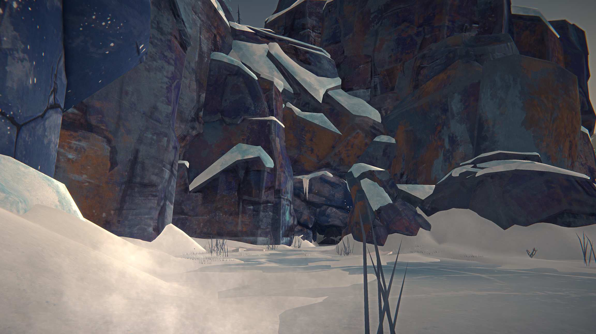

# Archie's Crawlspace

<table class="infobox">
<caption>Archie's Crawlspace</caption>
<colgroup>
<col style="width: 50%" />
<col style="width: 50%" />
</colgroup>
<tbody>
<tr>
<td colspan="2"><figure>

<figcaption>Screen_07396e10-f97f-47ed-8f34-e3083be6fa00_hi.png</figcaption>
</figure></td>
</tr>
<tr>
<td colspan="2" class="section">
<strong>Location</strong>
</td>
</tr>
<tr>
<td colspan="2"><figure>
[Missing image: Archie's_Crawlspace_Location.png]
<figcaption>Archie's_Crawlspace_Location.png</figcaption>
</figure></td>
</tr>
<tr>
<td>
Region
</td>
<td>
<a href="./Forsaken%20Airfield.md" class="wikilink" title="Forsaken Airfield">Forsaken Airfield</a>|-
</td>
</tr>
<tr>
<td colspan="2" class="section">
<strong>General</strong>
</td>
</tr>
<tr>
<td>
Type
</td>
<td></td>
</tr>
<tr>
<td><figure>

<figcaption>bed_icon.png</figcaption>
</figure></td>
<td></td>
</tr>
<tr>
<td></td>
<td>
Has an interior|}

<strong>Archie's Crawlspace</strong> is a small cave in the south part of the <a href="./Drift%20Island.md" class="wikilink" title="Drift Island">Drift Island</a> to the east of <a href="./Cove.md" class="wikilink" title="Cove">Cove</a>.

<h2 id="Overview">Overview</h2>

The cave gives a small warmth bonus, compared to the harsh climate of the <a href="./Shoulder%20Lake.md" class="wikilink" title="Shoulder Lake">Shoulder Lake</a>. There is no bed, but bodies and a wolf carcass can be found here. <a href="./Deer.md" class="wikilink" title="Deer">Deer</a> can be found just south of the cave. The surroundings are also rich in <a href="./Cat%20Tail%20Stalk.md" class="wikilink" title="Cat Tails">Cat Tails</a> and <a href="./Rose%20Hip.md" class="wikilink" title="Rose Hips">Rose Hips</a>.

A <a href="./Bear.md" class="wikilink" title="bear">bear</a> may also patrol this area.

<strong>Lua execution error in Module:Navbox function navbox</strong> <a href="ru:%D0%9D%D0%BE%D1%80%D0%B0_%D0%90%D1%80%D1%87%D0%B8" class="wikilink" title="ru:Нора Арчи">ru:Нора Арчи</a>
</td>
</tr>
</tbody>
</table>

