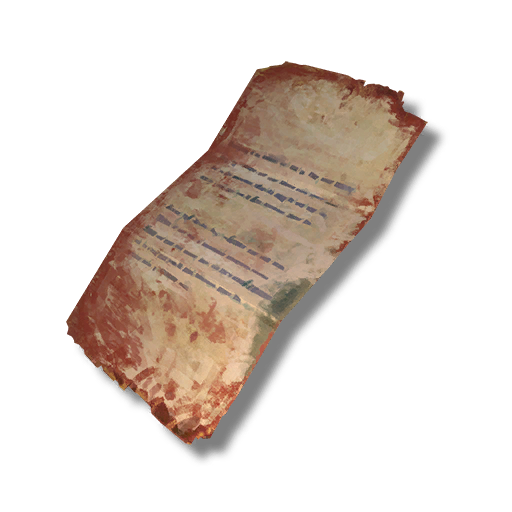

# Archival Report

**Contents**

- [Transcript](#Transcript)
- [Volume A](#Volume_A)
- [Volume B](#Volume_B)
- [Volume C](#Volume_C)
- [Volume D](#Volume_D)
- [Update history](#Update_history)

<table class="infobox">
<caption>Archival Report</caption>
<colgroup>
<col style="width: 50%" />
<col style="width: 50%" />
</colgroup>
<tbody>
<tr>
<td colspan="2"><figure>

<figcaption>Archival_Report_icon.png</figcaption>
</figure></td>
</tr>
<tr>
<td>
Release
</td>
<td>
<a href="./The%20Long%20Dark%20%E2%80%94%20Changelog.md#1.95" class="wikilink" title="6 October 2021">6 October 2021</a>
</td>
</tr>
<tr>
<td>
Wintermute
</td>
<td>
<a href="./Episode%204%20-%20Fury%2C%20Then%20Silence.md" class="wikilink" title="Episode 4">Episode 4</a> - <a href="./Dark%20Star.md" class="wikilink" title="Dark Star">Dark Star</a>
</td>
</tr>
<tr>
<td colspan="2" class="section">
<strong>Properties</strong>
</td>
</tr>
<tr>
<td>
Item type
</td>
<td>
<a href="./Collectibles.md" class="wikilink" title="Collectibles">Collectibles</a>|-
</td>
</tr>
<tr>
<td>
Stackable
</td>
<td>
No
</td>
</tr>
<tr>
<td>
Examine
</td>
<td>
A bloody page torn from Blackrock Penitentiary records.
</td>
</tr>
<tr>
<td colspan="2" class="section">
<strong>Values</strong>
</td>
</tr>
<tr>
<td>
Weight
</td>
<td>
0.00 kg (0 lbs)
</td>
</tr>
<tr>
<td colspan="2" class="section">
<strong>Actions</strong>
</td>
</tr>
<tr>
<td>
Backpack
</td>
<td>
Examine
</td>
</tr>
<tr>
<td>
On ground
</td>
<td>
Take It, Read Text, Leave It
</td>
</tr>
<tr>
<td colspan="2" class="section">
<strong>Advanced data</strong>
</td>
</tr>
<tr>
<td>
Item key
</td>
<td>
GAMEPLAY_PrisonLore
</td>
</tr>
</tbody>
</table>

**Archival Report** are 4 <a href="./Collectibles.md" class="wikilink" title="Collectible">Collectible</a> items found in <a href="./Episode%204%20-%20Fury%2C%20Then%20Silence.md" class="wikilink" title="Episode 4">Episode 4</a> of the <a href="./Wintermute.md" class="wikilink" title="Wintermute">Wintermute</a> story mode during the <a href="./Dark%20Star.md" class="wikilink" title="Dark Star">Dark Star</a> side mission.

During the course of the mission, <a href="./Will%20Mackenzie.md" class="wikilink" title="Will Mackenzie">Will Mackenzie</a> finds the four volumes of the note *Archival Report* within the <a href="./Blackrock.md" class="wikilink" title="Blackrock">Blackrock</a> region.

## Transcript

### Volume A

The following text is transcribed from **Archival Report Volume A**

\[Blackrock -- An Oral History, Vol. A\]

I helped build Blackrock. Helped bring steel and bricks in from the Mainland.

But we also sourced rock and stone from some quarries at the foot of that big mountain. I guess that’s why we were all there? Blackrock Mountain. There were mining folk all around that valley, so it was easy to find help to put the bones up on that prison. Some died, some would wander off. But we all got paid and the thing got done. Can’t say much for the mean look of the place but we built ‘er strong.

Nice enough place in the summer months, Great Bear, but those winters were evil things, I tell you. Wind came whippin’ down from the mountain, screaming after ya.

### Volume B

The following text is transcribed from **Archival Report Volume B**

\[Blackrock -- An Oral History, Vol. B\]

My husband got recruited by some old navy buddy of his. This was the early 50s, and we weren’t exactly in a good spot then. As I found out later from some of the other wives, no good road leads to Blackrock.

We had a little cabin in a hamlet a ways away from the prison. A lot of the staff lived nearby, but not all. Some put as much distance between them and the prison as possible. Even when winters made that a tough go when you had a shift.

I tried not to think about what went on up there. It changed my husband, somehow. He was a sweet man, if a little lost and unlucky in his work. Like a lot of men were back then. But our time on Great Bear, at that place, well, it left him sad in a way I can’t explain.

I tended a garden and wrote endless letters to my sisters. That’s how I remember those years. Endless writing, waiting to leave as the seasons passed.

### Volume C

The following text is transcribed from **Archival Report Volume C**

\[Blackrock -- An Oral History, Vol. C\]

I knew one of the first wardens out there. I cooked for him just like I cooked for the rest of them. Got to know him pretty well, as you do with folks like that. That fellow would throw these questions at me over dinner, “whadda ya think about this, about that.”

I mostly shrugged when he tried this on me. What did I know? But I had been doing the same cooking during the war. I was used to it.

He had a good head on his shoulders. Good enough for those kinds of men anyway. But he had some funny ideas about punishment. Lots of lectures and preaching type-stuff, that the land would fix them, the prisoners I mean. The Blackrock Mountain. That being in that terrible place was their mission. I never understood any of it.

### Volume D

The following text is transcribed from **Archival Report Volume D**

\[Blackrock -- An Oral History, Vol. D\]

I was in the first group of guards they brought out there. And it was my first job. I was just a kid still, really. Green like the trees on that freezing island.

But that was the point, I think. That place shaped the guards as much as the men they locked up there. Some of us felt sorta locked up too. Right alongside the inmates.

After a few years, I did my bit, shook their hands, and left. That was the last I saw of Blackrock.

## Update history

- UPDATE **6 October 2021 (<a href="./The%20Long%20Dark%20%E2%80%94%20Changelog.md#1.95" class="wikilink" title="Update">Update</a>):**
  - Added to game.

**Lua execution error in Module:Navbox function navbox**

<a href="ru:%D0%90%D1%80%D1%85%D0%B8%D0%B2%D0%BD%D1%8B%D0%B9_%D0%BE%D1%82%D1%87%D1%91%D1%82" class="wikilink" title="ru:Архивный отчёт">ru:Архивный отчёт</a>

