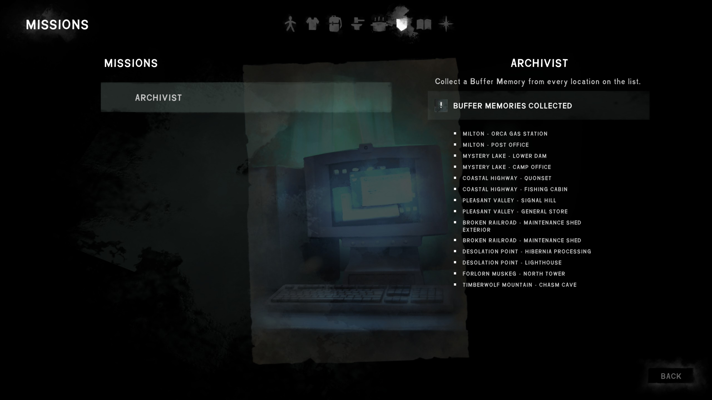

# Archivist

**Categories:** Challenges · **Source:** [Fandom](https://thelongdark.fandom.com/wiki/Archivist)

**Contents**

- [Overview](#overview)
- [Start](#start)
- [Journal](#journal)
- [Tips](#tips)
- [Gallery](#gallery)

**Archivist**

_Challenge\_Archivist.png_

**Details**

**Regions:** [Mountain Town](./Mountain%20Town.md), [Mystery Lake](./Mystery%20Lake%20%28disambiguation%29.md), [Coastal Highway](./Coastal%20Highway.md), [Pleasant Valley](./Pleasant%20Valley.md), [Broken Railroad](./Broken%20Railroad.md), [Desolation Point](./Desolation%20Point.md), [Forlorn Muskeg](./Forlorn%20Muskeg.md), [Timberwolf Mountain](./Timberwolf%20Mountain.md)

**Difficulty:** 3

**Date Added:** December 2018

> “__In the Quiet Apocalypse, fragments of the old world are few and far between. Collect all the Buffer Memories you find, to preserve their echoes.  
 During the aurora, collect Buffer Memories from across Great Bear Island at the locations listed in your Journal.__”
>
> — Main Menu description

**Archivist** is one of eight [challenges](./Challenge.md) in [_The Long Dark_](./The%20Long%20Dark.md).

## Overview

> “**Collect a Buffer Memory from every location on the list.**”
>
> — Journal Objective

In this challenge, the player must view a [Buffer Memory](./Buffer%20Memories.md) at each location listed in the journal. Each location will have a computer, which will turn on and display buffer memories during an [Aurora](./Aurora.md).

The frequency of auroras is increased for this challenge, although they will not occur every night. As a result, it is often necessary to pass time at a location before a Buffer Memory can be accessed. The Buffer Memory displayed on screen will change periodically per Aurora, although only one Buffer Memory is needed at each location in order to complete the challenge.

The difficulty uses Voyageur settings, except for the aurora frequency, and possibly the aggressiveness of wolves.

## Start

The player starts out in the [Milton House (Grey Mother's)](./Milton%20House%20%28Grey%20Mother%27s%29.md) fully rested, fully hydrated, and with 2000 calories, and at night with an Aurora already present. The player will have a [Bedroll](./Bedroll.md) and a [Flashlight](./Flashlight.md), in addition to some miscellaneous items and clothing.

## Journal

_Archivist\_Journal.jpg_

| Region | Location |
| --- | --- |
| [Milton](./Milton.md) | [Orca Gas Station](./Orca%20Gas%20Station.md) |
| Milton | [Post Office](./Milton%20Post%20Office.md) |
| [Mystery Lake](./Mystery%20Lake%20%28region%29.md) | [Lower Dam](./Carter%20Hydro%20Dam.md) |
| Mystery Lake | [Camp Office](./Camp%20Office.md) |
| [Coastal Highway](./Coastal%20Highway.md) | [Quonset](./Quonset%20Garage.md) |
| Coastal Highway | [Fishing Cabin](./Fishing%20Camp.md) |
| [Pleasant Valley](./Pleasant%20Valley.md) | [Signal Hill](./Signal%20Hill.md) |
| Pleasant Valley | [General Store](./Thomson%27s%20Crossing.md) |
| [Broken Railroad](./Broken%20Railroad.md) | [Maintenance Shed Exterior](./Maintenance%20Yard.md) |
| Broken Railroad | [Maintenance Shed](./Maintenance%20Yard.md) |
| [Desolation Point](./Desolation%20Point.md) | [Hibernia Processing](./Hibernia%20Processing.md) |
| Desolation Point | [Lighthouse](./Lonely%20Lighthouse.md) |
| [Forlorn Muskeg](./Forlorn%20Muskeg.md) | [North Tower](./Shortwave%20Tower.md) |
| [Timberwolf Mountain](./Timberwolf%20Mountain.md) | [Chasm Cave](./Chasm%20Cave.md) |

## Tips

The Buffer Memory in the Lower Dam should be given special consideration — during an Aurora, the sparking wires make it difficult to traverse from the Upper to Lower Dam safely. You should be prepared to travel to the Lower Dam office where the memory appears during the day, and have enough supplies of food and water to wait in the Lower Dam until the next aurora.

Sparking wires are also of concern when accessing the Maintenance Shed buffer memory and the Hibernia Processing buffer memory.

The North Tower and Chasm Cave buffer memories are outdoors. You should be prepared to face [aurora wolves](./Wolf.md#Aurora_wolves) when attempting to access these.

## Gallery

_The badge awarded upon completing the challenge_
