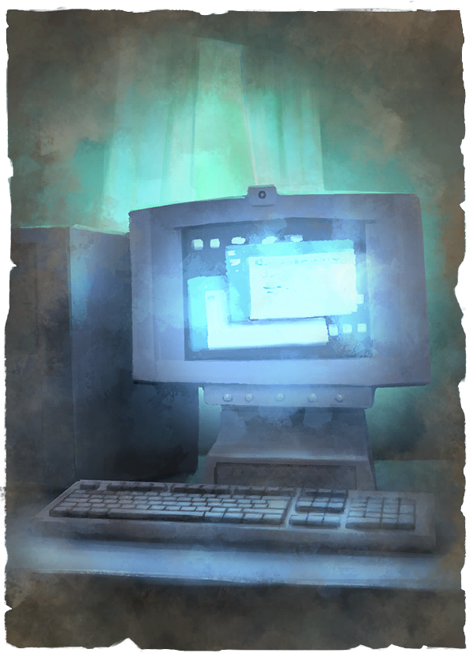

# Archivist

**Contents**

- [Overview](#Overview)
- [Start](#Start)
- [Journal](#Journal)
- [Tips](#Tips)
- [Gallery](#Gallery)

<table class="infobox">
<caption>Archivist</caption>
<colgroup>
<col style="width: 50%" />
<col style="width: 50%" />
</colgroup>
<tbody>
<tr>
<td colspan="2"><figure>

<figcaption>Challenge_Archivist.png</figcaption>
</figure></td>
</tr>
<tr>
<td colspan="2" class="section">
<strong>Details</strong>
</td>
</tr>
<tr>
<td>
Regions
</td>
<td>
<a href="./Mountain%20Town.md" class="wikilink" title="Mountain Town">Mountain Town</a>, <a href="./Mystery%20Lake%20%28disambiguation%29.md" class="wikilink" title="Mystery Lake">Mystery Lake</a>, <a href="./Coastal%20Highway.md" class="wikilink" title="Coastal Highway">Coastal Highway</a>, <a href="./Pleasant%20Valley.md" class="wikilink" title="Pleasant Valley">Pleasant Valley</a>, <a href="./Broken%20Railroad.md" class="wikilink" title="Broken Railroad">Broken Railroad</a>, <a href="./Desolation%20Point.md" class="wikilink" title="Desolation Point">Desolation Point</a>, <a href="./Forlorn%20Muskeg.md" class="wikilink" title="Forlorn Muskeg">Forlorn Muskeg</a>, <a href="./Timberwolf%20Mountain.md" class="wikilink" title="Timberwolf Mountain">Timberwolf Mountain</a>
</td>
</tr>
<tr>
<td>
Difficulty
</td>
<td>
3
</td>
</tr>
<tr>
<td>
Date Added
</td>
<td>
December 2018
</td>
</tr>
</tbody>
</table>

<table>
<colgroup>
<col style="width: 33%" />
<col style="width: 33%" />
<col style="width: 33%" />
</colgroup>
<tbody>
<tr>
<td style="vertical-align: top; font-size: 3em; color: #5d5980; padding-right: 10px">
“
</td>
<td>
In the Quiet Apocalypse, fragments of the old world are few and far between. Collect all the Buffer Memories you find, to preserve their echoes. 
During the aurora, collect Buffer Memories from across Great Bear Island at the locations listed in your Journal.

&#10;

Main Menu description

</td>
<td style="vertical-align: bottom; font-size: 3em; color: #5d5980; padding-left: 10px">
”
</td>
</tr>
</tbody>
</table>

**Archivist** is one of eight <a href="./Challenge.md" class="wikilink" title="challenges">challenges</a> in <a href="./The%20Long%20Dark.md" class="wikilink" title="The Long Dark"><em>The Long Dark</em></a>.

## Overview

<table>
<colgroup>
<col style="width: 33%" />
<col style="width: 33%" />
<col style="width: 33%" />
</colgroup>
<tbody>
<tr>
<td style="vertical-align: top; font-size: 3em; color: #5d5980; padding-right: 10px">
“
</td>
<td>
Collect a Buffer Memory from every location on the list.

&#10;

Journal Objective

</td>
<td style="vertical-align: bottom; font-size: 3em; color: #5d5980; padding-left: 10px">
”
</td>
</tr>
</tbody>
</table>

In this challenge, the player must view a <a href="./Buffer%20Memories.md" class="wikilink" title="Buffer Memory">Buffer Memory</a> at each location listed in the journal. Each location will have a computer, which will turn on and display buffer memories during an <a href="./Aurora.md" class="wikilink" title="Aurora">Aurora</a>.

The frequency of auroras is increased for this challenge, although they will not occur every night. As a result, it is often necessary to pass time at a location before a Buffer Memory can be accessed. The Buffer Memory displayed on screen will change periodically per Aurora, although only one Buffer Memory is needed at each location in order to complete the challenge.

The difficulty uses Voyageur settings, except for the aurora frequency, and possibly the aggressiveness of wolves.

## Start

The player starts out in the <a href="./Milton%20House%20%28Grey%20Mother%27s%29.md" class="wikilink" title="Milton House (Grey Mother&#39;s)">Milton House (Grey Mother's)</a> fully rested, fully hydrated, and with 2000 calories, and at night with an Aurora already present. The player will have a <a href="./Bedroll.md" class="wikilink" title="Bedroll">Bedroll</a> and a <a href="./Flashlight.md" class="wikilink" title="Flashlight">Flashlight</a>, in addition to some miscellaneous items and clothing.

## Journal

<figure>
[Missing image: Archivist_Journal.jpg]
<figcaption>Archivist_Journal.jpg</figcaption>
</figure>

| Region | Location |
|----|----|
| <a href="./Milton.md" class="wikilink" title="Milton">Milton</a> | <a href="./Orca%20Gas%20Station.md" class="wikilink" title="Orca Gas Station">Orca Gas Station</a> |
| Milton | <a href="./Milton%20Post%20Office.md" class="wikilink" title="Post Office">Post Office</a> |
| <a href="./Mystery%20Lake%20%28region%29.md" class="wikilink" title="Mystery Lake">Mystery Lake</a> | <a href="./Carter%20Hydro%20Dam.md" class="wikilink" title="Lower Dam">Lower Dam</a> |
| Mystery Lake | <a href="./Camp%20Office.md" class="wikilink" title="Camp Office">Camp Office</a> |
| <a href="./Coastal%20Highway.md" class="wikilink" title="Coastal Highway">Coastal Highway</a> | <a href="./Quonset%20Garage.md" class="wikilink" title="Quonset">Quonset</a> |
| Coastal Highway | <a href="./Fishing%20Camp.md" class="wikilink" title="Fishing Cabin">Fishing Cabin</a> |
| <a href="./Pleasant%20Valley.md" class="wikilink" title="Pleasant Valley">Pleasant Valley</a> | <a href="./Signal%20Hill.md" class="wikilink" title="Signal Hill">Signal Hill</a> |
| Pleasant Valley | <a href="./Thomson%27s%20Crossing.md" class="wikilink" title="General Store">General Store</a> |
| <a href="./Broken%20Railroad.md" class="wikilink" title="Broken Railroad">Broken Railroad</a> | <a href="./Maintenance%20Yard.md" class="wikilink" title="Maintenance Shed Exterior">Maintenance Shed Exterior</a> |
| Broken Railroad | <a href="./Maintenance%20Yard.md" class="wikilink" title="Maintenance Shed">Maintenance Shed</a> |
| <a href="./Desolation%20Point.md" class="wikilink" title="Desolation Point">Desolation Point</a> | <a href="./Hibernia%20Processing.md" class="wikilink" title="Hibernia Processing">Hibernia Processing</a> |
| Desolation Point | <a href="./Lonely%20Lighthouse.md" class="wikilink" title="Lighthouse">Lighthouse</a> |
| <a href="./Forlorn%20Muskeg.md" class="wikilink" title="Forlorn Muskeg">Forlorn Muskeg</a> | <a href="./Shortwave%20Tower.md" class="wikilink" title="North Tower">North Tower</a> |
| <a href="./Timberwolf%20Mountain.md" class="wikilink" title="Timberwolf Mountain">Timberwolf Mountain</a> | <a href="./Chasm%20Cave.md" class="wikilink" title="Chasm Cave">Chasm Cave</a> |

## Tips

The Buffer Memory in the Lower Dam should be given special consideration — during an Aurora, the sparking wires make it difficult to traverse from the Upper to Lower Dam safely. You should be prepared to travel to the Lower Dam office where the memory appears during the day, and have enough supplies of food and water to wait in the Lower Dam until the next aurora.

Sparking wires are also of concern when accessing the Maintenance Shed buffer memory and the Hibernia Processing buffer memory.

The North Tower and Chasm Cave buffer memories are outdoors. You should be prepared to face <a href="./Wolf.md#Aurora_wolves" class="wikilink" title="aurora wolves">aurora wolves</a> when attempting to access these.

## Gallery

<table class="gallery">
<colgroup>
<col style="width: 100%" />
</colgroup>
<tbody>
<tr>
<td><figure>

<figcaption>The badge awarded upon completing the challenge</figcaption>
</figure></td>
</tr>
</tbody>
</table>

**Lua execution error in Module:Navbox function navbox**<a href="ru:%D0%90%D1%80%D1%85%D0%B8%D0%B2%D0%B0%D1%80%D0%B8%D1%83%D1%81" class="wikilink" title="ru:Архивариус">ru:Архивариус</a> <a href="es:Archivista" class="wikilink" title="es:Archivista">es:Archivista</a>

