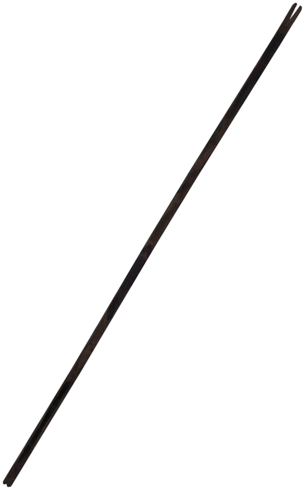

# Arrow Shaft

**Contents**

- [Crafting](#crafting)
- [Products](#products)
- [Trivia](#trivia)
- [Gallery](#gallery)
- [Update history](#update-history)

**Arrow Shaft**

| Property | Details |
| --- | --- |
|  |  / *Arrow\_Shaft\_icon.png* |
| Release | [22 May 2015](./The%20Long%20Dark%20%E2%80%94%20Changelog.md#0.233) |
| Wintermute | No |
| Renewable | Yes |
| **Properties** |  |
| Item type | [Materials](./Materials.md)\|- |
| Stackable | No |
| Examine | A straight wooden arrow, cut and shaped from a cured Birch sapling. Combine with Crow feathers and Arrowhead to make a usable Arrow. |
| **Values** |  |
| Weight | 0.05 kg (0.11 lbs) |
| **Actions** |  |
| Backpack | Take It, Leave It |
| On ground | Drop |
| **Advanced data** |  |
| Item key | GAMEPLAY\_FeatheredArrowShaft |

An **Arrow Shaft** is a material used in crafting [Simple Arrows](./Simple%20Arrow.md) in *[The Long Dark](./The%20Long%20Dark.md).*

Arrow shafts are primarily used in the making of arrows. Arrow Shafts can be cut from a [Cured Birch Sapling](./Cured%20Birch%20Sapling.md) at a [Work Bench](./Work%20Bench.md) with the use of a knife. Three [Crow Feathers](./Crow%20Feather.md) along with one [Arrowhead](./Arrowhead.md) can be used with an Arrow Shaft to create one Simple Arrow.

## Crafting

**Arrow Shaft**

| Property | Details |
| --- | --- |
|  | [Repair](./Repair.md) |
|  | 1 |
|  | 30 minutes |
| **Requirements** |  |
| Facility | **Template:iconlink** |
| Tool | **Template:iconlink** |
| **Materials** |  |
| **Template:iconlink plain** |  |
| Item | [Cured Birch Sapling](./Cured%20Birch%20Sapling.md) |
| Quantity | 1 |

## Products

## Trivia

- This material is classified as a [Tool](./Tools.md) within the player's [Backpack](./Backpack.md), despite being classified as a Material when view from the ground.

## Gallery

| Column 1 |
| --- |
|  / *Old model.* |

## Update history

- UPDATE **22 May 2015 ([Update](./The%20Long%20Dark%20%E2%80%94%20Early%20Access%20Changelog.md#0.223)):**
  - Added to game

**Lua execution error in Module:Navbox function navbox** [ru:Древко стрелы](ru:%D0%94%D1%80%D0%B5%D0%B2%D0%BA%D0%BE_%D1%81%D1%82%D1%80%D0%B5%D0%BB%D1%8B)
