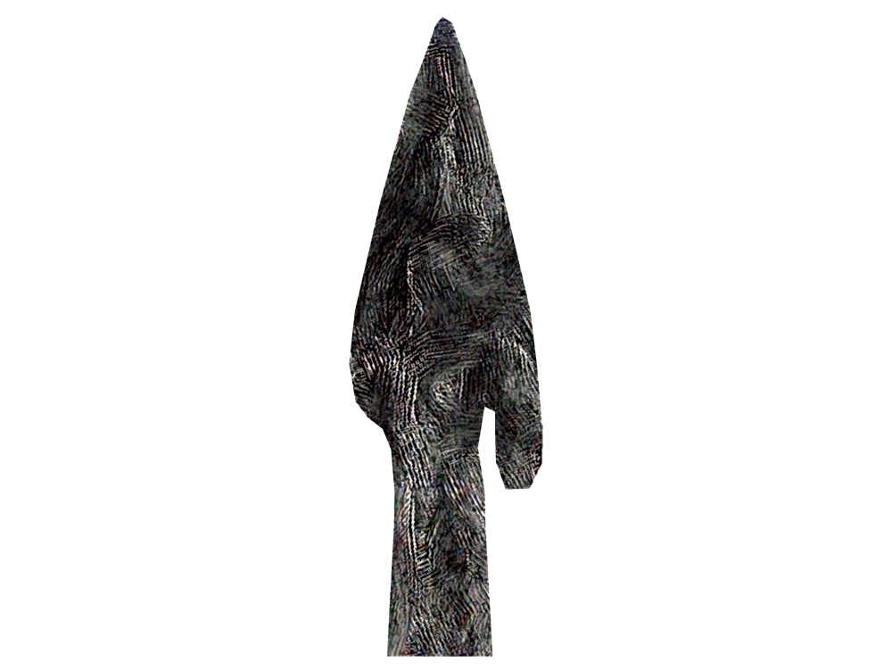

# Arrowhead

**Categories:** Materials, Pages with update history · **Source:** [Fandom](https://thelongdark.fandom.com/wiki/Arrowhead)

**Contents**

- [Overview](#overview)
- [Tips](#tips)
- [Crafting](#crafting)
- [Products](#products)
- [Gallery](#gallery)
- [Update history](#update-history)

**Arrowhead**

[Arrowhead icon](../assets/Arrowhead_icon.png)

**Release:** [22 May 2015](./The%20Long%20Dark%20%E2%80%94%20Changelog.md#0.233)

**Wintermute:** No

**Renewable:** Yes

**Properties**

**Item type:** [Materials](./Materials.md)

**Stackable:** Yes

**Examine:** Sharp metal tip for an Arrow, improvised from scrap.

**Values**

**Weight:** 0.07 kg (0.15 lbs)

**Actions**

**Backpack:** Take It, Leave It

**On ground:** Drop

**Advanced data**

**Item key:** GAMEPLAY\_ArrowHead

An **Arrowhead** is a crafting Material in _The Long Dark._

## Overview

Arrowheads are created at a [Forge](./Forge.md) and are used to craft [Simple Arrows](./Simple%20Arrow.md). They can also be acquired by harvesting simple arrows and broken arrows (arrows which reach 0% condition), and rarely found inside containers, such as tool chests at industrial locations (e.g. [Quonset Gas Station](./Quonset%20Garage.md)).

Broken Arrows sometimes spawn on or near animal carcasses, [frozen corpses](./Frozen%20Corpse.md), or archery targets like at [Pleasant Valley Outbuildings](./Pleasant%20Valley%20Outbuildings.md).

2 Arrowheads always spawn in the Work Bench in [Angler's Den](./Angler%27s%20Den.md).

## Tips

- It is best to craft multiple batches of arrowheads at one time to require fewer trips to a [forge](./Forge.md).
- Harvesting broken arrows yields one arrowhead and two [crow feathers](./Crow%20Feather.md).

## Crafting

**Arrowhead**

[Repair](./Repair.md)

1

60 minutes (1 hour 0 minutes)

**Requirements**

**Item:** [Scrap Metal](./Scrap%20Metal.md)

**Quantity:** 1

## Products

| Item | Skills | Materials |
| --- | --- | --- |
| [Simple Arrow](./Simple%20Arrow.md) | None | - 1 × [Arrowhead](./Arrowhead.md) - 1 × [Arrow Shaft](./Arrow%20Shaft.md) - 3 × [Crow Feather](./Crow%20Feather.md) |

## Gallery

## Update history

- HOTFIX **16 October 2015 ([Update](./The%20Long%20Dark%20%E2%80%94%20Early%20Access%20Changelog.md#0.280)):**
  - Added a small chance that Arrowheads may spawn in Cash Registers or Tool Chests.

- HOTFIX **26 September 2015 ([Update](./The%20Long%20Dark%20%E2%80%94%20Early%20Access%20Changelog.md#0.270)):**
  - Added a \*small number\* of random spawn arrows and arrowheads, spread across the game world.

- UPDATE **22 May 2015 ([Update](./The%20Long%20Dark%20%E2%80%94%20Early%20Access%20Changelog.md#0.223)):**
  - Added to game
