# As the Dead Sleep Challenge Walkthrough

**Contents**

- [Gameplay](#Gameplay)
- [Tips](#Tips)
- [Walkthrough](#Walkthrough)
- [Step \#1](#Step_%231)
- [Step \#2](#Step_%232)
- [Step \#3](#Step_%233)
- [Step \#4](#Step_%234)
- [Step \#5](#Step_%235)
- [Step \#6](#Step_%236)
- [Step \#7](#Step_%237)
- [Step \#8](#Step_%238)
- [Step \#9](#Step_%239)
- [Step \#10](#Step_%2310)
- [Step \#11](#Step_%2311)
- [Step \#12](#Step_%2312)
- [Step \#13](#Step_%2313)
- [Step \#14](#Step_%2314)
- [Step \#15](#Step_%2315)
- [Step \#16](#Step_%2316)
- [Step \#17](#Step_%2317)
- [Step \#18](#Step_%2318)
- [Step \#19](#Step_%2319)
- [Step \#20](#Step_%2320)
- [Step \#21](#Step_%2321)
- [Step \#22](#Step_%2322)
- [Step \#23](#Step_%2323)

## Gameplay

In the <a href="./As%20the%20Dead%20Sleep.md" class="wikilink" title="As The Dead Sleep">As The Dead Sleep</a> challenge, will always spawn in the <a href="./Fallen%20Lighthouse.md" class="wikilink" title="Fallen Lighthouse">Fallen Lighthouse</a> at <a href="./Bleak%20Inlet.md" class="wikilink" title="Bleak Inlet">Bleak Inlet</a> at the start of the Challenge, with the weather set to windy.

The game is set to <a href="./Interloper.md" class="wikilink" title="Interloper">Interloper</a> difficulty, meaning that wildlife are highly aggressive and high-tier loot (MREs, Expedition Parkas, Firearms, etc.) cannot be found. However, the rarity of loot is set to <a href="./Stalker.md" class="wikilink" title="Stalker">Stalker</a>, with clothing and food being very plentiful once leaving Bleak Inlet. In this challenge, you cannot heal <a href="./Condition.md" class="wikilink" title="Condition">Condition</a> by sleeping and <a href="./Birch%20Bark%20Tea.md" class="wikilink" title="Birch Bark Tea">Birch Bark Tea</a> is disabled, making the only way to heal by finding and using rare <a href="./Emergency%20Stim.md" class="wikilink" title="Emergency Stims">Emergency Stims</a>. <a href="./Deer.md" class="wikilink" title="Deer">Deer</a>, <a href="./Rabbit.md" class="wikilink" title="Rabbits">Rabbits</a>, and <a href="./Ptarmigan.md" class="wikilink" title="Ptarmigan">Ptarmigan</a> will not spawn, though <a href="./Deer%20Carcass.md" class="wikilink" title="Deer Carcasses">Deer Carcasses</a> are still available to scavenge. <a href="./Crafting.md" class="wikilink" title="Crafting">Crafting</a> and <a href="./Hunting.md" class="wikilink" title="Hunting">Hunting</a> is not advised, as there is plenty of Clothing and food to allow the player to quickly run from region to region to complete the challenge.

The 5 graves are in the following locations:

- <a href="./Maintenance%20Yard.md" class="wikilink" title="Maintenance Yard">Maintenance Yard</a> in <a href="./Broken%20Railroad.md" class="wikilink" title="Broken Railroad">Broken Railroad</a>
- <a href="./Many%20Falls%20Vista.md" class="wikilink" title="Many Falls Vista">Many Falls Vista</a> in <a href="./Hushed%20River%20Valley.md" class="wikilink" title="Hushed River Valley">Hushed River Valley</a>
- <a href="./Crystal%20Lake.md" class="wikilink" title="Crystal Lake">Crystal Lake</a> in <a href="./Timberwolf%20Mountain.md" class="wikilink" title="Timberwolf Mountain">Timberwolf Mountain</a>
- <a href="./Ravine%20Basin.md" class="wikilink" title="Ravine Basin">Ravine Basin</a> in <a href="./The%20Ravine.md" class="wikilink" title="The Ravine">The Ravine</a>
- <a href="./The%20Riken.md" class="wikilink" title="The Riken">The Riken</a> in <a href="./Desolation%20Point.md" class="wikilink" title="Desolation Point">Desolation Point</a>

## Tips

Interloper difficulty means that you will not be able to loot warm manufactured clothes or firearms at any point during this challenge. With the amount of time it takes to prepare a bow and hide clothing, plan on completing the challenge without either. General Interloper gameplay advice applies to this challenge, with some additional points

- Predator spawns are slightly reduced compared to <a href="./Interloper.md" class="wikilink" title="Interloper">Interloper</a>, but encounters are significantly more dangerous due to the lack of healing except for <a href="./Emergency%20Stim.md" class="wikilink" title="emergency stims">emergency stims</a>. Plan travel routes around avoiding their spawn areas.
- Always carry a <a href="./Stone.md" class="wikilink" title="stone">stone</a> that you can aim at a <a href="./Wolf.md" class="wikilink" title="wolf">wolf</a> while standing on a torch/flare to scare it away. You can also, out of spite, throw it at a <a href="./Bear.md" class="wikilink" title="bear">bear</a> after it just attacked you and ruined your run.
- Consider using the <a href="./Daisy%20Chaining.md" class="wikilink" title="Daisy Chaining">Daisy Chaining</a> strategy to conserve <a href="./Condition.md" class="wikilink" title="Condition">Condition</a> when moving between <a href="./Region.md" class="wikilink" title="regions">regions</a>. By the time you leave the <a href="./Mountain%20Town.md" class="wikilink" title="Mountain Town">Mountain Town</a> region, you should have enough warm <a href="./Clothing.md" class="wikilink" title="clothing">clothing</a> to keep yourself from freezing too often.
- Avoid travel through predator territory at night: clear weather brings the chance of an <a href="./Aurora.md" class="wikilink" title="Aurora">Aurora</a> which increases animal aggression and strips you of any means to ward predators off except for the <a href="./Distress%20Pistol.md" class="wikilink" title="Distress Pistol">Distress Pistol</a>, while bad weather will obscure your vision and impede travel.
- A <a href="./Bedroll.md" class="wikilink" title="bedroll">bedroll</a> can often be found on the second floor of the <a href="./Fallen%20Lighthouse.md" class="wikilink" title="Fallen Lighthouse">Fallen Lighthouse</a> immediately upon spawning. However, in the event the <a href="./Bedroll.md" class="wikilink" title="bedroll">bedroll</a> does not spawn, you will likely not find a <a href="./Bedroll.md" class="wikilink" title="bedroll">bedroll</a> until reaching <a href="./Hushed%20River%20Valley.md" class="wikilink" title="Hushed River Valley">Hushed River Valley</a> or <a href="./Mystery%20Lake%20%28region%29.md" class="wikilink" title="Mystery Lake">Mystery Lake</a>, so make sure you know where the nearest naturally-spawning bed is at all times.
- The lack of high-tier <a href="./Clothing.md" class="wikilink" title="clothing">clothing</a> gives you more carrying capacity; consider carrying more water and firewood than normal.
- Stop regularly during travel to warm up at fires; you lose 20% condition in 5 minutes of real time (1 hour in-game) from freezing.
  - Making hot food/beverages while at the fire can be advantageous as it provides the <a href="./Warming%20Up.md" class="wikilink" title="Warming Up">Warming Up</a> benefit, in addition to immediately restoring some of your warmth upon consumption. Be aware that you can drop a beverage near a fire and it will warm up without taking a cooking slot on the fire.
  - The transition cave from <a href="./Bleak%20Inlet.md" class="wikilink" title="Bleak Inlet">Bleak Inlet</a> to <a href="./Forlorn%20Muskeg.md" class="wikilink" title="Forlorn Muskeg">Forlorn Muskeg</a>, the forge at <a href="./Old%20Spence%20Family%20Homestead.md" class="wikilink" title="Spence Family Homestead">Spence Family Homestead</a>, and the forge in the <a href="./Maintenance%20Yard.md" class="wikilink" title="Maintenance Yard">Maintenance Yard</a> should provide more than enough <a href="./Coal.md" class="wikilink" title="coal">coal</a> to ensure that you can easily restore lost warmth while traveling.
- Consider not visiting major loot spots unless they are on your path through a region. Locations such as the <a href="./Hunting%20Lodge.md" class="wikilink" title="Hunting Lodge">Hunting Lodge</a> and <a href="./Paradise%20Meadows%20Farm.md" class="wikilink" title="Paradise Meadows Farm">Paradise Meadows Farm</a>, for example, will likely contain great loot spots, but also require traveling through <a href="./Wolf.md" class="wikilink" title="wolf">wolf</a> territory.
- Food can be quite scarce, especially in the beginning of the challenge. Always weigh the pros and cons of running at the expense of extra caloric expenditure for the benefit of retreating from cold sooner.
- Familiarize yourself with the rules surrounding <a href="./Food%20Poisoning.md" class="wikilink" title="Food Poisoning">Food Poisoning</a> and which foods cause it at what condition. Contracting food poisoning can do a serious number on your condition and it is generally only worth risking if you are at risk of losing condition due to hunger and if you are prepared to deal with it.
  - Food poisoning will not decrease your condition while it is treated and you are sleeping. Sleep as much as possible while recovering to prevent as much condition loss as possible.
  - Since food poisoning will not bring your condition below 15%, if your condition is already at or lower than that amount, contracting it is always preferable to losing condition due to hunger.
- Because <a href="./Condition.md" class="wikilink" title="condition">condition</a> can only be regenerated with <a href="./Emergency%20Stim.md" class="wikilink" title="emergency stims">emergency stims</a>, it is almost always worth eating food if you have it and if you are hungry. Eating food will reduce your weight and there is no benefit to delaying eating.
- When possible, try to travel close to structures / walls / cliff or mountain faces to benefit from wind protection they may provide.

## Walkthrough

IT IS ADVISED TO READ THE ENTIRE WALKTHROUGH BEFORE STARTING. AT THE VERY LEAST, READ A FEW STEPS AHEAD TO BE AWARE OF WHAT CHALLENGES AWAIT YOU AND WHICH RESOURCES ARE WORTH PRESERVING FOR SPECIFIC POINTS IN YOUR TRAVELS.

The route in this walkthrough is tailored for players less familiar with this challenge. There are more time-efficient routes and routes with less backtracking. However, this route is safer at the expense of time. Thus, it is a good route to gain experience with this challenge in preparation for more challenging routes in future runs.

### Step \#1

This step will be the most thorough and exhaustive, as it is the most important part of the challenge. Principles in this part of the walkthrough will generally be applicable to the remainder of the walkthrough, but may not be as critical in the future as gear and resources become more abundant.

Inverted color maps are nice to have up on your secondary monitor as you play without completely blinding yourself 👍

<table>
<colgroup>
<col style="width: 50%" />
<col style="width: 50%" />
</colgroup>
<tbody>
<tr>
<td><figure>
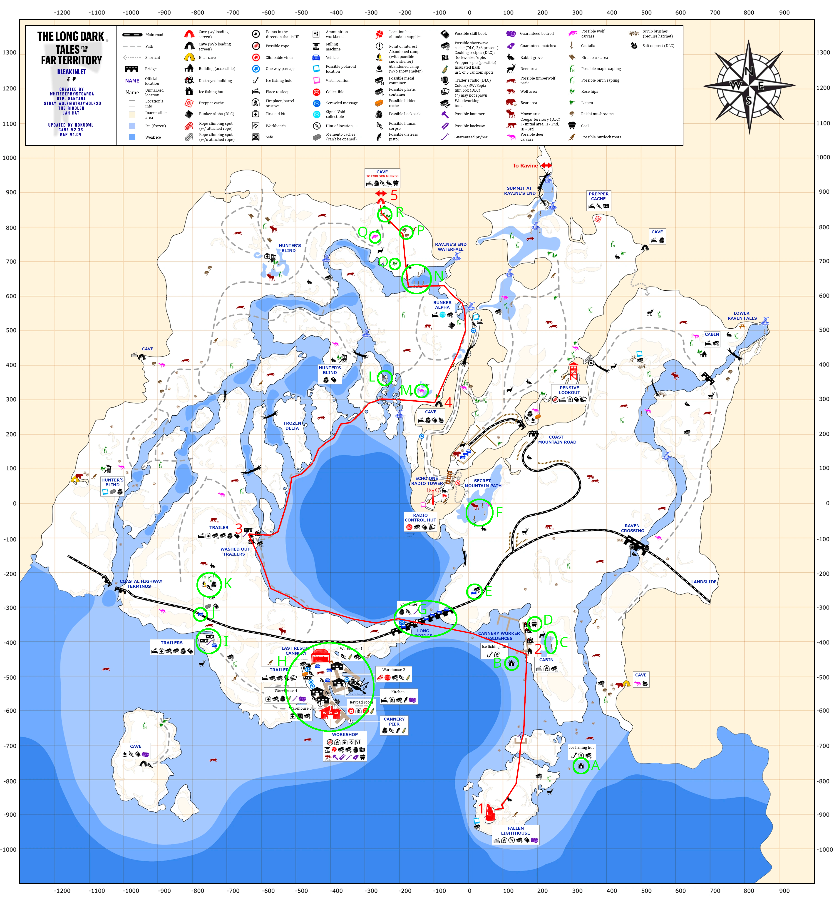
<figcaption>Atds_step_1.png</figcaption>
</figure></td>
<td><figure>
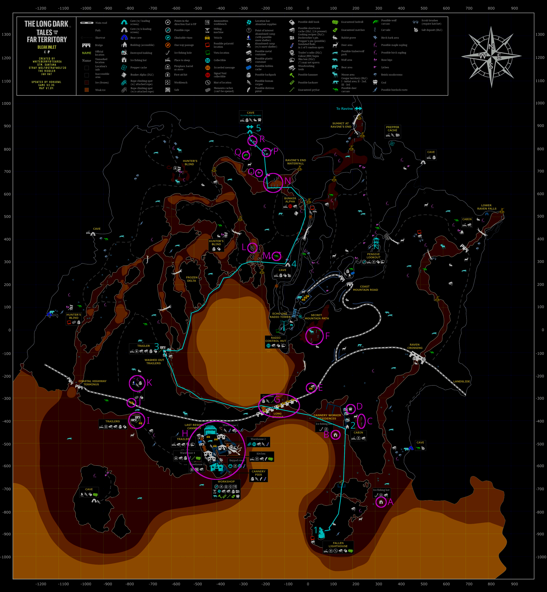
<figcaption>Atds_step_1_inverted.png</figcaption>
</figure></td>
</tr>
<tr>
<td></td>
<td></td>
</tr>
</tbody>
</table>

1.  You will spawn at point 1 (<a href="./Fallen%20Lighthouse.md" class="wikilink" title="Fallen Lighthouse">Fallen Lighthouse</a>) denoted on the map above.
2.  Immediately loot the first and second floor, which can sometimes contain a <a href="./Bedroll.md" class="wikilink" title="bedroll">bedroll</a>.
    1.  For learning this challenge, you may want to restart the challenge until you find a <a href="./Bedroll.md" class="wikilink" title="bedroll">bedroll</a>, as it significantly eases the beginning of this challenge.
3.  Navigate to point 2, running if necessary to prevent condition loss due to cold.
    1.  If you are comfortable, you can navigate to point A (ice fishing hut) for loot before navigating to point 2.
4.  Warm up in point 2, but do not start a fire immediately, as <a href="./Matches%20%28disambiguation%29.md" class="wikilink" title="matches">matches</a> can be sparse at this point. Loot the cabin as you warm up. Breaking down the crates for <a href="./Reclaimed%20Wood.md" class="wikilink" title="reclaimed wood">reclaimed wood</a> is a good idea. Ideally, you will find a <a href="./Sewing%20Kit.md" class="wikilink" title="sewing kit">sewing kit</a> here. If so, it is worth crafting an <a href="./Improvised%20Head%20Wrap.md" class="wikilink" title="improvised head wrap">improvised head wrap</a> and <a href="./Improvised%20Hand%20Wraps.md" class="wikilink" title="improvised hand wraps">improvised hand wraps</a> from the curtains in the cabin if you have not looted clothing items for those slots. If you have looted clothing items, it is worth repairing those items as you warm up.
5.  When you are warmed up, loot points B, C, and D. Looting point C is especially critical as food is scarce at this point. While you are looting point C, pick up a single <a href="./Stone.md" class="wikilink" title="stone">stone</a> to use as a deterrent for <a href="./Wolf.md" class="wikilink" title="wolves">wolves</a> if necessary in the future.
6.  Retreat back to point 2. Start a fire in the fireplace. Boil a decent amount of water using your single empty can. You don't have much gear at this point, so you have a lot of expendable carrying capacity for water. Also consider staying up late boiling water and repairing gear. Mornings are the coldest time in the game and it may not be worth venturing out until later in the day to prevent condition loss due to extreme cold and bad gear. If you have looted canned food, consider not eating it right now, as you do not have a proper tool to open the can, meaning you will lose a good percentage of the caloric content by smashing the can open.
7.  When you wake up, navigate to point 3.
    1.  If you are comfortable, and if weather permits, you can navigate to points E, F, and G. The vehicles don't tend to have much loot, but they can be worth checking if you have fuel for fires to warm back up. There is an overturned truck on the bridge at point G with wind protection that you can safely start a fire inside and warm up in. If the deer carcass is at point F, it is inadvisable to thaw the carcass and harvest it. The temperature and weather in <a href="./Bleak%20Inlet.md" class="wikilink" title="Bleak Inlet">Bleak Inlet</a> are unforgiving and can change rapidly, which could be a death sentence at this point of the challenge. Additionally, carrying meat will increase your <a href="./Scent.md" class="wikilink" title="scent">scent</a>, attracting predators.
    2.  Some players navigate to point H (<a href="./Last%20Resort%20Cannery.md" class="wikilink" title="Last Resort Cannery">Last Resort Cannery</a>) then I, J, and K on their way to point 3. You can find a good amount of loot here including many <a href="./Tin%20of%20Sardines.md" class="wikilink" title="tins of sardines">tins of sardines</a> which can be very helpful since food is scarce at this point in the challenge. However, be aware of two things:
        1.  <a href="./Tin%20of%20Sardines.md" class="wikilink" title="Tins of sardines">Tins of sardines</a> come with an increased risk of <a href="./Food%20Poisoning.md" class="wikilink" title="food poisoning">food poisoning</a>, which can be a death sentence at this point in the challenge.
        2.  You will inevitably encounter a pack of <a href="./Timberwolf.md" class="wikilink" title="timberwolves">timberwolves</a>. You likely have a marine flare or two with which to keep them at bay until you find refuge in the trailers at point I. Decide for yourself whether you want to risk the <a href="./Timberwolf.md" class="wikilink" title="timberwolf">timberwolf</a> encounter for the potential extra gear / food. Many players consider this to be an unnecessarily risky location to visit and will avoid it entirely.
    3.  Alternatively, you may skip point H and loot points I, J, and K, but these points may not be worth spending the extra time in <a href="./Bleak%20Inlet.md" class="wikilink" title="Bleak Inlet">Bleak Inlet</a> for.
8.  Warm up in point 3. Loot the trailer, and if necessary / possible, repair your gear. If you have not spent your time visiting points H, I, J, or K, you likely should not sleep here unless the weather is especially bad. You should expedite continuing on your way getting out of <a href="./Bleak%20Inlet.md" class="wikilink" title="Bleak Inlet">Bleak Inlet</a> as soon as possible.
9.  Navigate to point 4. Looting the <a href="./Cat%20Tail.md" class="wikilink" title="cat tails">cat tails</a> at point L on the way is recommended. Loot the <a href="./Rose%20Hip.md" class="wikilink" title="rose hips">rose hips</a> at the cave entrance.
    1.  If weather permits and the deer carcass exists at point M, you may consider warming and harvesting the carcass. Be aware that there is a roaming pack of <a href="./Timberwolf.md" class="wikilink" title="timberwolves">timberwolves</a> in the area and that the weather is quick to change in <a href="./Bleak%20Inlet.md" class="wikilink" title="Bleak Inlet">Bleak Inlet</a>. It may not be worth risking exposure and additional <a href="./Scent.md" class="wikilink" title="scent">scent</a> to harvest this carcass.
10. If you did not visit points H, I, J, and K, and if you have the available fuel, sleep in the cave with a fire going overnight to keep you warm and deter predators. Otherwise, expedite navigating to point 5 as soon as possible.
11. Navigate to point 5.
    1.  Harvest the <a href="./Cat%20Tail.md" class="wikilink" title="cat tails">cat tails</a> at point N. Harvest the <a href="./Rose%20Hip.md" class="wikilink" title="rose hips">rose hips</a> at point O. Harvest the <a href="./Reishi%20Mushroom.md" class="wikilink" title="reishi mushrooms">reishi mushrooms</a> at point P. Harvest the <a href="./Rose%20Hip.md" class="wikilink" title="rose hips">rose hips</a> at point R.
    2.  If conditions permit, you may thaw and harvest the wolf carcass at point Q, but this is not advised. Eating predator meat increases your chances of contracting <a href="./Intestinal%20Parasites.md" class="wikilink" title="intestinal parasites">intestinal parasites</a>, which could be a death sentence at this point in the challenge.

### Step \#2

To my knowledge, there is no proper map of this cave on this wiki. Refer to [this map by Steam user Melanee](https://steamcommunity.com/profiles/76561198087794193/images/) if you are unfamiliar with the cave. The cave is simple and carries little risk of getting lost or confused inside.

1.  Navigate through the cave, picking up any <a href="./Coal.md" class="wikilink" title="coal">coal</a> you encounter.
2.  While you are safe and warm in this cave, it is advised to craft any <a href="./Prepared%20Reishi%20Mushrooms.md" class="wikilink" title="prepared reishi mushrooms">prepared reishi mushrooms</a> and <a href="./Prepared%20Rose%20Hips.md" class="wikilink" title="prepared rose hips">prepared rose hips</a> and cook them into tea.
3.  Boil more water if you need to replenish your stores.
4.  Don't forget to drop any excess cat tail heads. They tend to accumulate and consume excess weight in your pack. Get in the habit of dropping these frequently.
5.  If the time is right, sleep in this cave. There is a naturally spawning bed in the cave if you don't have a <a href="./Bedroll.md" class="wikilink" title="bedroll">bedroll</a>.

### Step \#3

From this point, the walkthrough will not so thoroughly tell you exactly which detours to take. If there are cat tails / rose hips / reishi mushrooms / frozen carcasses close by the path on the map, evaluate your food situation and make your own determination as to if it is worth the time to collect the resources. Food at this point in the challenge is still quite scarce, so it is advised to collect everything directly on the path at the very least.

<table>
<colgroup>
<col style="width: 50%" />
<col style="width: 50%" />
</colgroup>
<tbody>
<tr>
<td><figure>
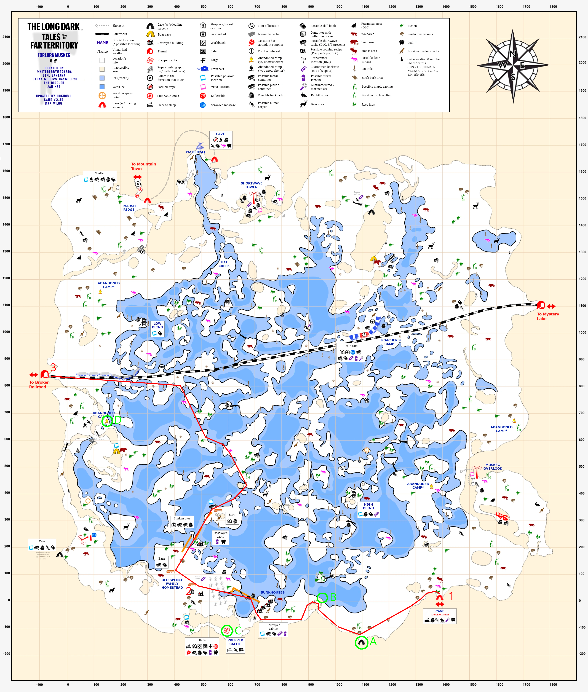
<figcaption>Atds_step_3.png</figcaption>
</figure></td>
<td><figure>
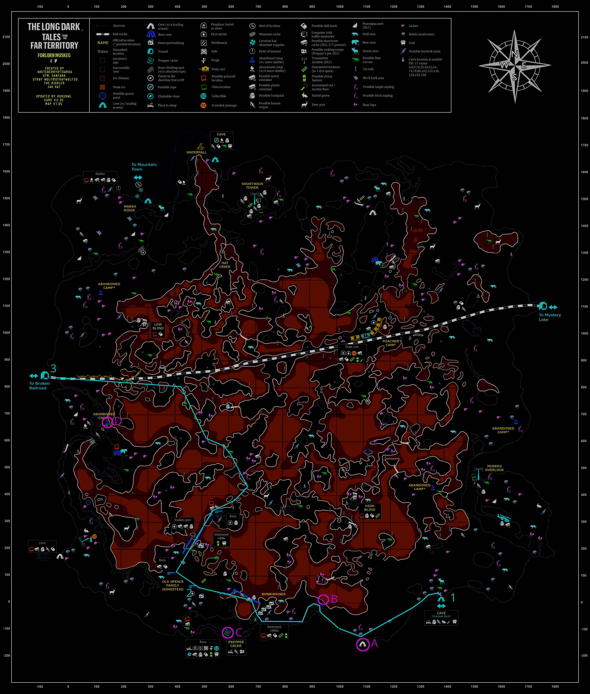
<figcaption>Atds_step_3_inverted.png</figcaption>
</figure></td>
</tr>
<tr>
<td></td>
<td></td>
</tr>
</tbody>
</table>

1.  You will exit the cave at point 1 denoted on the map above.
2.  Navigate to point 2.
    1.  The cave at point A is a good spot to warm up if you've spent time, especially in the morning, collecting resources along the path.
    2.  BE CAREFUL WITH THE THIN ICE AT POINT B. The red path on the map near point B requires climbing a steep hill to take to avoid walking on the ice. If you walk across the ice instead of climbing the hill, be prepared to sprint to avoid falling into the water. If you fall into the water, there is a good chance your run ends here.
    3.  I am not certain whether the prepper cache at point C will ever spawn. In my experience, I have never seen it.
3.  Navigate to point 3.
    1.  You may want to warm up at point D, but be aware that the abandoned camp may not spawn. Once you pass into <a href="./Broken%20Railroad.md" class="wikilink" title="Broken Radilroad">Broken Radilroad</a>, you will still have a decent walk to get to the <a href="./Maintenance%20Yard.md" class="wikilink" title="Maintenance Yard">Maintenance Yard</a>, so going in cold can be fatal especially in bad weather. There may be a snow shelter that you can use at this location which will provide a warmth bonus and complete wind protection. There may also a campfire that you can light if weather permits. <a href="./Bear.md" class="wikilink" title="BEAR">BEAR</a> in mind that aggressive wildlife can still attack you inside a snow shelter. If you have a bedroll, passing time or sleeping will provide the additional warmth bonus of the bedroll.

### Step \#4

<table>
<colgroup>
<col style="width: 50%" />
<col style="width: 50%" />
</colgroup>
<tbody>
<tr>
<td><figure>

<figcaption>Atds_step_4.png</figcaption>
</figure></td>
<td><figure>
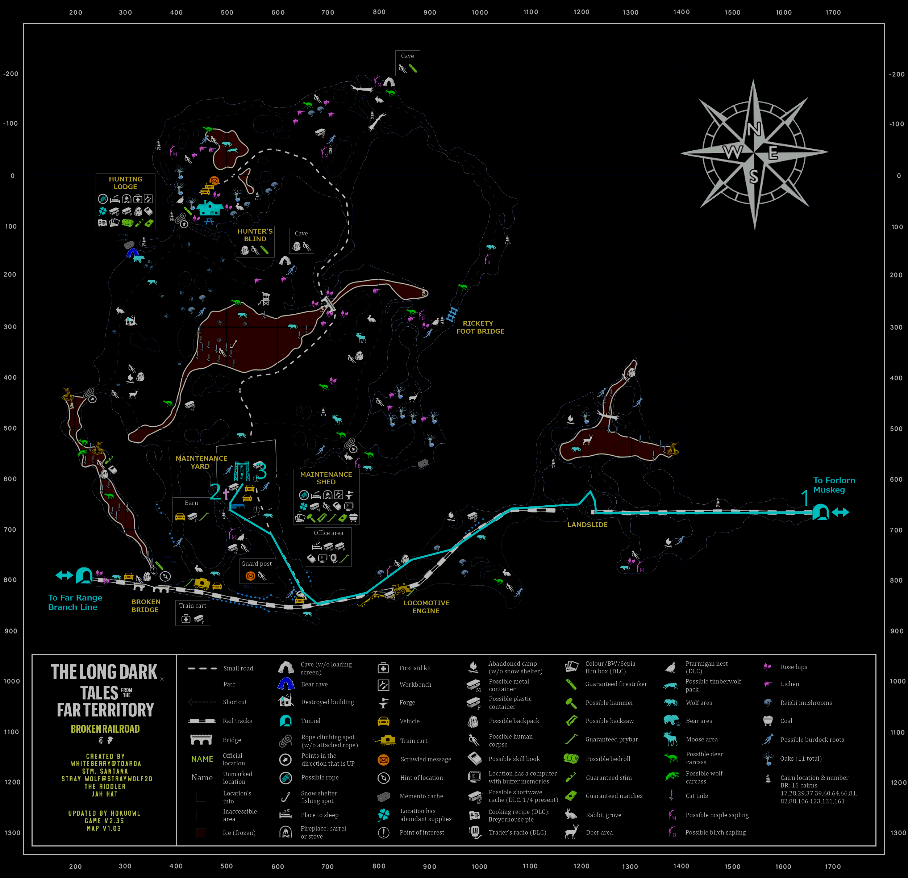
<figcaption>Atds_step_4_inverted.png</figcaption>
</figure></td>
</tr>
<tr>
<td></td>
<td></td>
</tr>
</tbody>
</table>

1.  Navigate to grave \#1 indicated on the map at point 2.
    1.  This area is tight, so it is difficult to completely avoid the wolves. If weather permits, it is especially worth daisy chaining torches so you are immediately prepared for a wolf encounter. This will help if you are cold as well. If weather does not permit torches, it is worth carrying an unlit flare so you can strike it as soon as a wolf engages with you. Prefer normal flares over marine flares here to preserve your marine flares for potential timberwolf encounters later.
    2.  If you are very cold or tired, you may prefer to run directly into the maintenance yard to warm up and sleep. You can easily visit the grave when you exit the maintenance yard on the next step of this walkthrough.
2.  Navigate to point 3.
    1.  Loot the maintenance yard, but remain aware of your carry weight.
    2.  Some players, if they have the resources, like to craft a knife or hatchet at the forge. If you don't have a can opener, this can be useful to avoid losing food from smashing cans open.

### Step \#5

<table>
<colgroup>
<col style="width: 50%" />
<col style="width: 50%" />
</colgroup>
<tbody>
<tr>
<td><figure>
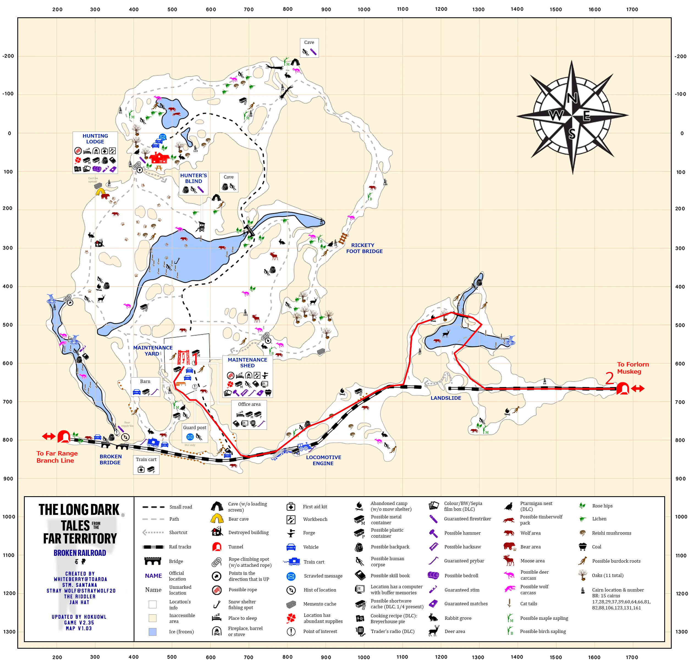
<figcaption>Atds_step_5.png</figcaption>
</figure></td>
<td><figure>
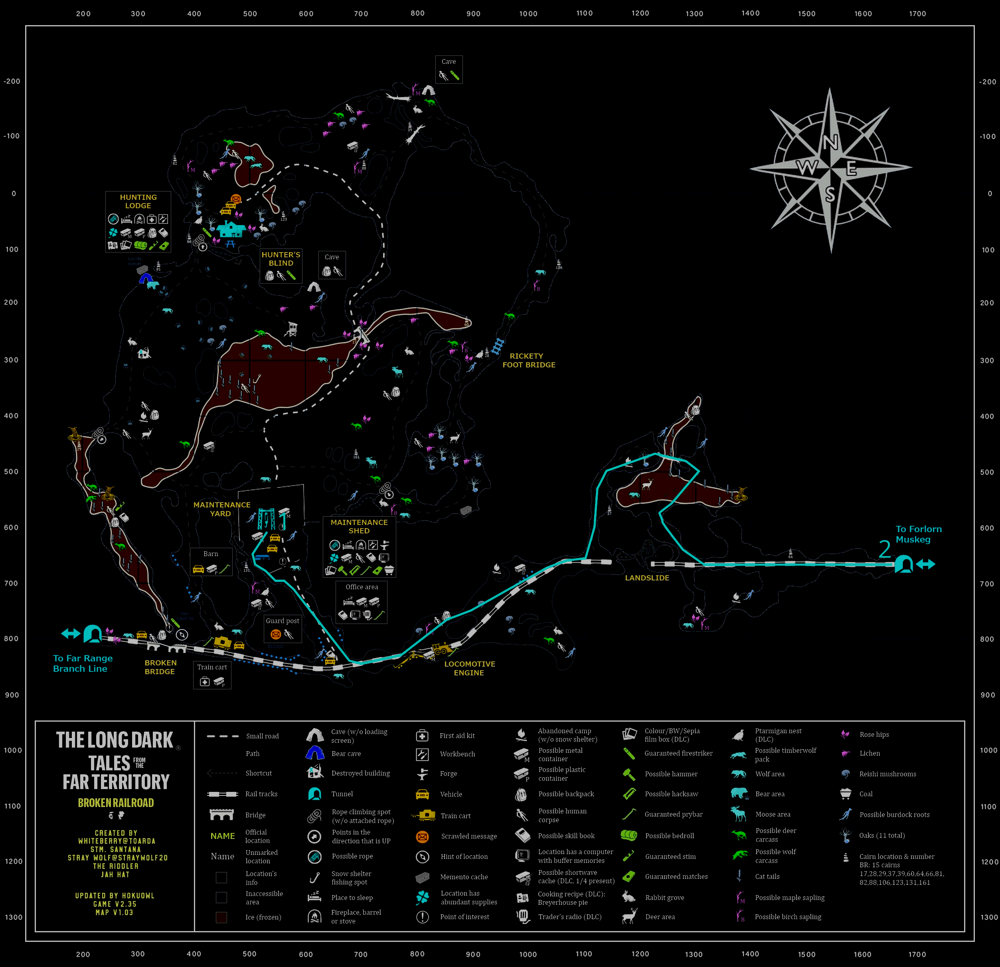
<figcaption>Atds_step_5_inverted.png</figcaption>
</figure></td>
</tr>
<tr>
<td></td>
<td></td>
</tr>
</tbody>
</table>

1.  STOP FOR A MOMENT!
    1.  If you don't have a bedroll at this point, the next step can be very difficult. This next step will involve traversing out of broken railroad, through forlorn muskeg, through milton basin in mountain town, up two quite large climbing ropes, and to paradise meadows farm, at which point, you will need to search for a key to unlock the house to get to warmth, safety, and most importantly, your next bed. Unless you are very confident, THIS PATH IS NOT ADVISED!
        1.  However, if you have a few <a href="./Cup%20of%20Coffee.md" class="wikilink" title="cups of coffee">cups of coffee</a>, this would be a strategic time to use them. The <a href="./Fatigue%20Reduced.md" class="wikilink" title="Fatigue Reduced">Fatigue Reduced</a> perk can help you keep your energy levels up, allowing you to stay on this more direct path.
    2.  Instead, it is recommended that when you enter forlorn muskeg, you walk across the entire map on the train tracks and pass into mystery lake. From there, navigate to trappers cabin. This is a much safer path to your next bed. From there, traverse the cave to mountain town, pass the waterfalls, cross the downed tree bridge, down the climbing rope, up the next climbing rope, and then to the house at milton park. From there, go to the orca gas station convenience store, then to the town of milton. At this point, you can rejoin this walkthrough. This walkthrough does not cover this alternate route.
2.  Navigate to point 2.
    1.  It is advised to equip a flare when exiting the maintenance yard so you can quickly light it if a wolf accosts you immediately upon exit.

### Step \#6

<table>
<colgroup>
<col style="width: 50%" />
<col style="width: 50%" />
</colgroup>
<tbody>
<tr>
<td><figure>
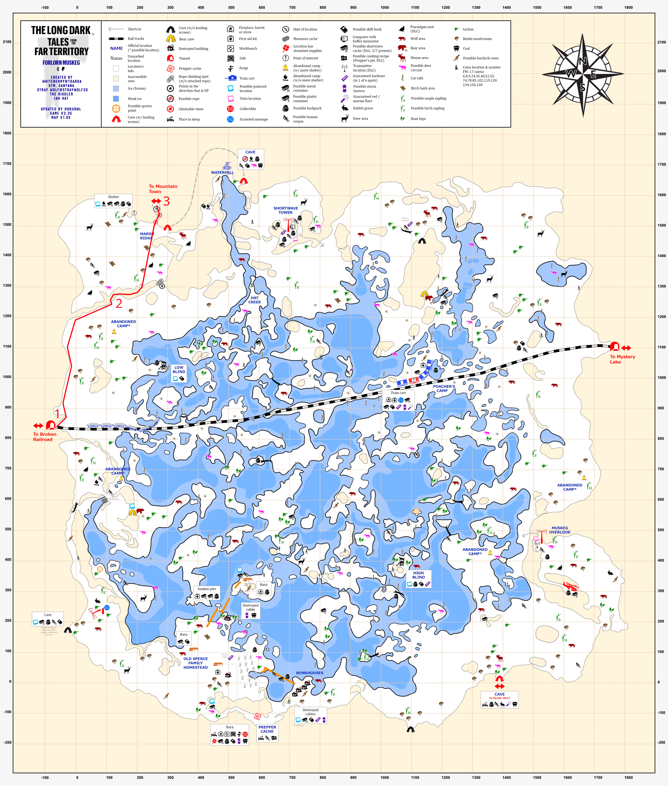
<figcaption>Atds_step_6.png</figcaption>
</figure></td>
<td><figure>
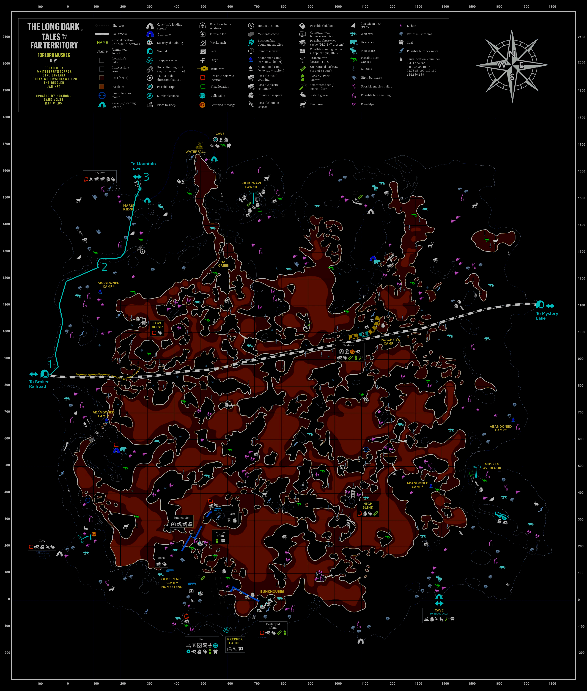
<figcaption>Atds_step_6_inverted.png</figcaption>
</figure></td>
</tr>
<tr>
<td></td>
<td></td>
</tr>
</tbody>
</table>

1.  Navigate to point 2.
2.  <a href="./Mountain%20Goating.md" class="wikilink" title="Mountain Goat">Mountain Goat</a> yourself up the cliff.
    1.  If you can't figure out how to <a href="./Mountain%20Goating.md" class="wikilink" title="Mountain Goat">Mountain Goat</a> up the cliff, don't waste too much time trying to figure it out. Just go around the cliff, and up the stream to the waterfall. You can use the cave system from the waterfall to marsh ridge to warm up and collect a few items.
3.  Navigate to point 3.
    1.  When you enter mountain town, keep in mind that you will need enough energy to climb up two climbing ropes. There is a cave between the two ropes to sleep in to regain energy if you have a bedroll.

### Step \#7

<table>
<colgroup>
<col style="width: 50%" />
<col style="width: 50%" />
</colgroup>
<tbody>
<tr>
<td><figure>
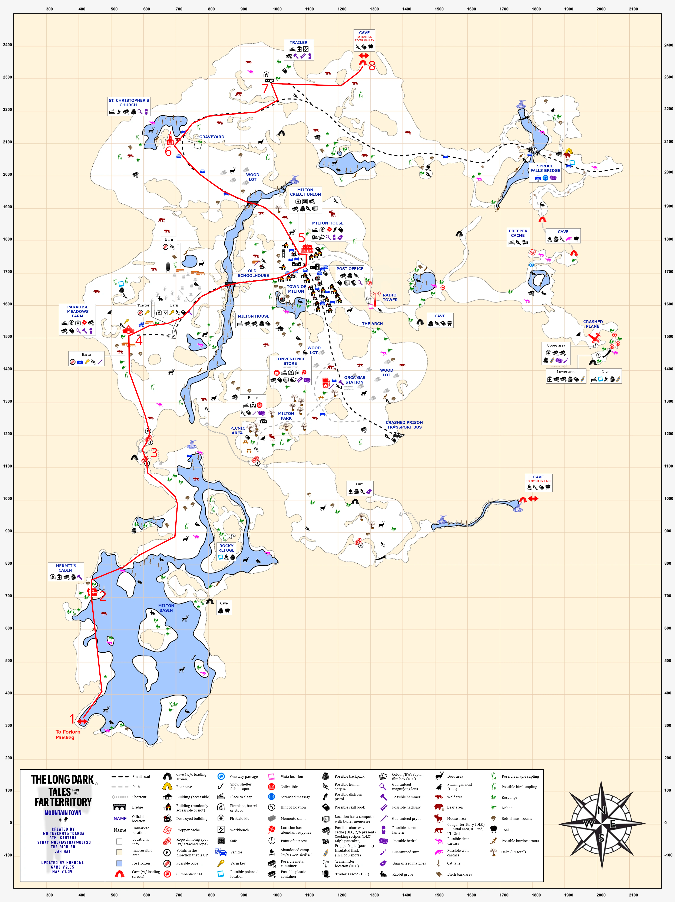
<figcaption>Atds_step_7.png</figcaption>
</figure></td>
<td><figure>
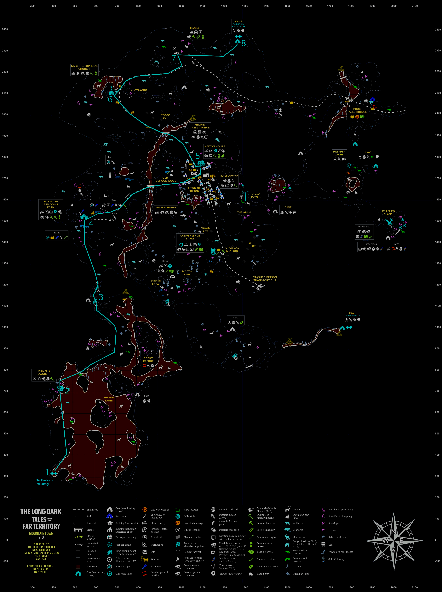
<figcaption>Atds_step_7_inverted.png</figcaption>
</figure></td>
</tr>
<tr>
<td></td>
<td></td>
</tr>
</tbody>
</table>

1.  Navigate to point 2.
    1.  You may not want to linger long at this spot since you want to have enough energy to climb at least the first rope at point 3.
2.  Navigate to point 3.
3.  Climb the first rope at point 3.
    1.  If you are too tired to climb the next rope, there is a cave here that you can sleep in to regain some energy before climbing the next rope, assuming you have a bedroll.
4.  Climb the second rope at point 3.
5.  Navigate to point 4.
    1.  You need to key to unlock <a href="./Paradise%20Meadows%20Farm.md" class="wikilink" title="Paradise Meadows Farm">Paradise Meadows Farm</a>. Refer to the <a href="./Paradise%20Meadows%20Farm%20Key.md" class="wikilink" title="Paradise Meadows Farm Key">Paradise Meadows Farm Key</a> page for help finding the key if you need.
    2.  Loot this location and warm up. If you need, cook some food/tea, boil some water, repair clothing.
6.  Navigate to point 5.
    1.  From here, you will be navigating into Hushed River Valley, which is a very cold region. If you are in need of better gear, it is advised to loot the entire town of milton. It may also be worth going up the mountain past the radio tower and to the crashed plane, collecting food and loot along the way. There are no predators up here, so it's an easy win. The orca gas station convenience store and the house at milton park may not be worth looting, as you will pass these locations in a future step soon.
7.  Navigate to point 6.
    1.  Loot this location and warm up.
8.  Navigate to point 7.
    1.  Loot this location and warm up.
    2.  If you don't have a bedroll, sleep here and head into <a href="./Hushed%20River%20Valley.md" class="wikilink" title="Hushed River Valley">Hushed River Valley</a> when you wake up. This same location will be your next opportunity to sleep.
9.  Navigate to point 8.

### Step \#8

<table>
<colgroup>
<col style="width: 50%" />
<col style="width: 50%" />
</colgroup>
<tbody>
<tr>
<td><figure>
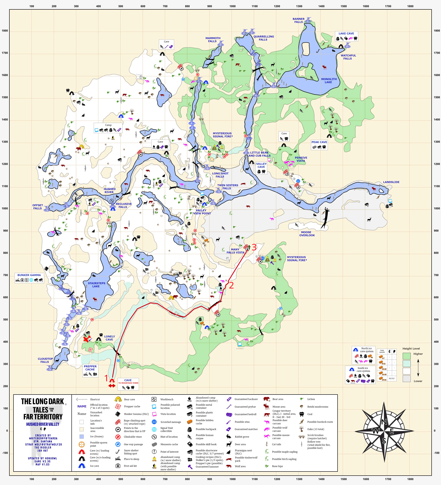
<figcaption>Atds_step_8.png</figcaption>
</figure></td>
<td><figure>
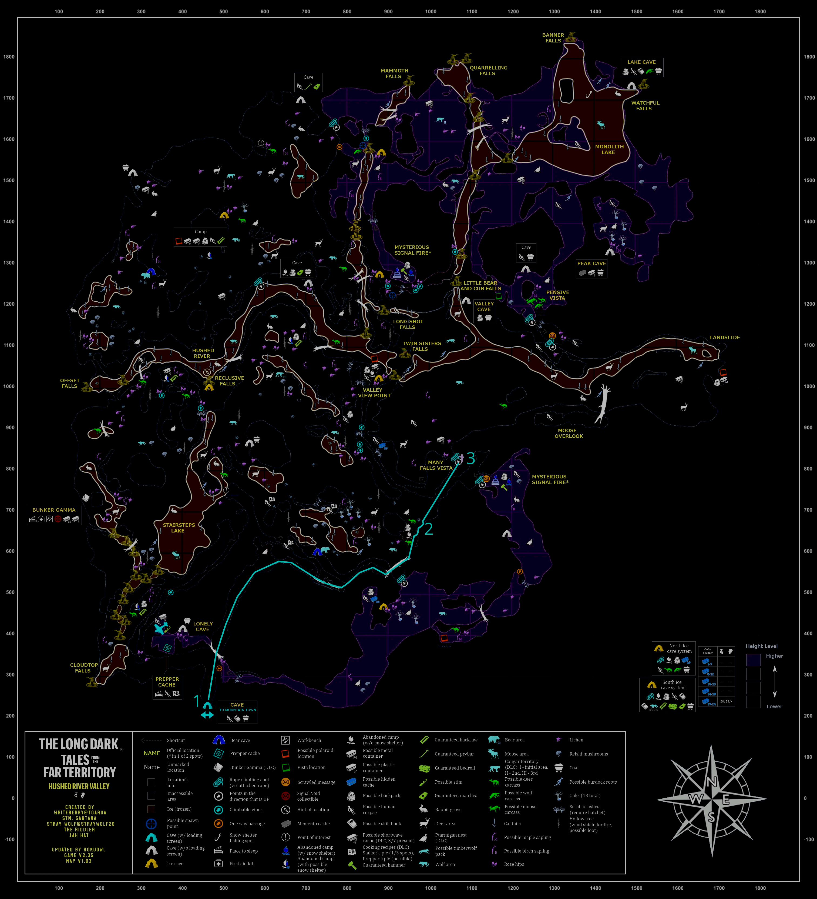
<figcaption>Atds_step_8_inverted.png</figcaption>
</figure></td>
</tr>
<tr>
<td></td>
<td></td>
</tr>
</tbody>
</table>

THE ROUTE GOES INTO AND IMMEDIATELY OUT OF THIS REGION. BECAUSE OF THIS, THE ROUTE ON THE MAP WOULD LARGELY OVERLAP. TO AVOID A CONFUSING MAP, THE ROUTE INTO AND OUT OF THIS REGION HAS BEEN SPLIT INTO TWO STEPS. THIS MEANS THAT THIS STEP DOES NOT END AT A SAFE LOCATION.

1.  Navigate to point 2.
    1.  From here, you will <a href="./Mountain%20Goating.md" class="wikilink" title="Mountain Goat">Mountain Goat</a> down the side of the cliff. <a href="./Mountain%20Goating.md" class="wikilink" title="Mountain Goating">Mountain Goating</a> down tends to be much easier than <a href="./Mountain%20Goating.md" class="wikilink" title="Mountain Goating">Mountain Goating</a> up, so don't be worried. Just go slow and be careful not to fall too far and break your legs.
2.  Navigate to grave \#2 at point 3.

### Step \#9

<table>
<colgroup>
<col style="width: 50%" />
<col style="width: 50%" />
</colgroup>
<tbody>
<tr>
<td><figure>
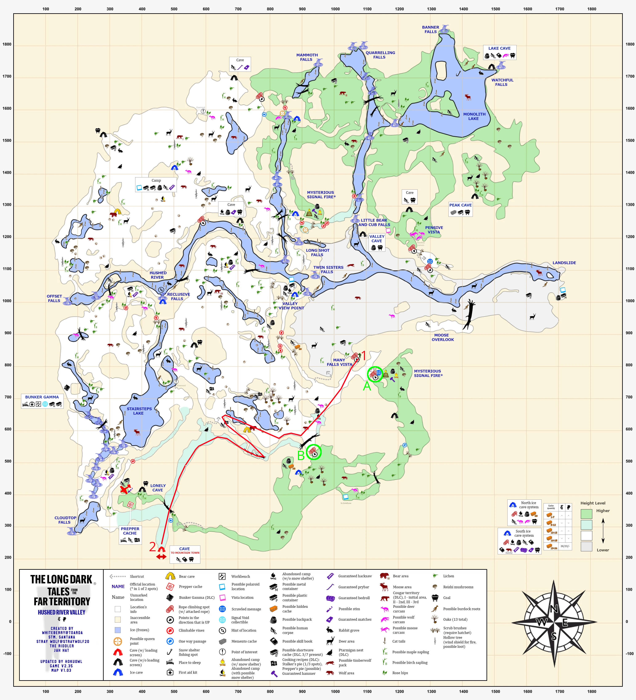
<figcaption>Atds_step_9.png</figcaption>
</figure></td>
<td><figure>
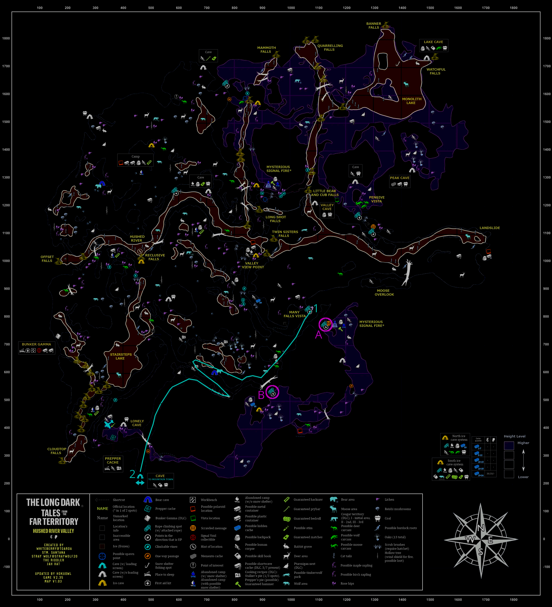
<figcaption>Atds_step_9_inverted.png</figcaption>
</figure></td>
</tr>
<tr>
<td></td>
<td></td>
</tr>
</tbody>
</table>

1.  Navigate to point 2.
    1.  Do not be tempted to climb the rope at point A unless you have a hatchet. This path requires clearing scrub brush patches, which cannot be done without a hatchet.
    2.  If the bear is in your path and/or you have the energy, you may climb the rope at point B. This will require that you <a href="./Mountain%20Goating.md" class="wikilink" title="Mountain Goat">Mountain Goat</a> around the scrub brush patch and <a href="./Mountain%20Goating.md" class="wikilink" title="Mountain Goat">Mountain Goat</a> down the cliff to get to point 2. This can be tricky especially if you are in a rush due to cold and it can be easy to accidentally hurt yourself while climbing down. The path show in the map is the simplest and safest unless the bear is nearby.

### Step \#10

<table>
<colgroup>
<col style="width: 50%" />
<col style="width: 50%" />
</colgroup>
<tbody>
<tr>
<td><figure>
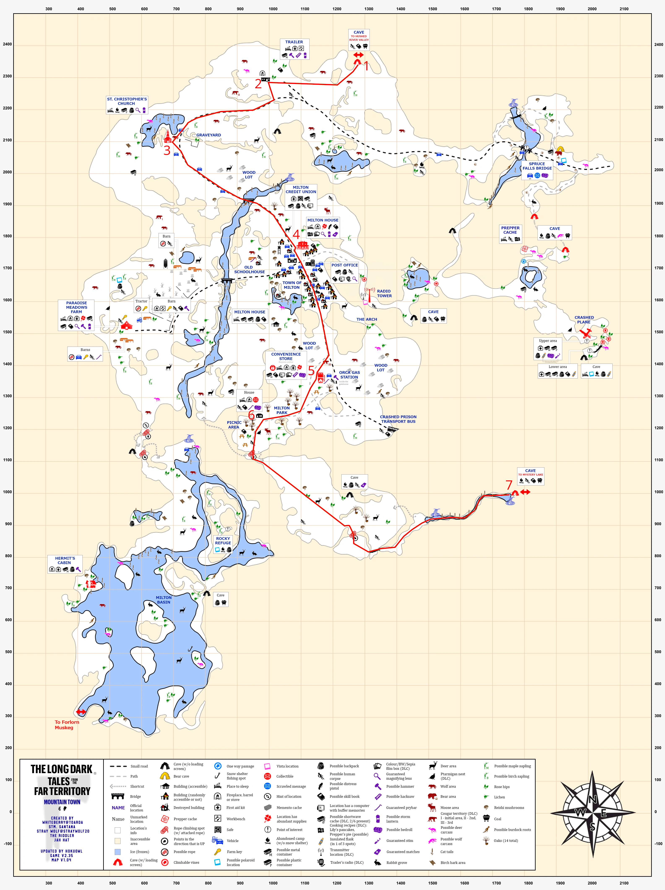
<figcaption>Atds_step_10.png</figcaption>
</figure></td>
<td><figure>
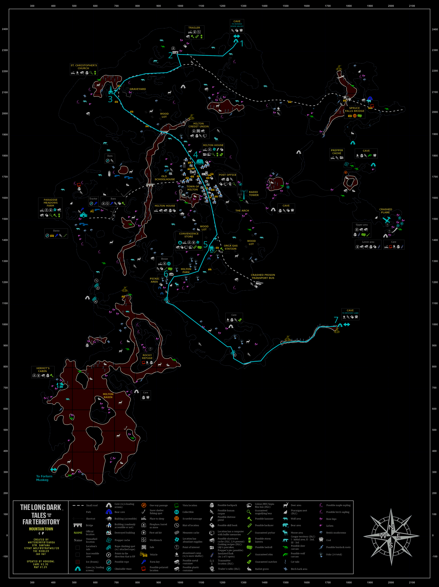
<figcaption>Atds_step_10_inverted.png</figcaption>
</figure></td>
</tr>
<tr>
<td></td>
<td></td>
</tr>
</tbody>
</table>

YOU MAY BE TEMPTED TO NAVIGATE INSTEAD TO SPRUCE FALLS BRIDGE AND THROUGH THE CAVE TO THE CRASHED PLANE AREA. DO SO AT YOUR OWN RISK. THIS PATH WILL BRING YOU THROUGH TIGHT QUARTERS WITH A BEAR. I AM PARTICULARLY AVERSE TO THIS PATH AS THIS BEAR HAS KILLED ME BEFORE.

1.  Navigate to point 2 and warm up if necessary.
2.  Navigate to point 3 and warm up if necessary.
3.  Navigate to point 4 and warm up if necessary.
4.  Navigate to point 5.
    1.  BE AWARE THAT THE BOTH DOORS TO THE CONVENIENCE STORE REQUIRES PRYING. DON'T EXPECT QUICK ENTRY IF YOU ARE BEING PURSUED BY A WOLF. DON'T EXPECT ENTRY AT ALL IF YOU DON'T HAVE A PRYBAR.
    2.  Loot this area and warm up if necessary.
    3.  There will be some rope climbing in your immediate future, so this may be a great place to sleep.
5.  Navigate to point 6.
    1.  Loot this area.
6.  Navigate to point 7.
    1.  Collecting the natural resources in the area between the climbing ropes is especially advised as there is no hostile wildlife in this area. However, keep in mind that you still have to climb a rope out, so keep an eye on your carry weight and your energy. There is a cave that at least sometimes has a naturally spawning bed. I'm not sure if this is guaranteed.

### Step \#11

From this point, the walkthrough will not give such thorough instructions as to what to do at each location. If you've made it this far, you know what to loot and when to loot.

<table>
<colgroup>
<col style="width: 50%" />
<col style="width: 50%" />
</colgroup>
<tbody>
<tr>
<td><figure>
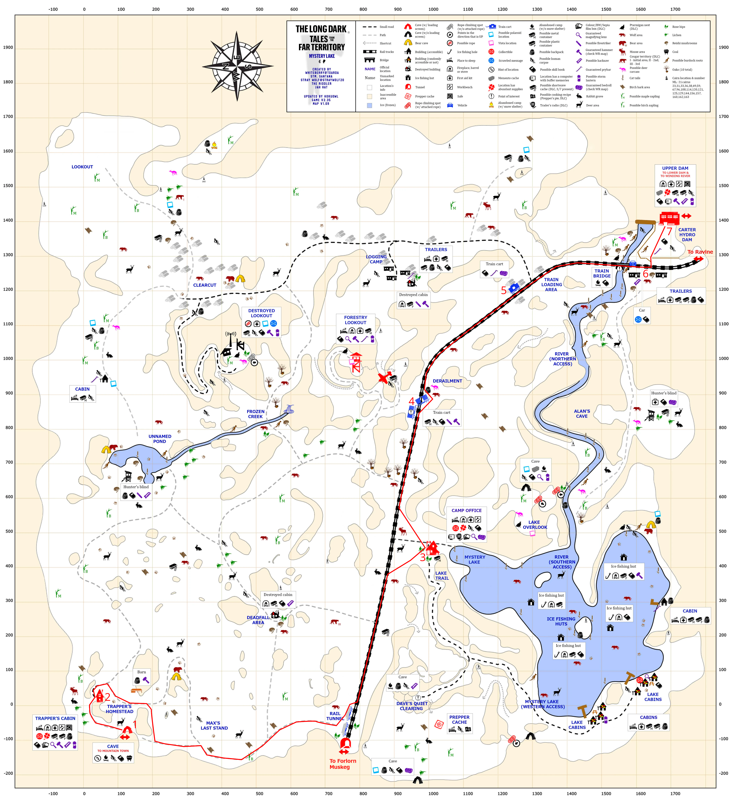
<figcaption>Atds_step_11.png</figcaption>
</figure></td>
<td><figure>
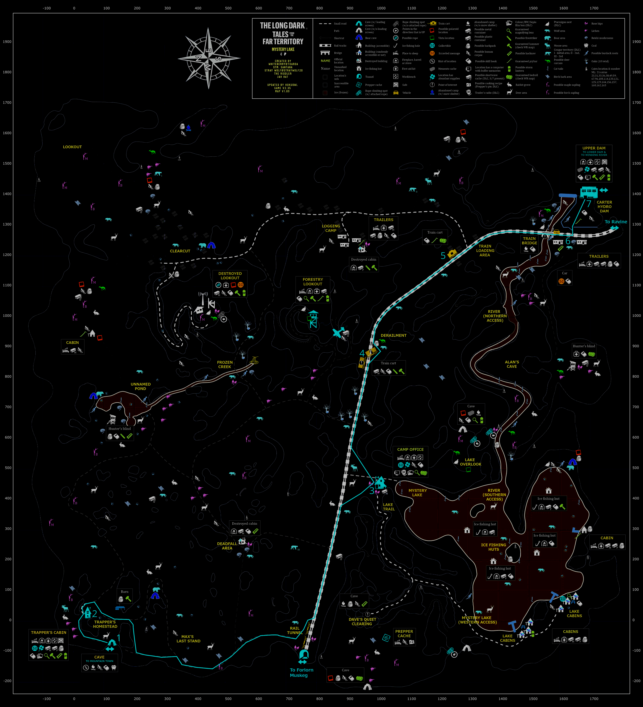
<figcaption>Atds_step_11_inverted.png</figcaption>
</figure></td>
</tr>
<tr>
<td></td>
<td></td>
</tr>
</tbody>
</table>

1.  Navigate to point 2.
2.  Navigate to point 3.
    1.  If you are low on food, you may want to navigate to points 6 and 7 over Mystery Lake and take the River (Southern Access), collecting cattails along the way.
3.  Navigate to point 4.
4.  Navigate to point 5.
5.  Navigate to point 6.
    1.  You may want to investigate the trailers, but if there is a wolf nearby, it may be safer to skip them.
6.  Navigate to point 7.

### Step \#12

If it's worth it to you, loot the whole dam. It's entirely up to you. Maybe you could use some better gear, maybe you could use some more resources. Honestly at this point, you're doing very well at the challenge and if you keep it up, it's in the bag. If you're aiming for a shorter completion time, maybe it isn't worth looting. If you're aiming to maximize your safety, maybe it is worth looting.

<table>
<colgroup>
<col style="width: 50%" />
<col style="width: 50%" />
</colgroup>
<tbody>
<tr>
<td><figure>
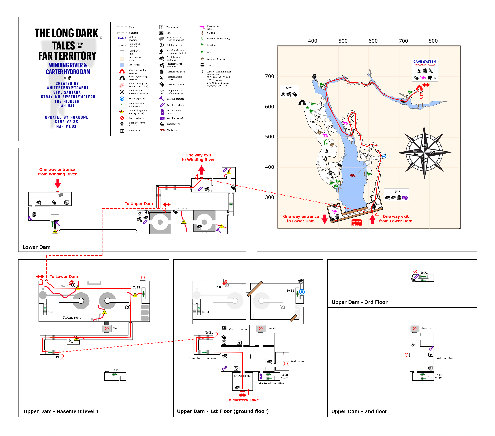
<figcaption>Atds_step_12.png</figcaption>
</figure></td>
<td><figure>
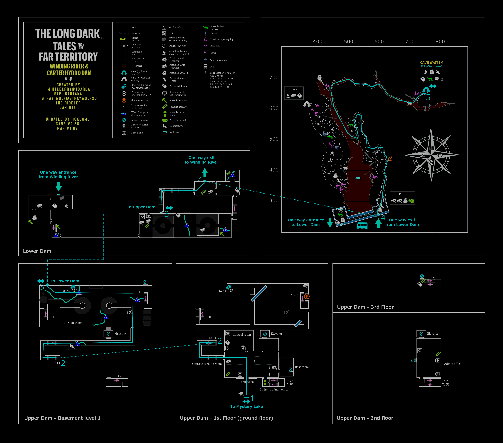
<figcaption>Atds_step_12_inverted.png</figcaption>
</figure></td>
</tr>
<tr>
<td></td>
<td></td>
</tr>
</tbody>
</table>

1.  Navigate to point 2.
    1.  ALWAYS KEEP IN MIND THAT THE ELECTRICAL WIRES ON THE FLOOR BECOME LIVE DURING AN AURORA AND DRAIN YOUR CONDITION RAPIDLY IF YOU WALK ACROSS THEM.
2.  Navigate to point 3.
3.  Navigate to point 4.
4.  Navigate to point 5.

### Step \#13

<table>
<colgroup>
<col style="width: 50%" />
<col style="width: 50%" />
</colgroup>
<tbody>
<tr>
<td><figure>
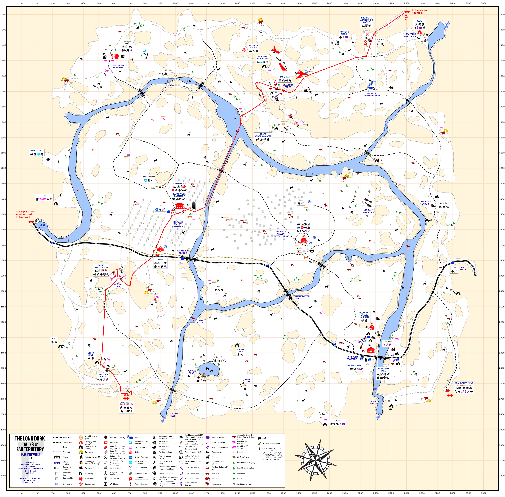
<figcaption>Atds_step_13.png</figcaption>
</figure></td>
<td><figure>
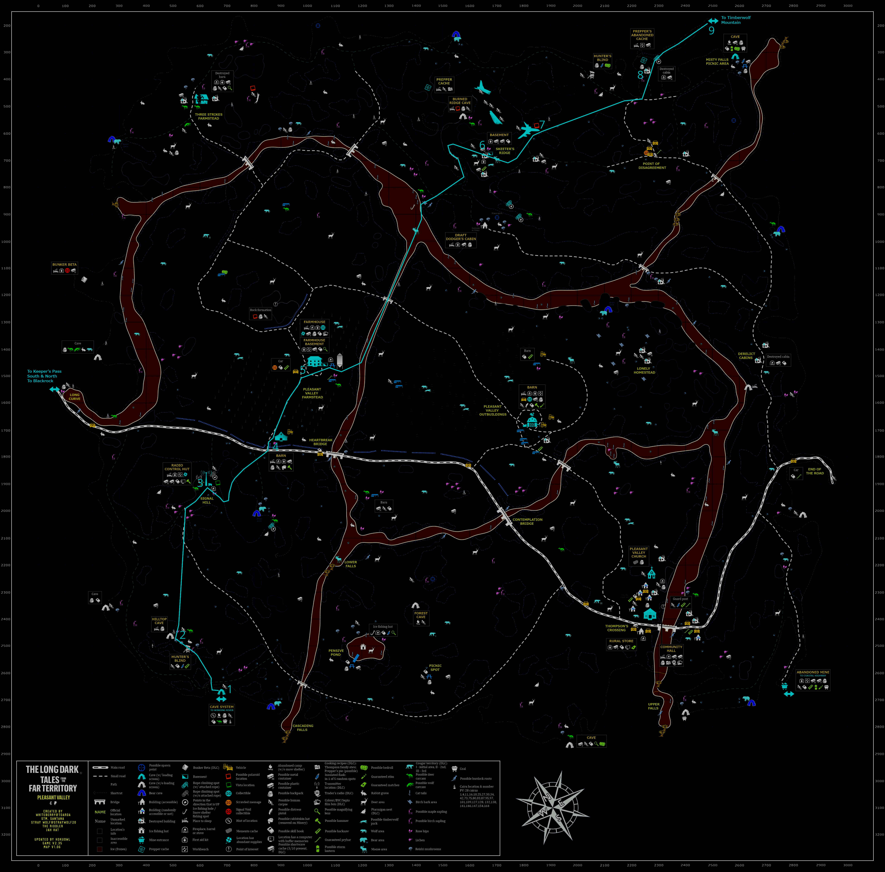
<figcaption>Atds_step_13_inverted.png</figcaption>
</figure></td>
</tr>
<tr>
<td></td>
<td></td>
</tr>
</tbody>
</table>

1.  Navigate to point 2.
2.  Navigate to point 3.
3.  Navigate to point 4.
    1.  As always, if you aren't confident <a href="./Mountain%20Goating.md" class="wikilink" title="Mountain Goating">Mountain Goating</a> down the cliff, just take the longer route down.
4.  Navigate to point 5.
5.  Navigate to point 6.
    1.  If there is a timberwolf pack in this area, it is of course advised to avoid the area. Go up to burned ridge cave and past the crashed plane instead to be safe.
6.  Navigate to point 7.
7.  Navigate to point 8.
8.  Navigate to point 9.
    1.  There is rope climbing at this step.

### Step \#14

<table>
<colgroup>
<col style="width: 50%" />
<col style="width: 50%" />
</colgroup>
<tbody>
<tr>
<td><figure>
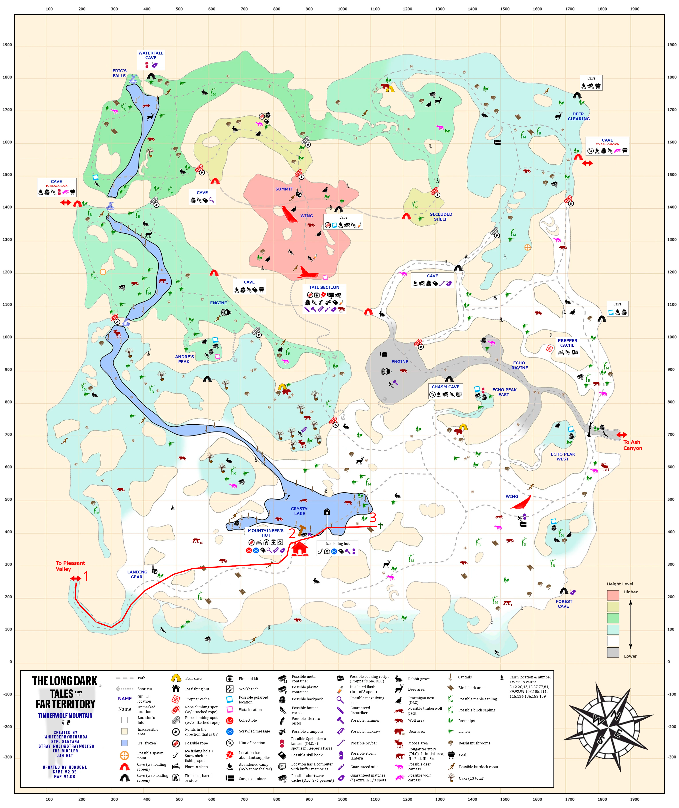
<figcaption>Atds_step_14.png</figcaption>
</figure></td>
<td><figure>
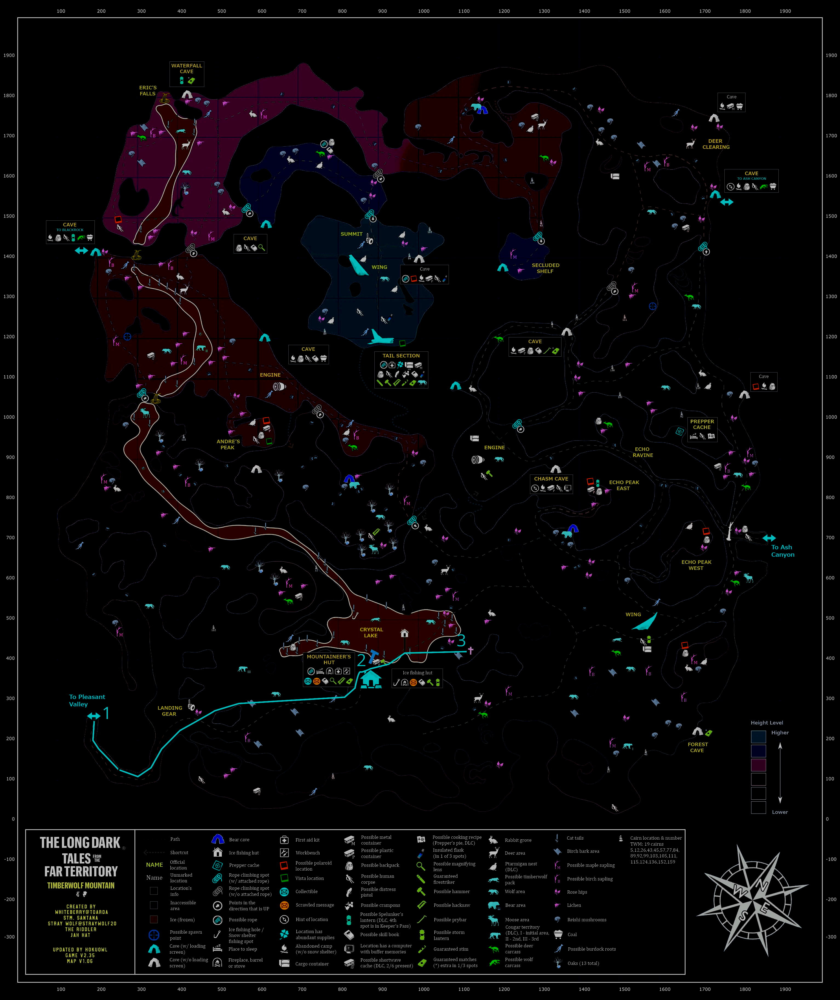
<figcaption>Atds_step_14_inverted.png</figcaption>
</figure></td>
</tr>
<tr>
<td></td>
<td></td>
</tr>
</tbody>
</table>

1.  Navigate to point 2.
    1.  This region can be very cold, so warm up at point 2 or on the way to it if you need.
2.  Navigate to grave \#3 at point 3.

### Step \#15

<table>
<colgroup>
<col style="width: 50%" />
<col style="width: 50%" />
</colgroup>
<tbody>
<tr>
<td><figure>

<figcaption>Atds_step_15.png</figcaption>
</figure></td>
<td><figure>

<figcaption>Atds_step_15_inverted.png</figcaption>
</figure></td>
</tr>
<tr>
<td></td>
<td></td>
</tr>
</tbody>
</table>

1.  Navigate to point 2.
2.  Navigate to point 3.

### Step \#16

<table>
<colgroup>
<col style="width: 50%" />
<col style="width: 50%" />
</colgroup>
<tbody>
<tr>
<td><figure>
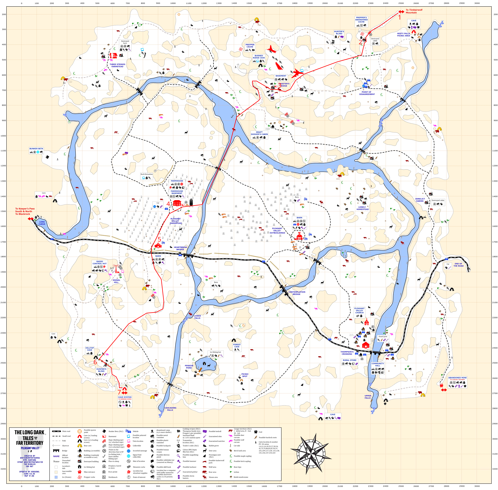
<figcaption>Atds_step_16.png</figcaption>
</figure></td>
<td><figure>
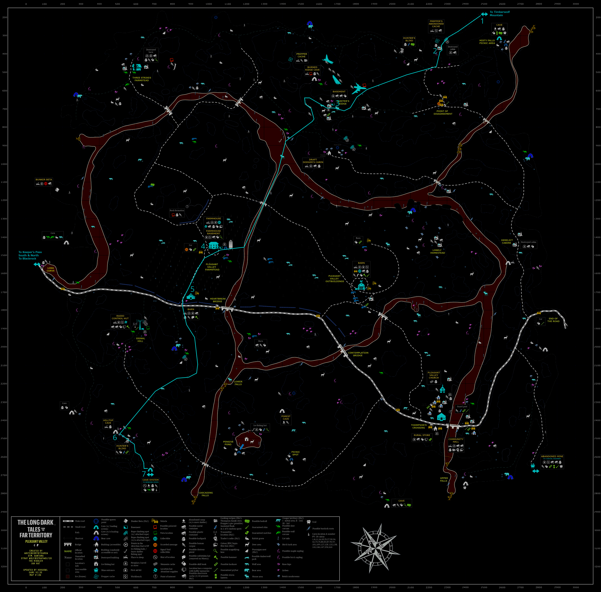
<figcaption>Atds_step_16_inverted.png</figcaption>
</figure></td>
</tr>
<tr>
<td></td>
<td></td>
</tr>
</tbody>
</table>

1.  Navigate to point 2.
2.  Navigate to point 3.
3.  Navigate to point 4.
4.  Navigate to point 5.
5.  Navigate to point 6.
    1.  If you don't need to warm up, consider skipping 6 and going straight to 7.
6.  Navigate to point 7.

### Step \#17

<table>
<colgroup>
<col style="width: 50%" />
<col style="width: 50%" />
</colgroup>
<tbody>
<tr>
<td><figure>
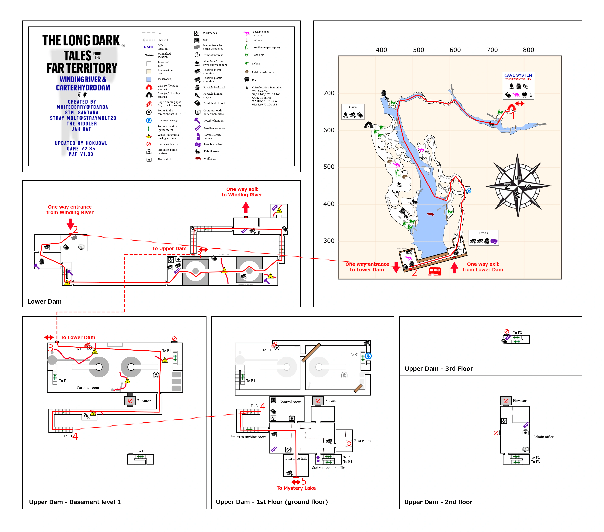
<figcaption>Atds_step_17.png</figcaption>
</figure></td>
<td><figure>
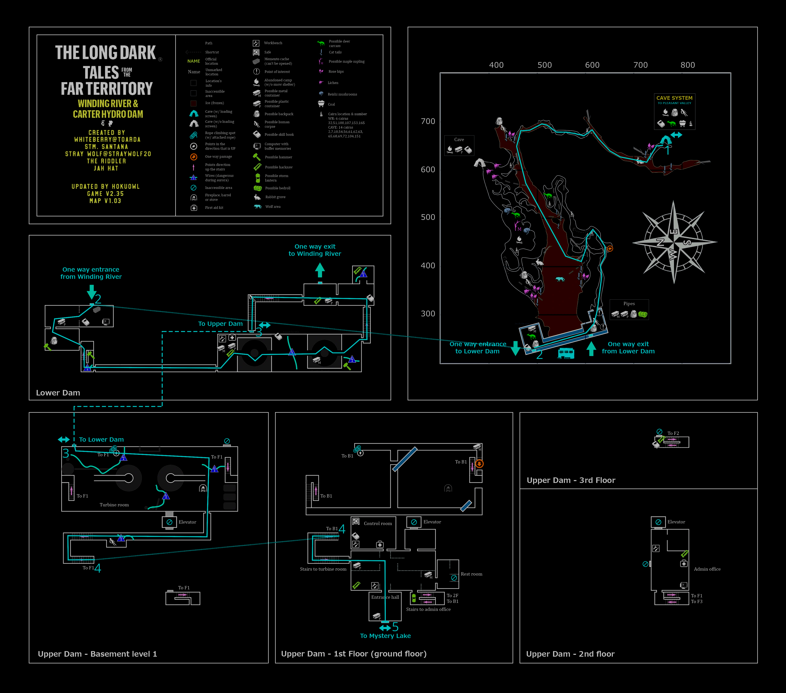
<figcaption>Atds_step_17_inverted.png</figcaption>
</figure></td>
</tr>
<tr>
<td></td>
<td></td>
</tr>
</tbody>
</table>

1.  Navigate to point 2.
    1.  Don't fall!
2.  Navigate to point 3.
    1.  Remember that live wires during an aurora will do serious damage to you.
3.  Navigate to point 4.
4.  Navigate to point 5.

### Step \#18

<table>
<colgroup>
<col style="width: 50%" />
<col style="width: 50%" />
</colgroup>
<tbody>
<tr>
<td><figure>

<figcaption>Atds_step_18.png</figcaption>
</figure></td>
<td><figure>
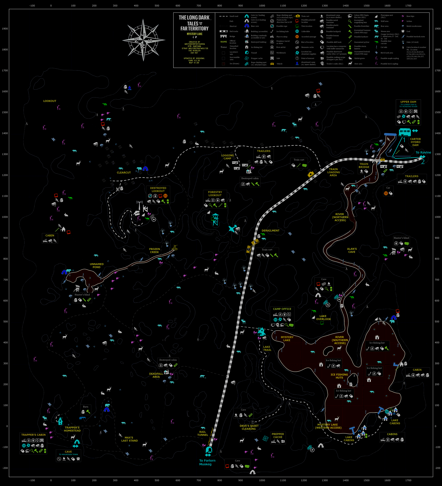
<figcaption>Atds_step_18_inverted.png</figcaption>
</figure></td>
</tr>
<tr>
<td></td>
<td></td>
</tr>
</tbody>
</table>

1.  Navigate to point 2.

### Step \#19

<table>
<colgroup>
<col style="width: 50%" />
<col style="width: 50%" />
</colgroup>
<tbody>
<tr>
<td><figure>
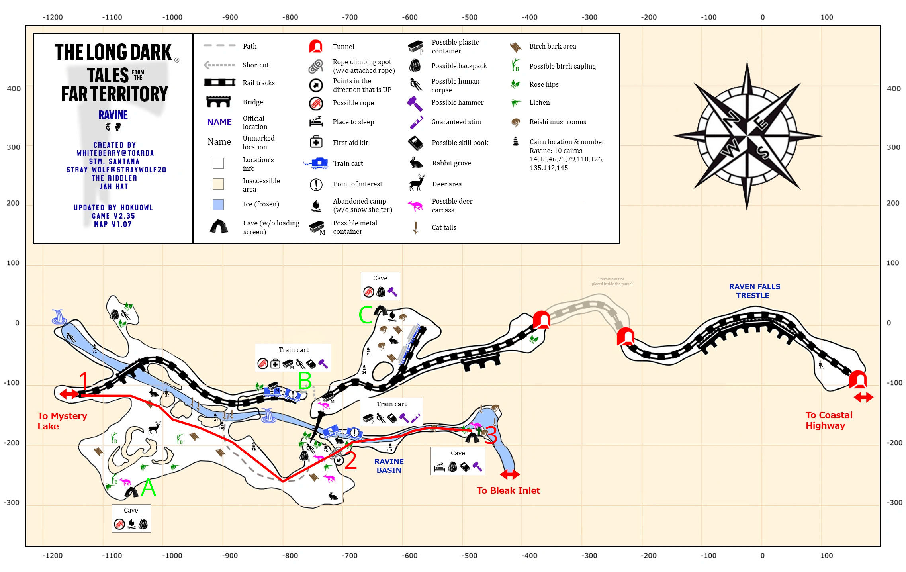
<figcaption>Atds_step_19.png</figcaption>
</figure></td>
<td><figure>
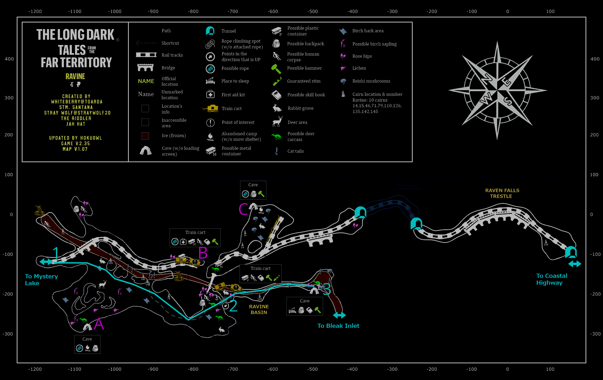
<figcaption>Atds_step_19_inverted.png</figcaption>
</figure></td>
</tr>
<tr>
<td></td>
<td></td>
</tr>
</tbody>
</table>

1.  Navigate to point 2.
    1.  You will require a mountaineering rope to climb down to the ravine basin at point 2.
    2.  Check points A, B, and C on the map for a mountaineering rope spawn.
    3.  I am not certain if a mountaineering rope is guaranteed to spawn in this location, but in my experience, I have always found one. If you do not find one, you will have to remove a pre-deployed rope from another location. Your closest options will be the Lake Overlook in Mystery Lake, or the climbing location just south of Mystery Lake (Western Access).
    4.  BE AWARE THAT THIS IS A VERY LONG CLIMB! You will climb down to reach the next grave and then you must climb back up. Because carry weight affects climbing speed, it is advised to leave as much gear as possible at the top of the ravine before climbing down. You can retrieve it all after you climb back up shortly. Because climbing speed is directly tied to your current fatigue, you may want to plan to sleep in the cave near the grave to top your fatigue off before climbing back up.
2.  Navigate to grave \#4 at point 3.

### Step \#20

<table>
<colgroup>
<col style="width: 50%" />
<col style="width: 50%" />
</colgroup>
<tbody>
<tr>
<td><figure>
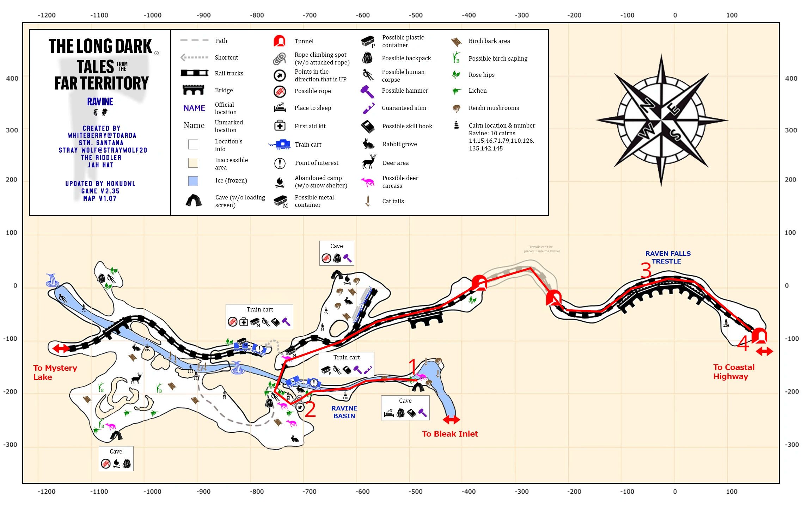
<figcaption>Atds_step_20.png</figcaption>
</figure></td>
<td><figure>
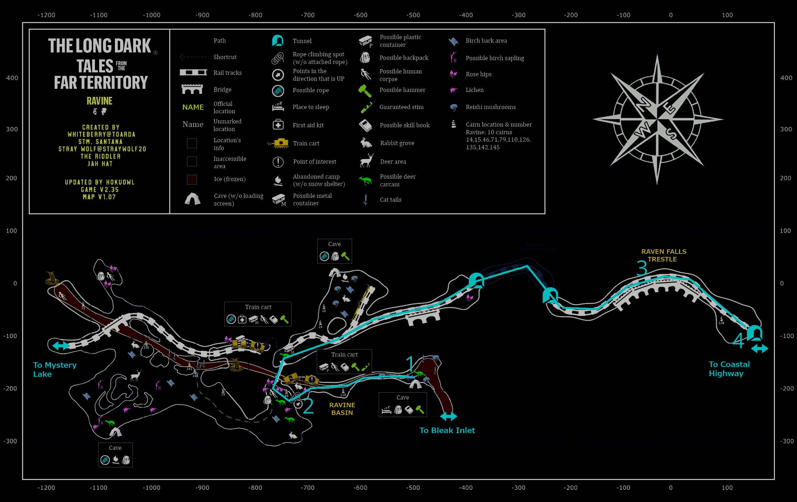
<figcaption>Atds_step_20_inverted.png</figcaption>
</figure></td>
</tr>
<tr>
<td></td>
<td></td>
</tr>
</tbody>
</table>

1.  Navigate to point 2.
    1.  Again, BE AWARE THAT THIS IS A VERY LONG CLIMB! You very likely should sleep in the cave at point 1 to top off your fatigue before attempting to climb back up. The <a href="./Fatigue%20Reduced.md" class="wikilink" title="Fatigue Reduced">Fatigue Reduced</a> <a href="./Afflictions.md" class="wikilink" title="Affliction">Affliction</a> from coffee does not reduce the amount of fatigue incurred by climbing, but it will reduce the amount of fatigue incurred by walking from point 1 to point 2. It may seem insignificant, but every little bit helps. Additionally, there is a ledge during the climb that you will very likely need to rest on to make it to the top of the climb. If you drink your coffee hot before leaving the cave at point 1, you will also get the <a href="./Warming%20Up.md" class="wikilink" title="Warming Up">Warming Up</a> <a href="./Afflictions.md" class="wikilink" title="Affliction">Affliction</a>, which will help you not freeze during the climb and while resting on the ledge.
2.  Navigate to point 3.
    1.  Don't fall!
3.  Navigate to point 4.

### Step \#21

<table>
<colgroup>
<col style="width: 50%" />
<col style="width: 50%" />
</colgroup>
<tbody>
<tr>
<td><figure>
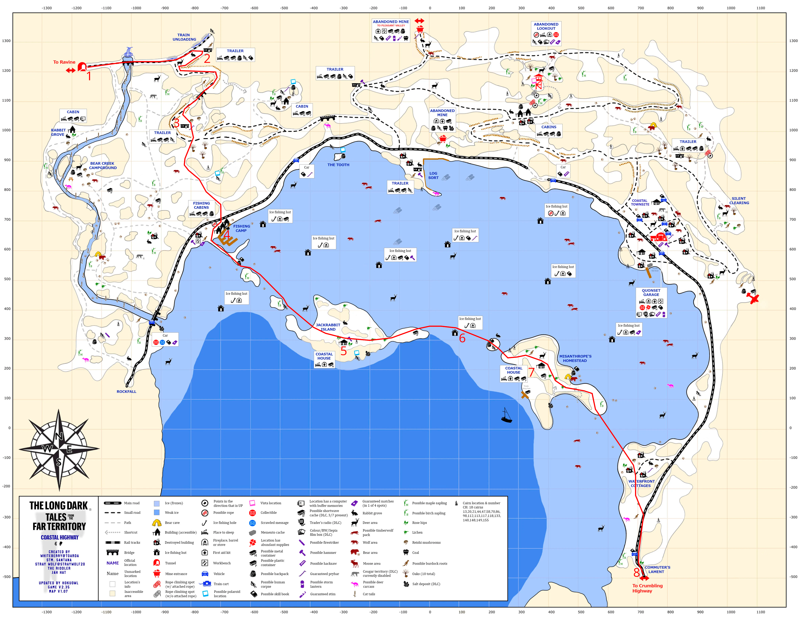
<figcaption>Atds_step_21.png</figcaption>
</figure></td>
<td><figure>
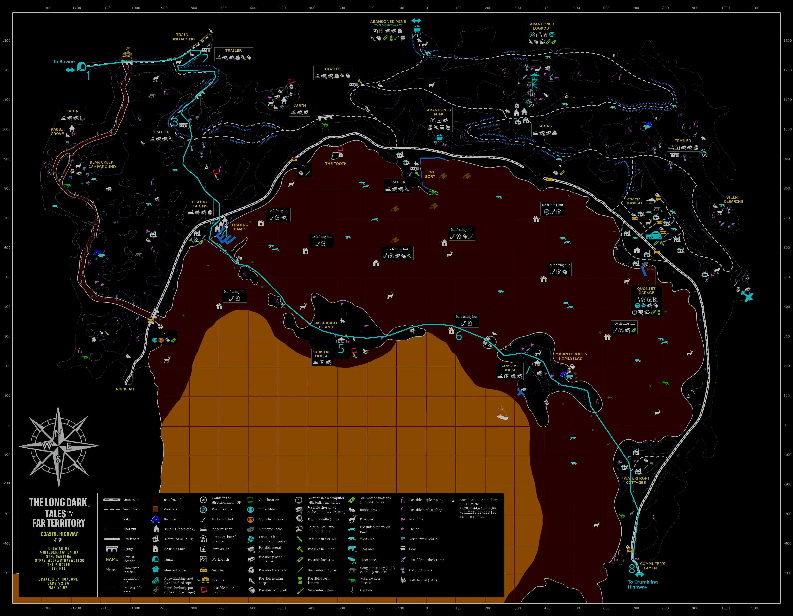
<figcaption>Atds_step_21_inverted.png</figcaption>
</figure></td>
</tr>
<tr>
<td></td>
<td></td>
</tr>
</tbody>
</table>

1.  Navigate to point 2.
2.  Navigate to point 3.
3.  Navigate to point 4.
4.  Navigate to point 5.
5.  Navigate to point 6.
    1.  Don't stray too close to the edge of the ice.
6.  Navigate to point 7.
7.  Navigate to point 8.
    1.  The stretch between point 7 and the next interior to warm up in is a bit long. You will probably want to warm up with a fire at some point. Commuter's Lament is a good spot for this because there is good wind cover.

### Step \#22

<table>
<colgroup>
<col style="width: 50%" />
<col style="width: 50%" />
</colgroup>
<tbody>
<tr>
<td><figure>
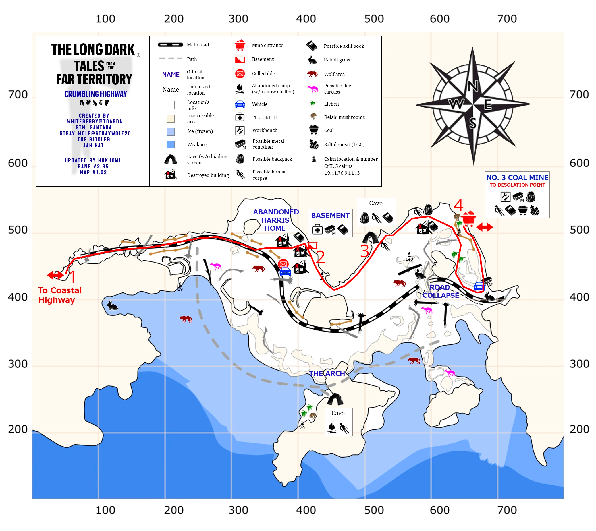
<figcaption>Atds_step_22.png</figcaption>
</figure></td>
<td><figure>
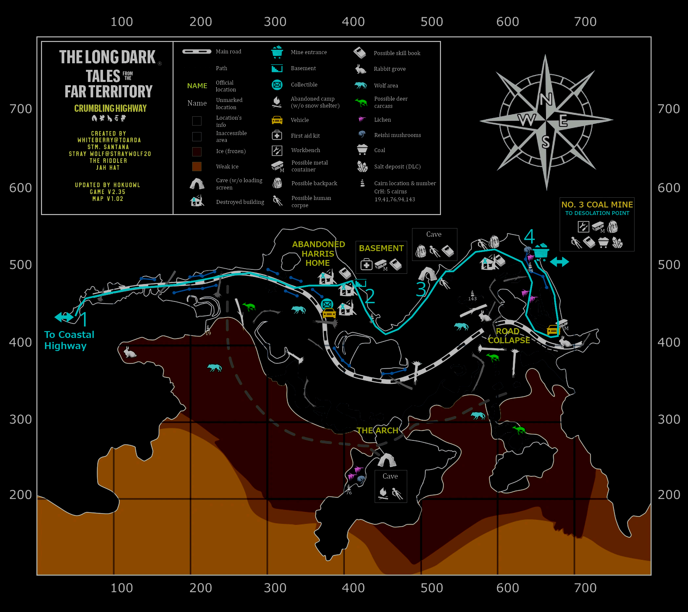
<figcaption>Atds_step_22_inverted.png</figcaption>
</figure></td>
</tr>
<tr>
<td></td>
<td></td>
</tr>
</tbody>
</table>

1.  Navigate to point 2.
    1.  This region is very tight and you will be in close quarters with wolves. If you have any flares available, keep one equipped and at the ready. Otherwise keep a torch at the ready, but flares are preferable since wind cannot extinguish them unexpectedly, leaving you defenseless. You are so close to finishing this challenge, and that is not how you want your run to end.
2.  Navigate to point 3.
3.  Navigate to point 4.

### Step \#23

<table>
<colgroup>
<col style="width: 50%" />
<col style="width: 50%" />
</colgroup>
<tbody>
<tr>
<td><figure>
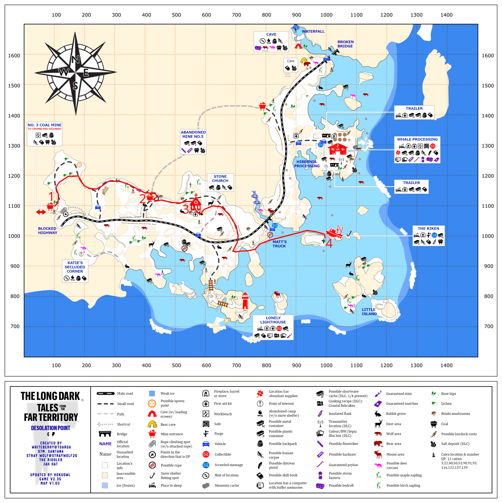
<figcaption>Atds_step_23.png</figcaption>
</figure></td>
<td><figure>
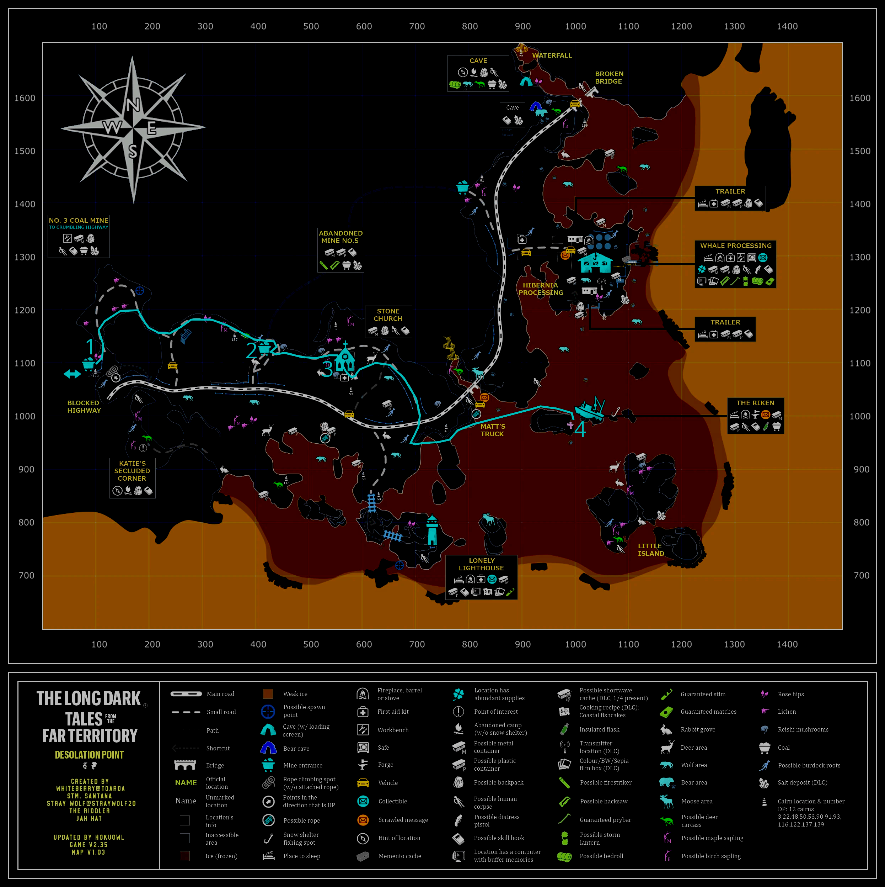
<figcaption>Atds_step_23_inverted.png</figcaption>
</figure></td>
</tr>
<tr>
<td></td>
<td></td>
</tr>
</tbody>
</table>

1.  Navigate to point 2.
2.  Navigate to point 3.
    1.  Remember that it is possible for wolves to identify you inside the church or follow you inside.
3.  Navigate to grave \#5 point 4.
    1.  It is possible to Mountain Goat down from the bridge above Matt's Truck, but if you aren't comfortable doing that, just follow the path.
4.  CONGRATULATIONS! YOU'VE BEATEN THE CHALLENGE!

**Lua execution error in Module:Navbox function navbox**

