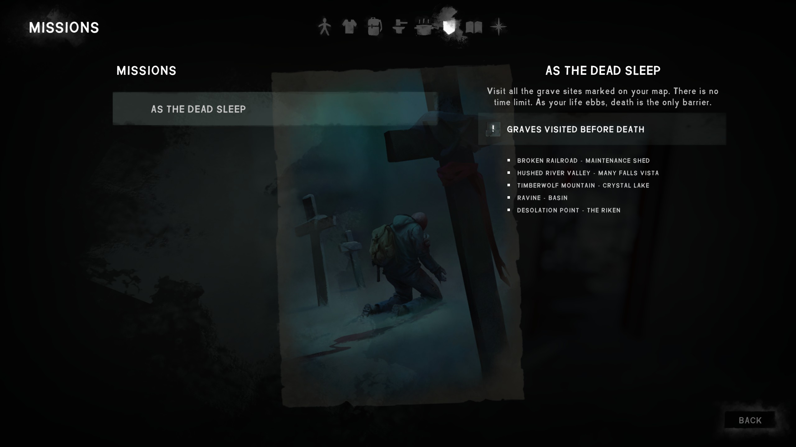

# As the Dead Sleep

**Categories:** Challenges · **Source:** [Fandom](https://thelongdark.fandom.com/wiki/As_the_Dead_Sleep)

**Contents**

- [Gameplay](#gameplay)
- [Routes](#routes)
- [Grave Quotes](#grave-quotes)
- [Tips](#tips)
- [History](#history)
- [Trivia](#trivia)

**As the Dead Sleep**

_as\_the\_dead\_sleep.png_

**Details**

**Regions:** [Broken Railroad](./Broken%20Railroad.md), [Hushed River Valley](./Hushed%20River%20Valley.md), [Timberwolf Mountain](./Timberwolf%20Mountain.md), [The Ravine](./The%20Ravine.md), [Desolation Point](./Desolation%20Point.md)

**Difficulty:** 6

**Date Added:** 10 December 2019

> “__The world has changed. But there's a chance for one last journey before the cold sets in. Walk the path, visit the graves, and make things right before the end.  
 Visit all the grave sites listed on your map. There is no time limit. As your life ebbs, death is the only barrier.__”
>
> — Main Menu description

**As the Dead Sleep**is the 7th [Challenge](./Challenge.md) to be added into the game. In the challenge, you have to visit 5 graves in marked locations around [Great Bear Island](./Great%20Bear%20Island.md). It is considered the hardest Challenge currently in the game (even harder than [Escape the Darkwalker](./Escape%20the%20Darkwalker.md)), and was inspired by the community-created "Deadman" custom difficulty.

## Gameplay

> “**Visit all the grave sites listed on your map. There is no time limit. As your life ebbs, death is the only barrier.**”
>
> — Journal Entry

You will always spawn in the [Fallen Lighthouse](./Fallen%20Lighthouse.md) at [Bleak Inlet](./Bleak%20Inlet.md) at the start of the Challenge, with the weather set to windy.

The game is set to [Interloper](./Interloper.md) difficulty, meaning that wildlife are highly aggressive and high-tier loot (MREs, Expedition Parkas, Firearms, etc.) cannot be found. However, the rarity of loot is set to [Stalker](./Stalker.md), with clothing and food being very plentiful once leaving Bleak Inlet. In this challenge, you cannot heal [Condition](./Condition.md) by sleeping and [Birch Bark Tea](./Birch%20Bark%20Tea.md) is disabled, making the only way to heal by finding and using rare [Emergency Stims](./Emergency%20Stim.md). [Deer](./Deer.md), [Rabbits](./Rabbit.md), and [Ptarmigan](./Ptarmigan.md) will not spawn, though [Deer Carcasses](./Deer%20Carcass.md) are still available to scavenge. [Crafting](./Crafting.md) and [Hunting](./Hunting.md) is not advised, as there is plenty of Clothing and food to allow the player to quickly run from region to region to complete the challenge.  The 5 graves are in the following locations:

- [Maintenance Yard](./Maintenance%20Yard.md) in [Broken Railroad](./Broken%20Railroad.md)
- [Many Falls Vista](./Many%20Falls%20Vista.md) in [Hushed River Valley](./Hushed%20River%20Valley.md)
- [Crystal Lake](./Crystal%20Lake.md) in [Timberwolf Mountain](./Timberwolf%20Mountain.md)
- [Ravine Basin](./Ravine%20Basin.md) in [The Ravine](./The%20Ravine.md)
- [The Riken](./The%20Riken.md) in [Desolation Point](./Desolation%20Point.md)

## Routes

The most common route for completing this challenge requires visiting the graves in the following order:

1. Head for [Broken Railroad](./Broken%20Railroad.md) via [Forlorn Muskeg](./Forlorn%20Muskeg.md) and scavenge the area for supplies, including the [Hunting Lodge](./Hunting%20Lodge.md). An Emergency Stim sometimes spawns inside, useful for the grave in Ravine Basin.
2. Leave Broken Railroad into Forlorn Muskeg and then for the [Hushed River Valley](./Hushed%20River%20Valley.md) via [Marsh Ridge](./Marsh%20Ridge.md) and [Mountain Town](./Mountain%20Town.md). It is advised to loot [Milton](./Milton.md) as it is the first place to have a large amount of decent gear, mainly clothing, food, and water. Proceed into the Hushed River Valley and find the grave.
3. From there, most players will head back through [Mountain Town](./Mountain%20Town.md) and into [Mystery Lake](./Mystery%20Lake%20%28region%29.md). The path can diverge to two points from here based on the player's preference:
  1. Go through the [Winding River](./Winding%20River.md) to [Pleasant Valley](./Pleasant%20Valley.md) to reach [Timberwolf Mountain](./Timberwolf%20Mountain.md), then to [Coastal Highway](./Coastal%20Highway.md) and [Desolation Point](./Desolation%20Point.md), then to [The Ravine](./The%20Ravine.md) and [Ravine Basin](./Ravine%20Basin.md).
  2. Through [The Ravine](./The%20Ravine.md) to go to the [Ravine Basin](./Ravine%20Basin.md), then [Coastal Highway](./Coastal%20Highway.md) and then to [Desolation Point](./Desolation%20Point.md). Then to [Pleasant Valley](./Pleasant%20Valley.md) and off to [Timberwolf Mountain](./Timberwolf%20Mountain.md).

## Grave Quotes

As the player visits each grave, the thoughts of the survivor will be displayed on screen. They will be displayed in the same order no matter what order the graves are found. Notes are generated in the player's inventory when a grave is visited. The quotes are as follows:

1. I found the water. Like I promised. Where the rivers meet the sea. A bitter and empty place. You were right. ([Memento Mori 1](./Memento%20Mori%201.md))
2. We were all so cold. More than we could take. No escape from it. Please forgive me. ([Memento Mori 2](./Memento%20Mori%202.md))
3. I left you behind. My guts freezing. My feet on fire. Each step a hundred years. It was too far, too far. ([Memento Mori 3](./Memento%20Mori%203.md))
4. Why couldn't you hold out? Why couldn't I let go? Are you at rest? Is there sky above where you are? ([Memento Mori 4](./Memento%20Mori%204.md))
5. The world falling away. Did you know already, somehow? Before you left us? The lights, they used to go on. ([Memento Mori 5](./Memento%20Mori%205.md))

## Tips

Interloper difficulty means that you will not be able to loot warm manufactured clothes or firearms at any point during this challenge. With the amount of time it takes to prepare a bow and hide clothing, plan on completing the challenge without either. General Interloper gameplay advice applies to this challenge, with some additional points. If you are having trouble completing the challenge, consider following the [As the Dead Sleep Challenge Walkthrough](./As%20the%20Dead%20Sleep%20Challenge%20Walkthrough.md).

- Predator spawns are slightly reduced compared to Interloper, but encounters are exponentially more dangerous due to the lack of healing except for stims. Plan travel routes around avoiding their spawn areas.
- Consider using the [Daisy Chaining](./Daisy%20Chaining.md) strategy to conserve Condition when moving between regions. By the time you leave the Mountain Town region, you should have enough warm clothing to keep yourself from freezing too often.
- Avoid any travel at night: clear weather brings the chance of an Aurora which increases animal aggression and strips you of any means to ward predators off except for the [Distress Pistol](./Distress%20Pistol.md), while bad weather will obscure your vision and impede travel.
- A bedroll can often be found on the second floor of the lighthouse immediately upon spawning. However, in the event the bedroll does not spawn, you will likely not find a bedroll until reaching Hushed River Valley or Mystery Lake, so make sure you know where the nearest naturally-spawning bed is at all times.
- The lack of high-tier clothing gives you more carrying capacity; consider carrying more water and firewood than normal.
- Stop regularly during travel to warm up at fires; you lose 20% condition in 5 minutes of real time (1 hour in-game) from freezing.
  - Making hot food/beverages while at the fire can be advantageous as it provides the [Warming Up](./Warming%20Up.md) benefit, in addition to immediately restoring some of your warmth upon consumption.
  - The transition cave from Bleak Inlet to Forlorn Muskeg, the forge at [Spence Family Homestead](./Old%20Spence%20Family%20Homestead.md), and the forge in the [Maintenance Yard](./Maintenance%20Yard.md) should provide more than enough coal to ensure that you can easily restore lost warmth while traveling.
- Consider not visiting major loot spots unless they are on your path through a region. Locations such as the [Hunting Lodge](./Hunting%20Lodge.md) and [Paradise Meadows Farm](./Paradise%20Meadows%20Farm.md), for example, will likely contain great loot spots, but also require traveling through wolf territory.

## History

- This challenge was introduced in version 1.64.

## Trivia

A grave headstone similar to the ones in this challenge is found outside of the [Community Hall](./Community%20Hall.md).
