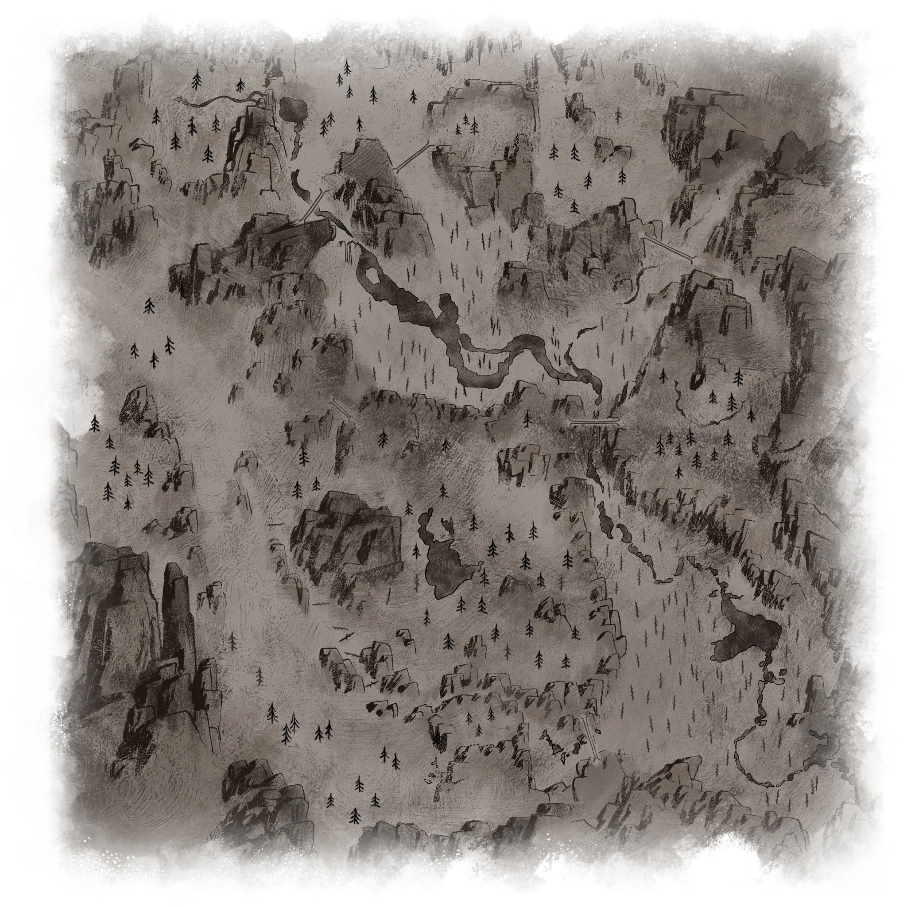
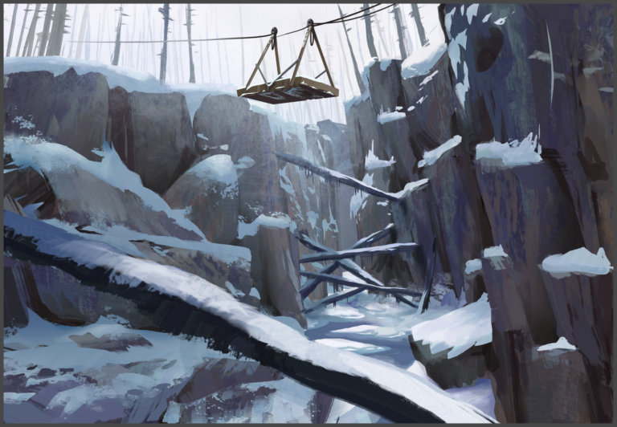

# Ash Canyon

**Contents**

- [Overview](#Overview)
- [Exclusive gear](#Exclusive_gear)
- [Survivability](#Survivability)
- [Base locations](#Base_locations)
- [Locations](#Locations)
- [Map](#Map)
- [Gallery](#Gallery)
- [Trivia](#Trivia)

<table class="infobox">
<caption>Ash Canyon</caption>
<colgroup>
<col style="width: 50%" />
<col style="width: 50%" />
</colgroup>
<tbody>
<tr>
<td colspan="2"><figure>
[Missing image: Ash_Canyon.jpg]
<figcaption>Ash_Canyon.jpg</figcaption>
</figure></td>
</tr>
<tr>
<td colspan="2" class="section">
<strong>Location on <a href="./Great%20Bear%20Island.md" class="wikilink" title="Great Bear Island">Great Bear Island</a></strong>
</td>
</tr>
<tr>
<td colspan="2"><figure>
[Missing image: Ash_Canyon_Location.png]
<figcaption>Ash_Canyon_Location.png</figcaption>
</figure></td>
</tr>
<tr>
<td colspan="2"><figure>

<figcaption>Ash_Canyon_Region_Map.png</figcaption>
</figure></td>
</tr>
<tr>
<td colspan="2" class="section">
<strong>Details</strong>
</td>
</tr>
<tr>
<td>
Description
</td>
<td>
Deep valleys and high plateaus connected by rope bridges overlooking burnt, decaying trees subject to an ancient forest fire.
</td>
</tr>
<tr>
<td>
Connecting Regions
</td>
<td>
<a href="./Timberwolf%20Mountain.md" class="wikilink" title="Timberwolf Mountain">Timberwolf Mountain</a> (through multiple different connection points)
</td>
</tr>
<tr>
<td>
Difficulty
</td>
<td>
Advanced
</td>
</tr>
<tr>
<td>
Interloper Region Spawn
</td>
<td>
Yes
</td>
</tr>
<tr>
<td>
Locations
</td>
<td>
20
</td>
</tr>
<tr>
<td>
Hazards and Survivability
</td>
<td>
Lots of high rope bridges. Weather can often be poor. Some shelters scattered throughout.
</td>
</tr>
<tr>
<td>
Date Added
</td>
<td>
December 7 2020
</td>
</tr>
</tbody>
</table>

<table>
<colgroup>
<col style="width: 33%" />
<col style="width: 33%" />
<col style="width: 33%" />
</colgroup>
<tbody>
<tr>
<td style="vertical-align: top; font-size: 3em; color: #5d5980; padding-right: 10px">
“
</td>
<td>
For advanced players. A climber's paradise dotted with narrow ravines, towering cliffs, and multiple high plateaus. Its burnt forests and mining settlements also hint at a darker history. 

&#10;

- In-game description

</td>
<td style="vertical-align: bottom; font-size: 3em; color: #5d5980; padding-left: 10px">
”
</td>
</tr>
</tbody>
</table>

**Ash Canyon** is the 11th <a href="./Region.md" class="wikilink" title="Region">Region</a> added to *The Long Dark* and was released on December 7th, 2020 in the Hesitant Prospect update. It was first announced in 2020 along with the Halloween event and subsequent <a href="./Challenge.md" class="wikilink" title="Challenge">Challenge</a>: <a href="./Escape%20the%20Darkwalker.md" class="wikilink" title="Escape the Darkwalker">Escape the Darkwalker</a>.

Ash Canyon can be accessed from two locations in eastern <a href="./Timberwolf%20Mountain.md" class="wikilink" title="Timberwolf Mountain">Timberwolf Mountain</a>: the eastern end of the <a href="./Echo%20Ravine.md" class="wikilink" title="Echo Ravine">Echo Ravine</a> basin which leads to <a href="./Bitter%20Marsh.md" class="wikilink" title="Bitter Marsh">Bitter Marsh</a>, and a transition cave east of <a href="./Deer%20Clearing.md" class="wikilink" title="Deer Clearing">Deer Clearing</a> to <a href="./Pillar%27s%20Footrest.md" class="wikilink" title="Pillar&#39;s Footrest">Pillar's Footrest</a>.

## Overview

The region is relatively cold (-25°C / -13°F) and consists almost entirely of wilderness: charred forests, frozen wetlands and high plateaus separated by deep canyons. A variety of bridges (artificial and natural) connect the higher elevation areas.

Traveling to higher elevations requires either lengthy detours or multiple rope climbs from the lower areas of the region. While traveling at higher elevations, there is little risk of hostile wildlife, but traversing rope bridges can pose serious risks since falling from them is fatal. In addition, the limited availability of food, especially on Stalker and Interloper with the presence of <a href="./Intestinal%20Parasites.md" class="wikilink" title="Intestinal Parasites">Intestinal Parasites</a> in wolf and bear meat, will likely prevent lengthy stays in the upper areas without utilization of starvation tactics.

## Exclusive gear

Three pieces of gear are exclusive to Ash Canyon: the <a href="./Curator%27s%20Rifle.md" class="wikilink" title="Curator&#39;s Rifle">Curator's Rifle</a>, <a href="./Crampons.md" class="wikilink" title="Crampons">Crampons</a> and the <a href="./Technical%20Backpack.md" class="wikilink" title="Technical Backpack">Technical Backpack</a> (not to be confused with <a href="./Moose-Hide%20Satchel.md" class="wikilink" title="Moose-Hide Satchel">Moose-Hide Satchel</a>).

The crampons and technical backpack are located inside of the <a href="./Gold%20Mine.md" class="wikilink" title="Gold Mine">Gold Mine</a> by a <a href="./Frozen%20Corpse.md" class="wikilink" title="Frozen Corpse">Frozen Corpse</a> to the region's northwest. Similar to other mines on <a href="./Great%20Bear%20Island.md" class="wikilink" title="Great Bear Island">Great Bear Island</a>, the Gold Mine's interior is dark and warm; its interior also contains shallow pools of <a href="./Environmental%20Hazard.md" class="wikilink" title="cold water">cold water</a> and an underground waterfall which must be passed through. The <a href="./Curator%27s%20Rifle.md" class="wikilink" title="Curator&#39;s Rifle">Curator's Rifle</a>, a unique variant of the <a href="./Hunting%20Rifle.md" class="wikilink" title="Hunting Rifle">Hunting Rifle</a>, will always spawn in the region, though its exact location will vary in each playthrough.

Despite the challenging environment, these items make exploring Ash Canyon and other regions easier. The backpack increases carry weight, and crampons help during rope climbs and navigating steep hills. The Curator's Rifle has 33% longer range than a normal rifle, which makes hunting <a href="./Bear.md" class="wikilink" title="Bears">Bears</a> and <a href="./Moose.md" class="wikilink" title="Moose">Moose</a> somewhat safer.

## Survivability

Ash Canyon features steep terrain and numerous plateaus separating lowland areas (like <a href="./Hushed%20River%20Valley.md" class="wikilink" title="Hushed River Valley">Hushed River Valley</a>), and offers a few man-made shelters, many of which have been severely damaged (like <a href="./Pleasant%20Valley.md" class="wikilink" title="Pleasant Valley">Pleasant Valley</a>).

A defining feature of the Canyon is its challenging terrain: specifically numerous <a href="./Rope%20Climbing.md" class="wikilink" title="Rope Climbs">Rope Climbs</a>, slopes which can be slid down but not climbed, and regular extreme cold. At first some locations are only accessible via winding paths through cliff sides and tunnels, but once discovered mountaineering ropes may be deployed for shortcuts in the future. <a href="./Go!%20Energy%20Drink.md" class="wikilink" title="GO! Energy Drinks">GO! Energy Drinks</a>, <a href="./Cup%20of%20Coffee.md" class="wikilink" title="Coffee">Coffee</a>, and <a href="./Emergency%20Stim.md" class="wikilink" title="Emergency Stim">Emergency Stim</a> are useful for emergencies, but strategic planning is best (e.g. avoiding climbs whenever possible, and careful planning).

Numerous shallow and unnamed caves litter Ash Canyon, providing wind protection and resources, but little warmth bonus. As of to Patch 1.93+ all Ash Canyon caves provide some warmth bonus, if slight, acting more similarly to caves in other regions. Constant cold, harsh weather and limited shelter necessitates regular use of <a href="./Campfire.md" class="wikilink" title="Campfires">Campfires</a>, especially overnight to avoid freezing. Firewood and sticks are abundant throughout the region, as are other natural resources including: <a href="./Cat%20Tail.md" class="wikilink" title="Cat Tail">Cat Tail</a>, <a href="./Rose%20Hip.md" class="wikilink" title="Rose Hip">Rose Hip</a>, <a href="./Reishi%20Mushroom.md" class="wikilink" title="Reishi Mushroom">Reishi Mushroom</a>, <a href="./Green%20Birch%20Sapling.md" class="wikilink" title="Birch">Birch</a> and <a href="./Green%20Maple%20Sapling.md" class="wikilink" title="Maple Sapling">Maple Sapling</a>.

Wildlife is sparse throughout Ash Canyon and mostly confined to lower elevations, although there are a few rabbit groves at higher elevations and a bear spawn near <a href="./Miner%27s%20Folly.md" class="wikilink" title="Miner&#39;s Folly">Miner's Folly</a>. Wolves of Ash Canyon tend to patrol the narrow passages in the lowest areas of the region, preventing easy travel to <a href="./Angler%27s%20Den.md" class="wikilink" title="Angler&#39;s Den">Angler's Den</a> and <a href="./Broad%20Falls.md" class="wikilink" title="Broad Falls">Broad Falls</a>. However, this means that one can travel through higher elevations with meat and hides without attracting predators, the only exception being the Bear near <a href="./Miner%27s%20Folly.md" class="wikilink" title="Miner&#39;s Folly">Miner's Folly</a>. When entering the region from the Deer Clearing cave in Timberwolf Mountain, it's possible to reach the Mine without a single wolf encounter, although this route requires three consecutive rope climbs up an exposed cliff face. Few <a href="./Rabbit.md" class="wikilink" title="Rabbits">Rabbits</a> are present and a Moose may spawn at the bottom of the rope climbs in the west; a second moose may spawn in the southeast in Bitter Marsh near the broken fishing hut (which provides shelter from wind and animals).

Similar to <a href="./Hushed%20River%20Valley.md" class="wikilink" title="Hushed River Valley">Hushed River Valley</a>, Ash Canyon contains <a href="./Hidden%20Cache.md" class="wikilink" title="Hidden Caches">Hidden Caches</a>. Although fewer, these contain mid-tier loot hidden in crevices, such as near <a href="./Stone%20Shelf%20Cave.md" class="wikilink" title="Stone Shelf Cave">Stone Shelf Cave</a>.

Work Benches are also present, including one inside Angler's Den and an outdoor bench at Miner's Folly. Arrowheads may be found at some locations (e.g., Angler's Den), enabling limited access to hunting without the need to cross several regions to the closest <a href="./Forge.md" class="wikilink" title="Forge">Forge</a>.

### Base locations

<a href="./Homesteader%27s%20Respite.md" class="wikilink" title="Homesteader&#39;s Respite">Homesteader's Respite</a> provides an attractive base option. Once reached for the first time (from above), a climbing rope may be deployed for easier future access from below. It is also not necessary to climb down, as the landslide near the homestead provides a safe path to scramble down. With the nearby broken fishing hut and a lack of nearby predators, this is possibly the most sustainable base in the region, although fuel will have to be carried up as none spawns on the ledge the cabin is on.

<a href="./Angler%27s%20Den.md" class="wikilink" title="Angler&#39;s Den">Angler's Den</a> is also a popular base option, given that it is very central and has everything a player might need, including a <a href="./Work%20Bench.md" class="wikilink" title="Work Bench">Work Bench</a>, <a href="./Pot%20Belly%20Stove.md" class="wikilink" title="Pot Belly Stove">Pot Belly Stove</a>, <a href="./Bed.md" class="wikilink" title="bunk bed">bunk bed</a>, and a chest. There's also three <a href="./Arrowhead.md" class="wikilink" title="arrowheads">arrowheads</a> that always spawn there, allowing Interloper players to start hunting without a long trip to <a href="./The%20Riken.md" class="wikilink" title="The Riken">The Riken</a> for forging. Both <a href="./Deer.md" class="wikilink" title="Deer">Deer</a> and Rabbits can be found nearby, and the fishing hut at <a href="./Bitter%20Marsh.md" class="wikilink" title="Bitter Marsh">Bitter Marsh</a> is not too far away. The major disadvantage of this location is that leaving the immediate area can be difficult, due to wolves in the narrow passages.

A final option for a base is <a href="./Miner%27s%20Folly.md" class="wikilink" title="Miner&#39;s Folly">Miner's Folly</a>. Most players will prefer to live in the <a href="./Foreman%27s%20Retreat.md" class="wikilink" title="Foreman&#39;s Retreat">Foreman's Retreat</a> nearby, as it offers a stove, fireplace, and plenty of storage. The nearby Bear can be hunted, providing a large amount of food, and a few Deer can spawn nearby. A <a href="./Fire%20Barrel.md" class="wikilink" title="Fire Barrel">Fire Barrel</a> near a Work Bench allows crafting without catching <a href="./Cabin%20Fever.md" class="wikilink" title="Cabin Fever">Cabin Fever</a>. Fuel is somewhat limited, however <a href="./Coal.md" class="wikilink" title="Coal">Coal</a> can be found in a large <a href="./Cave%20%28Ash%20Canyon%20location%29.md" class="wikilink" title="Cave">Cave</a> nearby.

## Locations

There are a number of discoverable locations in this region.

<table>
<colgroup>
<col style="width: 50%" />
<col style="width: 50%" />
</colgroup>
<tbody>
<tr>
<td><ul>
<li><a href="./Angler%27s%20Den.md" class="wikilink" title="Angler&#39;s Den">Angler's Den</a></li>
<li><a href="./Bitter%20Marsh.md" class="wikilink" title="Bitter Marsh">Bitter Marsh</a></li>
<li><a href="./Broad%20Falls.md" class="wikilink" title="Broad Falls">Broad Falls</a></li>
<li><a href="./Climber%27s%20Cave.md" class="wikilink" title="Climber&#39;s Cave">Climber's Cave</a></li>
<li><a href="./Fire%20Overlook.md" class="wikilink" title="Fire Overlook">Fire Overlook</a></li>
<li><a href="./Foreman%27s%20Retreat.md" class="wikilink" title="Foreman&#39;s Retreat">Foreman's Retreat</a></li>
<li><a href="./Gold%20Mine.md" class="wikilink" title="Gold Mine">Gold Mine</a></li>
<li><a href="./High%20Meadow.md" class="wikilink" title="High Meadow">High Meadow</a></li>
<li><a href="./Homesteader%27s%20Respite.md" class="wikilink" title="Homesteader&#39;s Respite">Homesteader's Respite</a></li>
<li><a href="./Long%20Falls.md" class="wikilink" title="Long Falls">Long Falls</a></li>
<li><a href="./Pillar%27s%20Footrest.md" class="wikilink" title="Pillar&#39;s Footrest">Pillar's Footrest</a></li>
</ul></td>
<td data-valign="top" style="width: 50%"><ul>
<li><a href="./Miner%27s%20Folly.md" class="wikilink" title="Miner&#39;s Folly">Miner's Folly</a></li>
<li><a href="./Mining%20Camp.md" class="wikilink" title="Mining Camp">Mining Camp</a></li>
<li><a href="./Narrow%20Falls%20Cave.md" class="wikilink" title="Narrow Falls Cave">Narrow Falls Cave</a></li>
<li><a href="./Runaway%20Bridge.md" class="wikilink" title="Runaway Bridge">Runaway Bridge</a></li>
<li><a href="./Shattered%20Cove.md" class="wikilink" title="Shattered Cove">Shattered Cove</a></li>
<li><a href="./Stone%20Shelf%20Cave.md" class="wikilink" title="Stone Shelf Cave">Stone Shelf Cave</a></li>
<li><a href="./Wolf%27s%20Jaw%20Overlook.md" class="wikilink" title="Wolf&#39;s Jaw Overlook">Wolf's Jaw Overlook</a></li>
<li>To Cave System (Region Transition to <a href="./Timberwolf%20Mountain.md" class="wikilink" title="Timberwolf Mountain">Timberwolf Mountain</a>)</li>
<li>To Timberwolf Mountain (Region Transition to <a href="./Timberwolf%20Mountain.md" class="wikilink" title="Timberwolf Mountain">Timberwolf Mountain</a>)</li>
</ul></td>
</tr>
</tbody>
</table>

There is also 1 <a href="./Prepper%20Cache.md" class="wikilink" title="Prepper Cache">Prepper Cache</a> close to the Cave Region Transition.

## Map

<table class="gallery">
<colgroup>
<col style="width: 33%" />
<col style="width: 33%" />
<col style="width: 33%" />
</colgroup>
<tbody>
<tr>
<td><figure>
[Missing image: AC_map_default.png]
<figcaption>A detailed map of Ash Canyon v2.35 (spoilers)</figcaption>
</figure></td>
<td><figure>
[Missing image: AC_map_loper.png]
<figcaption>A detailed map of Ash Canyon v2.35 (Interloper/Misery edition, includes spoilers)</figcaption>
</figure></td>
<td><figure>

<figcaption>Older map variant v1.94</figcaption>
</figure></td>
</tr>
</tbody>
</table>

## Gallery

<table class="gallery">
<colgroup>
<col style="width: 50%" />
<col style="width: 50%" />
</colgroup>
<tbody>
<tr>
<td><figure>
[Missing image: Ash_Canyon_Rope_Bridge_Fog.jpg]
<figcaption>Fog at higher elevations can make traversal difficult, with bridges looking as though they lead to nowhere</figcaption>
</figure></td>
<td><figure>

<figcaption>Concept art for the region. Do note that such bridges do not appear in the final product</figcaption>
</figure></td>
</tr>
</tbody>
</table>

## Trivia

The forest fire that occurred throughout the region may have been caused by past miners heading to the <a href="./Gold%20Mine.md" class="wikilink" title="Gold Mine">Gold Mine</a>, as several <a href="./Cardboard%20Matches.md" class="wikilink" title="Cardboard Matches">Cardboard Matches</a> can be found on both sides of many of the swinging bridges. A broken <a href="./Storm%20Lantern.md" class="wikilink" title="Storm Lantern">Storm Lantern</a> can also be found on the cliff west of <a href="./Angler%27s%20Den.md" class="wikilink" title="Angler&#39;s Den">Angler's Den</a>, and could have also been the cause. **Lua execution error in Module:Navbox function navbox** **Lua execution error in Module:Navbox function navbox** <a href="fr:Canyon_des_Cendres" class="wikilink" title="fr:Canyon des Cendres">fr:Canyon des Cendres</a> <a href="ru:%D0%9F%D0%B5%D0%BF%D0%B5%D0%BB%D1%8C%D0%BD%D1%8B%D0%B9_%D0%BA%D0%B0%D0%BD%D1%8C%D0%BE%D0%BD" class="wikilink" title="ru:Пепельный каньон">ru:Пепельный каньон</a>

