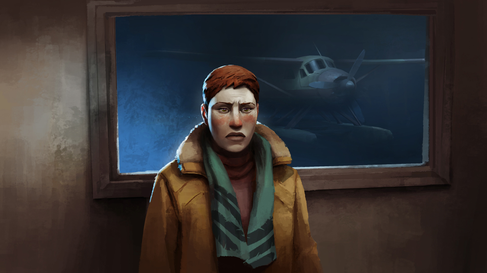
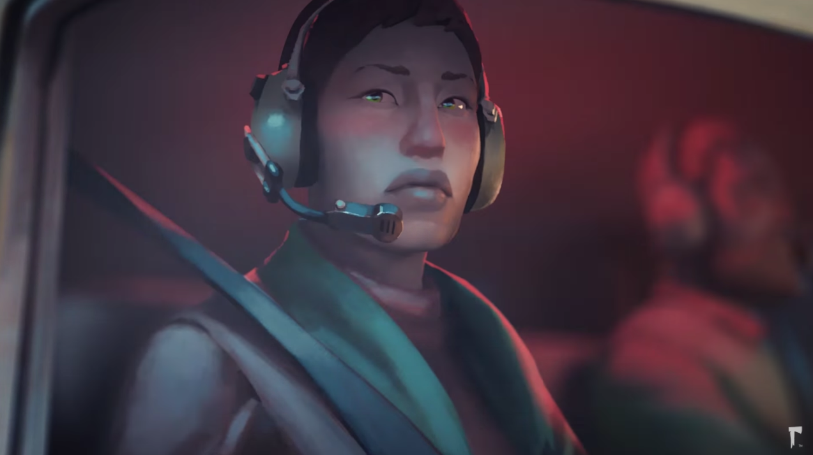
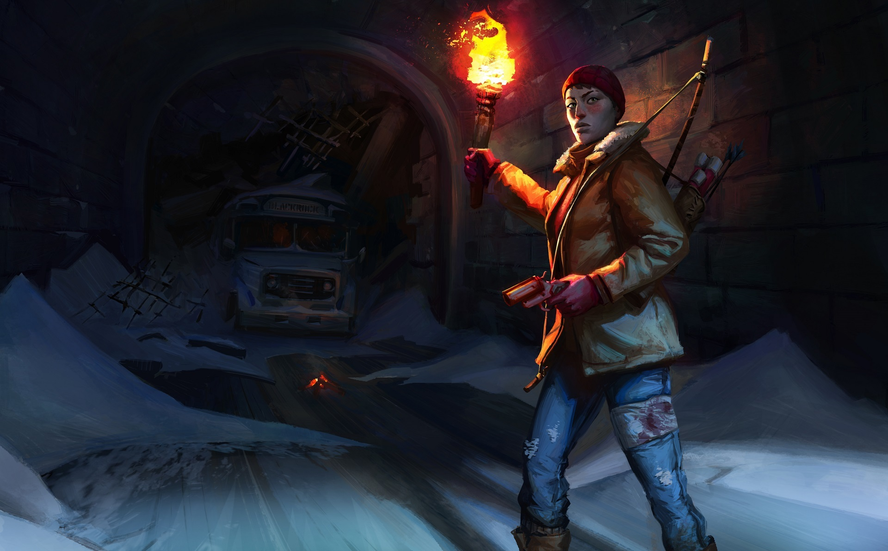
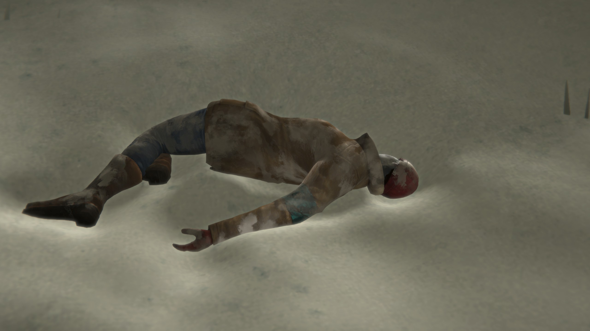
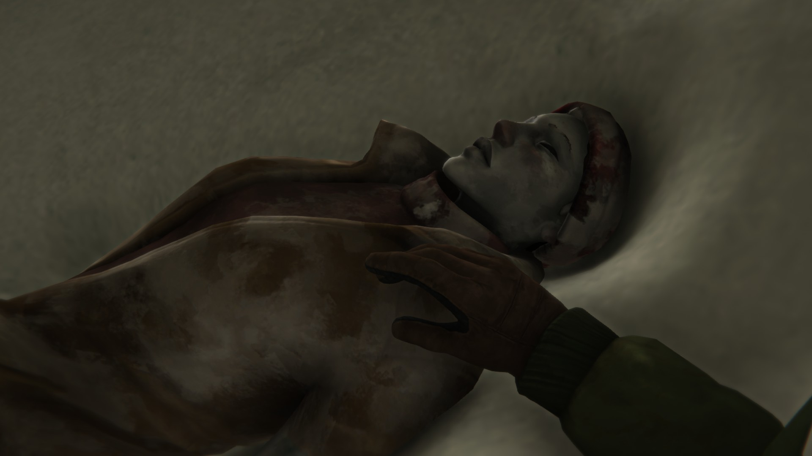
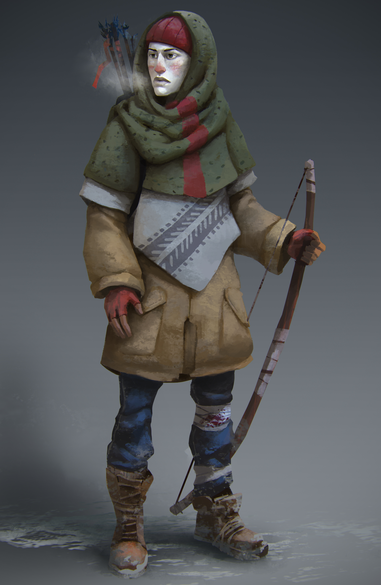
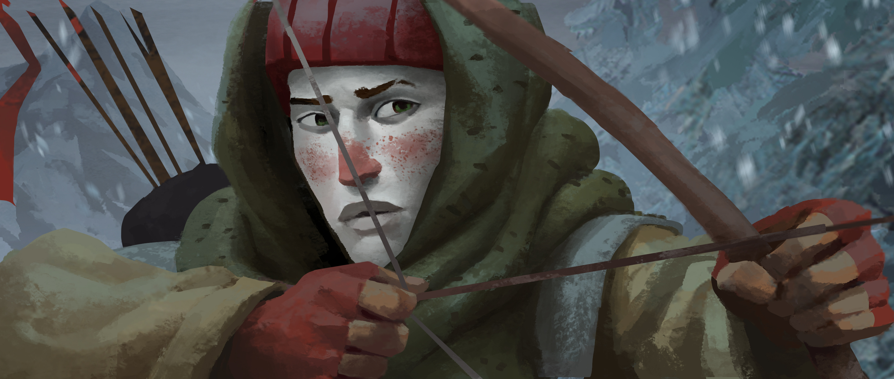

# Astrid Greenwood

**Categories:** Characters · **Source:** [Fandom](https://thelongdark.fandom.com/wiki/Astrid_Greenwood)

**Contents**

- [Overview](#overview)
- [Description](#description)
- [Background](#background)
- [Episode 1](#episode-1)
- [Episode 3](#episode-3)
- [Episode 4](#episode-4)
- [Episode 5](#episode-5)
- [Ingame stats](#ingame-stats)
- [Belongings](#belongings)
- [Gallery](#gallery)
- [Trivia](#trivia)

**Astrid Greenwood**

[Astrid](../assets/Astrid.png)

**Release:** [Wintermute Launch (v1.0)](./The%20Long%20Dark%20%E2%80%94%20Changelog%20%E2%80%94%20Archive%201.md#1.00)

**Date:** 1 August 2017

**Wintermute:** **•** [Episode 1](./Episode%201%20-%20Do%20Not%20Go%20Gentle.md) **•** [Episode 3](./Episode%203%20-%20Crossroads%20Elegy.md) **•** [Episode 4](./Episode%204%20-%20Fury%2C%20Then%20Silence.md)

**Mission:** **•** [Memories](./Memories.md) **•** [Trauma](./Trauma.md) **•** [Fallen Star](./Fallen%20Star.md) **•** [Coming Storm](./Coming%20Storm.md) **•** [Aftermath](./Aftermath.md) **•** [Donner](./Donner.md)

**Biographical Information**

**Age:** 30's - 40's

**Status:** Alive

**Relatives:** **•** [Will Mackenzie](./Will%20Mackenzie.md) (Ex-Husband) **•** Jack (Son)

**Occupation:** Doctor

**Physical Information**

**Hair:** Brown

**Eyes:** Green

**Game Information**

**Voiced by:** [Jennifer Hale](https://en.wikipedia.org/wiki/Jennifer_Hale)

> “__I may not be able to stop this darkness from coming. But I'll be damned if I'm going to let it happen without a fight. __”

**Doctor Astrid Greenwood** is one of two playable protagonists in _[The Long Dark](./The%20Long%20Dark.md)_. She is playable in Episode 3 and Episode 5.

<!-- #Overview -->
​

<!-- #overview -->
## Overview

Dr. Astrid Greenwood is a freelance medical doctor and the ex-wife of Will Mackenzie. After an unexpected confrontation between the two sometime before the [First Flare](./First%20Flare.md), Astrid seeks Will out after years of being apart. Will's skill and determination as a bush pilot make him Astrid's best hope to reach an isolated town in the north of Great Bear Island, where a patient of hers awaits treatment. After hesitating at first, Mackenzie agrees to fly her out in bad weather. During a tense conversation alluding to a shared, devastating loss, a bright flash of light blazes across the sky. The First Flare event sends their small plane crashing to the ground in the northern wilderness. The two are separated and forced to survive in the unforgiving reality of the Quiet Apocalypse.

Players experience [Story mode](./Wintermute.md) through both [Will Mackenzie's](./Will%20Mackenzie.md) and Astrid's point of view.

<!-- #Description -->
​

<!-- #description -->
## Description

Astrid is indigenous with short, brown hair and green eyes. She wears a tan jacket over a red sweater, with a green scarf, a pair of blue jeans, and brown boots.

Astrid is a doctor--a researcher more than a medical provider, she says--who goes above and beyond to try to help those in need. She generally has a serious, no-nonsense demeanor, in comparison to [Will Mackenzie's](./Will%20Mackenzie.md) much more sarcastic tendencies.

<!-- #Background -->
​

<!-- #background -->
## Background

Through Episode 1, we learn that Astrid was married to Will Mackenzie, but they were separated due to an unknown incident, likely the death of their child. She is a doctor who used to work at The Center, which is implied to be a health research department. It was brought to her attention that someone was sick in [Perseverance Mills](./Perseverance%20Mills.md), likely by someone she knows. She had left The Center, and implied to have stolen something from it.

<!-- #episode_1 -->
​

<!-- #Episode_1 -->
​

<!-- #episode-1 -->
## Episode 1

She meets Will an unknown amount of time after asking to be sent to Great Bear Island in poor weather conditions, and he reluctantly agrees. After having a shared conversation about their loss, Astrid witnesses the First Flare along with Mackenzie and crashes into Great Bear.

Shortly after the crash, Astrid makes her way to [Milton](./Milton.md), leaving the case and her pack behind, possibly due to injuries. Upon arrival, she finds the [schoolhouse](./Old%20Schoolhouse.md) burning down, along with the people inside it. She tries to save them, but is attacked by a group of convicts, including [Hobbs](./Hobbs.md), and is forced to defend herself, which includes stabbing Hobbs. She is pursued to the Tunnel and crawls under the prison bus, writing 'PERSEVERANCE' in blood before escaping to the other side.

<!-- #episode_3 -->
​

<!-- #Episode_3 -->
​

<!-- #episode-3 -->
## Episode 3

[Molly](./Molly.md) is out hunting and makes her way to the other side of the tunnel. After looking into a car with a frozen corpse, she hears a crow cawing behind her. She goes to investigate to find Astrid frozen and half-dead, buried in the snow.

She brings Astrid back to her farmhouse and sets up a bed in the kitchen. After Astrid asks some questions, and learns about the power outage, Molly leaves to find some food. She comes back with a bag of meat and offers to have meat and tea, before asking Astrid some questions. Upon asking if Molly had a husband or any family, she grows more defensive and leaves the house. Astrid gets up and looks to see if she can find out more about Molly.

Soon after, she hears the rotary phone ringing and when answered, Molly explains that she has gone to the barn and is now surrounded by a pack of wolves. She tells Astrid to retrieve the basement key under a vase and grab her spare revolver and some rifle ammo, and explicitly says to stay out of anything else. She tells her to follow the storm lines to reach the barn. Upon entering the basement, about halfway to the weapons cupboard, a small earthquake occurs, revealing a hand from underneath a blanket on a bed. When inspected, Astrid finds a dead body, similar to the painting she found.

Astrid retrieves the revolver and rifle ammo and leaves the basement, to find a heavy blizzard raging outside. She follows the storm lines and reaches the barn, maybe attacked by a wolf or two, to find a wolf carcass with two arrows pelted into it. The rotary phone rings again and Molly says she found her old bow and shot a wolf which got inside and left. Astrid tells Molly that she found the body, and Molly panics and gets angry at Astrid. Upon hanging up, Astrid finds a map of Pleasant Valley as well as a flyer for the Thomson's Crossing [Community Hall](./Community%20Hall.md). She believes perhaps there are supplies or other survivors inside it.

When approaching [Thomson's Crossing](./Thomson%27s%20Crossing.md), she sees smoke, indicating there are other people there. When entering the Community Hall, she finds several sick [survivors](./Crash%20Survivor.md) wrapped up in beds a well as [Father Thomas](./Father%20Thomas.md). Father Thomas proceeds to greet Astrid and thinks that she is from the recent passenger airliner crash, and upon denial Father Thomas thinks that perhaps Astrid has memory loss. However, he says that Astrid is in much better shape than the other survivors and thinks maybe she could help. After explaining she is a doctor, she offers to check on the survivors and see if there's anything serious that needs to be treated.

Upon examination, most of the survivors only have hypothermia or other easily healable afflictions, but however finds a survivor, Dimitri, to have type one diabetes, and needs insulin in order to survive. Father Thomas explains that insulin must be found in Dimitri's own luggage, and that as well as finding the insulin, they must also find the ID's of the friends and family of the survivors to provide closure, to regain hope. When Astrid goes to leave Father Thomas gives her his cross necklace, as he believes "its the only way he can pray for those fallen in the crash" while also taking care of those in the community hall. The rotary phone rings and Molly asks why Astrid wants to help people. She leaves a gift for Astrid in a car next to the playground.

Astrid arrives at the [crash site](./Crash%20Site%20%28Pleasant%20Valley%29.md), and gathers the ID's from the frozen corpses. However, among the wreckage, she finds someone alive crushed under a seat - Gwen. When examined, Astrid finds she is in shock, has frostbite and lost a lot of blood, but however will save her despite these injuries. Next to Gwen, she finds Dimitri's suitcase, along with his insulin. Finding everything she needed, Astrid painstakingly carried Gwen to the community hall. In a derelict house down the only exit of the plane crash, she finds the rotary phone ringing again. Molly reveals that she is spying on Astrid. When asked more about the dead body, Molly asks if not being able to help someone counts as murder. Astrid says it depends on circumstance and intent. Molly says that she didn't inflict the accident, but her intent was to kill him.

When returning to the community hall, she places Gwen on a newly provided bed and gives Dimitri his insulin. She returns all the ID's she found but 3 were still missing off the passenger manifest. Father Thomas is pleased but explains that a monster Blizzard usually comes this time of year. Usually they would hunker down with a full pantry and a warm fire, but with the increased weather intensity and dwindling supplies he is afraid they will not make it through the storm. Astrid offers to gather supplies before the storm hits, and also says how she couldn't find three passengers on the manifest. Father Thomas suspects that those survivors are out there and asks Astrid to return them.

Astrid gathers the supplies and returns the survivors, and Father Thomas is forever grateful for the things Astrid did for them. Astrid offers to give the necklace back but Father Thomas insists she keeps it, to help keep God and him on her side on her adventure. Astrid, while insisting to not be religious, takes the necklace. Father Thomas sees that Astrid has a burden, and while doesn't want her to seek faith or change her mind, tries to tell her to share her burden with someone. When asked how to get out of Pleasant Valley, Father Thomas knows of a coal mine which may lead to Perseverance Mills, and draws it on her map.

When Astrid prepares to leave, the rotary phone rings again. Molly tells Astrid that the wolves had killed her husband, and she didn't do anything to stop it. She also says that on Signal Hill, there is an intact radio which may allow Astrid to contact Perseverance Mills - Astrid exclaims why Molly didn't tell her earlier, and Molly was afraid it might not work. Molly ends the call saying how despite being a doctor, Astrid never gets noticed or praised for her work, and that Molly's husband belittled and abused her. She asks Astrid if those survivors would do the same to her, and Astrid shrugs it off.

Despite the raging blizzard outside, Astrid trudges on toward signal hill, and finds a convict with arrows lodged in his back outside of the control room. When entering the control room, she tries the radio. It doesn't work. Disappointed, she goes to bed and prepares to leave Pleasant Valley.

However, she awakes in the middle of the Aurora, to find the the lights on and the radio working. She scrambles towards the radio and tunes in to find Mackenzie and Perseverance Mills attempting make contact, with both voices being much clearer than what is heard with Mackenzie, and hears more when he gets cut off. She is unable to respond or speak to any of them. The rotary phone rings, and this time, Molly explains how she was standing outside, with her rifle, while her husband was surrounded. How he was screaming at her to shoot, but she was frozen. Molly says that she doesn't regret it, that although he was company, she was abused and made feel small, and that no one should mess with people like them. She says if Astrid would mind if for some reason Mackenzie had crossed her path and was shot, and Astrid replied that she would prefer to find him without an arrow in his back. Molly then says that she hopes they don't cross paths, before saying goodbye for the final time.

With the knowledge that her ex-husband is alive and newfound hope, Astrid leaves Signal Hill and heads into the coal mine. In the middle of going through the tunnel, experiencing several small earthquakes, a bigger earthquakes causes her to get crushed by fallen rocks, blocking her path behind. She moves forward to find a broken elevator and 3 broken fuses, and is forced to replace them.

She rides the elevator up and exits the mine into Desolation Point, and witnesses several beached whales and a shipwreck. The episode ends while she delivers a monologue.

<!-- #episode_4 -->
​

<!-- #Episode_4 -->
​

<!-- #episode-4 -->
## Episode 4

Astrid is seen very briefly at the end of Episode 4. Having commandeered a boat and some blankets from the Coastal Highway region, Astrid has sailed her way to Perseverance Mills, where she is encountered by the locals. A guard initially mistakes her for a runaway who has broken quarantine, but recognizes her as an outsider. A [woman](./Jane%20Yang.md) that had been on the phone call in the Episode 3 flashback appears, but realizes that Astrid does not have the hardcase with her.

<!-- #ingame_stats -->
​

<!-- #Ingame_stats -->
​

<!-- #Ingame_Stats -->
​

<!-- #ingame-stats -->
## Ingame stats

In [Story](./Wintermute.md) mode each survivor has slightly different skills, these skills are not shown in game directly, but some can be extrapolated from gameplay. Astrid has:

- lvl 2 [Rifle Firearm](./Rifle%20Firearm.md) skill [¹](#fn1)
- lvl 3 [Cooking](./Cooking.md) skill [²](#fn2)

<!-- #Belongings -->
​

<!-- #belongings -->
## Belongings

-  [Astrid's Toque](./Astrid%27s%20Toque.md)
-  [Astrid's Jacket](./Astrid%27s%20Jacket.md)
-  [Astrid's Sweater](./Astrid%27s%20Sweater.md)
-  [Astrid's Jeans](./Astrid%27s%20Jeans.md)
-  [Astrid's Gloves](./Astrid%27s%20Gloves.md)
-  [Astrid's Boots](./Astrid%27s%20Boots.md)
-  [Astrid's Hardcase](./Astrid%27s%20Hardcase.md)
- Astrid wears a blue scarf with birds on it at the start of Episode 1, but it is mostly destroyed and its remains are used by Hobbs to make a makeshift arm sling.

<!-- #Gallery -->
​

<!-- #gallery -->
## Gallery

_A photo of Will and Astrid in the [Jackrabbit Remote Transport](./Jackrabbit%20Hangar.md)_

<!-- #Trivia -->
​

<!-- #trivia -->
## Trivia

- Astrid Greenwood is voiced by [Jennifer Hale](https://en.wikipedia.org/wiki/Jennifer_Hale). Hale's other notable works include [Commander Shepard](https://masseffect.fandom.com/wiki/Commander_Shepard) (female) in the _[Mass Effect](https://masseffect.fandom.com/wiki/Category:Games)_ series, [Jennifer Mui](https://mercenaries.fandom.com/wiki/Jennifer_Mui) in the _[Mercenaries](https://mercenaries.fandom.com/wiki/Category:Games)_ series, and [Naomi Hunter](https://metalgear.fandom.com/wiki/Naomi_Hunter) in the _[Metal Gear Solid](https://metalgear.fandom.com/wiki/Category:Games)_ series, among many others.
- Astrid evidently enjoys driving [steam locomotives](./Steam%20Train.md), as this is the only time she laughs in the entire game.

[fr:Astrid\_Greenwood](https://fr.wikipedia.org/wiki/Astrid_Greenwood) [ru:Астрид Гринвуд](https://ru.wikipedia.org/wiki/%D0%90%D1%81%D1%82%D1%80%D0%B8%D0%B4_%D0%93%D1%80%D0%B8%D0%BD%D0%B2%D1%83%D0%B4)

<!-- #footnotes -->
​

<!-- #notes -->
## Notes

---

1. Visible as +2% condition gain when cleaning rifle instead of the revolver[↩︎](#fnref1)
2. Visible as +15% calories from cooked food, for example a [Cup of Coffee](./Cup%20of%20Coffee.md) having 115 kcal instead of 100.[↩︎](#fnref2)
