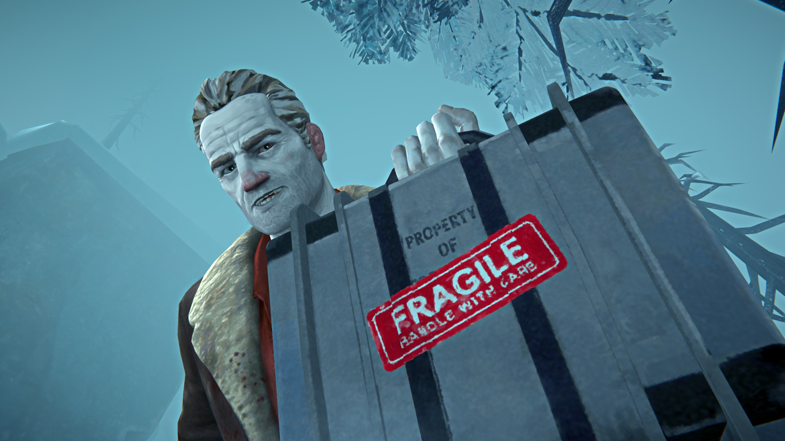
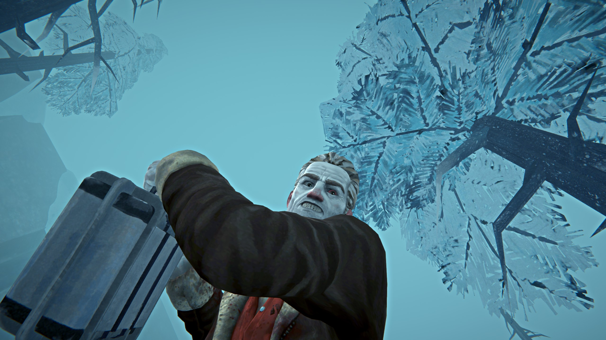

# Astrid's Hardcase

**Categories:** Pages with update history, Story items · **Source:** [Fandom](https://thelongdark.fandom.com/wiki/Astrid's_Hardcase)

**Contents**

- [Episode 1](#episode-1)
- [Memories](#memories)
- [The Crash](#the-crash)
- [Episode 2](#episode-2)
- [Episode 4](#episode-4)
- [Trivia](#trivia)
- [Update history](#update-history)

**Astrid's Hardcase**

_Astrid's\_Hardcase\_icon.png_

**General**

**Item Type:** Item

**Wintermute:** Yes\|-

**Weight:** 0 kg(0 lbs)

**Astrid's Hardcase** is a [Tool](./Tools.md) and [Collectible](./Collectibles.md) found throughout most episodes of [Wintermute](./Wintermute.md). It belongs to [Astrid Greenwood](./Astrid%20Greenwood.md) and is one of the main plot points of the Wintermute story.

## Episode 1

### Memories

> “**A protective case. It looks like it could survive just about anything.**”
>
> — In-game Description

{| style="margin:auto" | style="vertical-align:top; font-size:3em; color:#5d5980; padding-right:10px" |“ | **The mysterious case. Astrid definitely doesn't want to talk about what's inside. Which means...she's probably not supposed to have it.**

Mackenzie's Description

| style="vertical-align:bottom; font-size:3em; color:#5d5980; padding-left:10px" |” |} In the mission [Memories](./Memories.md), Astrid arrives with it at the [Jackrabbit Remote Transport](./Jackrabbit%20Hangar.md) hangar and after a short cutscene is treated as a tool. It is treated as a tool and weighs 5.00 kg, and is a required object to be placed inside the floatplane in order to progress the mission.

### The Crash

> “**Hardcase found with Astrid's backpack at the crash site.**”

It is found near the wreckage of the [crash site](./Mackenzie%27s%20Crashed%20Plane.md) in the beginning of [Episode 1](./Episode%201%20-%20Do%20Not%20Go%20Gentle.md) and is picked up by [Will Mackenzie](./Will%20Mackenzie.md) and carried for the rest of the episode. It weighs 0.00 kg after at this point and acts as a Collectible for the rest of the game.

## Episode 2

The Hardcase is carried over into [Episode 2](./Episode%202%20-%20Luminance%20Fugue.md) as a key item but does not play much role in the story until the ending cutscene, where [Mathis](./Mathis.md) finds Mackenzie and tortures him for information on how to open it. The episode ends with Mathis knocking out Mackenzie.

## Episode 4

[Episode 4](./Episode%204%20-%20Fury%2C%20Then%20Silence.md) requires the player to retrieve it once more after it is stolen by [Convicts](./Convicts.md). It is re-acquired near the end of the Episode, in the Warden's office.

## Trivia

As of Episode 4, it is revealed that the case contains the cure for an unknown illness which is affecting the inhabitants of [Perseverance Mills](./Perseverance%20Mills.md), and that [Mathis](./Mathis.md) intensely desires having the case for his own curiosity, as well as to spite [Mackenzie](./Will%20Mackenzie.md).

The Hardcase is treated as the MacGuffin for the Wintermute story, as the entire plot is centered around its safe passage and delivery, despite the fact that case is treated as nothing more than a key item that stays in the player's inventory, otherwise being unimportant gameplay wise.

At the end of [Episode 5](./Episode%205%20-%20The%20Light%20At%20The%20End%20Of%20All%20Things.md), it is revealed that the case contains experimental vaccines against [Alzheimer's](https://en.wikipedia.org/wiki/Alzheimer%27s_disease).

Gallery

_Mackenzie finding the Hardcase after crashing_

_Mathis holding the hardcase_

_Mathis striking Mackenzie over the head with the case_

_The Hardcase and [Astrid's Backpack](./Astrid%27s%20Backpack.md)_

## Update history

UPDATE **7 December 2021 ([Update](./The%20Long%20Dark%20%E2%80%94%20Changelog.md)):**

- Item description has been updated from "Hardcase found in Astrid's backpack at the crash site".
