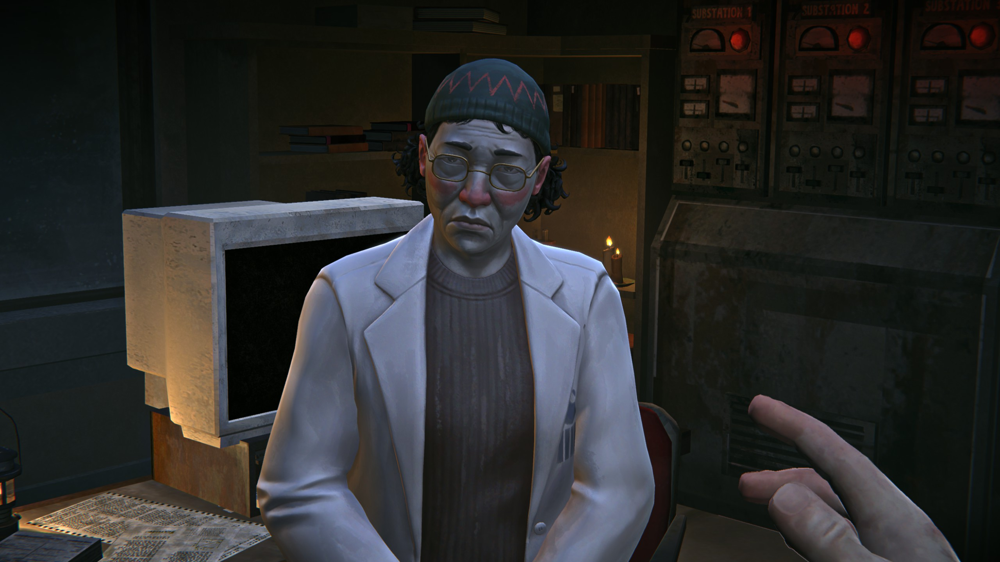
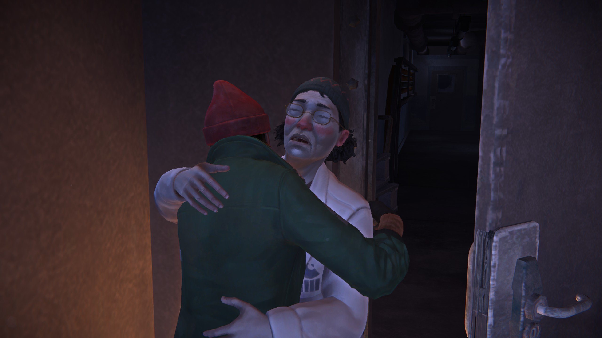

# Atwood

**Categories:** Characters, Story · **Source:** [Fandom](https://thelongdark.fandom.com/wiki/Atwood)

**Contents**

- [Episode 2](#episode-2)
- [Episode 4](#episode-4)
- [Episode 5](#episode-5)
- [Trivia](#trivia)
- [Gallery](#gallery)

**Spoiler Warning:****This page may contain spoilers from the [story](./Wintermute.md) of The Long Dark.**

**Dr. Atwood**

[Dr Atwood](../assets/Dr_Atwood.jpg)

**Wintermute:** [Episode 5: The Light At The End Of All Things](./Episode%205%20-%20The%20Light%20At%20The%20End%20Of%20All%20Things.md)

**Biographical Information**

**Status:** Alive

**Occupation:** Doctor Astrophysicist

**Physical Information**

**Sex:** Female

**Hair:** Black

**Game Information**

**Voiced by:** Mayumi Yoshida

> “**An old friend of mine, lives alone in a cabin in the hills near [Perseverance](./Perseverance%20Mills.md). Goes by the name Atwood. People in town will know how to find them. You need to get them this message as soon as possible.**”
>
> — - [Jeremiah](./Jeremiah.md)

**Dr. Janet Atwood** is a woman who lives at the [Suzuki Radio Telescope](./Suzuki%20Radio%20Telescope.md) facility, near [Perseverance Mills](./Perseverance%20Mills.md). In the final chapter of [Episode 2](./Episode%202%20-%20Luminance%20Fugue.md), [Will Mackenzie](./Will%20Mackenzie.md) promises [Jeremiah](./Jeremiah.md) that he will take a message ("_Wintermute_") to Atwood.

## Episode 2

Being unable to get a message out on the repaired shortwave radio before it is destroyed by the Aurora, Jeremiah tasks Mackenzie with delivering a message to a person named Atwood.

Jeremiah knows who Atwood is but does not reveal much about her, only referring to Atwood as "them." He instructs Mackenzie to deliver the message "Wintermute" to her in his stead (since he is unable to travel after being wounded and bed ridden by the [Old Bear](./Old%20Bear.md)), stressing the urgency of this code word and that it may be the most important message Mackenzie will ever deliver in his life, but not specifying the meaning behind it. Mackenzie eventually heads through the [Carter Hydro Dam](./Carter%20Hydro%20Dam.md) to [Signal Hill](./Signal%20Hill.md) per Jeremiah's instruction, but is ultimately captured by [Mathis](./Mathis.md).

## Episode 4

Atwood is mentioned in the opening story recap by Jeremiah.

In [Episode 4](./Episode%204%20-%20Fury%2C%20Then%20Silence.md), Atwood is revealed to be [Jace's](./Jace.md) thesis professor, which means she was probably a doctor in astrophysics and/or medicine sciences. Jace also reveals that Atwood is a woman, a detail that Jeremiah did not previously provide.

While originally staying behind to prevent the [Convicts](./Convicts.md) at [Blackrock Prison](./Blackrock%20Prison.md) from heading to the Suzuki Radio Telescope, Jace eventually recruits Mackenzie to keep them in line. Once it is revealed that the Convicts plan on overtaking the whole Island however, the duo eventually destroy the Prison in order to escape from the Convicts. The Episode ends with Mackenzie and Jace heading to Perseverance Mills to find Atwood, with the two bracing for the eventual fallout of Mathis and his gang following them to exact their revenge.

## Episode 5

Atwood is slated to appear in the upcoming [Episode 5: The Light At The End Of All Things](./Episode%205%20-%20The%20Light%20At%20The%20End%20Of%20All%20Things.md).

## Trivia

- Atwood was originally described as a woman that lived alone in a cabin near Perseverance Mills in Predux Episode 2, but this detail was changed in the Redux storyline.
- A cut side mission in Predux [Episode 2: Luminance Fugue](./Episode%202%20-%20Luminance%20Fugue.md), [Jeremiah's Hideout](./Jeremiah%27s%20Hideout.md), reveals that Jeremiah had a secret correspondent that he wrote to frequently, despite supposedly being a lonely hermit. Jeremiah tasks Mackenzie to burn [his letters](./Jeremiah%27s%20Papers.md) but not to read them, as in his words "reading them won't do you any good, so no peeking." Whether or not Atwood was the recipiant of these letters is unknown.

## Gallery

