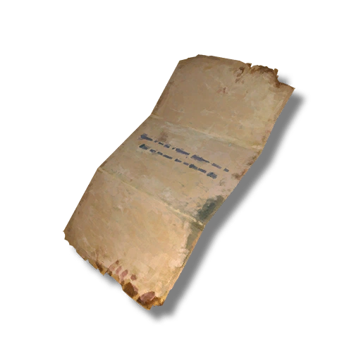

# Aurora Hatch Door Entry Code

<table class="infobox">
<caption>Aurora Hatch Door Entry Code</caption>
<colgroup>
<col style="width: 50%" />
<col style="width: 50%" />
</colgroup>
<tbody>
<tr>
<td colspan="2"><figure>

<figcaption>Aurora_Hatch_Door_Entry_Code_icon.png</figcaption>
</figure></td>
</tr>
<tr>
<td>
Release
</td>
<td>
<a href="./The%20Long%20Dark%20%E2%80%94%20Early%20Access%20Changelog.md#1.00" class="wikilink" title="1 August 2017">1 August 2017</a>
</td>
</tr>
<tr>
<td>
Wintermute
</td>
<td>
<a href="./Episode%202%20-%20Luminance%20Fugue.md" class="wikilink" title="Episode 2">Episode 2</a> - <a href="./Aurora%20Hatch.md" class="wikilink" title="Aurora Hatch">Aurora Hatch</a>
</td>
</tr>
<tr>
<td colspan="2" class="section">
<strong>Properties</strong>
</td>
</tr>
<tr>
<td>
Item type
</td>
<td>
<a href="./Collectibles.md" class="wikilink" title="Collectibles">Collectibles</a>|-
</td>
</tr>
<tr>
<td>
Stackable
</td>
<td>
No
</td>
</tr>
<tr>
<td>
Examine
</td>
<td>
Code that unlocks a door inside the aurora hatch.
</td>
</tr>
<tr>
<td colspan="2" class="section">
<strong>Values</strong>
</td>
</tr>
<tr>
<td>
Weight
</td>
<td>
0.00 kg (0 lbs)
</td>
</tr>
<tr>
<td colspan="2" class="section">
<strong>Actions</strong>
</td>
</tr>
<tr>
<td>
Backpack
</td>
<td>
Examine
</td>
</tr>
<tr>
<td>
On ground
</td>
<td>
Take It, Leave It
</td>
</tr>
</tbody>
</table>

**Aurora Hatch Door Entry Code** is a <a href="./Collectibles.md" class="wikilink" title="Collectible">Collectible</a> item found in <a href="./Episode%202%20-%20Luminance%20Fugue.md" class="wikilink" title="Episode 2">Episode 2</a> of the <a href="./Wintermute.md" class="wikilink" title="Wintermute">Wintermute</a> story mode. It is found in one of the supply caches in the hills near the <a href="./Hunting%20Lodge.md" class="wikilink" title="Hunting Lodge">Hunting Lodge</a> as part of the <a href="./Forest%20Talker%20Supply%20Caches.md" class="wikilink" title="Forest Talker Supply Caches">Forest Talker Supply Caches</a> side mission. Claiming the note starts the <a href="./Aurora%20Hatch.md" class="wikilink" title="Aurora Hatch">Aurora Hatch</a> side mission.

## Transcript

The following text is transcribed from **Aurora Hatch Door Entry Code**

Deb,

If you're reading this it's because I've left the Island and the last treatment didn't work. You're probably still out there somewhere in the woods, doing what you've been doing. I always admired that about you, even if I didn't agree. Hopefully what's left of my old bunker can be of some use to you.

Just because you hide, doesn't mean you're lost.

Remember that, and this number -- 0794. That will let you in.

\- G

## Update history

\* UPDATE **17 December 2018 (<a href="./The%20Long%20Dark%20%E2%80%94%20Changelog.md#1.41" class="wikilink" title="Update">Update</a>):**

- - Added to game.

**Lua execution error in Module:Navbox function navbox**

