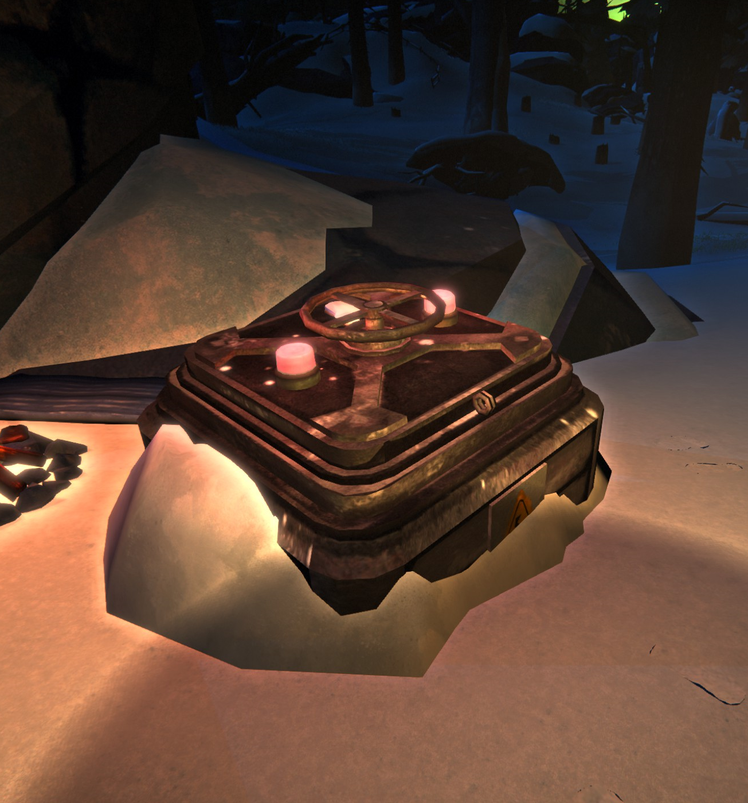
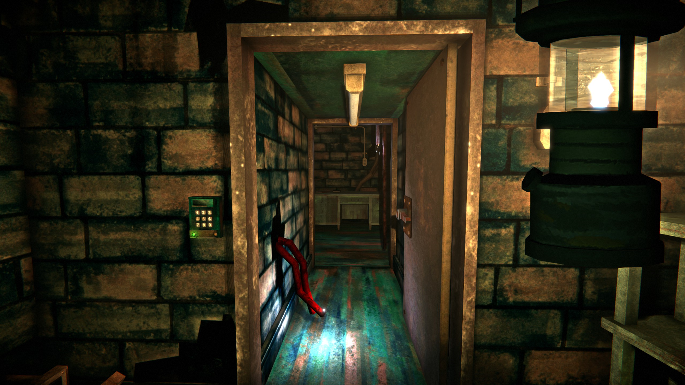

# Aurora Hatch

**Categories:** Episode 2, Pages with update history · **Source:** [Fandom](https://thelongdark.fandom.com/wiki/Aurora_Hatch)

**Contents**

- [Tasks](#tasks)
- [Walkthrough](#walkthrough)
- [Utilizing scripted aurora event](#utilizing-scripted-aurora-event)
- [Guaranteed Aurora Spawn](#guaranteed-aurora-spawn)
- [Contents/Loot](#contentsloot)
- [Trivia](#trivia)
- [Gallery](#gallery)
- [Game History](#game-history)

**Aurora Hatch**

_The Aurora Hatch._

**Episode:** [Episode 2](./Episode%202%20-%20Luminance%20Fugue.md)

**Previous:** [Mystery Lake Supply Caches](./Mystery%20Lake%20Supply%20Caches.md)

**Current:** Aurora Hatch

**Region:** [Broken Railroad](./Broken%20Railroad.md) / [Forlorn Muskeg](./Forlorn%20Muskeg.md)

**Template:spoiler**

> “**There's a hidden bunker in Forlorn Muskeg that can only be opened when the aurora is active.**”
>
> — In-game description

**Aurora Hatch** is a side mission in [Episode 2](./Episode%202%20-%20Luminance%20Fugue.md) of the [story](./Wintermute.md) and replaces the former side mission [Jeremiah's Hideout](./Jeremiah%27s%20Hideout.md), leading towards the same hatch. Completing the mission allows access to a prepper cache, which contains many supplies. However, the hatch can only be opened during an aurora. If the player does not leave the bunker by the time the aurora event has finished, the hatch may lock itself with the player still inside. Checking the time frequently while inside is advised.

## Tasks

- Locate the hidden bunker.
- Enter the bunker when the aurora is active.
- Use the code to unlock the door.

## Walkthrough

The mission is started by finding the Hunting Lodge cache from the side quest "[Mystery Lake Supply Caches](./Mystery%20Lake%20Supply%20Caches.md). It contains a letter ([Aurora Hatch Door Entry Code](./Aurora%20Hatch%20Door%20Entry%20Code.md)) leading towards the hatch which also gives you the entry code for a door inside the bunker.

The bunker is located north of the [Shortwave Tower](./Shortwave%20Tower.md) in the Forlorn Muskeg region.

Upon arriving at the bunker, the player will have to wait for an aurora to happen, which they can do e.g. directly next to the hatch in the wilderness or inside a near cave, located west of the hatch next to the waterfall. In Hardened Survivor mode, the area is guarded by three wolves, so both getting from the cave to the hatch and camping next to it might have its difficulties.

Inside the bunker, first a door has to be unlocked with the given entry code. After that, the prepper cache contains lots of food and drink and also some medical supplies.

### Utilizing scripted aurora event

It is possible to utilize the scripted aurora even which starts right after the survivor finishes forging the anti-bear spear to reach this location with much less interaction with wildlife, take an easier route through [Forlorn Muskeg](./Forlorn%20Muskeg.md) and still arrive during the aurora to open the hatch.

This method results in encounter with only 2-4 wolves and even on hardened survivor will not cause the three guarding wolves to spawn.

Brew yourself a cup of coffee as at this point the survivor is probably half tired, but do not sleep.

Walking from the [Maintenance Yard](./Maintenance%20Yard.md) to the exit of [Broken Railroad](./Broken%20Railroad.md) should be without meeting a single wolf.

After arriving to Forlorn Muskeg, hug the left cliff. With some luck this will attract 0-1 of the 2 wolves normally guarding the portion of the railtrack right in front of the Region transition. You do not necessarily have to shoot it, but ammo should be plentiful at this point.

Afterwards continue hugging the left cliffside, but beware of sprained wrists. You should see 2 other wolves in the small forest between you and the water. Shooting a wolf from safe distance, at this point, is preferred to scaring it, as it will make the other one run further away, and sometimes lock it in a "fleeing mode" where it will flee if you just aim the rifle at it (not reliable).

After dispatching these wolves continue a bit towards the Radio Tower, there is a place where the cliff (before the where the creek meets the Muskeg) has a patch of snow that is walkable, utilizing this route will make you avoid 2 more wolves outright.

After reaching the [Hat Creek](./Hat%20Creek.md) follow it upstream and take the first right, you will arrive to the forest behind the Radio Tower and should see the hatch light blinking at the other end of it, no wolves have spawned at this point.

At this point it is advised to save (there will also be a checkpoint inside but to be sure) as you do not have much time before the [Aurora](./Aurora.md) ends. Loot the prepper cache but do not stay inside, as the hatch will lock after the Aurora ends, and the travel here already used up a large portion of the time.

### Guaranteed Aurora Spawn

Upon successful completion of "[What One Man Can Do](./What%20One%20Man%20Can%20Do.md)" Main Story Mission and starting "[Renewed Hope](./Renewed%20Hope.md)," then it will guarantee an Aurora Spawn every night until you complete Episode 2. Each Aurora lasts for 6-8 hours of in-game time.

## Contents/Loot

The cache will usually contain

- **7x [Rifle Ammunition](./Rifle%20Ammunition.md)**
- **2x [Flare Shell](./Flare%20Shell.md)**
- **1x [Emergency Stim](./Emergency%20Stim.md)**
- **2x [Military-Grade MRE](./Military-Grade%20MRE.md)**
- **Decent[Cowichan Sweater](./Cowichan%20Sweater.md)**
- **New [Snow Pants](./Snow%20Pants.md)**
- [Bedroll](./Bedroll.md)
- [Flashlight](./Flashlight.md)
- 2.5l [Water (Potable)](./Water%20%28Potable%29.md)
- 3.5l [Lantern Fuel](./Lantern%20Fuel.md)
- 3x [Salty Crackers](./Salty%20Crackers.md)
- 3x [Go! Energy Drink](./Go!%20Energy%20Drink.md)
- 2x [Condensed Milk](./Condensed%20Milk.md)
- 3x [Accelerant](./Accelerant.md)
- [Cloth](./Cloth.md), [Books](./Book.md), [Painkillers](./Painkillers.md), [Antibiotics](./Antibiotics.md), [Bandages](./Bandage.md), [Stacy's Grape Soda](./Stacy%27s%20Grape%20Soda.md)
- minor loot from 8 (randomized) containers

Tested on Hardened survivor.

## Trivia

Before the REDUX Update in December 2018, this bunker was a side quest given by Jeremiah as a [Trust](./Cut%20%E2%80%94%20Discontinued%20Content.md#Trust) reward. The bunker was called Jeremiah's Hideout.

## Gallery

_The unlocked door inside the hatch._

_The Aurora Hatch._

## Game History

\* UPDATE **17 December 2018 ([Update](./The%20Long%20Dark%20%E2%80%94%20Changelog.md#1.41)):**

- Added to game.
