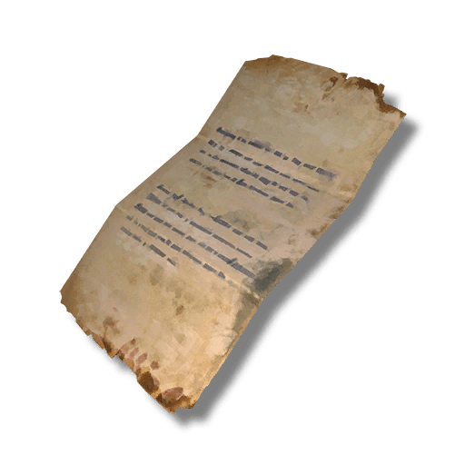

# Aurora Observations

<table class="infobox">
<caption>Aurora Observations</caption>
<colgroup>
<col style="width: 50%" />
<col style="width: 50%" />
</colgroup>
<tbody>
<tr>
<td colspan="2"><figure>

<figcaption>Aurora_Observations_icon.png</figcaption>
</figure></td>
</tr>
<tr>
<td>
Release
</td>
<td>
<a href="./The%20Long%20Dark%20%E2%80%94%20Early%20Access%20Changelog.md#1.00" class="wikilink" title="1 August 2017">1 August 2017</a>
</td>
</tr>
<tr>
<td>
Wintermute
</td>
<td>
<a href="./Episode%202%20-%20Luminance%20Fugue.md" class="wikilink" title="Episode 2">Episode 2</a>
</td>
</tr>
<tr>
<td colspan="2" class="section">
<strong>Properties</strong>
</td>
</tr>
<tr>
<td>
Item type
</td>
<td>
<a href="./Collectibles.md" class="wikilink" title="Collectibles">Collectibles</a>|-
</td>
</tr>
<tr>
<td>
Stackable
</td>
<td>
No
</td>
</tr>
<tr>
<td>
Examine
</td>
<td>
A note found at the Maintenance Shed with observations about the Aurora.
</td>
</tr>
<tr>
<td colspan="2" class="section">
<strong>Values</strong>
</td>
</tr>
<tr>
<td>
Weight
</td>
<td>
0.00 kg (0 lbs)
</td>
</tr>
<tr>
<td colspan="2" class="section">
<strong>Actions</strong>
</td>
</tr>
<tr>
<td>
Backpack
</td>
<td>
Examine
</td>
</tr>
<tr>
<td>
On ground
</td>
<td>
Take It, Leave It
</td>
</tr>
</tbody>
</table>

**Aurora Observations** is a <a href="./Collectibles.md" class="wikilink" title="Collectible">Collectible</a> item found in <a href="./Episode%202%20-%20Luminance%20Fugue.md" class="wikilink" title="Episode 2">Episode 2</a> of the <a href="./Wintermute.md" class="wikilink" title="Wintermute">Wintermute</a> story mode. It is found in the <a href="./Maintenance%20Yard.md" class="wikilink" title="Maintenance Yard">Maintenance Yard</a> office building on the computer where the medic <a href="./Buffer%20Memories.md" class="wikilink" title="Buffer Memory">Buffer Memory</a> is in <a href="./Survival%20Mode.md" class="wikilink" title="Survival Mode">Survival Mode</a>.

## Transcript

The following text is transcribed from **Aurora Observations**

Those lights in the sky are doing some funny things to the machines around here. We found this old shed, and the computers started turning on by themselves, lamps lighting up. We've been trying to call down the main office when the aurora or whatever it's called is out, but we're not getting through. Can't tell if the phones even work. There are just a handful of us from the winter crew holed up here. Some of them want to try for the Coast and the settlements there. If you find this, that's where we've gone.

We're still hoping Breyerhouse sends a team up before it comes to that. Even with the fire barrel we brought indoors, it's a bitter cold.

## Update history

\* UPDATE **17 December 2018 (<a href="./The%20Long%20Dark%20%E2%80%94%20Changelog.md#1.41" class="wikilink" title="Update">Update</a>):**

- - Added to game.

**Lua execution error in Module:Navbox function navbox**

