# Aurora

**Categories:** Environment · **Source:** [Fandom](https://thelongdark.fandom.com/wiki/Aurora)

**Contents**

- [Overview](#overview)
- [Effects](#effects)
- [Gameplay](#gameplay)
- [Survival Mode](#survival-mode)
- [Wintermute](#wintermute)
- [Electronically Locked Doors](#electronically-locked-doors)
- [Milling Machine](#milling-machine)
- [Hazards](#hazards)
- [Animal Behavior](#animal-behavior)
- [Electrified Hazards](#electrified-hazards)
- [Entrapment Hazard](#entrapment-hazard)
- [Trivia](#trivia)
- [Gallery](#gallery)

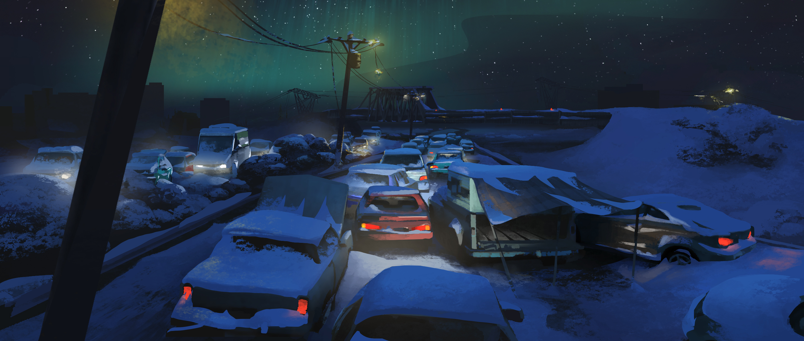_Story mode concept art of aurora affecting the electronics in street lights and vehicles._
> **Mackenzie: "So...this is some kind of reoccurring aurora borealis?"**
>
> Methuselah: "Possibly."
>
> Mackenzie: "And it's...affecting the electricity? The power?"
>
> Methuselah: "And everything dependent on it. Animating it. Or destroying it. Perhaps both."
>
> Mackenzie: "And, you...knew this was coming?"
>
> Methuselah: "No. But it was only a mater of time. This has all happened before."
>
>
> — [Methuselah](./Methuselah.md) explaining the Aurora to [Mackenzie](./Will%20Mackenzie.md)

The **Aurora** is a type of weather in _[The Long Dark](./The%20Long%20Dark.md)_. They are a reoccurring phenomenon that is the result of a [geo-magnetic storm](./First%20Flare.md) which ended civilization on Earth. Auroras create bright, colorful lights in the night sky, make predators more dangerous, and temporarily power electronics like the [Flashlight](./Flashlight.md).

## Overview

Auroras are unusual weather events on [Great Bear Island](./Great%20Bear%20Island.md) similar to the Northern Lights (Aurora Borealis), where bright, multi-colored lights are visible in the night sky. The Aurora is unusual in that it makes [predators](./Wildlife.md) more dangerous (while herbivores flee), and temporarily powers electronics (e.g. [Handheld Shortwave Radio](./Handheld%20Shortwave%20Radio.md), Flashlight, vehicle headlights, and hazards like [exposed wires](./Burns.md)). The post-apocalyptic setting of The Long Dark takes place after the [First Flare](./First%20Flare.md), the first such aurora which destroyed civilization. The cause of these unnatural auroras is unknown, but may be the result of an aggressive [Coronal Mass Ejection](https://en.wikipedia.org/wiki/Coronal_mass_ejection).

The Aurora has a set percentage set of occurring several times in a single night. Each potential aurora moment is checked internally to see if the game will start the event. The Aurora can first occur at dusk, which is noticeable because there is a chance that the Aurora sound cue and music will start playing before the sun sets completely and the player will be able to see the Aurora lights in the sky overtop the sunset colors. This first type will usually stop around one third of the night through. The second potential time for an Aurora to start happens roughly after a quarter of the night has passed. The last potential Aurora start time is at the very end of the night, from about two hours before sunrise to nearly starting at the same time as the first dawn colors appear. This last Aurora type is the shortest of the three, lasting sometimes as short as two hours.

- During an aurora, predators are more dangerous and electrified hazards are present in industrial areas via electrified wires.
- Like clear daytime weather, Auroras allow [Surveying](./Charcoal.md) but do not allow the use of [Magnifying Lens](./Magnifying%20Lens.md) to start campfires.
- Auroras count as light for the purpose of reading a [Research Book](./Research%20Book.md).
- The night after a [Transmitter](./Transmitters.md) is repaired will always be an aurora. Note that the aurora will happen after the last item required for the repair is inserted, even if the Transmitter hasn't been switched on yet.
- Completing a trade at night at the [Trade Drop Box](./Trade%20Drop%20Box.md) will instantly trigger an aurora as long as there is enough time left in the night. If the trade is completed during the day, the aurora will always trigger on the following night.
- The daytime equivalent to the Aurora is [Glimmer Fog](./Glimmer%20Fog.md), which only occurs in regions of [The Far Territory](./Far%20Range%20Branch%20Line.md) (though it does not create aurora predators and creates [Afflictions](./Insomnia.md) that the Aurora does not).

## Effects

Auroras shares similarities with Glimmer Fog, but both weather types are distinct.

**Aurora and Glimmer Fog Properties**

|  | Aurora | Glimmer Fog |
| --- | --- | --- |
| Occurs | Night | Day |
| Powers Electronics | Yes | Yes |
| Aurora Predators | Yes | No |
| Electrocution Hazard | Yes | No |
| Insomnia Risk | No | Yes |
| Occurs In | Any Region | Far Territory |

Note: [Flashlights](./Flashlight.md) "high beam" mode are effective deterrents against aurora predators (during an Aurora); however, although the [Glimmer Fog](./Glimmer%20Fog.md) will also power them, flashlights will be ineffective at deterring non-aurora predators during the dynamic event.

## Gameplay

Aurora frequency is based on game mode and region. More challenging modes (e.g. [Interloper](./Interloper.md) in Sandbox, Hardened Survivor in [Wintermute](./Wintermute.md)) have more frequent weather changes and more auroras. Aurora frequency is one of the settings in Custom Mode, allowing the player to choose how common auroras will be. Each region has its own custom level for weather and dynamic events: [Bleak Inlet](./Bleak%20Inlet.md), [Blackrock](./Blackrock.md) and [Coastal Highway](./Coastal%20Highway.md) having the highest chance of aurora per night. In [Wintermute](./Wintermute.md), the first aurora (The First Flare) begins during a cutscene, with following auroras in [Episode 2: Luminance Fugue](./Episode%202%20-%20Luminance%20Fugue.md) and onward. A Wintermute-exclusive elevator at the [Carter Hydro Dam](./Carter%20Hydro%20Dam.md) in [Mystery Lake](./Mystery%20Lake%20%28region%29.md) becomes operational during Episode 2. Auroras are also more common during the [Archivist](./Archivist.md) [challenge](./Challenge.md).

### Survival Mode

In **[Survival Mode](./Survival%20Mode.md)** and most challenges, auroras are uncommon but can occur in any region at night. When the Aurora is active, all electronics will come to life, including your own tools like the [Flashlight](./Flashlight.md) and the [Radio](./Handheld%20Shortwave%20Radio.md). House lights flicker; car high beams will turn on and off, streets will be illuminated by lampposts once more; signs advertising the [Quonset Garage](./Quonset%20Garage.md) or [Orca Gas Station](./Orca%20Gas%20Station.md) can be seen from afar; [computers](./Computer.md) will turn on, sometimes revealing information from before the Flare in the form of [Buffer Memories](./Buffer%20Memories.md) collectibles; TVs will buzz with static, radios in buildings and [cars](./Car.md) can be interacted with and, if they are turned on, will play classical music. In [Survival Mode](./Survival%20Mode.md), the elevator that leads down to the lower section of the [Cinder Hills Coal Mine](./Cinder%20Hills%20Coal%20Mine.md) in Coastal Highway (located near the [Log Sort](./Log%20Sort.md)) becomes temporarily operational, allowing the player to access an entire underground area with high-level loot and many hazards brought on by the electricity.

Auroras have two distinct "power stages". Roughly one in-game hour after the start, the aurora reaches its full power. Likewise, roughly one hour before the end, the aurora descends to its buildup stage. Until then, only some of the effects listed below occur. Hard Interrupts occur at the start and end of the full power stage. For example predators will immediately run away, even if currently stalking or even mauling the player.

**Aurora Stage**

|  | Aurora Buildup | Full power |
| --- | --- | --- |
| Powers Shortwave Radio &amp; Flashlight | Yes | Yes |
| Powers Artificial Light | No | Yes |
| Trackable Shortwave Radio Signals | No | Yes |
| Interaction with Electronically Locked Doors | Yes | Yes |
| Interaction with Milling Machine | No | Yes |
| Electrocution Hazard | Yes | Yes |
| Aurora Wildlife | No | Yes |

The [flashlight's](./Flashlight.md) battery can be recharged when the aurora is active. However, it will immediately die when the aurora ceases, rendering the flashlight useless until the next aurora.

### Wintermute

In **[Story mode](./Wintermute.md)** the aurora first appears during a cutscene near the start of the game, with Will [Mackenzie](./Will%20Mackenzie.md) waking after a [plane crash](./Episode%201%20-%20Do%20Not%20Go%20Gentle.md). This initial, intensely bright aurora is hereafter referred to as the "First Flare", where it destroys most electronic technology. Further auroras appear in [Episode 2](./Episode%202%20-%20Luminance%20Fugue.md), and periodically afterwards.

The cause of the auroras and their effect on electrical devices are not fully explained in Wintermute. Their impact on electrical systems and the unusual brilliance, along with The Long Dark's store description and survivor sandbox prompt text describes their cause as a "geo-magnetic storm", which could mean a powerful solar flare, or coronal mass ejection (CME) from The Sun hitting Earth, similar to [The Carrington Event](https://en.wikipedia.org/wiki/Carrington_Event).

### Electronically Locked Doors

Bulkhead-style doors in [Last Resort Cannery](./Last%20Resort%20Cannery.md) ([Bleak Inlet](./Bleak%20Inlet.md)) and [Blackrock Prison](./Blackrock%20Prison.md) ([Blackrock](./Blackrock.md)) are electrically powered, and can only be opened during an active aurora. Both doors additionally require a passcode to unlock (by using their [Keypad](./Keypad.md), which must also be powered). Once these doors are opened they do not require additional auroras to be traversed.

### Milling Machine

[Milling Machines](./Milling%20Machine.md) are electrically powered devices used to repair damaged [tools](./Tools.md) and [firearms](./Hunting%20Rifle.md). They may only be found in the [Last Resort Cannery](./Last%20Resort%20Cannery.md) ([Bleak Inlet](./Bleak%20Inlet.md)) and [Blackrock Prison](./Blackrock%20Prison.md) ([Blackrock](./Blackrock.md)), and require an active aurora and [scrap metal](./Scrap%20Metal.md) to operate. 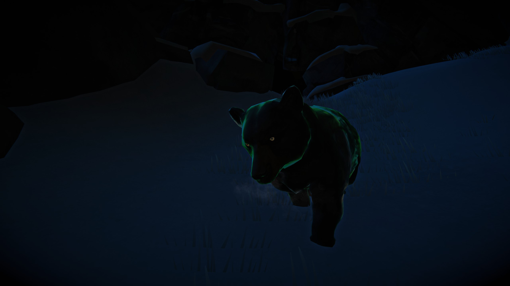_A bear during an aurora_

## Hazards

### Animal Behavior

Predators during an aurora are upgraded to "Aurora Predators", which are more aggressive (detection radius) and dangerous (more health). When an aurora begins wildlife will flee and be replaced with their aurora counterparts (e.g. Wolf -&gt; Aurora Wolf). Herbivores (Rabbit, Deer) will flee during an aurora, and not re-appear until it ends; fish and crows are unaffected by auroras.

Aurora wildlife have a green iridescent glow to their fur and their eyes glow yellow.

Light sources which wildlife fear (lit [torch](./Torch.md), [campfires](./Campfire.md)) are ineffective against aurora predators; however aurora wildlife fear artificial lights which become powered during auroras (streetlamps, vehicle headlights, flashlight's "high beam" mode).

**Animal Fear**

|  | Non-Aurora | Aurora | Aurora Poisoned Wolf |
| --- | --- | --- | --- |
| Torch | Yes | No | No |
| Campfire | Yes | No | No |
| Flare | Yes | Yes | No |
| Marine Flare | Yes | Yes | No |
| Streetlights/etc. | No | Yes | Yes |
| Flashlight | No | Yes | Yes |
| Gunshot/explosives | Yes | Yes | Yes |

### Electrified Hazards

Auroras provide temporary power to exposed electrical wiring on the floor or hanging from the ceiling and will electrify water sources that have wires in them. These wires/water sources are extremely dangerous and can kill in seconds. Each brush with a wire will instantly give a [Burn affliction](./Burns.md) to the player, reducing their condition by 25% per touch. Standing on a wire or in electrified water will give repeated instances of Burns, killing the player in four 25% ticks of damage. This usually takes less than two seconds.

Walking on exposed wiring/water when no aurora is present is safe, but caution should be taken during the night, as the weather could change to an aurora and electrify the survivor, especially during time acceleration while standing on/in a hazard (sleeping, passing time, crafting, harvesting, etc).

In Survival Mode, exposed wires and electrified water can be found in:

- [Mystery Lake](./Mystery%20Lake%20%28region%29.md): Carter Hydro Dam &amp; Environs; Upper and Lower
- [Broken Railroad](./Broken%20Railroad.md): Maintenance Yard
- [Coastal Highway](./Coastal%20Highway.md): Cinder Hills Coal Mine
- [Bleak Inlet](./Bleak%20Inlet.md): Last Resort Cannery

### Entrapment Hazard

The [Cinder Hills Coal Mine](./Cinder%20Hills%20Coal%20Mine.md) features an electric elevator which must be powered by an active aurora to go down to the rest of the mine. This elevator can only be used during an aurora. If the weather changes while the survivor is inside the mine, they will become trapped until the next aurora, potentially for many days, making it likely they will starve, dehydrate or die from [cabin fever](./Cabin%20Fever.md).

## Trivia

- Auroras are a real-world phenomena of brightly colored lights in the sky, normally only visible at high latitudes (close to the north or south poles). They can occur during the day, but are normally too dim to be seen except at night. They are created when radiation from The Sun enters the Earth's magnetosphere.

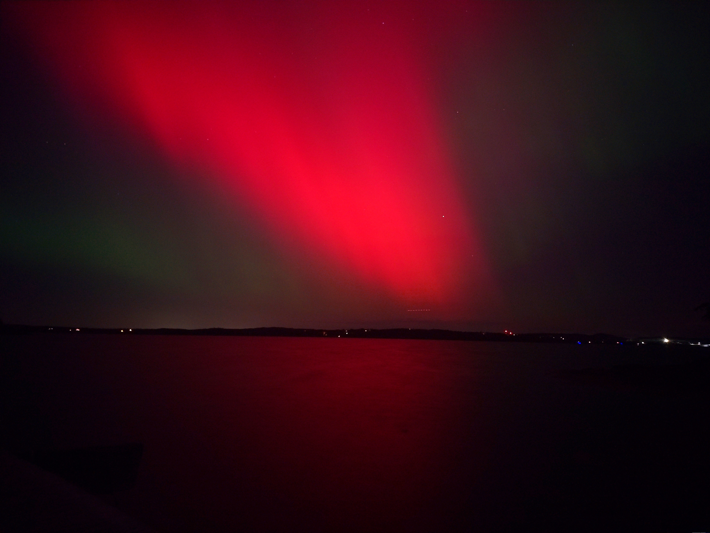

- [The Carrington Event](https://en.wikipedia.org/wiki/Carrington_Event) may be an inspiration for _The Long Dark_. Like "The First Flare", it was a geo-magnetic storm during the 1–2 of September 1859. It resulted in widespread auras at low latitudes: Hawaii, Cuba, Queensland, Japan and Colombia. It caused telegraph pylons to throw sparks, shocked operators, powered telegraphs (even when turned off), and was bright enough to allow reading at night.

- Radios found in buildings or inside vehicle consoles can be turned on/off through interaction. If "on" during an aurora, they will play "Glenn Gould performing Bach: Goldberg Variations, BWV988 - Variation 6 Canon"
- Desktop and Laptop Computers found in many locations can be interacted with during an aurora to receive a collectible "Buffer Memory", a short textual note or email from various characters.
- "Buffer Memory" in computer science are a region of a memory used to temporarily store data while being moved. This may suggest that auroras not only damage and power electronics, but move or manipulate data. 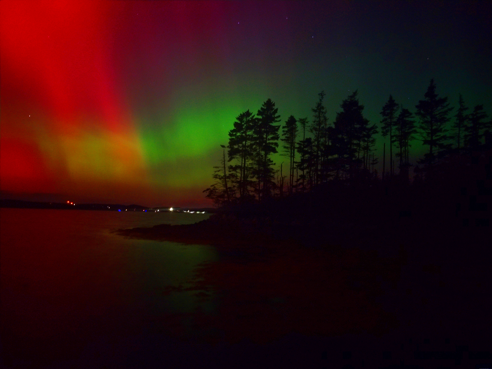_Another shot of the real-world aurora in Nova Scotia, October 2024._

## Gallery

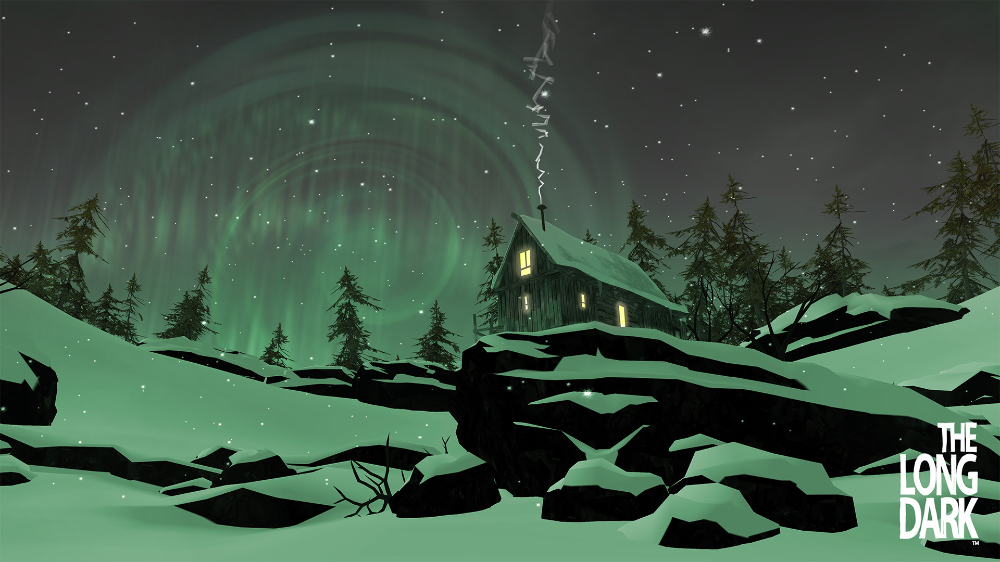

_Aurora behind [Trapper's Homestead](./Trapper%27s%20Homestead.md) _(early alpha)__

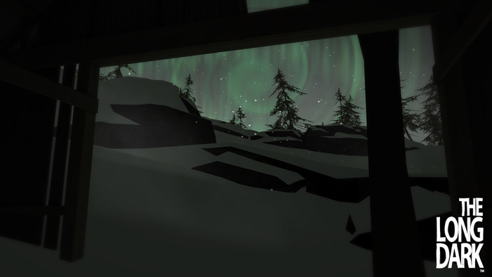

_Aurora _(early alpha)__

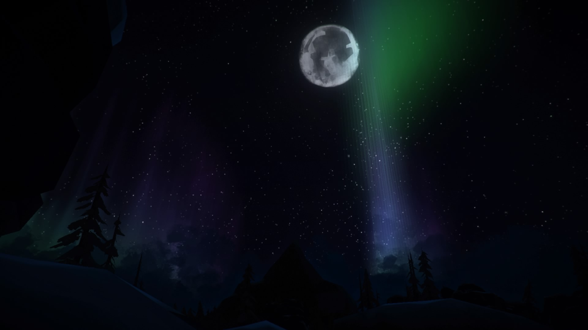

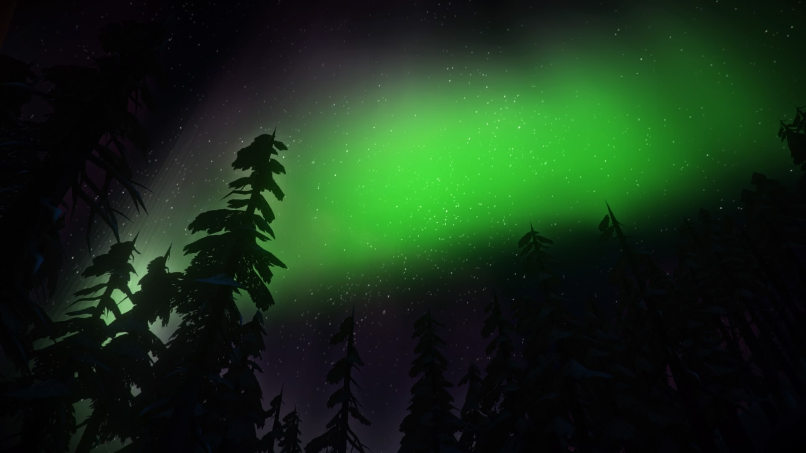

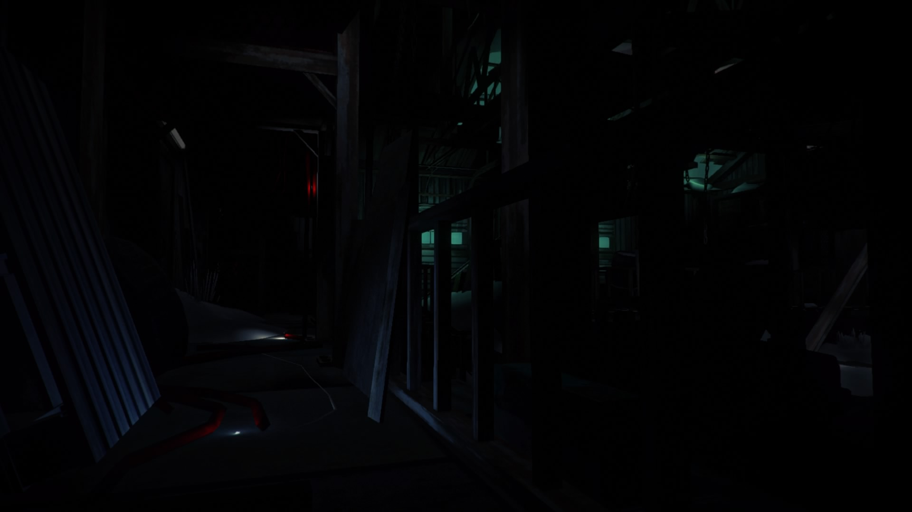

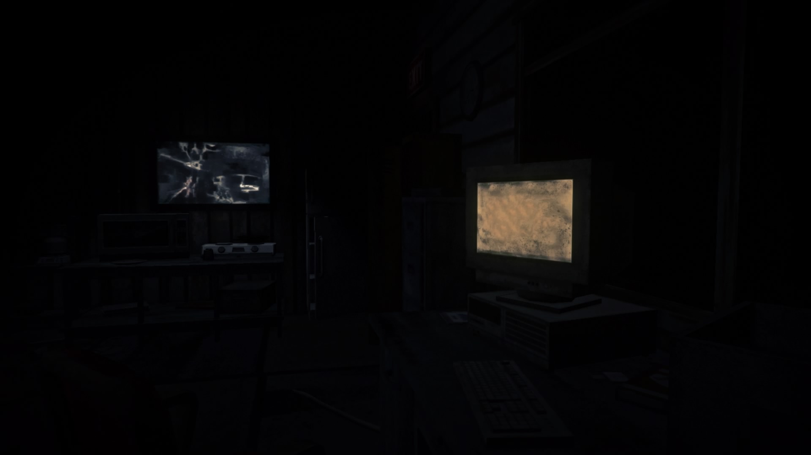

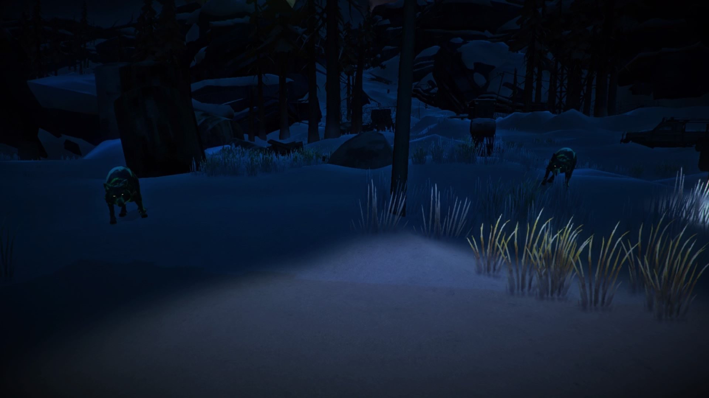

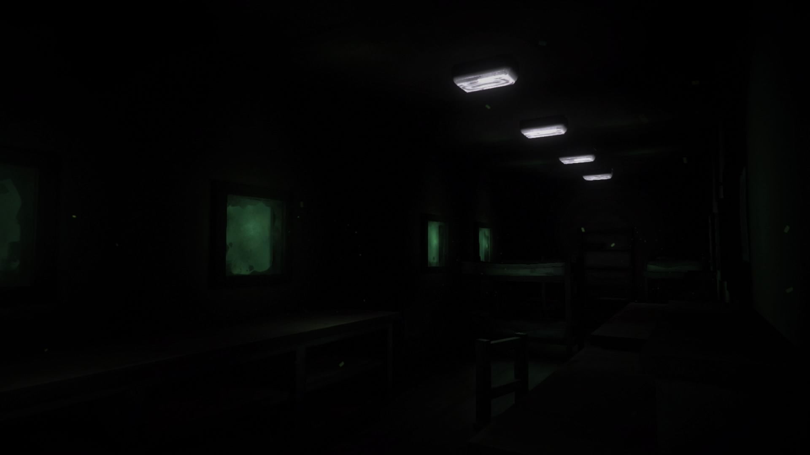

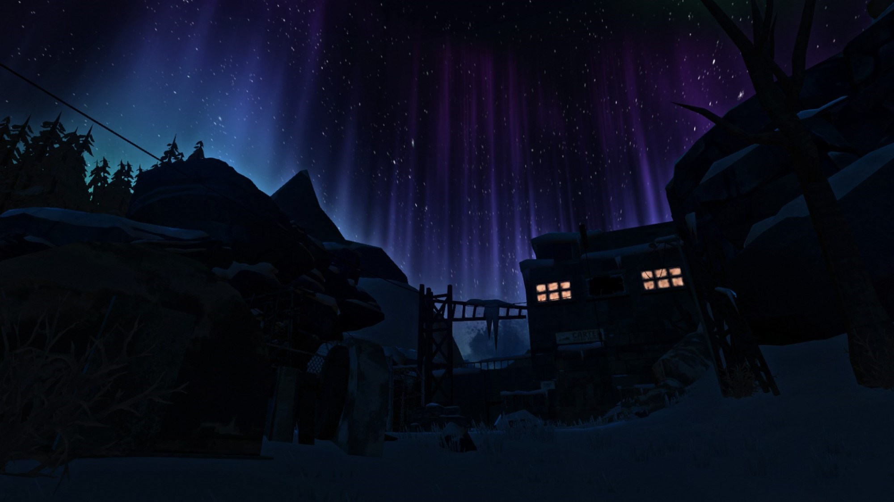

_The [Carter Hydro Dam](./Carter%20Hydro%20Dam.md) during an aurora_

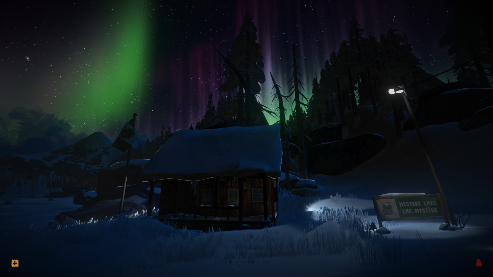

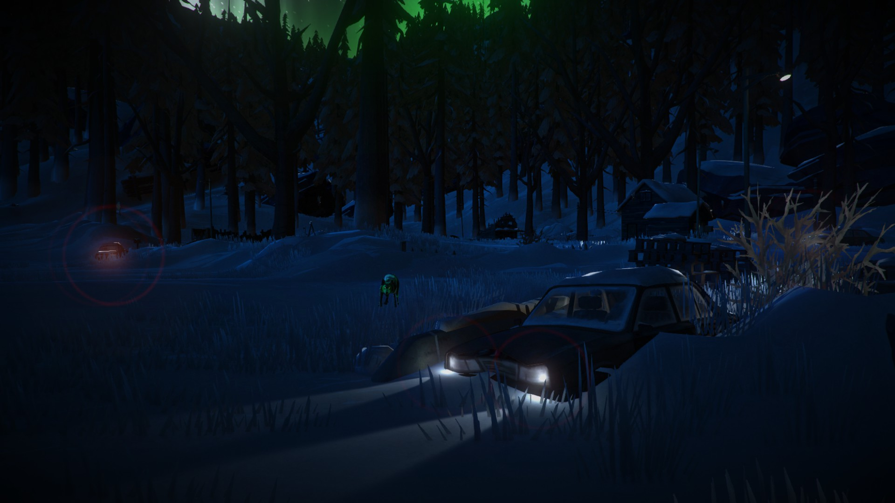

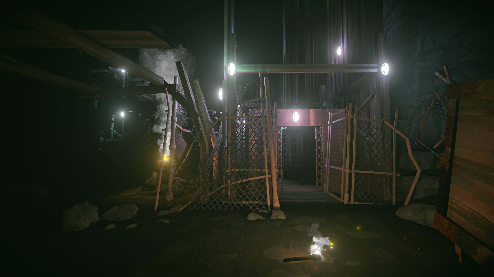

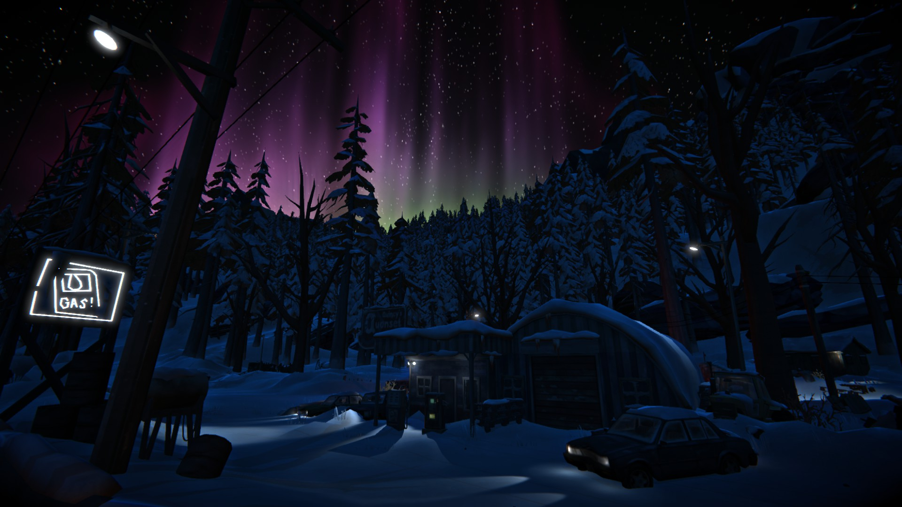

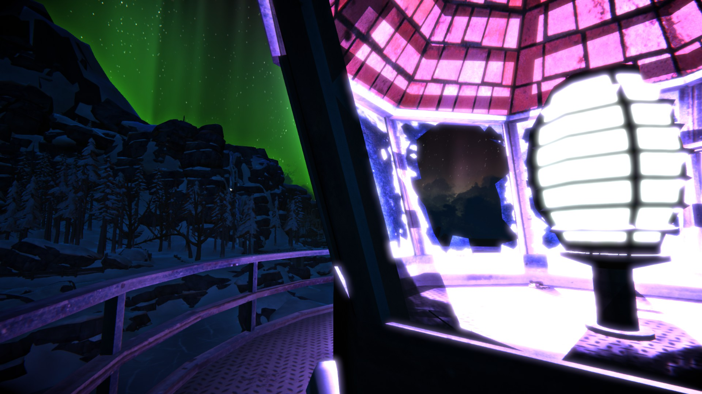

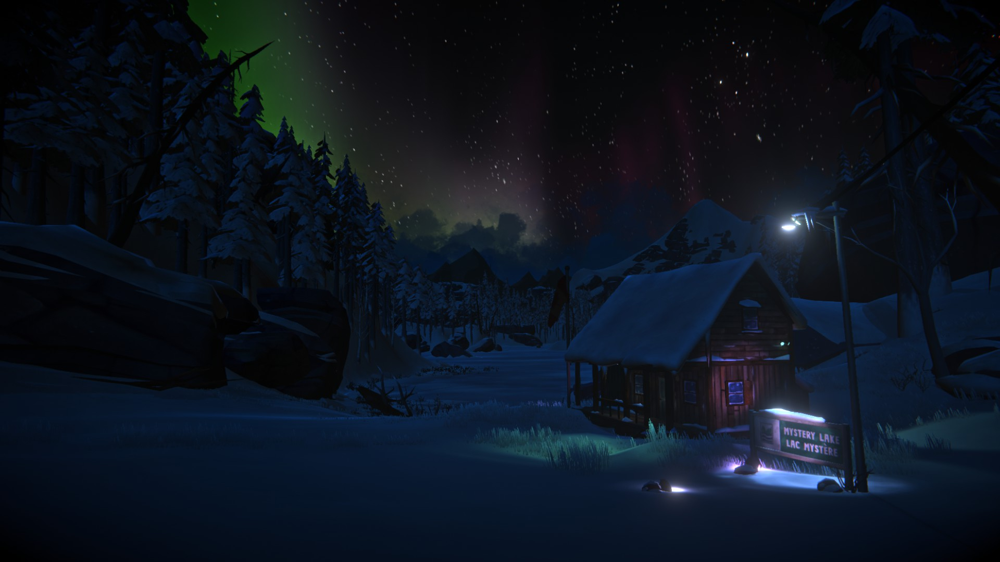

[es:Aurora Boreal](https://es.wikipedia.org/wiki/Aurora_Boreal) [ru:Полярное сияние](https://ru.wikipedia.org/wiki/%D0%9F%D0%BE%D0%BB%D1%8F%D1%80%D0%BD%D0%BE%D0%B5_%D1%81%D0%B8%D1%8F%D0%BD%D0%B8%D0%B5) [fr:Aurore Boréale](https://fr.wikipedia.org/wiki/Aurore_Bor%C3%A9ale)
