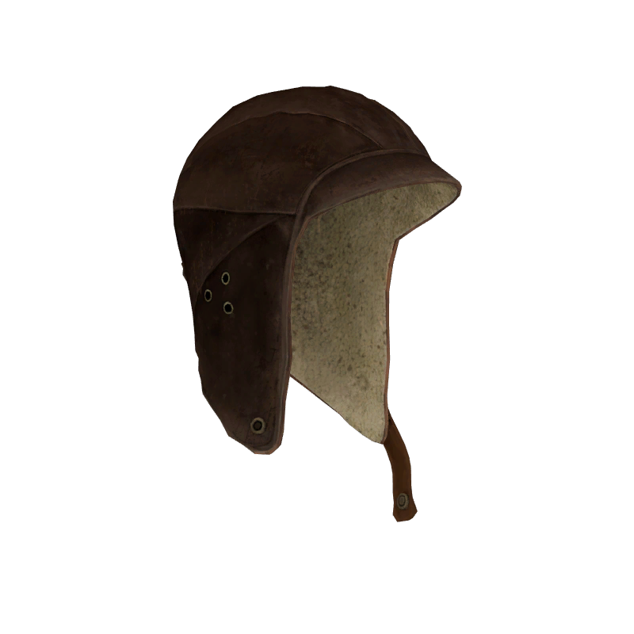

# Aviator Cap

**Categories:** Clothing, DLC Content, Pages with update history · **Source:** [Fandom](https://thelongdark.fandom.com/wiki/Aviator_Cap)

**Aviator Cap**

[Aviator Cap icon](../assets/Aviator_Cap_icon.png)

**General**

**Item Type:** Clothing

**Renewable:** Yes ([Trader](./Trader.md) or very rarely through [Beachcombing](./Beachcombing.md))

**Clothing Slot:** Head

**Statistics**

**Weight:** [Weight icon](../assets/Weight_icon.png)0.30 kg(0.66 lbs)

**Warmth bonus:** [Temp icon](../assets/Temp_icon.png)2.0 °C(3.6 °F)

**Windproof bonus:** [Windproofness icon](../assets/Windproofness_icon.png)2.0 °C(3.6 °F)

**Waterproof bonus:** [Waterproofness icon](../assets/Waterproofness_icon.png)30%

**Protection:** [Protection icon](../assets/Protection_icon.png)4%

**Mobility:** [Mobility icon](../assets/Mobility_icon.png)0%

**Harvest:** 1 × [Cured Leather](./Cured%20Leather.md) 10 minutes

**Repair:** 1 × [Cured Leather](./Cured%20Leather.md) 25 minutes 60% condition

**DLC-Exclusive content.**

This content requires the [Tales from the Far Territory](./Tales%20from%20the%20Far%20Territory.md) addon to be installed before it can be seen or used in regular gameplay.

> “**A warm, durable hat favoured by pilots operating in the frozen North. Stylish, to a point.**”

**Aviator Cap** is a type of clothing in The Long Dark. It is part of the [Tales from the Far Territory](./Tales%20from%20the%20Far%20Territory.md) DLC.

## Overview

Aviator Caps are a rare hat with superior stats to the crafted [Rabbitskin Hat](./Rabbitskin%20Hat.md) (0.05kg lighter, and 0.5*C more windproof), making it the third best outer-layer hat after the [Cougar Hide Wrap](./Cougar%20Hide%20Wrap.md) and the [Wolfskin Hat](./Wolfskin%20Hat.md). Like other clothing made of [Cured Leather](./Cured%20Leather.md), Aviator Caps are considerably more durable than cloth or animal hide clothing (losing less condition over time, from blizzards, or animals struggles) but requires Cured Leather for repair.

Aviator Caps spawn rarely on all game modes.

## Locations

- Inside [Main Hangar](./Main%20Hangar.md) in [Forsaken Airfield](./Forsaken%20Airfield.md), on the bed in the basement.
- Inside [Mindful Cabin](./Mindful%20Cabin.md) in [Forsaken Airfield](./Forsaken%20Airfield.md).
- Inside [Camp Office](./Camp%20Office.md) in [Mystery Lake](./Mystery%20Lake%20%28region%29.md).
- Inside the [Mountaineer's Hut](./Mountaineer%27s%20Hut.md) in [Timberwolf Mountain](./Timberwolf%20Mountain.md).
- Inside a container in the Abandoned Mine, in [Blackrock](./Blackrock.md).
- Inside aircraft crashes found in multiple regions.
- Inside fishing boats that spawn through [Beachcombing](./Beachcombing.md).
- Inside fishing huts.
- Inside vehicles.
- On a corpse, Narrow Falls Cave, Ash Canyon

## Update history

- UPDATE **30 March 2023 ([Update](./The%20Long%20Dark%20%E2%80%94%20Changelog.md#2.10)):**
  - Added to game.
