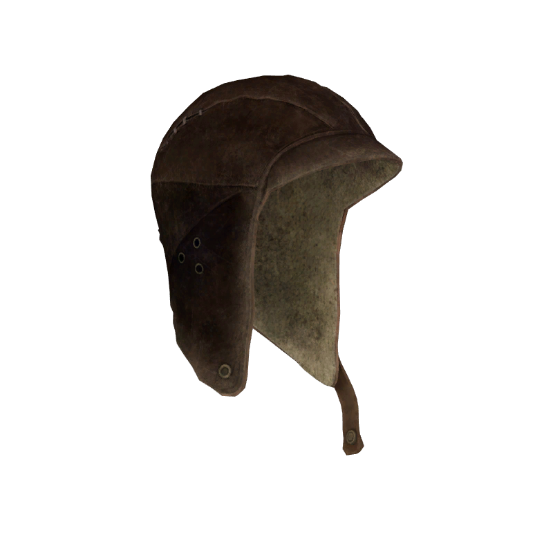

# Aviator Cap

<table class="infobox">
<caption>Aviator Cap</caption>
<colgroup>
<col style="width: 50%" />
<col style="width: 50%" />
</colgroup>
<tbody>
<tr>
<td colspan="2"><figure>

<figcaption>Aviator_Cap_icon.png</figcaption>
</figure></td>
</tr>
<tr>
<td colspan="2" class="section">
<strong>General</strong>
</td>
</tr>
<tr>
<td>
Item Type
</td>
<td>
Clothing|-
</td>
</tr>
<tr>
<td>
Renewable
</td>
<td>
Yes (<a href="./Trader.md" class="wikilink" title="Trader">Trader</a> or very rarely through <a href="./Beachcombing.md" class="wikilink" title="Beachcombing">Beachcombing</a>)
</td>
</tr>
<tr>
<td>
Clothing Slot
</td>
<td>
Head
</td>
</tr>
<tr>
<td colspan="2" class="section">
<strong>Statistics</strong>
</td>
</tr>
<tr>
<td>
Weight
</td>
<td>
0.30 kg(0.66 lbs)
</td>
</tr>
<tr>
<td>
Warmth bonus
</td>
<td>
2.0 °C(3.6 °F)
</td>
</tr>
<tr>
<td>
Windproof bonus
</td>
<td>
2.0 °C(3.6 °F)
</td>
</tr>
<tr>
<td>
Waterproof bonus
</td>
<td>
30%
</td>
</tr>
<tr>
<td>
Protection
</td>
<td>
4%
</td>
</tr>
<tr>
<td>
Mobility
</td>
<td>
0%
</td>
</tr>
<tr>
<td>
Harvest
</td>
<td>
1 × <a href="./Cured%20Leather.md" class="wikilink" title="Cured Leather">Cured Leather</a> 
10 minutes
</td>
</tr>
<tr>
<td>
Repair
</td>
<td>
1 × <a href="./Cured%20Leather.md" class="wikilink" title="Cured Leather">Cured Leather</a> 
25 minutes 
60% condition
</td>
</tr>
</tbody>
</table>

<table>
<colgroup>
<col style="width: 33%" />
<col style="width: 33%" />
<col style="width: 33%" />
</colgroup>
<tbody>
<tr>
<td width="40px"><figure>
[Missing image: Ptarmigan_icon.png]
<figcaption>Ptarmigan_icon.png</figcaption>
</figure></td>
<td>
<strong>DLC-Exclusive content.</strong> 

This content requires the <a href="./Tales%20from%20the%20Far%20Territory.md" class="wikilink" title="Tales from the Far Territory">Tales from the Far Territory</a> addon to be installed before it can be seen or used in regular gameplay.

</td>
<td>
|}

<table>
<tbody>
<tr>
<td style="vertical-align: top; font-size: 3em; color: #5d5980; padding-right: 10px">
“
</td>
<td>
A warm, durable hat favoured by pilots operating in the frozen North. Stylish, to a point.
</td>
<td style="vertical-align: bottom; font-size: 3em; color: #5d5980; padding-left: 10px">
”
</td>
</tr>
</tbody>
</table>

<strong>Aviator Cap</strong> is a type of clothing in The Long Dark. It is part of the <a href="./Tales%20from%20the%20Far%20Territory.md" class="wikilink" title="Tales from the Far Territory">Tales from the Far Territory</a> DLC.

<h2 id="Overview">Overview</h2>

Aviator Caps are a rare hat with superior stats to the crafted <a href="./Rabbitskin%20Hat.md" class="wikilink" title="Rabbitskin Hat">Rabbitskin Hat</a> (0.05kg lighter, and 0.5*C more windproof), making it the third best outer-layer hat after the <a href="./Cougar%20Hide%20Wrap.md" class="wikilink" title="Cougar Hide Wrap">Cougar Hide Wrap</a> and the <a href="./Wolfskin%20Hat.md" class="wikilink" title="Wolfskin Hat">Wolfskin Hat</a>. Like other clothing made of <a href="./Cured%20Leather.md" class="wikilink" title="Cured Leather">Cured Leather</a>, Aviator Caps are considerably more durable than cloth or animal hide clothing (losing less condition over time, from blizzards, or animals struggles) but requires Cured Leather for repair.

Aviator Caps spawn rarely on all game modes.

<h2 id="Locations">Locations</h2>
<ul>
<li>Inside <a href="./Main%20Hangar.md" class="wikilink" title="Main Hangar">Main Hangar</a> in <a href="./Forsaken%20Airfield.md" class="wikilink" title="Forsaken Airfield">Forsaken Airfield</a>, on the bed in the basement.</li>
<li>Inside <a href="./Mindful%20Cabin.md" class="wikilink" title="Mindful Cabin">Mindful Cabin</a> in <a href="./Forsaken%20Airfield.md" class="wikilink" title="Forsaken Airfield">Forsaken Airfield</a>.</li>
<li>Inside <a href="./Camp%20Office.md" class="wikilink" title="Camp Office">Camp Office</a> in <a href="./Mystery%20Lake%20%28region%29.md" class="wikilink" title="Mystery Lake">Mystery Lake</a>.</li>
<li>Inside the <a href="./Mountaineer%27s%20Hut.md" class="wikilink" title="Mountaineer&#39;s Hut">Mountaineer's Hut</a> in <a href="./Timberwolf%20Mountain.md" class="wikilink" title="Timberwolf Mountain">Timberwolf Mountain</a>.</li>
<li>Inside a container in the Abandoned Mine, in <a href="./Blackrock.md" class="wikilink" title="Blackrock">Blackrock</a>.</li>
<li>Inside aircraft crashes found in multiple regions.</li>
<li>Inside fishing boats that spawn through <a href="./Beachcombing.md" class="wikilink" title="Beachcombing">Beachcombing</a>.</li>
<li>Inside fishing huts.</li>
<li>Inside vehicles.</li>
<li>On a corpse, Narrow Falls Cave, Ash Canyon</li>
</ul>
<table class="gallery">
<colgroup>
<col style="width: 50%" />
<col style="width: 50%" />
</colgroup>
<tbody>
<tr>
<td><figure>

<figcaption>Model icon</figcaption>
</figure></td>
<td><figure>

<figcaption>Model icon damaged</figcaption>
</figure></td>
</tr>
</tbody>
</table>
<h2 id="Update_history">Update history</h2>

<ul>
<li>UPDATE <strong>30 March 2023 (<a href="./The%20Long%20Dark%20%E2%80%94%20Changelog.md#2.10" class="wikilink" title="Update">Update</a>):</strong>
<ul>
<li>Added to game.</li>
</ul></li>
</ul>

<strong>Lua execution error in Module:Navbox function navbox</strong> <a href="ru:%D0%93%D0%BE%D0%BB%D0%BE%D0%B2%D0%BD%D0%BE%D0%B9_%D1%83%D0%B1%D0%BE%D1%80_%D0%BB%D1%91%D1%82%D1%87%D0%B8%D0%BA%D0%B0" class="wikilink" title="ru:Головной убор лётчика">ru:Головной убор лётчика</a>
</td>
</tr>
</tbody>
</table>

