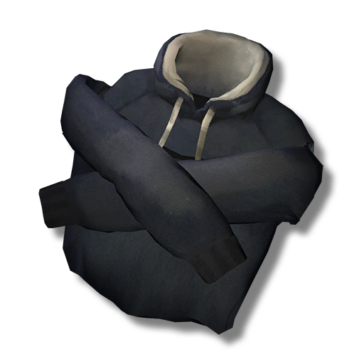

# Backpack

<table class="infobox">
<caption>Backpack</caption>
<colgroup>
<col style="width: 33%" />
<col style="width: 33%" />
<col style="width: 33%" />
</colgroup>
<tbody>
<tr>
<td colspan="2">
[[File:

<table class="gallery">
<colgroup>
<col style="width: 50%" />
<col style="width: 50%" />
</colgroup>
<tbody>
<tr>
<th><figure>
[Missing image: Backpack_Green.jpg]
<figcaption>Green</figcaption>
</figure></th>
<td><figure>

<figcaption>Forest Talker</figcaption>
</figure></td>
</tr>
</tbody>
</table></td>
<td>
250px]]
</td>
</tr>
<tr>
<td>
Release
</td>
<td>
TBD
</td>
<td></td>
</tr>
<tr>
<td>
Update
</td>
<td>
<a href="./The%20Long%20Dark%20%E2%80%94%20Changelog.md#0.00" class="wikilink" title="0.00">0.00</a>
</td>
<td></td>
</tr>
<tr>
<td>
Story item
</td>
<td>
No
</td>
<td></td>
</tr>
<tr>
<td colspan="2">
<strong>Container</strong>
</td>
<td></td>
</tr>
<tr>
<td>
Capacity
</td>
<td>
15.00 kg(33 lbs)
</td>
<td></td>
</tr>
<tr>
<td colspan="2">
<strong>Advanced data</strong>
</td>
<td></td>
</tr>
<tr>
<td>
Object key
</td>
<td>
GAMEPLAY_BackPack
</td>
<td></td>
</tr>
</tbody>
</table>

A **Backpack** is a stationary interactable object in <a href="./The%20Long%20Dark.md" class="wikilink" title="The Long Dark">The Long Dark</a>. It is most often found indoors or outdoors near a <a href="./Frozen%20Corpse.md" class="wikilink" title="Frozen Corpse">Frozen Corpse</a> and comes in the colors green or <a href="./Forest%20Talkers.md" class="wikilink" title="Forest Talkers">Forest Talkers</a> brown. They are not to be confused with the <a href="./Technical%20Backpack.md" class="wikilink" title="Technical Backpack">Technical Backpack</a>.

## Loot

<table>
<colgroup>
<col style="width: 33%" />
<col style="width: 33%" />
<col style="width: 33%" />
</colgroup>
<thead>
<tr>
<th></th>
<th>
Item
</th>
<th>
Rarity
</th>
</tr>
</thead>
<tbody>
<tr>
<td><figure>

<figcaption>Beef_Jerky_icon.png</figcaption>
</figure></td>
<td>
<a href="./Beef%20Jerky.md" class="wikilink" title="Beef Jerky">Beef Jerky</a>
</td>
<td>
7.46%
</td>
</tr>
<tr>
<td><figure>

<figcaption>Chocolate_Bar_icon.png</figcaption>
</figure></td>
<td>
<a href="./Chocolate%20Bar.md" class="wikilink" title="Chocolate Bar">Chocolate Bar</a>
</td>
<td>
7.46%
</td>
</tr>
<tr>
<td><figure>

<figcaption>Ketchup_Chips_icon.png</figcaption>
</figure></td>
<td>
<a href="./Ketchup%20Chips.md" class="wikilink" title="Ketchup Chips">Ketchup Chips</a>
</td>
<td>
6.72%
</td>
</tr>
<tr>
<td><figure>

<figcaption>Granola_Bar_icon.png</figcaption>
</figure></td>
<td>
<a href="./Granola%20Bar.md" class="wikilink" title="Granola Bar">Granola Bar</a>
</td>
<td>
6.72%
</td>
</tr>
<tr>
<td><figure>

<figcaption>Summit_Soda_icon.png</figcaption>
</figure></td>
<td>
<a href="./Summit%20Soda.md" class="wikilink" title="Summit Soda">Summit Soda</a>
</td>
<td>
5.97%
</td>
</tr>
<tr>
<td><figure>

<figcaption>Stacy's_Grape_Soda_icon.png</figcaption>
</figure></td>
<td>
<a href="./Stacy%27s%20Grape%20Soda.md" class="wikilink" title="Stacy&#39;s Grape Soda">Stacy's Grape Soda</a>
</td>
<td>
5.97%
</td>
</tr>
<tr>
<td><figure>

<figcaption>Wood_Matches_icon.png</figcaption>
</figure></td>
<td>
<a href="./Wood%20Matches.md" class="wikilink" title="Wood Matches">Wood Matches</a>
</td>
<td>
5.22%
</td>
</tr>
<tr>
<td><figure>

<figcaption>Dog_Food_icon.png</figcaption>
</figure></td>
<td>
<a href="./Dog%20Food.md" class="wikilink" title="Dog Food">Dog Food</a>
</td>
<td>
5.22%
</td>
</tr>
<tr>
<td><figure>

<figcaption>Spray_Paint_icon.png</figcaption>
</figure></td>
<td>
<a href="./Spray%20Paint.md" class="wikilink" title="Spray Paint">Spray Paint</a>
</td>
<td>
5.22%
</td>
</tr>
<tr>
<td><figure>

<figcaption>Water_(Potable)_icon.png</figcaption>
</figure></td>
<td>
<a href="./Water%20%28Potable%29.md" class="wikilink" title="Water (Potable)">Water (Potable)</a>
</td>
<td>
4.48%
</td>
</tr>
<tr>
<td><figure>

<figcaption>Tin_of_Sardines_icon.png</figcaption>
</figure></td>
<td>
<a href="./Tin%20of%20Sardines.md" class="wikilink" title="Tin of Sardines">Tin of Sardines</a>
</td>
<td>
4.48%
</td>
</tr>
<tr>
<td><figure>

<figcaption>Accelerant_icon.png</figcaption>
</figure></td>
<td>
<a href="./Accelerant.md" class="wikilink" title="Accelerant">Accelerant</a>
</td>
<td>
3.73%
</td>
</tr>
<tr>
<td><figure>

<figcaption>Salty_Crackers_icon.png</figcaption>
</figure></td>
<td>
<a href="./Salty%20Crackers.md" class="wikilink" title="Salty Crackers">Salty Crackers</a>
</td>
<td>
3.73%
</td>
</tr>
<tr>
<td><figure>

<figcaption>Pinnacle_Peaches_icon.png</figcaption>
</figure></td>
<td>
<a href="./Pinnacle%20Peaches.md" class="wikilink" title="Pinnacle Peaches">Pinnacle Peaches</a>
</td>
<td>
2.99%
</td>
</tr>
<tr>
<td><figure>

<figcaption>Energy_Bar_icon.png</figcaption>
</figure></td>
<td>
<a href="./Energy%20Bar.md" class="wikilink" title="Energy Bar">Energy Bar</a>
</td>
<td>
2.99%
</td>
</tr>
<tr>
<td><figure>

<figcaption>Wool_Toque_icon.png</figcaption>
</figure></td>
<td>
<a href="./Wool%20Toque.md" class="wikilink" title="Wool Toque">Wool Toque</a>
</td>
<td>
2.24%
</td>
</tr>
<tr>
<td><figure>

<figcaption>Wool_Mittens_icon.png</figcaption>
</figure></td>
<td>
<a href="./Wool%20Mittens.md" class="wikilink" title="Wool Mittens">Wool Mittens</a>
</td>
<td>
2.24%
</td>
</tr>
<tr>
<td><figure>

<figcaption>T-Shirt_icon.png</figcaption>
</figure></td>
<td>
<a href="./T-Shirt.md" class="wikilink" title="T-Shirt">T-Shirt</a>
</td>
<td>
2.24%
</td>
</tr>
<tr>
<td><figure>

<figcaption>Baseball_Cap_icon.png</figcaption>
</figure></td>
<td>
<a href="./Baseball%20Cap.md" class="wikilink" title="Baseball Cap">Baseball Cap</a>
</td>
<td>
2.24%
</td>
</tr>
<tr>
<td><figure>

<figcaption>Wool_Socks_icon.png</figcaption>
</figure></td>
<td>
<a href="./Wool%20Socks.md" class="wikilink" title="Wool Socks">Wool Socks</a>
</td>
<td>
1.49%
</td>
</tr>
<tr>
<td><figure>

<figcaption>Down_Vest_icon.png</figcaption>
</figure></td>
<td>
<a href="./Down%20Vest.md" class="wikilink" title="Down Vest">Down Vest</a>
</td>
<td>
1.49%
</td>
</tr>
<tr>
<td><figure>

<figcaption>Hoodie_icon.png</figcaption>
</figure></td>
<td>
<a href="./Hoodie.md" class="wikilink" title="Hoodie">Hoodie</a>
</td>
<td>
1.49%
</td>
</tr>
<tr>
<td><figure>

<figcaption>Military-Grade_MRE_icon.png</figcaption>
</figure></td>
<td>
<a href="./Military-Grade%20MRE.md" class="wikilink" title="Military-Grade MRE">Military-Grade MRE</a>
</td>
<td>
0.75%
</td>
</tr>
<tr>
<td><figure>

<figcaption>Thin_Wool_Sweater_icon.png</figcaption>
</figure></td>
<td>
<a href="./Thin%20Wool%20Sweater.md" class="wikilink" title="Thin Wool Sweater">Thin Wool Sweater</a>
</td>
<td>
0.75%
</td>
</tr>
<tr>
<td><figure>

<figcaption>Rifle_Cartridge_icon.png</figcaption>
</figure></td>
<td>
<a href="./Rifle%20Ammunition.md" class="wikilink" title="Rifle Cartridge">Rifle Cartridge</a>
</td>
<td>
0.75%
</td>
</tr>
<tr>
<td><figure>

<figcaption>Fishing_Tackle_icon.png</figcaption>
</figure></td>
<td>
<a href="./Fishing%20Tackle.md" class="wikilink" title="Fishing Tackle">Fishing Tackle</a>
</td>
<td>
0.75%
</td>
</tr>
<tr>
<td><figure>

<figcaption>Flare_icon.png</figcaption>
</figure></td>
<td>
<a href="./Flare.md" class="wikilink" title="Flare">Flare</a>
</td>
<td>
0.75%
</td>
</tr>
<tr>
<td><figure>

<figcaption>Climbing_Socks_icon.png</figcaption>
</figure></td>
<td>
<a href="./Climbing%20Socks.md" class="wikilink" title="Climbing Socks">Climbing Socks</a>
</td>
<td>
0.75%
</td>
</tr>
<tr>
<td><figure>

<figcaption>Recycled_Can_icon.png</figcaption>
</figure></td>
<td>
<a href="./Recycled%20Can.md" class="wikilink" title="Recycled Can">Recycled Can</a>
</td>
<td>
0.75%
</td>
</tr>
<tr>
<td><figure>

<figcaption>Go!_Energy_Drink_icon.png</figcaption>
</figure></td>
<td>
<a href="./Go!%20Energy%20Drink.md" class="wikilink" title="Go! Energy Drink">Go! Energy Drink</a>
</td>
<td>
0.75%
</td>
</tr>
<tr>
<td><figure>

<figcaption>Revolver_Cartridge_icon.png</figcaption>
</figure></td>
<td>
<a href="./Revolver%20Ammunition.md" class="wikilink" title="Revolver Cartridge">Revolver Cartridge</a>
</td>
<td>
0.75%
</td>
</tr>
<tr>
<td><figure>

<figcaption>Marine_Flare_icon.png</figcaption>
</figure></td>
<td>
<a href="./Marine%20Flare.md" class="wikilink" title="Marine Flare">Marine Flare</a>
</td>
<td>
0.75%
</td>
</tr>
<tr>
<td><figure>

<figcaption>Maple_Syrup_icon.png</figcaption>
</figure></td>
<td>
<a href="./Maple%20Syrup.md" class="wikilink" title="Maple Syrup">Maple Syrup</a>
</td>
<td>
0.75%
</td>
</tr>
</tbody>
</table>

**Lua execution error in Module:Navbox function navbox**

