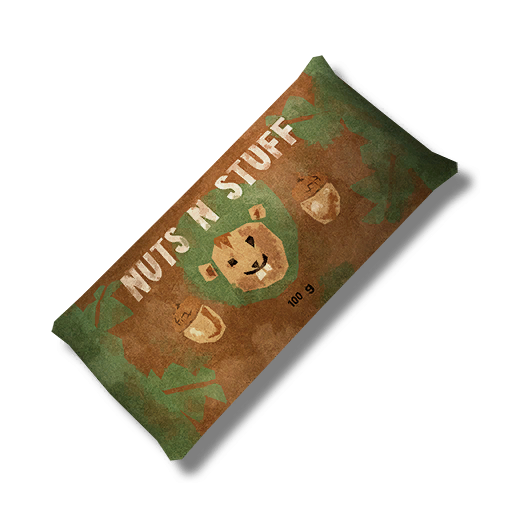
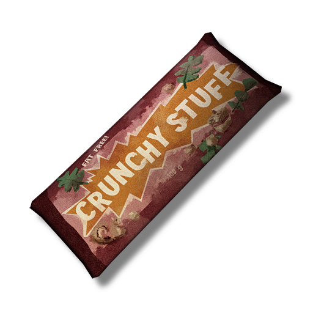
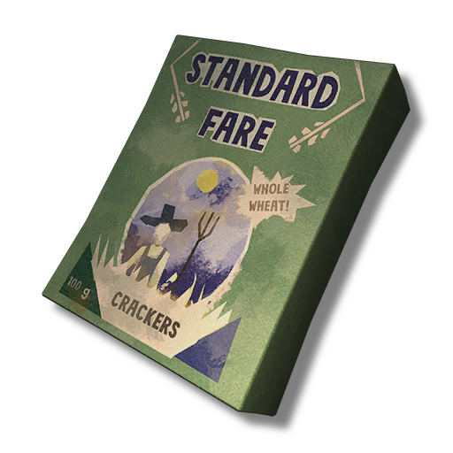
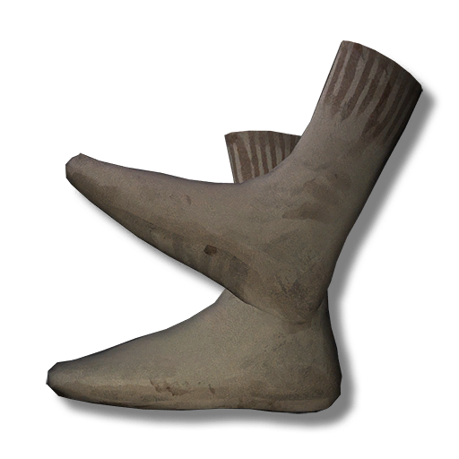

# Backpack

**Backpack**

| Property | Details |
| --- | --- |
| \[\[File: / \|  / *Green* \|  / *Forest Talker* \| / \| --- \| --- \| | 250px\]\] |
|  / *Green* |  / *Forest Talker* |
| Release | TBD |
| Update | [0.00](./The%20Long%20Dark%20%E2%80%94%20Changelog.md#0.00) |
| Story item | No |
| **Container** |  |
| Capacity | 15.00 kg(33 lbs) |
| **Advanced data** |  |
| Object key | GAMEPLAY\_BackPack |

A **Backpack** is a stationary interactable object in [The Long Dark](./The%20Long%20Dark.md). It is most often found indoors or outdoors near a [Frozen Corpse](./Frozen%20Corpse.md) and comes in the colors green or [Forest Talkers](./Forest%20Talkers.md) brown. They are not to be confused with the [Technical Backpack](./Technical%20Backpack.md).

## Loot

|  | Item | Rarity |
| --- | --- | --- |
|  / *Beef\_Jerky\_icon.png* | [Beef Jerky](./Beef%20Jerky.md) | 7.46% |
|  / *Chocolate\_Bar\_icon.png* | [Chocolate Bar](./Chocolate%20Bar.md) | 7.46% |
|  / *Ketchup\_Chips\_icon.png* | [Ketchup Chips](./Ketchup%20Chips.md) | 6.72% |
|  / *Granola\_Bar\_icon.png* | [Granola Bar](./Granola%20Bar.md) | 6.72% |
|  / *Summit\_Soda\_icon.png* | [Summit Soda](./Summit%20Soda.md) | 5.97% |
|  / *Stacy's\_Grape\_Soda\_icon.png* | [Stacy's Grape Soda](./Stacy%27s%20Grape%20Soda.md) | 5.97% |
|  / *Wood\_Matches\_icon.png* | [Wood Matches](./Wood%20Matches.md) | 5.22% |
|  / *Dog\_Food\_icon.png* | [Dog Food](./Dog%20Food.md) | 5.22% |
|  / *Spray\_Paint\_icon.png* | [Spray Paint](./Spray%20Paint.md) | 5.22% |
|  / *Water\_(Potable)\_icon.png* | [Water (Potable)](./Water%20%28Potable%29.md) | 4.48% |
|  / *Tin\_of\_Sardines\_icon.png* | [Tin of Sardines](./Tin%20of%20Sardines.md) | 4.48% |
|  / *Accelerant\_icon.png* | [Accelerant](./Accelerant.md) | 3.73% |
|  / *Salty\_Crackers\_icon.png* | [Salty Crackers](./Salty%20Crackers.md) | 3.73% |
|  / *Pinnacle\_Peaches\_icon.png* | [Pinnacle Peaches](./Pinnacle%20Peaches.md) | 2.99% |
|  / *Energy\_Bar\_icon.png* | [Energy Bar](./Energy%20Bar.md) | 2.99% |
|  / *Wool\_Toque\_icon.png* | [Wool Toque](./Wool%20Toque.md) | 2.24% |
|  / *Wool\_Mittens\_icon.png* | [Wool Mittens](./Wool%20Mittens.md) | 2.24% |
|  / *T-Shirt\_icon.png* | [T-Shirt](./T-Shirt.md) | 2.24% |
|  / *Baseball\_Cap\_icon.png* | [Baseball Cap](./Baseball%20Cap.md) | 2.24% |
|  / *Wool\_Socks\_icon.png* | [Wool Socks](./Wool%20Socks.md) | 1.49% |
|  / *Down\_Vest\_icon.png* | [Down Vest](./Down%20Vest.md) | 1.49% |
|  / *Hoodie\_icon.png* | [Hoodie](./Hoodie.md) | 1.49% |
|  / *Military-Grade\_MRE\_icon.png* | [Military-Grade MRE](./Military-Grade%20MRE.md) | 0.75% |
|  / *Thin\_Wool\_Sweater\_icon.png* | [Thin Wool Sweater](./Thin%20Wool%20Sweater.md) | 0.75% |
|  / *Rifle\_Cartridge\_icon.png* | [Rifle Cartridge](./Rifle%20Ammunition.md) | 0.75% |
|  / *Fishing\_Tackle\_icon.png* | [Fishing Tackle](./Fishing%20Tackle.md) | 0.75% |
|  / *Flare\_icon.png* | [Flare](./Flare.md) | 0.75% |
|  / *Climbing\_Socks\_icon.png* | [Climbing Socks](./Climbing%20Socks.md) | 0.75% |
|  / *Recycled\_Can\_icon.png* | [Recycled Can](./Recycled%20Can.md) | 0.75% |
|  / *Go!\_Energy\_Drink\_icon.png* | [Go! Energy Drink](./Go!%20Energy%20Drink.md) | 0.75% |
|  / *Revolver\_Cartridge\_icon.png* | [Revolver Cartridge](./Revolver%20Ammunition.md) | 0.75% |
|  / *Marine\_Flare\_icon.png* | [Marine Flare](./Marine%20Flare.md) | 0.75% |
|  / *Maple\_Syrup\_icon.png* | [Maple Syrup](./Maple%20Syrup.md) | 0.75% |

**Lua execution error in Module:Navbox function navbox**
