# Badges

**Contents**

- [Overview](#Overview)
- [List of Badges](#List_of_Badges)
- [Trivia](#Trivia)
- [Gallery](#Gallery)

## Overview

Badges are unique unlockable challenge based achievements (not to be confused with regular <a href="./The%20Long%20Dark%20%E2%80%94%20Achievements.md" class="wikilink" title="achievements">achievements</a>) that can be acquired from playing <a href="./The%20Long%20Dark.md" class="wikilink" title="The Long Dark"><em>The Long Dark</em></a>.

As their name implies, Badges are awarded as commemorative status symbols, and are earned after accomplishing certain in game tasks. They do not, however, provide any active gameplay benefits, unlike <a href="./Feats.md" class="wikilink" title="Feats">Feats</a>. Most Badges are acquired from simply completing <a href="./Survival%20Mode.md" class="wikilink" title="Survival Mode">Survival Mode</a> <a href="./Challenge.md" class="wikilink" title="Challenge">Challenge</a> scenarios, whereas others require the player to perform specific tasks to unlock them, similar to Feats. Some Badges are acquired through exclusive timed events, and are thus impossible to unlock once the event passes.

Badges can be viewed in Survival Mode main menu, under the Challenges and Badges menu, alongside Feats. They can also be viewed in the Badges section of the in-game pause menu while in Survival Mode.

## List of Badges

<table>
<caption>Survival Mode Challenge Badges</caption>
<colgroup>
<col style="width: 33%" />
<col style="width: 33%" />
<col style="width: 33%" />
</colgroup>
<thead>
<tr>
<th>
Badge
</th>
<th>
Badge Name
</th>
<th>
Unlock Requirements
</th>
</tr>
</thead>
<tbody>
<tr>
<td><figure class="thumb">
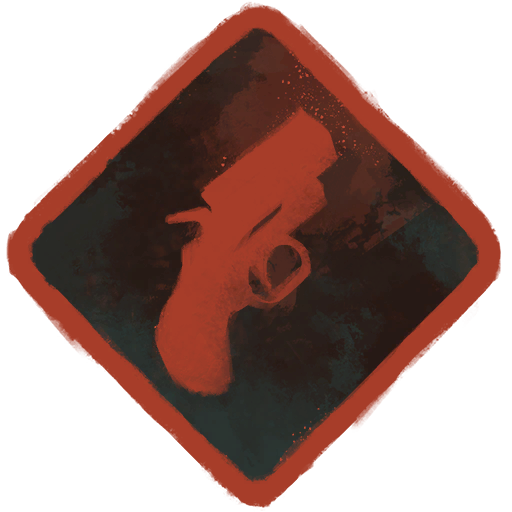
</figure></td>
<td>
Hopeless Rescue
</td>
<td>
Awarded upon completion of the <a href="./Hopeless%20Rescue.md" class="wikilink" title="Hopeless Rescue">Hopeless Rescue</a> Challenge.
</td>
</tr>
<tr>
<td><figure class="thumb">
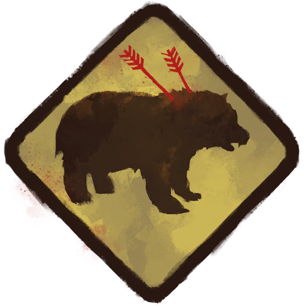
</figure></td>
<td>
The Hunted, Part One
</td>
<td>
Awarded upon completion of the "<a href="./The%20Hunted%2C%20Part%20One.md" class="wikilink" title="The Hunted, Part One">The Hunted, Part One</a>" Challenge
</td>
</tr>
<tr>
<td><figure class="thumb">
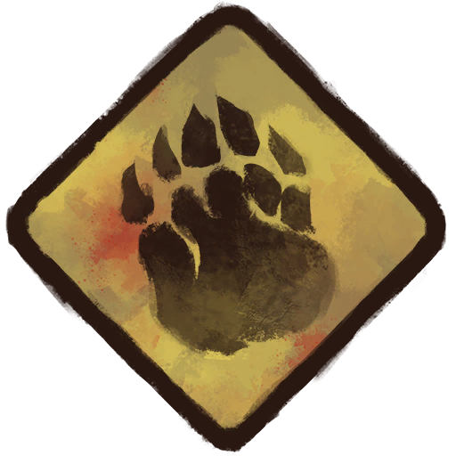
</figure></td>
<td>
The Hunted, Part Two
</td>
<td>
Awarded upon completion of the "<a href="./The%20Hunted%2C%20Part%20Two.md" class="wikilink" title="The Hunted, Part Two">The Hunted, Part Two</a>" Challenge
</td>
</tr>
<tr>
<td>
TBA
</td>
<td>
The Hunted, Part Three
</td>
<td>
Awarded upon completion of the "<a href="./The%20Hunted%2C%20Part%20Three.md" class="wikilink" title="The Hunted, Part Three">The Hunted, Part Three</a>" Challenge
</td>
</tr>
<tr>
<td><figure class="thumb">
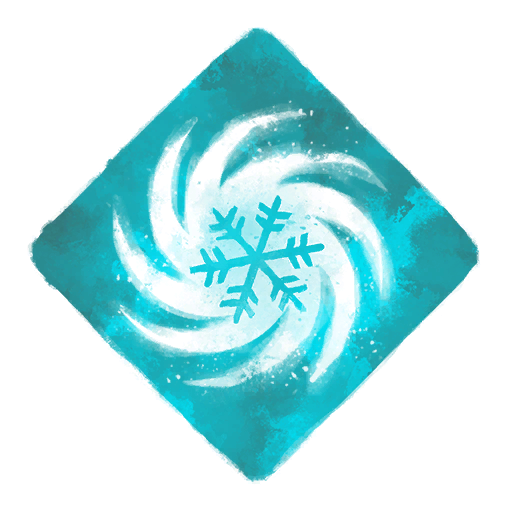
</figure></td>
<td>
Whiteout
</td>
<td>
Awarded upon completion of the <a href="./Whiteout.md" class="wikilink" title="Whiteout">Whiteout</a> Challenge
</td>
</tr>
<tr>
<td><figure class="thumb">
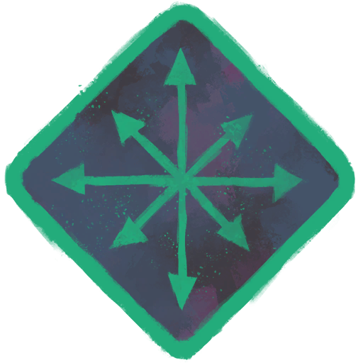
</figure></td>
<td>
Nomad
</td>
<td>
Awarded upon completion of the <a href="./Nomad.md" class="wikilink" title="Nomad">Nomad</a> Challenge
</td>
</tr>
<tr>
<td><figure class="thumb">

</figure></td>
<td>
Archivist
</td>
<td>
Awarded upon completion of the <a href="./Archivist.md" class="wikilink" title="Archivist">Archivist</a> Challenge
</td>
</tr>
<tr>
<td><figure class="thumb">
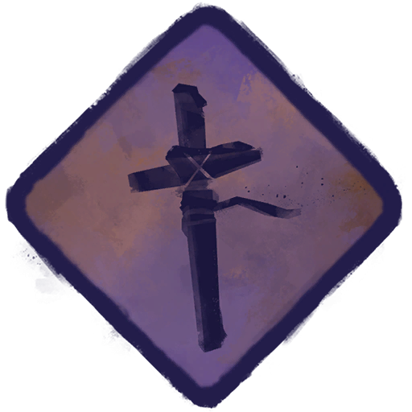
</figure></td>
<td>
As The Dead Sleep
</td>
<td>
Awarded upon completion of the "<a href="./As%20the%20Dead%20Sleep.md" class="wikilink" title="As The Dead Sleep">As The Dead Sleep</a>" Challenge
</td>
</tr>
<tr>
<td><figure class="thumb">
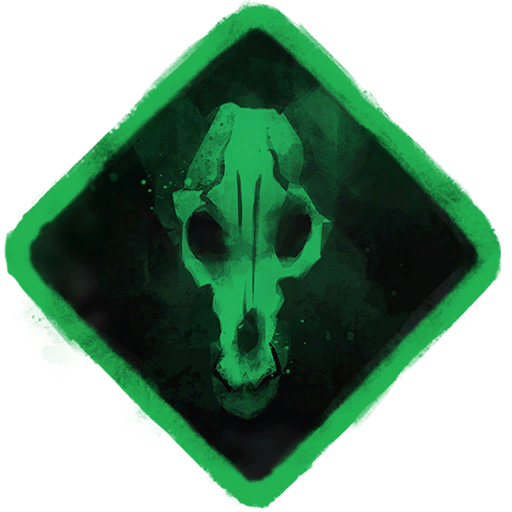
</figure></td>
<td>
Escape The Darkwalker
</td>
<td>
Complete the <a href="./Escape%20the%20Darkwalker.md" class="wikilink" title="Escape The Darkwalker">Escape The Darkwalker</a> Challenge (collect all 10 <a href="./A%20Note%20Left%20Behind.md" class="wikilink" title="Survivor Notes">Survivor Notes</a> and banish the entity).
</td>
</tr>
<tr>
<td><figure class="thumb">
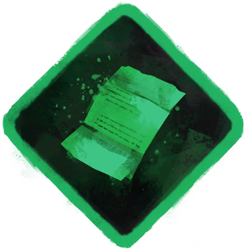
</figure></td>
<td>
Escape The Darkwalker -- Deadly Dreamer Badge
</td>
<td>
Collect 6 (of 10) <a href="./A%20Note%20Left%20Behind.md" class="wikilink" title="Survivor Notes">Survivor Notes</a> within the <a href="./Escape%20the%20Darkwalker.md" class="wikilink" title="Escape The Darkwalker">Escape The Darkwalker</a> Challenge.
</td>
</tr>
</tbody>
</table>

Survival Feats

<table>
<caption>Tales Badges</caption>
<colgroup>
<col style="width: 33%" />
<col style="width: 33%" />
<col style="width: 33%" />
</colgroup>
<thead>
<tr>
<th>
Badge
</th>
<th>
Badge Name
</th>
<th>
Unlock Requirements
</th>
</tr>
</thead>
<tbody>
<tr>
<td><figure class="thumb">
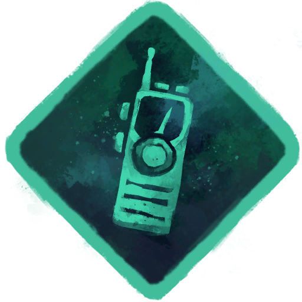
</figure></td>
<td>
Tales: Signal Void
</td>
<td>
Awarded upon completion of the <a href="./Tales.md" class="wikilink" title="Tale">Tale</a> <a href="./Signal%20Void.md" class="wikilink" title="Signal Void">Signal Void</a>.
</td>
</tr>
<tr>
<td><figure>
[Missing image: Buried_Echoes_icon.png]
<figcaption>XTHUMB</figcaption>
</figure></td>
<td>
Tales: Buried Echoes
</td>
<td>
Awarded upon completion of the <a href="./Tales.md" class="wikilink" title="Tale">Tale</a> <a href="./Buried%20Echoes.md" class="wikilink" title="Buried Echoes">Buried Echoes</a>.
</td>
</tr>
<tr>
<td><figure class="thumb">
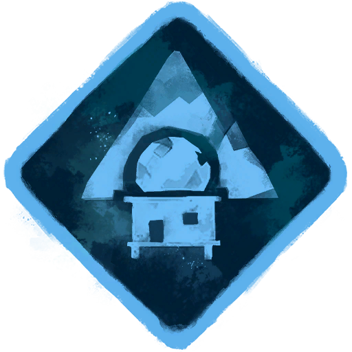
</figure></td>
<td>
Tales: Last Horizon
</td>
<td>
Awarded upon completion of the <a href="./Tales.md" class="wikilink" title="Tale">Tale</a> <a href="./Last%20Horizon.md" class="wikilink" title="Last Horizon">Last Horizon</a>
</td>
</tr>
</tbody>
</table>

<table>
<caption>Timed Event Badges</caption>
<colgroup>
<col style="width: 25%" />
<col style="width: 25%" />
<col style="width: 25%" />
<col style="width: 25%" />
</colgroup>
<thead>
<tr>
<th>
Badge
</th>
<th>
Badge Name
</th>
<th>
Unlock Requirements
</th>
<th>
Availability
</th>
</tr>
</thead>
<tbody>
<tr>
<td><figure class="thumb">
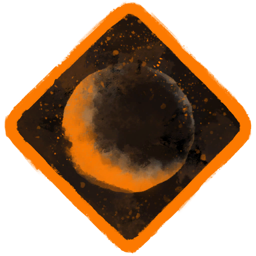
</figure></td>
<td>
4DON Twilight Badge (2018)
</td>
<td>
Survived for 2 nights within the <a href="./4%20Days%20of%20Night%20Event.md" class="wikilink" title="4 Days Of Night Event Challenge">4 Days Of Night Event Challenge</a>

[Must survive for 2 real world hours each day of the event for badge progress to accumulate*]
</td>
<td>
27 October 10 PM PST- November 10 AM PST 2018
</td>
</tr>
<tr>
<td><figure class="thumb">
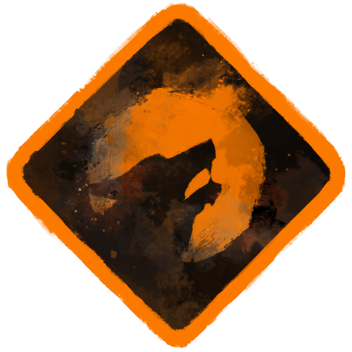
</figure></td>
<td>
4DON Midnight Badge (2018)
</td>
<td>
Survived all 4 nights within the <a href="./4%20Days%20of%20Night%20Event.md" class="wikilink" title="4Days Of Night Event Challenge">4Days Of Night Event Challenge</a>

[Must survive for 2 real world hours each day of the event for badge progress to accumulate*]
</td>
<td>
27 October 10 PM PST- November 10 AM PST 2018
</td>
</tr>
<tr>
<td><figure class="thumb">

</figure></td>
<td>
4DON Twilight Badge (2019)
</td>
<td>
Survived for 2 nights within the <a href="./4%20Days%20of%20Night%20Event.md" class="wikilink" title="4 Days Of Night Event Challenge">4 Days Of Night Event Challenge</a>

[Must survive for 2 real world hours each day of the event for badge progress to accumulate*]
</td>
<td>
27 October 10 PM PST- November 10 AM PST 2019
</td>
</tr>
<tr>
<td><figure class="thumb">
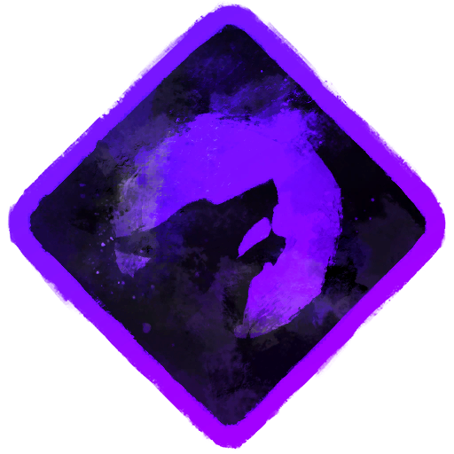
</figure></td>
<td>
4DON Midnight Badge (2019)
</td>
<td>
Survived all 4 nights within the <a href="./4%20Days%20of%20Night%20Event.md" class="wikilink" title="4 Days Of Night Event Challenge">4 Days Of Night Event Challenge</a>

[Must survive for 2 real world hours each day of the event for badge progress to accumulate*]
</td>
<td>
27 October 10 PM PST- November 10 AM PST 2019
</td>
</tr>
<tr>
<td><figure class="thumb">
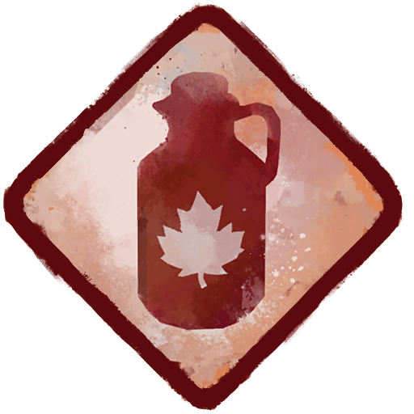
</figure></td>
<td>
Winter's Embrace Canadian Feast Badge (2020)
</td>
<td>
Consume 25 bottles of <a href="./Maple%20Syrup.md" class="wikilink" title="Maple Syrups">Maple Syrups</a> and 25 bags of <a href="./Ketchup%20Chips.md" class="wikilink" title="Ketchup Chips">Ketchup Chips</a> within the <a href="./Winter%27s%20Embrace.md" class="wikilink" title="Winter&#39;s Embrace Event Challenge">Winter's Embrace Event Challenge</a>
</td>
<td>
June 29th-July 31st 2020
</td>
</tr>
<tr>
<td><figure class="thumb">
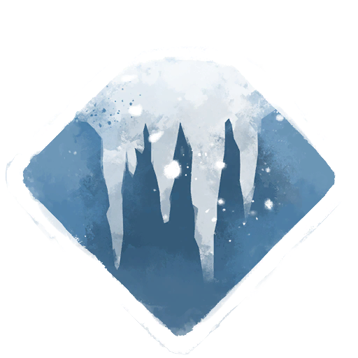
</figure></td>
<td>
Winter's Embrace Winter In July Badge (2020)
</td>
<td>
Survived for 25 days within the <a href="./Winter%27s%20Embrace.md" class="wikilink" title="Winter&#39;s Embrace Event Challenge">Winter's Embrace Event Challenge</a>
</td>
<td>
June 29th-July 31st 2020
</td>
</tr>
</tbody>
</table>

## Trivia

- It is entirely possible to miss the 4DON Twilight and Midnight Badges (2018 or 2019) despite meeting the requirements of surviving 2 to 4 days in game. The player has a Journel Objective that tracks the remaining survival time progress each day of the event (starting at 2 real world hours), yet the game does not autosave once the allotted time has passed (despite showing a check mark in the Objective). This requires the player to remember to force an autosave (sleeping, walking through transition doors), or else they will miss earning the Badges.
- <a href="./Escape%20the%20Darkwalker.md" class="wikilink" title="Escape The Darkwalker">Escape The Darkwalker</a> was originally a two week seasonal event for Halloween 2020 from October 29th to November 12th. A month later it was added as a permanent Challenge mode.
- The victory condition for the original (Halloween) version of Escape The Darkwalker was surving for 60 minutes (real-time) in a single game, this was changed with the <a href="./Challenge.md" class="wikilink" title="Challenge">Challenge</a> version of Escape the Darkwalker to banishing the entity.

## Gallery

<table class="gallery">
<colgroup>
<col style="width: 25%" />
<col style="width: 25%" />
<col style="width: 25%" />
<col style="width: 25%" />
</colgroup>
<tbody>
<tr>
<td><figure>
[Missing image: Whiteout_badge.png]
<figcaption>Old version of the Whiteout Badge</figcaption>
</figure></td>
<td><figure>
[Missing image: Nomad_badge.png]
<figcaption>Old version of the Nomad Badge</figcaption>
</figure></td>
<td><figure>

<figcaption>The image displayed for a locked Badge</figcaption>
</figure></td>
<td><figure>
[Missing image: 20221224110525_1.jpg]
<figcaption>A small selection of unlocked badges</figcaption>
</figure></td>
</tr>
</tbody>
</table>

**Lua execution error in Module:Navbox function navbox**

