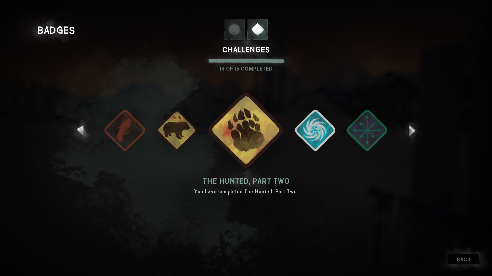

# Badges

**Categories:** Gameplay · **Source:** [Fandom](https://thelongdark.fandom.com/wiki/Badges)

**Contents**

- [Overview](#overview)
- [List of Badges](#list-of-badges)
- [Trivia](#trivia)
- [Gallery](#gallery)

## Overview

Badges are unique unlockable challenge based achievements (not to be confused with regular [achievements](./The%20Long%20Dark%20%E2%80%94%20Achievements.md)) that can be acquired from playing [_The Long Dark_](./The%20Long%20Dark.md).

As their name implies, Badges are awarded as commemorative status symbols, and are earned after accomplishing certain in game tasks. They do not, however, provide any active gameplay benefits, unlike [Feats](./Feats.md). Most Badges are acquired from simply completing [Survival Mode](./Survival%20Mode.md) [Challenge](./Challenge.md) scenarios, whereas others require the player to perform specific tasks to unlock them, similar to Feats. Some Badges are acquired through exclusive timed events, and are thus impossible to unlock once the event passes.

Badges can be viewed in Survival Mode main menu, under the Challenges and Badges menu, alongside Feats. They can also be viewed in the Badges section of the in-game pause menu while in Survival Mode.

## List of Badges

**Survival Mode Challenge Badges**

| Badge | Badge Name | Unlock Requirements |
| --- | --- | --- |
| [Badge challenge hopelessRescue](../assets/Badge_challenge_hopelessRescue.png) | Hopeless Rescue | Awarded upon completion of the [Hopeless Rescue](./Hopeless%20Rescue.md) Challenge. |
| [The Hunted Part One icon](../assets/The_Hunted_Part_One_icon.png) | The Hunted, Part One | Awarded upon completion of the "[The Hunted, Part One](./The%20Hunted%2C%20Part%20One.md)" Challenge |
| [Badge challenge huntedPart2](../assets/Badge_challenge_huntedPart2.png) | The Hunted, Part Two | Awarded upon completion of the "[The Hunted, Part Two](./The%20Hunted%2C%20Part%20Two.md)" Challenge |
| TBA | The Hunted, Part Three | Awarded upon completion of the "[The Hunted, Part Three](./The%20Hunted%2C%20Part%20Three.md)" Challenge |
| [Badge challenge whiteout](../assets/Badge_challenge_whiteout.png) | Whiteout | Awarded upon completion of the [Whiteout](./Whiteout.md) Challenge |
| [Badge challenge nomad](../assets/Badge_challenge_nomad.png) | Nomad | Awarded upon completion of the [Nomad](./Nomad.md) Challenge |
| [Badge challenge archivist](../assets/Badge_challenge_archivist.png) | Archivist | Awarded upon completion of the [Archivist](./Archivist.md) Challenge |
| [Badge challenge Deadman](../assets/Badge_challenge_Deadman.png) | As The Dead Sleep | Awarded upon completion of the "[As The Dead Sleep](./As%20the%20Dead%20Sleep.md)" Challenge |
| [Badge Umbra](../assets/Badge_Umbra.png) | Escape The Darkwalker | Complete the [Escape The Darkwalker](./Escape%20the%20Darkwalker.md) Challenge (collect all 10 [Survivor Notes](./A%20Note%20Left%20Behind.md) and banish the entity). |
| [Badge Deadly Dreamer](../assets/Badge_Deadly_Dreamer.png) | Escape The Darkwalker -- Deadly Dreamer Badge | Collect 6 (of 10) [Survivor Notes](./A%20Note%20Left%20Behind.md) within the [Escape The Darkwalker](./Escape%20the%20Darkwalker.md) Challenge. |

Survival Feats

**Tales Badges**

| Badge | Badge Name | Unlock Requirements |
| --- | --- | --- |
| [Signal Void icon](../assets/Signal_Void_icon.png) | Tales: Signal Void | Awarded upon completion of the [Tale](./Tales.md) [Signal Void](./Signal%20Void.md). |
| [Buried Echoes Icon](../assets/Buried_Echoes_Icon.png) | Tales: Buried Echoes | Awarded upon completion of the [Tale](./Tales.md) [Buried Echoes](./Buried%20Echoes.md). |
| [Last Horizon Badge](../assets/Last_Horizon_Badge.png) | Tales: Last Horizon | Awarded upon completion of the [Tale](./Tales.md) [Last Horizon](./Last%20Horizon.md) |

**Timed Event Badges**

| Badge | Badge Name | Unlock Requirements | Availability |
| --- | --- | --- | --- |
| [Badge challenge FourDaysOfNightHalf](../assets/Badge_challenge_FourDaysOfNightHalf.png) | 4DON Twilight Badge (2018) | Survived for 2 nights within the [4 Days Of Night Event Challenge](./4%20Days%20of%20Night%20Event.md) \[Must survive for 2 real world hours each day of the event for badge progress to accumulate\*\] | 27 October 10 PM PST- November 10 AM PST 2018 |
| [Badge challenge FourDaysOfNightFull](../assets/Badge_challenge_FourDaysOfNightFull.png) | 4DON Midnight Badge (2018) | Survived all 4 nights within the [4Days Of Night Event Challenge](./4%20Days%20of%20Night%20Event.md) \[Must survive for 2 real world hours each day of the event for badge progress to accumulate\*\] | 27 October 10 PM PST- November 10 AM PST 2018 |
| [Badge challenge FourDaysOfNight2019Half](../assets/Badge_challenge_FourDaysOfNight2019Half.png) | 4DON Twilight Badge (2019) | Survived for 2 nights within the [4 Days Of Night Event Challenge](./4%20Days%20of%20Night%20Event.md) \[Must survive for 2 real world hours each day of the event for badge progress to accumulate\*\] | 27 October 10 PM PST- November 10 AM PST 2019 |
| [Badge challenge FourDaysOfNight2019Full](../assets/Badge_challenge_FourDaysOfNight2019Full.png) | 4DON Midnight Badge (2019) | Survived all 4 nights within the [4 Days Of Night Event Challenge](./4%20Days%20of%20Night%20Event.md) \[Must survive for 2 real world hours each day of the event for badge progress to accumulate\*\] | 27 October 10 PM PST- November 10 AM PST 2019 |
| [Badge CanadianFeast](../assets/Badge_CanadianFeast.png) | Winter's Embrace Canadian Feast Badge (2020) | Consume 25 bottles of [Maple Syrups](./Maple%20Syrup.md) and 25 bags of [Ketchup Chips](./Ketchup%20Chips.md) within the [Winter's Embrace Event Challenge](./Winter%27s%20Embrace.md) | June 29th-July 31st 2020 |
| [Badge WinterInJuly](../assets/Badge_WinterInJuly.png) | Winter's Embrace Winter In July Badge (2020) | Survived for 25 days within the [Winter's Embrace Event Challenge](./Winter%27s%20Embrace.md) | June 29th-July 31st 2020 |

## Trivia

- It is entirely possible to miss the 4DON Twilight and Midnight Badges (2018 or 2019) despite meeting the requirements of surviving 2 to 4 days in game. The player has a Journel Objective that tracks the remaining survival time progress each day of the event (starting at 2 real world hours), yet the game does not autosave once the allotted time has passed (despite showing a check mark in the Objective). This requires the player to remember to force an autosave (sleeping, walking through transition doors), or else they will miss earning the Badges.
- [Escape The Darkwalker](./Escape%20the%20Darkwalker.md) was originally a two week seasonal event for Halloween 2020 from October 29th to November 12th. A month later it was added as a permanent Challenge mode.
- The victory condition for the original (Halloween) version of Escape The Darkwalker was surving for 60 minutes (real-time) in a single game, this was changed with the [Challenge](./Challenge.md) version of Escape the Darkwalker to banishing the entity.

## Gallery

