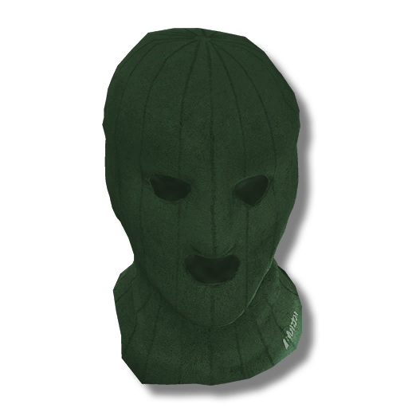
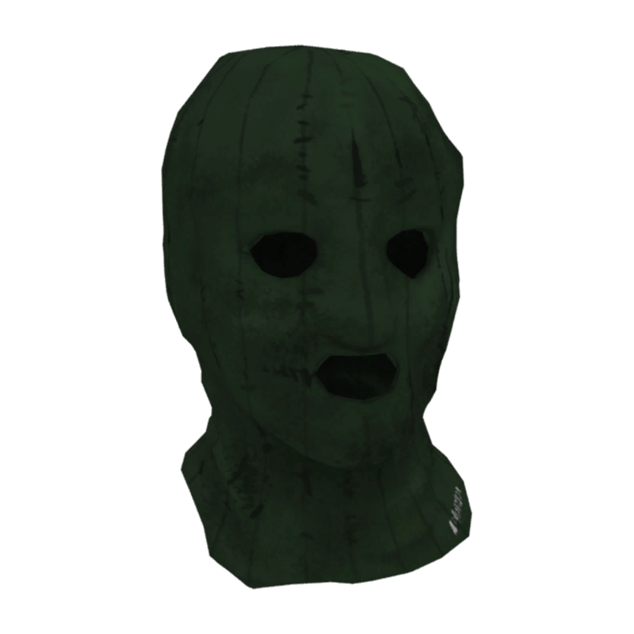
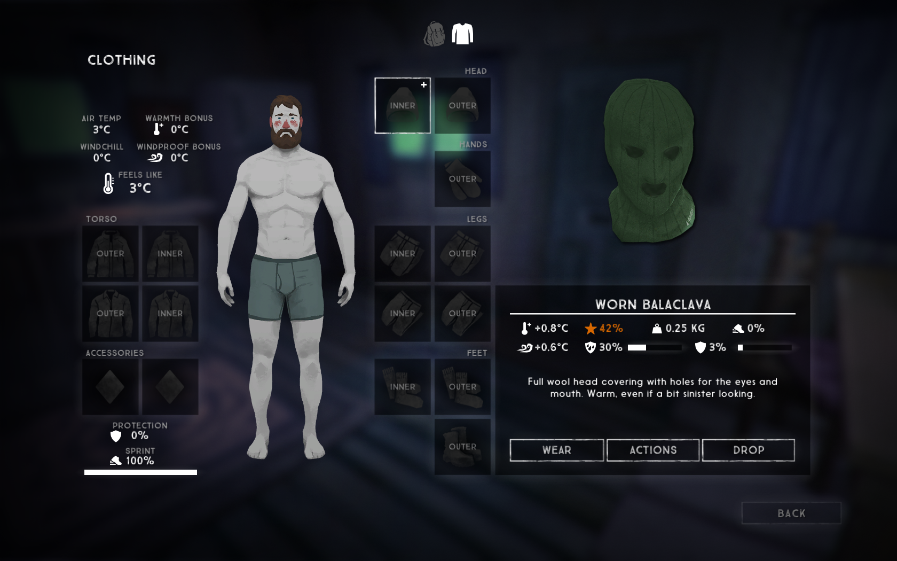

# Balaclava

<table class="infobox">
<caption>Balaclava</caption>
<colgroup>
<col style="width: 50%" />
<col style="width: 50%" />
</colgroup>
<tbody>
<tr>
<td colspan="2"><figure>

<figcaption>Balaclava_icon.png</figcaption>
</figure></td>
</tr>
<tr>
<td colspan="2" class="section">
<strong>General</strong>
</td>
</tr>
<tr>
<td>
Item Type
</td>
<td>
Clothing|-
</td>
</tr>
<tr>
<td colspan="2" class="section">
<strong>Statistics</strong>
</td>
</tr>
<tr>
<td>
Weight
</td>
<td>
0.25 kg(0.55 lbs)
</td>
</tr>
<tr>
<td>
Warmth bonus
</td>
<td>
2.0 °C(3.6 °F)
</td>
</tr>
<tr>
<td>
Windproof bonus
</td>
<td>
1.5 °C(2.7 °F)
</td>
</tr>
<tr>
<td>
Waterproof bonus
</td>
<td>
30%
</td>
</tr>
<tr>
<td>
Protection
</td>
<td>
3%
</td>
</tr>
<tr>
<td>
Mobility
</td>
<td>
0%
</td>
</tr>
<tr>
<td>
Harvest
</td>
<td>
1 × <a href="./Cloth.md" class="wikilink" title="Cloth">Cloth</a> 
10 minutes
</td>
</tr>
<tr>
<td>
Repair
</td>
<td>
1 × <a href="./Cloth.md" class="wikilink" title="Cloth">Cloth</a> 
30 minutes 
75% condition
</td>
</tr>
</tbody>
</table>

<table>
<colgroup>
<col style="width: 33%" />
<col style="width: 33%" />
<col style="width: 33%" />
</colgroup>
<tbody>
<tr>
<td style="vertical-align: top; font-size: 3em; color: #5d5980; padding-right: 10px">
“
</td>
<td>
Full wool head covering with holes for the eyes and mouth. Warm, even if a bit sinister looking.

&#10;

In-game description

</td>
<td style="vertical-align: bottom; font-size: 3em; color: #5d5980; padding-left: 10px">
”
</td>
</tr>
</tbody>
</table>

The Balaclava is a type of headgear in *<a href="./The%20Long%20Dark.md" class="wikilink" title="The Long Dark">The Long Dark</a>*. It is a rare item and additionally cannot be found on Interloper difficulty.

Only 1 Balaclava can be worn at a time, specifically in the inner head slot.

When worn along with an outer hat, the Balaclava loses its windproof resistance and protection bonus. This is because windproof and protection bonuses are only added from outer gear.

Despite this, the balaclava is just as good as the <a href="./Wool%20Toque.md" class="wikilink" title="Wool Toque">Wool Toque</a>, and should always be used as an inner hat slot, as the decay rate is slower than the wool toque.

## Gallery

<table class="gallery">
<colgroup>
<col style="width: 25%" />
<col style="width: 25%" />
<col style="width: 25%" />
<col style="width: 25%" />
</colgroup>
<tbody>
<tr>
<td><figure>

<figcaption>Clothing model</figcaption>
</figure></td>
<td><figure>

<figcaption>Clothing model damaged</figcaption>
</figure></td>
<td><figure>
[Missing image: Balaclava-full.jpg]
<figcaption>Balaclava v1.92</figcaption>
</figure></td>
<td><figure>

<figcaption>Balaclava in the clothing interface. (click to enlarge)</figcaption>
</figure></td>
</tr>
</tbody>
</table>

## Update history

- UPDATE **19 December 2016 (<a href="./The%20Long%20Dark%20%E2%80%94%20Early%20Access%20Changelog.md#0.386" class="wikilink" title="Update">Update</a>):**
  - Added to game

**Lua execution error in Module:Navbox function navbox** <a href="ru:%D0%91%D0%B0%D0%BB%D0%B0%D0%BA%D0%BB%D0%B0%D0%B2%D0%B0" class="wikilink" title="ru:Балаклава">ru:Балаклава</a>

