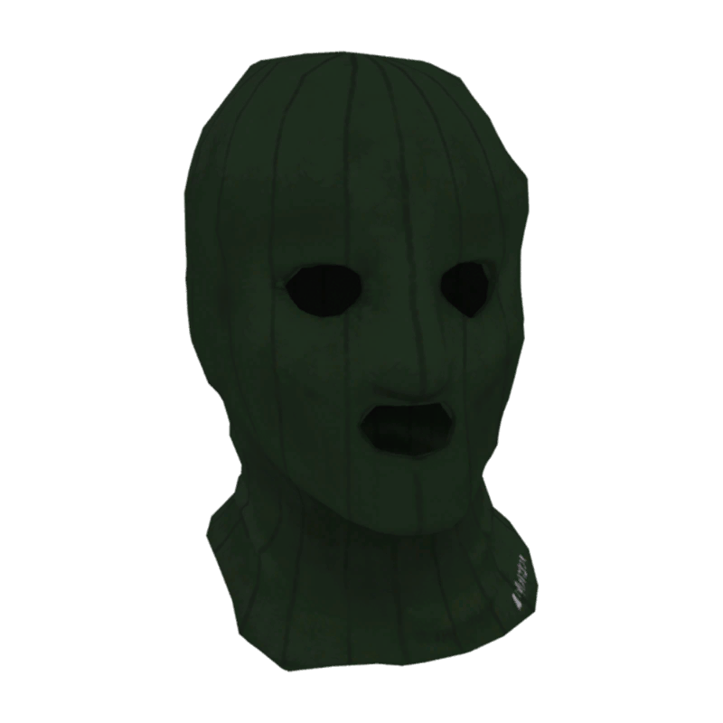
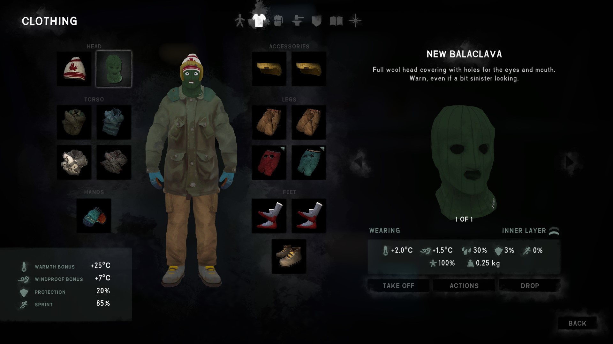

# Balaclava

**Balaclava**

| Property | Details |
| --- | --- |
|  |  / *Balaclava\_icon.png* |
| **General** |  |
| Item Type | Clothing\|- |
| **Statistics** |  |
| Weight | 0.25 kg(0.55 lbs) |
| Warmth bonus | 2.0 °C(3.6 °F) |
| Windproof bonus | 1.5 °C(2.7 °F) |
| Waterproof bonus | 30% |
| Protection | 3% |
| Mobility | 0% |
| Harvest | 1 × [Cloth](./Cloth.md) / 10 minutes |
| Repair | 1 × [Cloth](./Cloth.md) / 30 minutes / 75% condition |

> “**Full wool head covering with holes for the eyes and mouth. Warm, even if a bit sinister looking.**”
>
> — In-game description

The Balaclava is a type of headgear in *[The Long Dark](./The%20Long%20Dark.md)*. It is a rare item and additionally cannot be found on Interloper difficulty.

Only 1 Balaclava can be worn at a time, specifically in the inner head slot.

When worn along with an outer hat, the Balaclava loses its windproof resistance and protection bonus. This is because windproof and protection bonuses are only added from outer gear.

Despite this, the balaclava is just as good as the [Wool Toque](./Wool%20Toque.md), and should always be used as an inner hat slot, as the decay rate is slower than the wool toque.

## Gallery

| Column 1 | Column 2 | Column 3 | Column 4 |
| --- | --- | --- | --- |
|  / *Clothing model* |  / *Clothing model damaged* |  / *Balaclava v1.92* |  / *Balaclava in the clothing interface. *(click to enlarge)** |

## Update history

- UPDATE **19 December 2016 ([Update](./The%20Long%20Dark%20%E2%80%94%20Early%20Access%20Changelog.md#0.386)):**
  - Added to game

**Lua execution error in Module:Navbox function navbox** [ru:Балаклава](ru:%D0%91%D0%B0%D0%BB%D0%B0%D0%BA%D0%BB%D0%B0%D0%B2%D0%B0)
