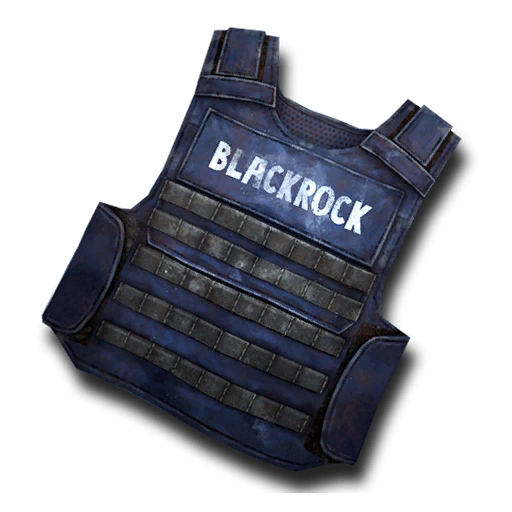
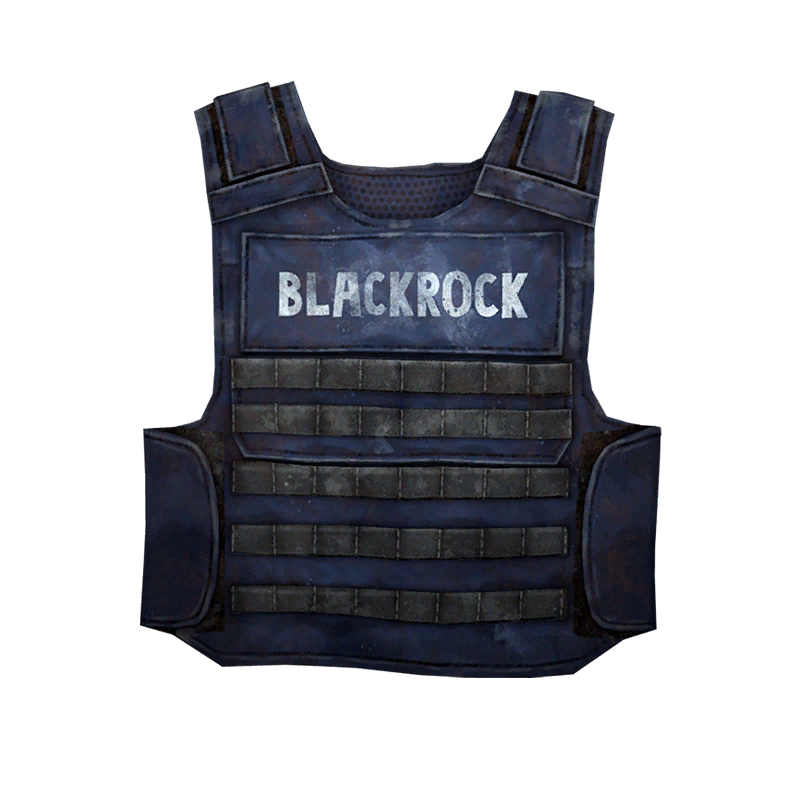
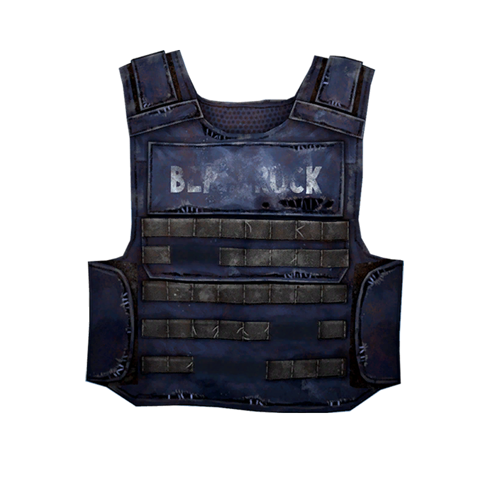

# Ballistic Vest

**Contents**

- [Overview](#Overview)
- [Location](#Location)
- [Gallery](#Gallery)
- [Update History](#Update_History)
- [Trivia](#Trivia)

<table class="infobox">
<caption>Ballistic Vest</caption>
<colgroup>
<col style="width: 50%" />
<col style="width: 50%" />
</colgroup>
<tbody>
<tr>
<td colspan="2"><figure>

<figcaption>Ballistic_Vest_icon.png</figcaption>
</figure></td>
</tr>
<tr>
<td colspan="2" class="section">
<strong>General</strong>
</td>
</tr>
<tr>
<td>
Item Type
</td>
<td></td>
</tr>
<tr>
<td>
Wintermute
</td>
<td></td>
</tr>
<tr>
<td>
Clothing Slot
</td>
<td>
Accessory
</td>
</tr>
<tr>
<td colspan="2" class="section">
<strong>Statistics</strong>
</td>
</tr>
<tr>
<td>
Weight
</td>
<td>
6.00 kg(13.2 lbs)
</td>
</tr>
<tr>
<td>
Warmth bonus
</td>
<td>
0 °C(0 °F)
</td>
</tr>
<tr>
<td>
Windproof bonus
</td>
<td>
0 °C(0 °F)
</td>
</tr>
<tr>
<td>
Waterproof bonus
</td>
<td>
0%
</td>
</tr>
<tr>
<td>
Protection
</td>
<td>
50%
</td>
</tr>
<tr>
<td>
Mobility
</td>
<td>
-40%
</td>
</tr>
<tr>
<td>
Harvest
</td>
<td>
Cannot Harvest
</td>
</tr>
<tr>
<td>
Repair
</td>
<td>
Cannot Repair
</td>
</tr>
</tbody>
</table>

<table>
<colgroup>
<col style="width: 33%" />
<col style="width: 33%" />
<col style="width: 33%" />
</colgroup>
<tbody>
<tr>
<td style="vertical-align: top; font-size: 3em; color: #5d5980; padding-right: 10px">
“
</td>
<td>
Law-enforcement body armour. Great Protection, but very heavy. You won't win any sprints wearing it.

&#10;

In-game description

</td>
<td style="vertical-align: bottom; font-size: 3em; color: #5d5980; padding-left: 10px">
”
</td>
</tr>
</tbody>
</table>

The **Ballistic Vest** is a type of clothing in The Long Dark.

## Overview

The Ballistic Vest provides the highest <a href="./Clothing.md#Protection" class="wikilink" title="Protection">Protection</a> rating in the game at 50%. However, it is very heavy, weighing in at 6kg (13.2lbs). It is the heaviest clothing item in the game, and is comparable to heavier items such as animal quarters or the <a href="./Car%20Battery.md" class="wikilink" title="Car Battery">Car Battery</a> in terms of item weight. In addition, it reduces the player's <a href="./Stamina.md" class="wikilink" title="Stamina">Stamina</a> bar by 40%, the highest mobility penalty any worn clothing offers.

The lack of windproof or warmth bonuses forces the player to choose between equipping it for the protection bonus, or leaving it behind, preserving mobility and carrying capacity. However, the trade-off for extreme protection may be worth it if players find themselves ending up in lots of struggles, or plan to journey through dangerous territory such as regions that are inhabited by <a href="./Timberwolf.md" class="wikilink" title="Timberwolf">Timberwolf</a> packs. It is most useful early-game when the player may not have sufficient resources to fend off attacks, especially on Interloper, or when playing a custom game in which condition loss is difficult to replace (i.e. Deadman).

With the weight reduction that is granted to equipped clothes/accessories, it is usually better to wear the vest if you are already carrying it, unless you need more sprint stamina; e.g., for <a href="./Rope%20Climbing.md" class="wikilink" title="Rope Climbing">Rope Climbing</a> or when crossing <a href="./Weak%20Ice.md" class="wikilink" title="Weak Ice">Weak Ice</a>.

The vest also gives its own unique buff called <a href="./Armoured.md" class="wikilink" title="Armoured">Armoured</a>. Armoured's actual effects are still debated: some say it has no actual effect at all, and simply informs the player of their high defense. Others suggest it reduces the risk of receiving negative <a href="./Afflictions.md" class="wikilink" title="Afflictions">Afflictions</a> from fights--for example, lowering the risk of <a href="./Blood%20Loss.md" class="wikilink" title="Blood Loss">Blood Loss</a> or <a href="./Sprained%20Ankle.md" class="wikilink" title="Sprained Ankle">Sprained Ankle</a>/<a href="./Sprained%20Wrist.md" class="wikilink" title="Sprained Wrist">Sprained Wrist</a>.

The Protection stat is meant to reduce wildlife damage by 1% per 1 protection, meaning equipping the vest cuts wildlife damage in half at minimum. This also means that acquiring 100% or more protection will make the player ***invulnerable*** to wildlife damage.

## Location

The Ballistic Vest can only be found inside of the main building of <a href="./Blackrock%20Prison.md" class="wikilink" title="Blackrock Prison">Blackrock Prison</a>, located in <a href="./Blackrock.md" class="wikilink" title="Blackrock.">Blackrock.</a> It spawns at the end of the hallway in Cell Block C, next to a corpse. Getting there requires the player to travel around the rear of the prison past multiple wolves and a bear, and then make a very short rope climb, following by walking inside the darkness and collapsed corridors of the ruined prison.

## Gallery

<table class="gallery">
<colgroup>
<col style="width: 50%" />
<col style="width: 50%" />
</colgroup>
<tbody>
<tr>
<td><figure>

<figcaption>Clothing model icon</figcaption>
</figure></td>
<td><figure>

<figcaption>Clothing model icon damaged</figcaption>
</figure></td>
</tr>
</tbody>
</table>

## Update History

UPDATE **7 December 2021 (<a href="./The%20Long%20Dark%20%E2%80%94%20Changelog.md" class="wikilink" title="Update">Update</a>):**

- Added to game

== Raw Data ==

Developer tooltips found in Unity Engine Inspector tool:

- Prevents Blood Loss very efficiently on the wearer's torso.
- Directly decreases Moose and Bear direct struggle damage done to the player by a large amount.
- Takes less over-time decay damage and takes heavily reduced decay from weather like blizzard and freezing water.
- Reduces recovery time from Broken Ribs caused by Moose by a good amount.

Direct notations taken from inside raw game code:

- No blood loss for chest.
- Clothing tearing reduced by 85%.
- Broken ribs recovery time reduced by 30% (helps set your bones).
- Reduces damage from bears and moose struggle, but apparently not from wolf struggle... Does not reduce damage from falling or anything else.
- Ballistic vest's condition does not change the amount of protection you get from it. It will protect at full efficiency whether at 99% condition or 1% condition, but cannot of course be used when fully ruined.

## Trivia

- The maximum protection possible is 106%, achievable by equipping <a href="./Ski%20Boots.md" class="wikilink" title="Ski Boots">Ski Boots</a>/<a href="./Combat%20Boots.md" class="wikilink" title="Combat Boots">Combat Boots</a> (10%), <a href="./Deerskin%20Pants.md" class="wikilink" title="Deerskin Pants">Deerskin Pants</a>/<a href="./Wolfskin%20Pants.md" class="wikilink" title="Wolfskin Pants">Wolfskin Pants</a> (10%), <a href="./Tactical%20Gloves.md" class="wikilink" title="Tactical Gloves">Tactical Gloves</a> (7%), <a href="./Moose-Hide%20Cloak.md" class="wikilink" title="Moose-Hide Cloak">Moose-Hide Cloak</a> (20%), <a href="./Cougar%20Hide%20Wrap.md" class="wikilink" title="Cougar Hide Wrap">Cougar Hide Wrap</a> (6%), <a href="./Crampons.md" class="wikilink" title="Crampons">Crampons</a> (3%), and the <a href="./Ballistic%20Vest.md" class="wikilink" title="Ballistic Vest">Ballistic Vest</a> (50%).
- The Ballistic Vest cannot be repaired.
- The Ballistic Vest goes into the accessory slot, not the jacket slot, making it the 4th item to use the accessory slot.
- The Ballistic Vest always spawns at 100% condition, similar to <a href="./Crampons.md" class="wikilink" title="Crampons.">Crampons.</a>

**Lua execution error in Module:Navbox function navbox** <a href="ru:%D0%9F%D1%83%D0%BB%D0%B5%D0%BD%D0%B5%D0%BF%D1%80%D0%BE%D0%B1%D0%B8%D0%B2%D0%B0%D0%B5%D0%BC%D1%8B%D0%B9_%D0%B6%D0%B8%D0%BB%D0%B5%D1%82" class="wikilink" title="ru:Пуленепробиваемый жилет">ru:Пуленепробиваемый жилет</a>

