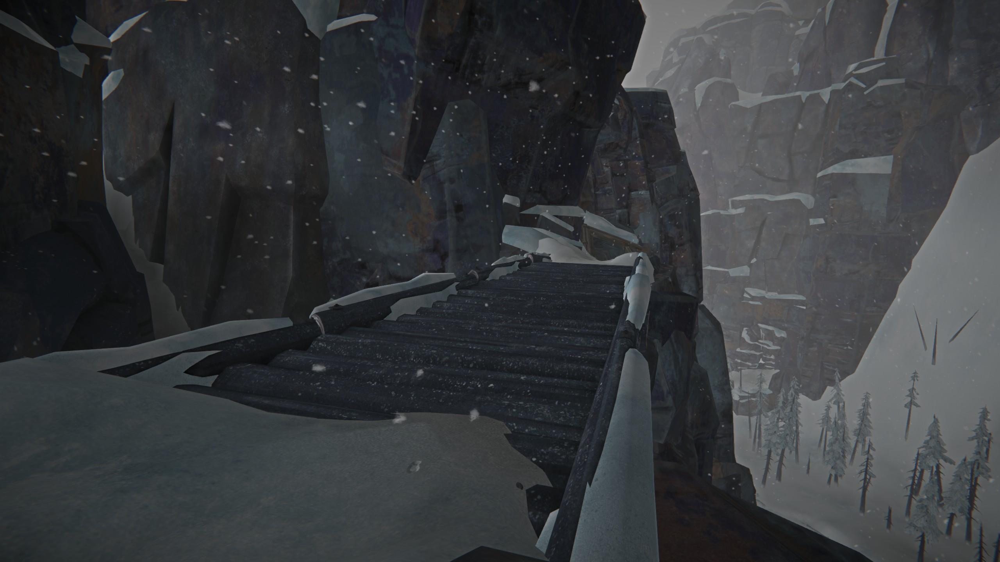
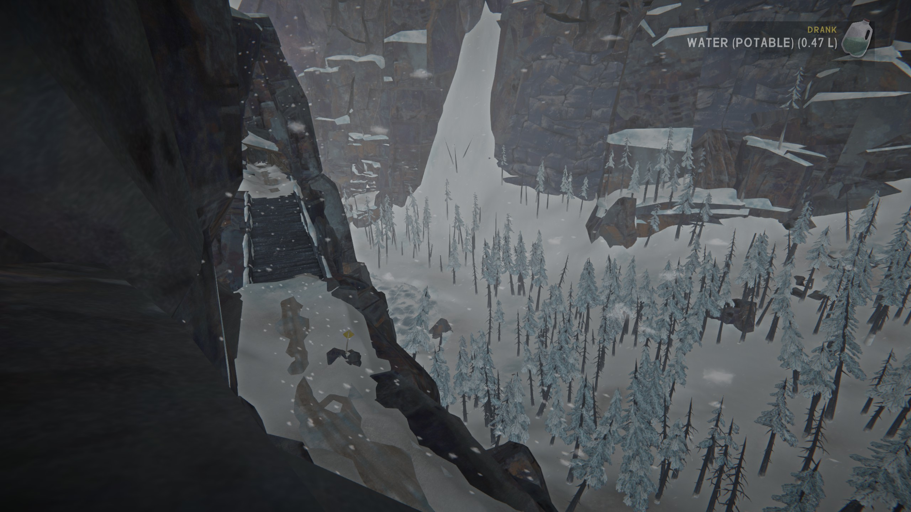

# Baneful Bridge

**Baneful Bridge**

| Property | Details |
| --- | --- |
|  |  / *Baneful\_Bridge.jpg* |
| **Location** |  |
|  |  / *Baneful\_Bridge\_Location.png* |
| Region | [Sundered Pass](./Sundered%20Pass.md)\|- |
| **General** |  |
|  | Has no shelter\|} **Baneful Bridge** is a location in [Sundered Pass](./Sundered%20Pass.md) near Refuge Cabin A, [Lotte's Rest](./Lotte%27s%20Rest.md), while following the southern section of the main mountain road. [Ptarmigan](./Ptarmigan.md) can sometimes be found between the bridge and the cabin, along with a ravaged [Deer Carcass](./Deer%20Carcass.md). / A hidden path can be accessed by walking off the right side closest to the tunnel, and leads down to a [Rope Climbing](./Rope%20Climbing.md) section leading to [Seedling Spring](./Seedling%20Spring.md). Going up the mountain leads to a hidden cliff overlook containing a [Frozen Corpse](./Frozen%20Corpse.md) and a [Backpack](./Backpack.md). *The bridge from the hidden cliff edge* / **Lua execution error in Module:Navbox function navbox** [ru:Гиблый мост](ru:%D0%93%D0%B8%D0%B1%D0%BB%D1%8B%D0%B9_%D0%BC%D0%BE%D1%81%D1%82) |
