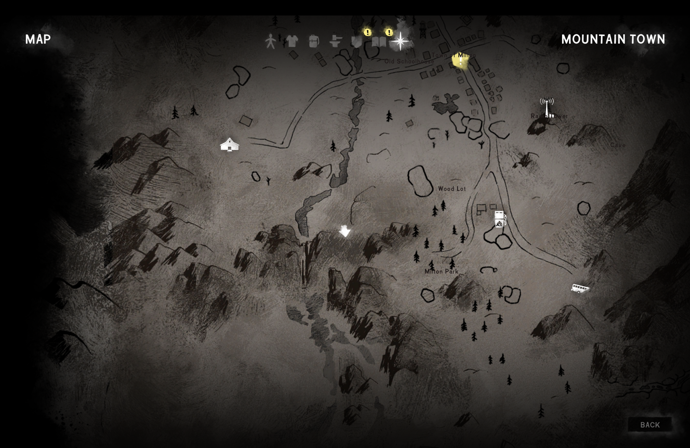

# Bank Deposit Box Key 13

**Categories:** Collectibles, Pages with update history · **Source:** [Fandom](https://thelongdark.fandom.com/wiki/Bank_Deposit_Box_Key_13)

**Bank Deposit Box Key (#13)**

[Bank Deposit Box Key 13 icon](../assets/Bank_Deposit_Box_Key_13_icon.png)

**Release:** [1 August 2017](./The%20Long%20Dark%20%E2%80%94%20Early%20Access%20Changelog.md#1.00)

**Wintermute:** [Episode 1](./Episode%201%20-%20Do%20Not%20Go%20Gentle.md) - [Milton Safety Deposit Box Keys](./Milton%20Safety%20Deposit%20Box%20Keys.md)

**Properties**

**Item type:** [Collectibles](./Collectibles.md)

**Stackable:** No

**Examine:** Bank deposit key. Will open one of the deposit boxes at the bank

**Values**

**Weight:** 0.00 kg (0 lbs)

**Actions**

**Backpack:** Examine

**Bank Deposit Box Key (#13)** is a [Collectibles](./Collectibles.md) key found in [Episode 1: Do Not Go Gentle](./Episode%201%20-%20Do%20Not%20Go%20Gentle.md) in [Wintermute](./Wintermute.md) as part of the [Milton Safety Deposit Box Keys](./Milton%20Safety%20Deposit%20Box%20Keys.md) side quest.

It is located on a corpse near the frozen river between [Orca Gas Station](./Orca%20Gas%20Station.md) and [Paradise Meadows Farm](./Paradise%20Meadows%20Farm.md). Follow the stream downhill directly behind the gas station. Right before the slight bend turn left up the slope and The corpse will be directly ahead. The crows circling above the corpse should make locating it easier; If walking downstream, the crows can be seen circling above on the lefthand side of the river.

## Update history

- UPDATE **1 August 2017 ([Update](./The%20Long%20Dark%20%E2%80%94%20Changelog.md#1.00)):**
  - Added to game.
