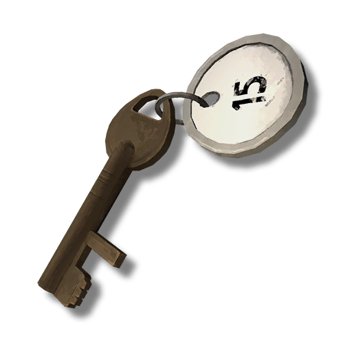

# Bank Deposit Box Key 15

<table class="infobox">
<caption>Bank Deposit Box Key (#15)</caption>
<colgroup>
<col style="width: 50%" />
<col style="width: 50%" />
</colgroup>
<tbody>
<tr>
<td colspan="2"><figure>

<figcaption>Bank_Deposit_Box_Key_15_icon.png</figcaption>
</figure></td>
</tr>
<tr>
<td>
Release
</td>
<td>
<a href="./The%20Long%20Dark%20%E2%80%94%20Early%20Access%20Changelog.md#1.00" class="wikilink" title="1 August 2017">1 August 2017</a>
</td>
</tr>
<tr>
<td>
Wintermute
</td>
<td>
<a href="./Episode%201%20-%20Do%20Not%20Go%20Gentle.md" class="wikilink" title="Episode 1">Episode 1</a> - <a href="./The%20Grey%20Mother.md" class="wikilink" title="The Grey Mother">The Grey Mother</a>
</td>
</tr>
<tr>
<td colspan="2" class="section">
<strong>Properties</strong>
</td>
</tr>
<tr>
<td>
Item type
</td>
<td>
<a href="./Collectibles.md" class="wikilink" title="Collectibles">Collectibles</a>|-
</td>
</tr>
<tr>
<td>
Stackable
</td>
<td>
No
</td>
</tr>
<tr>
<td>
Examine
</td>
<td>
Bank deposit key. Will open one of the deposit boxes at the bank
</td>
</tr>
<tr>
<td colspan="2" class="section">
<strong>Values</strong>
</td>
</tr>
<tr>
<td>
Weight
</td>
<td>
0.00 kg (0 lbs)
</td>
</tr>
<tr>
<td colspan="2" class="section">
<strong>Actions</strong>
</td>
</tr>
<tr>
<td>
Backpack
</td>
<td>
Examine
</td>
</tr>
<tr>
<td colspan="2" class="section">
<strong>Advanced data</strong>
</td>
</tr>
<tr>
<td>
Item key
</td>
<td>
GearItem__FarmerDepositBoxKey
</td>
</tr>
</tbody>
</table>

**Bank Deposit Box Key (#15)** is a <a href="./Collectibles.md" class="wikilink" title="Collectibles">Collectibles</a> key found in <a href="./Episode%201%20-%20Do%20Not%20Go%20Gentle.md" class="wikilink" title="Episode 1: Do Not Go Gentle">Episode 1: Do Not Go Gentle</a> in <a href="./Wintermute.md" class="wikilink" title="Wintermute">Wintermute</a> as part of the mission <a href="./The%20Grey%20Mother.md" class="wikilink" title="The Grey Mother">The Grey Mother</a>.

The key can be found next to <a href="./Hobbs.md" class="wikilink" title="Hobbs">Hobbs</a> immediately after the interaction with him, regardless of the outcome chosen. This is the only key that is necessary to progress through the story, as Bank Deposit Box \#15 holds a plot-sensitive item. The key originally belonged to <a href="./Martin%20Barker.md" class="wikilink" title="Martin Barker">Martin Barker</a>, and unlocks the deposit box containing <a href="./Grey%20Mother%27s%20Safety%20Deposit%20Box.md" class="wikilink" title="Grey Mother&#39;s Safety Deposit Box">Grey Mother's Safety Deposit Box</a>.

## Update history

- UPDATE **1 August 2017 (<a href="./The%20Long%20Dark%20%E2%80%94%20Changelog.md#1.00" class="wikilink" title="Update">Update</a>):**
  - Added to game.

**Lua execution error in Module:Navbox function navbox**

