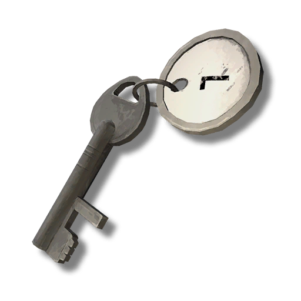

# Bank Deposit Box Key 7

<table class="infobox">
<caption>Bank Deposit Box Key (#7)</caption>
<colgroup>
<col style="width: 50%" />
<col style="width: 50%" />
</colgroup>
<tbody>
<tr>
<td colspan="2"><figure>

<figcaption>Bank_Deposit_Box_Key_7_icon.png</figcaption>
</figure></td>
</tr>
<tr>
<td>
Release
</td>
<td>
<a href="./The%20Long%20Dark%20%E2%80%94%20Early%20Access%20Changelog.md#1.00" class="wikilink" title="1 August 2017">1 August 2017</a>
</td>
</tr>
<tr>
<td>
Wintermute
</td>
<td>
<a href="./Episode%201%20-%20Do%20Not%20Go%20Gentle.md" class="wikilink" title="Episode 1">Episode 1</a> - <a href="./Milton%20Safety%20Deposit%20Box%20Keys.md" class="wikilink" title="Milton Safety Deposit Box Keys">Milton Safety Deposit Box Keys</a>
</td>
</tr>
<tr>
<td colspan="2" class="section">
<strong>Properties</strong>
</td>
</tr>
<tr>
<td>
Item type
</td>
<td>
<a href="./Collectibles.md" class="wikilink" title="Collectibles">Collectibles</a>|-
</td>
</tr>
<tr>
<td>
Stackable
</td>
<td>
No
</td>
</tr>
<tr>
<td>
Examine
</td>
<td>
Bank deposit key. Will open one of the deposit boxes at the bank
</td>
</tr>
<tr>
<td colspan="2" class="section">
<strong>Values</strong>
</td>
</tr>
<tr>
<td>
Weight
</td>
<td>
0.00 kg (0 lbs)
</td>
</tr>
<tr>
<td colspan="2" class="section">
<strong>Actions</strong>
</td>
</tr>
<tr>
<td>
Backpack
</td>
<td>
Examine
</td>
</tr>
</tbody>
</table>

**Bank Deposit Box Key (#7)** is a <a href="./Collectibles.md" class="wikilink" title="Collectibles">Collectibles</a> key found in <a href="./Episode%201%20-%20Do%20Not%20Go%20Gentle.md" class="wikilink" title="Episode 1: Do Not Go Gentle">Episode 1: Do Not Go Gentle</a> in <a href="./Wintermute.md" class="wikilink" title="Wintermute">Wintermute</a> as part of the <a href="./Milton%20Safety%20Deposit%20Box%20Keys.md" class="wikilink" title="Milton Safety Deposit Box Keys">Milton Safety Deposit Box Keys</a> side quest.

It is located inside a house on the main road between the <a href="./Milton%20Post%20Office.md" class="wikilink" title="Post Office">Post Office</a> and the <a href="./Orca%20Gas%20Station.md" class="wikilink" title="Orca Gas Station">Orca Gas Station</a>, in a plastic container underneath the bed. The house is across the main road from the <a href="./Bank%20Manager%27s%20House.md" class="wikilink" title="Bank Manager&#39;s House">Bank Manager's House</a>.

## Update history

- UPDATE **1 August 2017 (<a href="./The%20Long%20Dark%20%E2%80%94%20Changelog.md#1.00" class="wikilink" title="Update">Update</a>):**
  - Added to game.

**Lua execution error in Module:Navbox function navbox**

