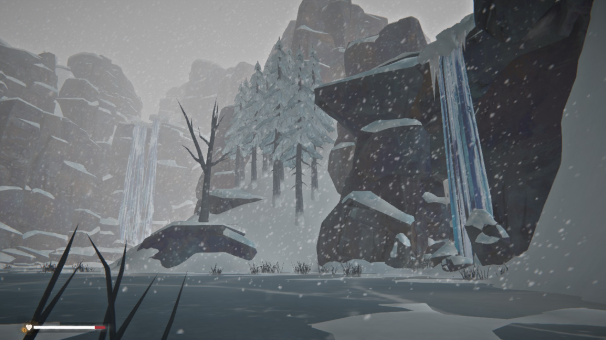

# Banner Falls

**Banner Falls**

| Property | Details |
| --- | --- |
| \[\[File: / \| Column 1 \| / \| --- \| / \|  / *Banner falls (Left) Watchfull Falls (right)* \| | 250px\]\] |
|  |  / *Banner falls (Left) Watchfull Falls (right)* |
| **Location** |  |
|  / *Banner\_Falls\_Location.png* |  |
| Region | [Hushed River Valley](./Hushed%20River%20Valley.md)\|- / Location |
| **General** |  |
| Type | Outdoors\|- |
