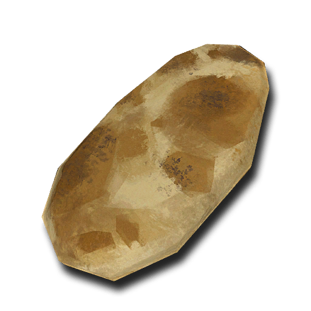

# Bannock

| Column 1 | Column 2 | Column 3 |
| --- | --- | --- |
|  / *Ptarmigan\_icon.png* | **DLC-Exclusive content.** / This content requires the [Tales from the Far Territory](./Tales%20from%20the%20Far%20Territory.md) addon to be installed before it can be seen or used in regular gameplay. | \|} / **Bannock** / \| Property \| Details \| / \| --- \| --- \| / \|  \|  / *Bannock\_icon.png* \| / \| Release \| [21 June 2023](./The%20Long%20Dark%20%E2%80%94%20Changelog.md#2.17) \| / \| Wintermute \| No \| / \| Renewable \| Yes ([Trader](./Trader.md) only) \| / \| **Properties** \|  \| / \| Item type \| [Food And Drink](./Food%20And%20Drink.md)\\|- \| / \| **Values** \|  \| / \| Calories \| 200 (250) kcal \| / \| Hydration \| -3.0% \| / \| Weight \| 0.05 kg (0.11 lbs) \| / \| **Decay Rate** \|  \| / \| Inside \| 20.000% per day \| / \| Outside \| 5.000% per day \| / \| **Advanced data** \|  \| / \| Item key \| GAMEPLAY\_Bannock \| / **Bannock** is a food item made with a [Cooking Skillet](./Cooking%20Skillet.md) or no tool on an open slot at a [Fire](./Fire.md). / To cook the Bannock without a Cooking Skillet, select the No Tool option over an active Cooking Slot.*No Tool option for cooking Bannock or Acorn Bannock without a Cooking Skillet* / ## Recipe / This recipe makes 2 Bannocks. / **Bannock** / \| Property \| Details \| / \| --- \| --- \| / \| **Template:pic link plain**[Cooking](./Cooking.md)** \|  \| / \|  \| - \| / \|  \| 40.00 minutes \| / \| **Requirements** \|  \| / \| Required level \| **Template:pic link plain** 2 \| / \| Facility \| **Template:iconlink** \| / \| Tool \| **Template:iconlink** \| / \| **Materials** \|  \| / \| **Template:iconlink plain** \|  \| / \| Item \| [Water (Potable)](./Water%20%28Potable%29.md) \| / \| Quantity \| 0.15 L \| / \| **Template:iconlink plain** \|  \| / \|  \| [Cooking Oil](./Cooking%20Oil.md) \| / \|  \| 0.05 L \| / \| **Template:iconlink plain** \|  \| / \|  \| [Old Mill Flour](./Old%20Mill%20Flour.md) \| / \|  \| 0.20 kg \| / ## Use / Bannocks, at 200 calories and weighing 0.05 kg, are one of the most calorie-dense foods in the game, beating out [cat tail stalks](./Cat%20Tail%20Stalk.md) and, at cooking level 5, are equal to [energy bars](./Energy%20Bar.md). While the in-game description suggests that bannocks are good travel food, it should be noted that they decay at a rate of 20% per day in the player's inventory. / ## Update history / - UPDATE **21 June 2023 ([Update](./The%20Long%20Dark%20%E2%80%94%20Changelog.md#2.17)):** / - Added to game. / **Lua execution error in Module:Navbox function navbox** [ru:Лепёшка](ru:%D0%9B%D0%B5%D0%BF%D1%91%D1%88%D0%BA%D0%B0) |
|  / *Bannock\_icon.png* |  |  |
| Release | [21 June 2023](./The%20Long%20Dark%20%E2%80%94%20Changelog.md#2.17) |  |
| Wintermute | No |  |
| Renewable | Yes ([Trader](./Trader.md) only) |  |
| **Properties** |  |  |
| Item type | [Food And Drink](./Food%20And%20Drink.md)\|- |  |
| **Values** |  |  |
| Calories | 200 (250) kcal |  |
| Hydration | -3.0% |  |
| Weight | 0.05 kg (0.11 lbs) |  |
| **Decay Rate** |  |  |
| Inside | 20.000% per day |  |
| Outside | 5.000% per day |  |
| **Advanced data** |  |  |
| Item key | GAMEPLAY\_Bannock |  |
| **Template:pic link plain**[Cooking](./Cooking.md) |  |  |
| - |  |  |
| 40.00 minutes |  |  |
| **Requirements** |  |  |
| Required level | **Template:pic link plain** 2 |  |
| Facility | **Template:iconlink** |  |
| Tool | **Template:iconlink** |  |
| **Materials** |  |  |
| **Template:iconlink plain** |  |  |
| Item | [Water (Potable)](./Water%20%28Potable%29.md) |  |
| Quantity | 0.15 L |  |
| **Template:iconlink plain** |  |  |
| [Cooking Oil](./Cooking%20Oil.md) |  |  |
| 0.05 L |  |  |
| **Template:iconlink plain** |  |  |
| [Old Mill Flour](./Old%20Mill%20Flour.md) |  |  |
| 0.20 kg |  |  |
