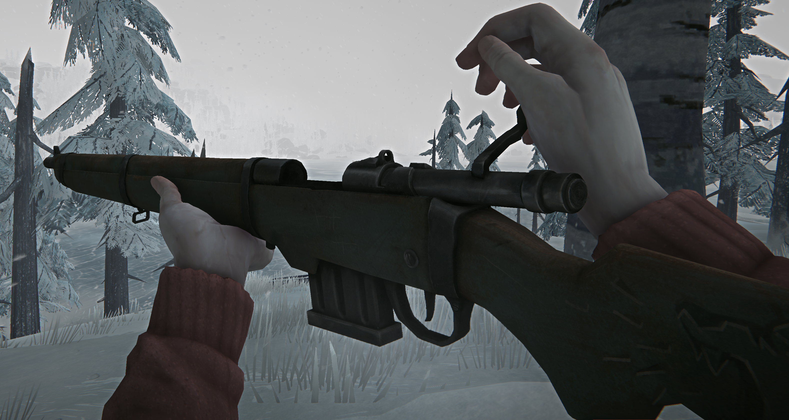
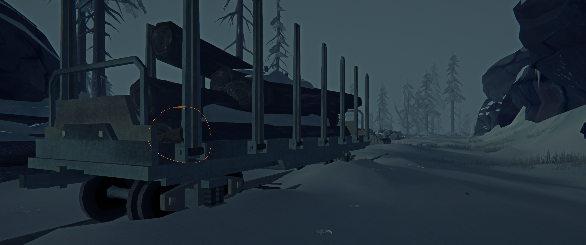

# Barb's Rifle

**Categories:** DLC Content, Pages with update history, Tools · **Source:** [Fandom](https://thelongdark.fandom.com/wiki/Barb's_Rifle)

**Contents**

- [Overview](#overview)
- [Locations](#locations)
- [Differences from Hunting Rifle](#differences-from-hunting-rifle)
- [Trivia](#trivia)
- [Gallery](#gallery)
- [Update History](#update-history)

**DLC-Exclusive content.**

This content requires the [Tales from the Far Territory](./Tales%20from%20the%20Far%20Territory.md) addon to be installed before it can be seen or used in regular gameplay.

**Barb's Rifle**

| Property | Details |
| --- | --- |
|  | [Barb's Rifle icon](../assets/Barb%27s_Rifle_icon.png) |
| Release | [5 December 2022](./The%20Long%20Dark%20%E2%80%94%20Changelog.md#2-03-tftft-part-1-forsaken-airfield-update) |
| Wintermute | No |
| Renewable | No (unique item) |
| **Properties** |  |
| Item type | [Tools](./Tools.md) |
| Equipable | Yes |
| Stackable | No |
| Examine | A pale green .303 with a custom stock. A trucker's companion and a durable friend on the open road. / Reliable beyond all else. |
| **Values** |  |
| Weight | 4.50 kg (9.9 lbs) |
| **Actions** |  |
| Backpack | Use, Actions, Drop |
| On ground | Take It, Equip It, Leave It |
| **Advanced data** |  |
| Item key | GAMEPLAY\_Rifle\_Barbs |

**Barb's Rifle** is a unique variant of the [Hunting Rifle](./Hunting%20Rifle.md) in _[The Long Dark](./The%20Long%20Dark.md)_, added by the _[Tales from the Far Territory](./Tales%20from%20the%20Far%20Territory.md)_ expansion.

## Overview

The unique perk of Barb's Rifle's is that it degrades 18% slower than the standard hunting rifle, this means a full condition Barb's Rifle can fire up to 89 shots at base [Rifle Skill](./Rifle%20Firearm.md) before breaking. This durability comes at the cost of weight as it's custom stock increases the gun's base weight to 4.50 kg, which is 0.50 kg heavier than the Hunting Rifle.

Barb's rifle also features a unique set of iron sights with a pointed front sight post, letting you better see where your shot will land.

Successful hits on live animals provide experience to the [Rifle Firearm](./Rifle%20Firearm.md) skill.

## Locations

Barb's Rifle will spawn once per world in various states of repair. It is found in a set of randomly selected [Coastal Highway](./Coastal%20Highway.md) locations, such as:

- Inside [Quonset Garage](./Quonset%20Garage.md).
- In one of the [Fishing Huts](./Fishing%20Hut.md) near [Quonset Garage](./Quonset%20Garage.md) leaning against the wall next to the stove.
- In a train log car near the trailer at [Train Unloading](./Train%20Unloading.md).
- Under the concrete bridge near [Rockfall](./Rockfall.md).

## Differences from Hunting Rifle

- Base weight is 0.50 kg more than the Hunting Rifle
- Total durability is 18% more than Hunting Rifle (Uses 1.125%-0.5625% condition per shot based on [Rifle Skill](./Rifle%20Firearm.md))

## Trivia

- With [Rifle Skill Level 5](./Rifle%20Firearm.md)'s 50% reduction in per shot durability use, Barb's Rifle can fire up to 178 shots from full condition before breaking. This makes it one of the best rifles for use on [Stalker](./Stalker.md), since it's higher durability and the reduced amount of cleaning kits available means you can stretch your materials further and spend less time repairing at a [milling machine.](./Milling%20Machine.md)
- The rifle appears to have been painted with a military olive green paint that has long since faded showing the fir wood furniture underneath, the stock depicts an image of a roaring bear on each of it's sides, and there are 12 tally marks on the rifle's side.
- Barb's Rifle has a unique stripper clip painted in green camo that can be seen when reloading.
- Barb's rifle is the most cost-effective rifle to repair, this makes it the best variant for long term use.
- Despite the description mentioning the rifle being more reliable, it has the exact same jamming rate and threshold as all other rifles.
- Barb's rifle belongs to Barbara Quincy, owner of the [Quonset Garage](./Quonset%20Garage.md), according to a [Buffer Memory.](./Buffer%20Memories.md#coastal-highway)
- Barb's rifle is based on the No. 4 Rifle, a later version of the Lee-Enfield rifle, albeit with a different magazine. On the actual rifles, the magazine did not change much.

## Gallery

## Update History

- UPDATE **5 December 2022 ([Update](./The%20Long%20Dark%20%E2%80%94%20Changelog.md#2-03-tftft-part-1-forsaken-airfield-update)):**
  - Added to game.
