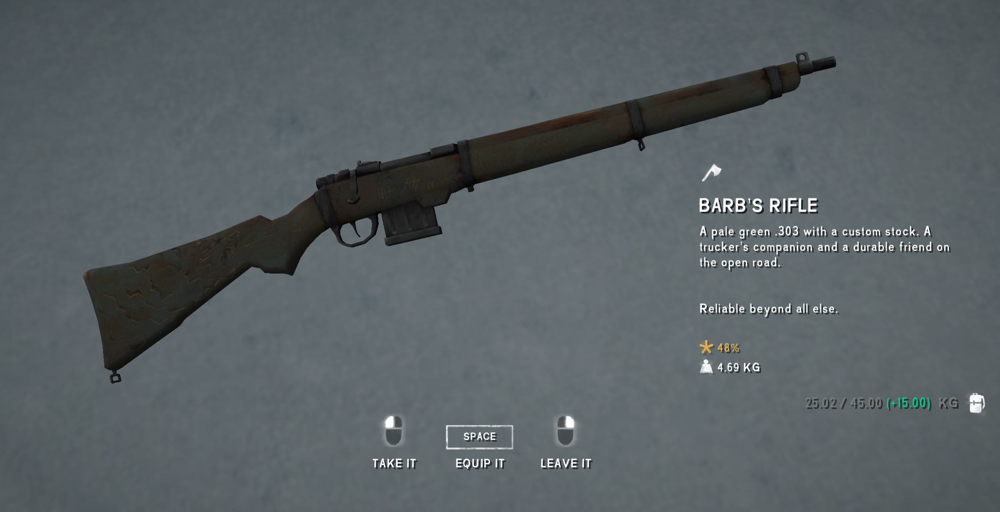
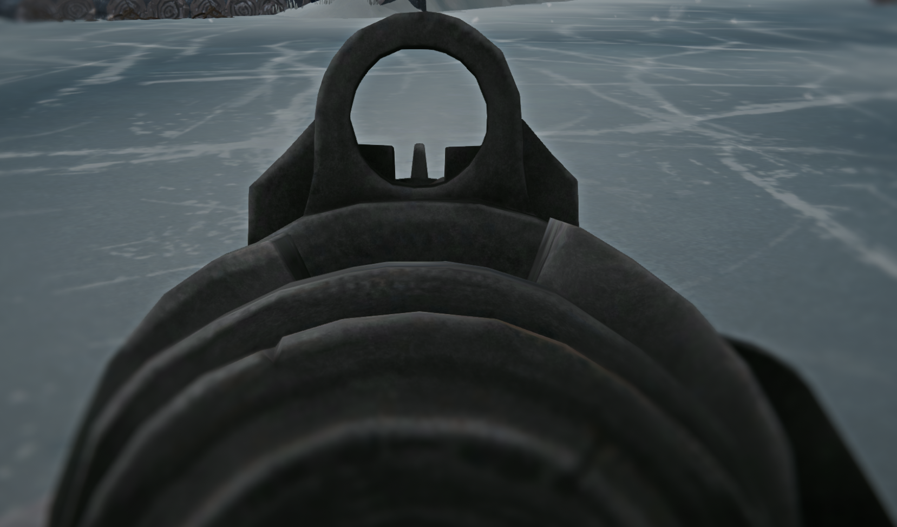
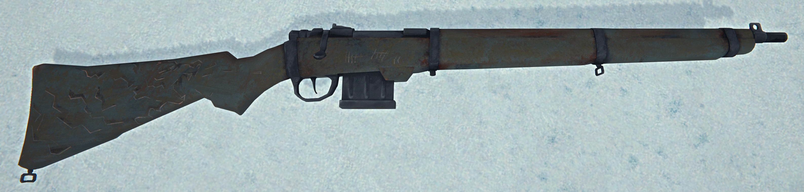
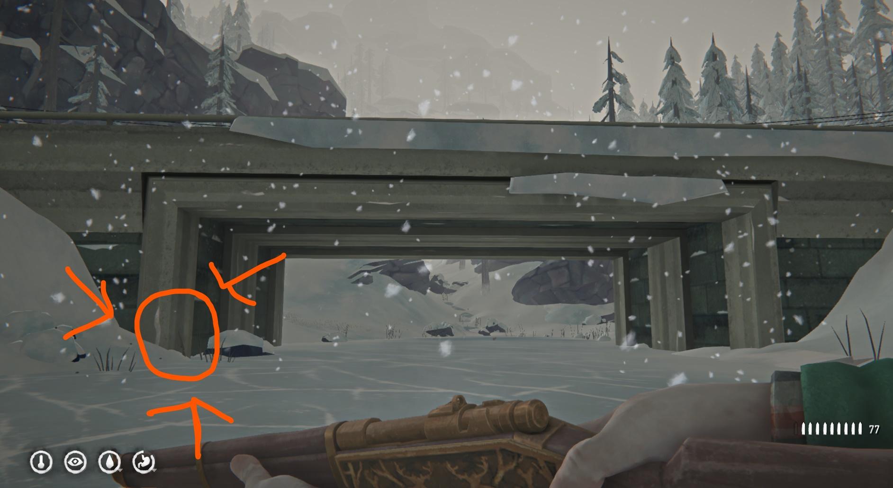

# Barb's Rifle

**Categories:** DLC Content, Pages with update history, Tools · **Source:** [Fandom](https://thelongdark.fandom.com/wiki/Barb's_Rifle)

**Contents**

- [Overview](#overview)
- [Locations](#locations)
- [Differences from Hunting Rifle](#differences-from-hunting-rifle)
- [Trivia](#trivia)
- [Gallery](#gallery)
- [Update History](#update-history)

_Ptarmigan\_icon.png_

**DLC-Exclusive content.** / This content requires the [Tales from the Far Territory](./Tales%20from%20the%20Far%20Territory.md) addon to be installed before it can be seen or used in regular gameplay.

_Barb's\_Rifle\_icon.png_

**Release:** [5 December 2022](./The%20Long%20Dark%20%E2%80%94%20Changelog.md#2.03)

**Wintermute:** No

**Renewable:** No (unique item)

**Properties**

**Item type:** [Tools](./Tools.md)\|-

**Stackable:** No

**Examine:** A pale green .303 with a custom stock. A trucker's companion and a durable friend on the open road. / Reliable beyond all else.

**Values**

**Weight:** 4.50 kg (9.9 lbs)

**Actions**

**Backpack:** Use, Actions, Drop

**On ground:** Take It, Equip It, Leave It

**Advanced data**

**Item key:** GAMEPLAY\_Rifle\_Barbs

_Barbs Rifle Inspect_

_Barbs\_Rifle\_bolt\_open.png_

_Barbs Rifle Iron Sights_

_Barbs Rifle Ground Model_

_The rifle's location in the Train Unloading area_

_ditto_

_The Rifle's location under the concrete bridge_

_Ditto_
