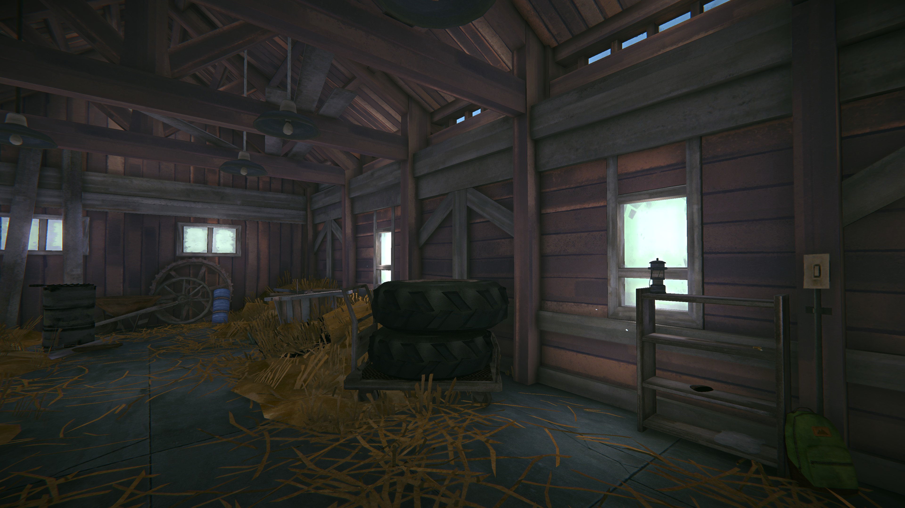

# Barn \(Molly's\)

**Barn (Molly's)**

| Property | Details |
| --- | --- |
|  |  / *Molly's\_Barn\_2.jpg* |
| **Location** |  |
|  |  / *Barn\_(Molly's)\_Location.png* |
| Region | [Pleasant Valley](./Pleasant%20Valley.md)\|- |
| Sublocations | West of Heartbreak Bridge |
| **General** |  |
| Type | Residential\|- |
|  / *bed\_icon.png* | Has a bed |
|  | Has an interior\|} / The **Barn** (Not to be confused with the one at the [Pleasant Valley Outbuildings](./Pleasant%20Valley%20Outbuildings.md)) is a small indoor hay storage shed south of [Pleasant Valley Farmstead](./Pleasant%20Valley%20Farmstead.md) and close to [Heartbreak Bridge](./Heartbreak%20Bridge.md). / ## Survival Mode / Inside, two hay beds can be found although they provide very little warmth. A wooden shelf can be found with a few basic items as well as a possible bedroll spawn. A Revolver may be found hidden in a hay stack. A hidden obstacle course to the upper storage area with the ladder can be found by walking to the west of the door and up the wooden planks. Up in the rafters is a [Frozen Corpse](./Frozen%20Corpse.md) often containing [Maple Syrup](./Maple%20Syrup.md) and a [Fleece Cowl](./Fleece%20Cowl.md). Close to the corpse, next to a hay bale, a possible spawn of a [Rabbitskin Hat](./Rabbitskin%20Hat.md) even on Interloper difficulty. / ## Episode 3 / In [Episode 3](./Episode%203%20-%20Crossroads%20Elegy.md) the Barn is named **Molly's Barn** and is the final location the first mission in the episode, [Trauma](./Trauma.md). The mission requires you to help [Molly](./Molly.md) who has been trapped in the barn by wolves and she is attacked by a [Timberwolf](./Timberwolf.md) before killing it with her bow. The upper rafters can be explored but don't contain anything. / ## Note / -The bagpack beside the Frozen Corpse floor is bugged and dont have collision, move to the sides or edit a plank to dont fell. / \| Column 1 \| Column 2 \| Column 3 \| / \| --- \| --- \| --- \| / \|  / *The farmhouse and the Heartbreak bridge behind the Barn* \|  / *The Signal hill radio tower behind the Barn* \|  / *interior* \| / **Lua execution error in Module:Navbox function navbox** [ru:Амбар (Молли)](ru:%D0%90%D0%BC%D0%B1%D0%B0%D1%80_%28%D0%9C%D0%BE%D0%BB%D0%BB%D0%B8%29) |
|  / *The farmhouse and the Heartbreak bridge behind the Barn* |  / *The Signal hill radio tower behind the Barn* /  / *interior* |
