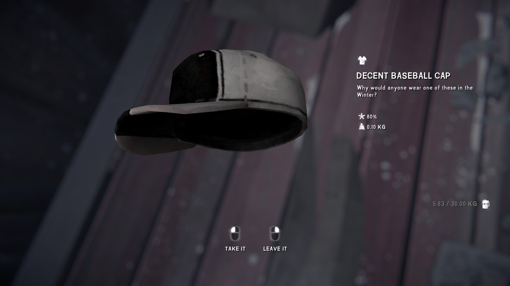

# Baseball Cap

**Baseball Cap**

| Property | Details |
| --- | --- |
|  |  / *Baseball\_Cap\_icon.png* |
| **General** |  |
| Item Type | Clothing\|- |
| Renewable | Yes ([Beachcombing](./Beachcombing.md)) |
| Clothing Slot | Head |
| **Statistics** |  |
| Weight | 0.10 kg(0.22 lbs) |
| Warmth bonus | 0.5 °C(0.9 °F) |
| Windproof bonus | 0.0 °C(0 °F) |
| Waterproof bonus | 0% |
| Protection | 0% |
| Mobility | 0% |
| Harvest | 1 × [Cloth](./Cloth.md) / 10 minutes |
| Repair | 1 × [Cloth](./Cloth.md) / 30 minutes / 75% condition |

> “**Why would anyone wear one of these in the Winter?**”
>
> — In-game description

The **Baseball Cap** is a type of hat that can be found in *[The Long Dark](./The%20Long%20Dark.md).*

## Overview

The Baseball Cap is a simple black and white hat that can commonly be found in many locations.

### Usefulness

The Baseball Cap is effectively useless for providing [Warmth](./Warmth.md), and it is usually best to harvest it for a piece of [Cloth](./Cloth.md).

Wearing it is better than nothing though, as it at least prevents [Frostbite](./Afflictions.md). Ironically, the [Improvised Head Wrap](./Improvised%20Head%20Wrap.md) has slightly higher statistics, but requires two Cloth to craft.

| Column 1 | Column 2 | Column 3 | Column 4 |
| --- | --- | --- | --- |
|  / *Clothing model* |  / *Clothing model damaged* |  / *the old 3d model was curled up* |  / *Current 3d model is not squished* |

## Update history

- UPDATE **19 December 2016 ([Update](./The%20Long%20Dark%20%E2%80%94%20Early%20Access%20Changelog.md#0.386)):**
  - Added to game

**Lua execution error in Module:Navbox function navbox** [ru:Бейсбольная кепка](ru:%D0%91%D0%B5%D0%B9%D1%81%D0%B1%D0%BE%D0%BB%D1%8C%D0%BD%D0%B0%D1%8F_%D0%BA%D0%B5%D0%BF%D0%BA%D0%B0)
