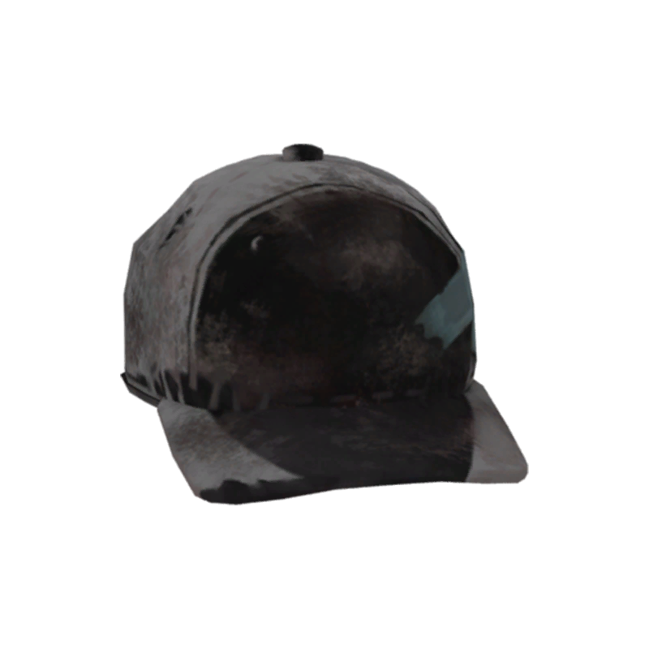
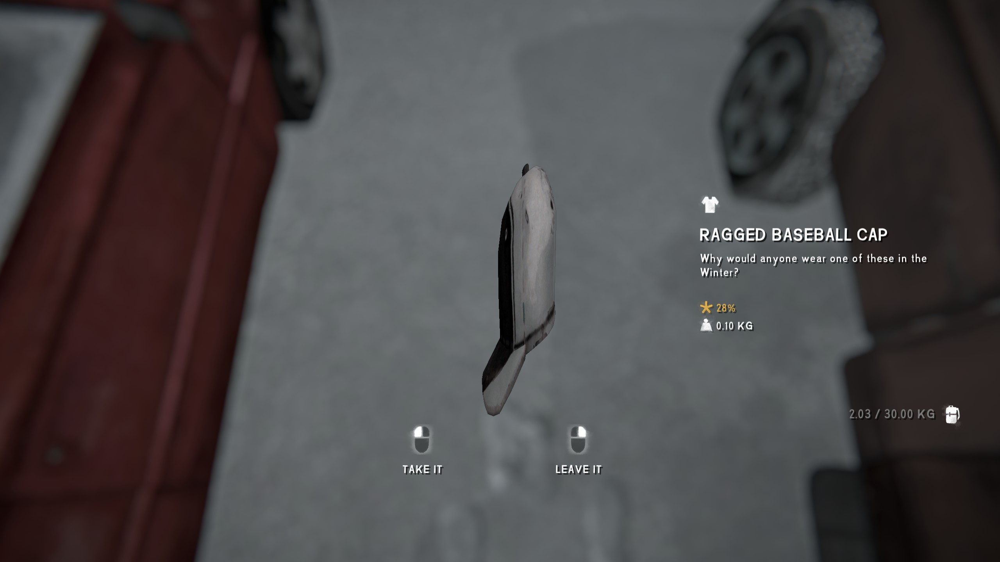

# Baseball Cap

**Categories:** Clothing, Pages with update history · **Source:** [Fandom](https://thelongdark.fandom.com/wiki/Baseball_Cap)

**Baseball Cap**

_Baseball\_Cap\_icon.png_

**General**

**Item Type:** Clothing

**Renewable:** Yes ([Beachcombing](./Beachcombing.md))

**Clothing Slot:** Head

**Statistics**

**Weight:** 0.10 kg(0.22 lbs)

**Warmth bonus:** 0.5 °C(0.9 °F)

**Windproof bonus:** 0.0 °C(0 °F)

**Waterproof bonus:** 0%

**Protection:** 0%

**Mobility:** 0%

**Harvest:** 1 × [Cloth](./Cloth.md) / 10 minutes

**Repair:** 1 × [Cloth](./Cloth.md) / 30 minutes / 75% condition

> “**Why would anyone wear one of these in the Winter?**”
>
> — In-game description

The **Baseball Cap** is a type of hat that can be found in _[The Long Dark](./The%20Long%20Dark.md)._

## Overview

The Baseball Cap is a simple black and white hat that can commonly be found in many locations.

### Usefulness

The Baseball Cap is effectively useless for providing [Warmth](./Warmth.md), and it is usually best to harvest it for a piece of [Cloth](./Cloth.md).

Wearing it is better than nothing though, as it at least prevents [Frostbite](./Afflictions.md). Ironically, the [Improvised Head Wrap](./Improvised%20Head%20Wrap.md) has slightly higher statistics, but requires two Cloth to craft.

_Clothing model_

_Clothing model damaged_

_the old 3d model was curled up_

_Current 3d model is not squished_

## Update history

- UPDATE **19 December 2016 ([Update](./The%20Long%20Dark%20%E2%80%94%20Early%20Access%20Changelog.md#0.386)):**
  - Added to game
