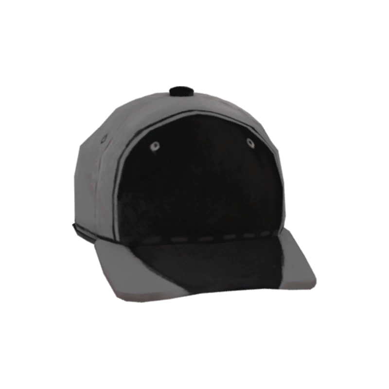

# Baseball Cap

<table class="infobox">
<caption>Baseball Cap</caption>
<colgroup>
<col style="width: 50%" />
<col style="width: 50%" />
</colgroup>
<tbody>
<tr>
<td colspan="2"><figure>

<figcaption>Baseball_Cap_icon.png</figcaption>
</figure></td>
</tr>
<tr>
<td colspan="2" class="section">
<strong>General</strong>
</td>
</tr>
<tr>
<td>
Item Type
</td>
<td>
Clothing|-
</td>
</tr>
<tr>
<td>
Renewable
</td>
<td>
Yes (<a href="./Beachcombing.md" class="wikilink" title="Beachcombing">Beachcombing</a>)
</td>
</tr>
<tr>
<td>
Clothing Slot
</td>
<td>
Head
</td>
</tr>
<tr>
<td colspan="2" class="section">
<strong>Statistics</strong>
</td>
</tr>
<tr>
<td>
Weight
</td>
<td>
0.10 kg(0.22 lbs)
</td>
</tr>
<tr>
<td>
Warmth bonus
</td>
<td>
0.5 °C(0.9 °F)
</td>
</tr>
<tr>
<td>
Windproof bonus
</td>
<td>
0.0 °C(0 °F)
</td>
</tr>
<tr>
<td>
Waterproof bonus
</td>
<td>
0%
</td>
</tr>
<tr>
<td>
Protection
</td>
<td>
0%
</td>
</tr>
<tr>
<td>
Mobility
</td>
<td>
0%
</td>
</tr>
<tr>
<td>
Harvest
</td>
<td>
1 × <a href="./Cloth.md" class="wikilink" title="Cloth">Cloth</a> 
10 minutes
</td>
</tr>
<tr>
<td>
Repair
</td>
<td>
1 × <a href="./Cloth.md" class="wikilink" title="Cloth">Cloth</a> 
30 minutes 
75% condition
</td>
</tr>
</tbody>
</table>

<table>
<colgroup>
<col style="width: 33%" />
<col style="width: 33%" />
<col style="width: 33%" />
</colgroup>
<tbody>
<tr>
<td style="vertical-align: top; font-size: 3em; color: #5d5980; padding-right: 10px">
“
</td>
<td>
Why would anyone wear one of these in the Winter?

&#10;

In-game description

</td>
<td style="vertical-align: bottom; font-size: 3em; color: #5d5980; padding-left: 10px">
”
</td>
</tr>
</tbody>
</table>

The **Baseball Cap** is a type of hat that can be found in *<a href="./The%20Long%20Dark.md" class="wikilink" title="The Long Dark">The Long Dark</a>.*

## Overview

The Baseball Cap is a simple black and white hat that can commonly be found in many locations.

### Usefulness

The Baseball Cap is effectively useless for providing <a href="./Warmth.md" class="wikilink" title="Warmth">Warmth</a>, and it is usually best to harvest it for a piece of <a href="./Cloth.md" class="wikilink" title="Cloth">Cloth</a>.

Wearing it is better than nothing though, as it at least prevents <a href="./Afflictions.md" class="wikilink" title="Frostbite">Frostbite</a>. Ironically, the <a href="./Improvised%20Head%20Wrap.md" class="wikilink" title="Improvised Head Wrap">Improvised Head Wrap</a> has slightly higher statistics, but requires two Cloth to craft.

<table class="gallery">
<colgroup>
<col style="width: 25%" />
<col style="width: 25%" />
<col style="width: 25%" />
<col style="width: 25%" />
</colgroup>
<tbody>
<tr>
<td><figure>

<figcaption>Clothing model</figcaption>
</figure></td>
<td><figure>

<figcaption>Clothing model damaged</figcaption>
</figure></td>
<td><figure>
[Missing image: Baseball_Cap_Model_old.jpg]
<figcaption>the old 3d model was curled up</figcaption>
</figure></td>
<td><figure>
[Missing image: Baseball_Cap_3d_model_current.jpg]
<figcaption>Current 3d model is not squished</figcaption>
</figure></td>
</tr>
</tbody>
</table>

## Update history

- UPDATE **19 December 2016 (<a href="./The%20Long%20Dark%20%E2%80%94%20Early%20Access%20Changelog.md#0.386" class="wikilink" title="Update">Update</a>):**
  - Added to game

**Lua execution error in Module:Navbox function navbox** <a href="ru:%D0%91%D0%B5%D0%B9%D1%81%D0%B1%D0%BE%D0%BB%D1%8C%D0%BD%D0%B0%D1%8F_%D0%BA%D0%B5%D0%BF%D0%BA%D0%B0" class="wikilink" title="ru:Бейсбольная кепка">ru:Бейсбольная кепка</a>

