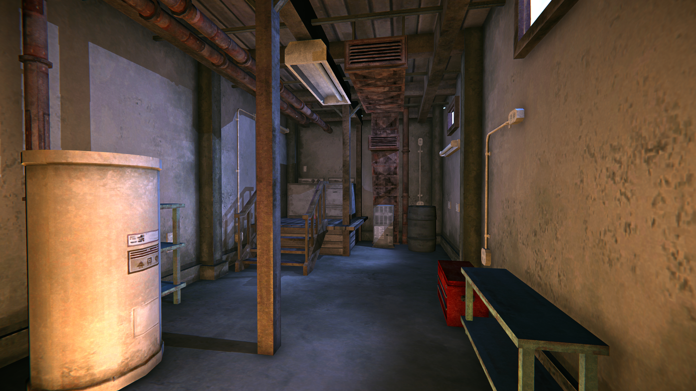

# Basement \(Crumbling Highway\)

**Categories:** Locations, Locations in Crumbling Highway, Residential locations · **Source:** [Fandom](https://thelongdark.fandom.com/wiki/Basement_%28Crumbling_Highway%29)

**Basement (Crumbling Highway)**

_Crumbling\_Highway\_Basement.jpg_

**Location**

**Region:** [Old Island Connector](./Crumbling%20Highway.md)

**Description:** A basement underneath the [Abandoned Harris Home](./Abandoned%20Harris%20Home.md)

**General**

**Type:** Residential

_bed\_icon.png_

_forge\_icon\_green.png_

_workbench\_icon\_green.png_

**Basement (Crumbling Highway)** is a sheltered indoor location in [Crumbling Highway](./Crumbling%20Highway.md), behind one of the houses in the [Abandoned Harris Home](./Abandoned%20Harris%20Home.md) location.

The interior has no bed or firebox, but is sheltered and can provide a place to sleep when transiting the area.

Contains a tool [Cabinet](./Cabinet.md) and a [First Aid](./First%20Aid%20Kit.md) box, as well as a [Washer](./Washer.md) and [Dryer](./Dryer.md) potentially containing some [clothing](./Clothing.md).

A [Wolf](./Wolf.md) spawn point can be found just outside across the road, therefore caution is advised when visiting this location.
