# Beachcombing

**Contents**

- [Item Spawns](#Item_Spawns)
- [Standard](#Standard)
- [Post-blizzard](#Post-blizzard)
- [Container and Large Object Spawns](#Container_and_Large_Object_Spawns)
- [Boat Spawns](#Boat_Spawns)
- [Strategy](#Strategy)

\[Missing image: rowboat.png\] A rowboat and loose items found while beachcombing. **Beachcombing** is a gameplay mechanic in *<a href="./The%20Long%20Dark.md" class="wikilink" title="The Long Dark">The Long Dark</a>,*which allows the player to acquire otherwise non-renewable items.

Items can wash up along the icy shoreline regions of <a href="./Great%20Bear%20Island.md" class="wikilink" title="Great Bear Island">Great Bear Island</a> (<a href="./Desolation%20Point.md" class="wikilink" title="Desolation Point">Desolation Point</a>, <a href="./Coastal%20Highway.md" class="wikilink" title="Coastal Highway">Coastal Highway</a>, <a href="./Bleak%20Inlet.md" class="wikilink" title="Bleak Inlet">Bleak Inlet</a> and <a href="./Crumbling%20Highway.md" class="wikilink" title="Crumbling Highway">Crumbling Highway</a>). Rarely the player's character must stand atop <a href="./Weak%20Ice.md" class="wikilink" title="Weak Ice">Weak Ice</a> to gather these items, but most of the time a player can safely stay on normal ice or the shore.

## Item Spawns

These small, lootable items can be found in many locations along the water, usually in small clusters. The quality and quantity of items will depend on difficulty setting. These items will respawn progressively (it is not necessary for a blizzard to occur).

### Standard

<table>
<colgroup>
<col style="width: 25%" />
<col style="width: 25%" />
<col style="width: 25%" />
<col style="width: 25%" />
</colgroup>
<thead>
<tr>
<th style="width: 50px"></th>
<th style="width: 250px">
Item
</th>
<th style="width: 75px">
Rarity
</th>
<th style="text-align: center; width: 50px;"><figure>
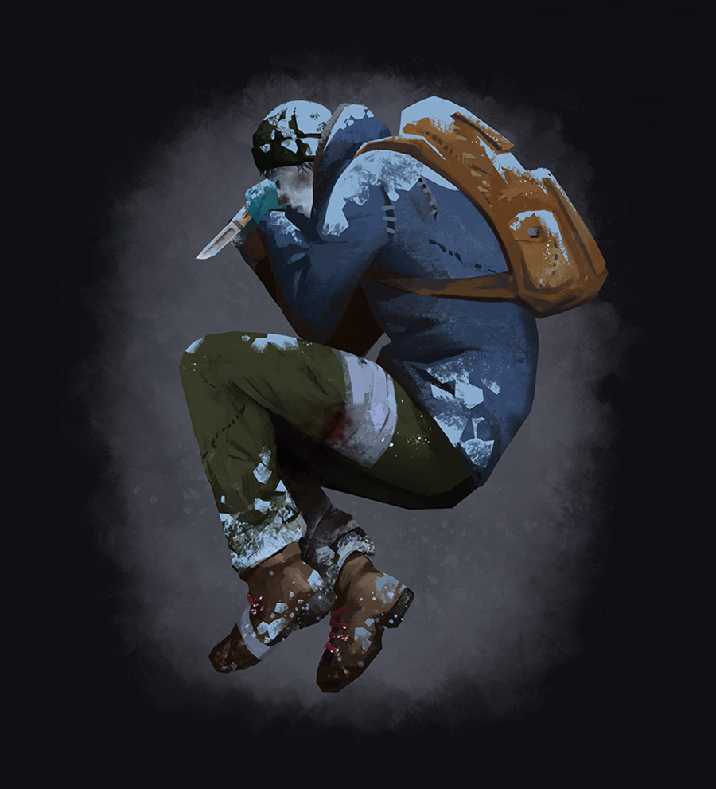
<figcaption>Misery_icon.png</figcaption>
</figure></th>
</tr>
</thead>
<tbody>
<tr>
<td><figure>

<figcaption>Stick_icon.png</figcaption>
</figure></td>
<td>
<a href="./Stick.md" class="wikilink" title="Stick">Stick</a>
</td>
<td>
22.22%
</td>
<td>
Yes
</td>
</tr>
<tr>
<td><figure>

<figcaption>Reclaimed_Wood_icon.png</figcaption>
</figure></td>
<td>
<a href="./Reclaimed%20Wood.md" class="wikilink" title="Reclaimed Wood">Reclaimed Wood</a>
</td>
<td>
7.41%
</td>
<td>
Yes
</td>
</tr>
<tr>
<td><figure>

<figcaption>Cedar_Firewood_icon.png</figcaption>
</figure></td>
<td>
<a href="./Cedar%20Firewood.md" class="wikilink" title="Cedar Firewood">Cedar Firewood</a>
</td>
<td>
5.93%
</td>
<td>
Yes
</td>
</tr>
<tr>
<td><figure>

<figcaption>Cloth_icon.png</figcaption>
</figure></td>
<td>
<a href="./Cloth.md" class="wikilink" title="Cloth">Cloth</a>
</td>
<td>
5.93%
</td>
<td>
Yes
</td>
</tr>
<tr>
<td><figure>

<figcaption>Smallmouth_Bass_(Raw)_icon.png</figcaption>
</figure></td>
<td>
<a href="./Smallmouth%20Bass%20%28Raw%29.md" class="wikilink" title="Smallmouth Bass (Raw)">Smallmouth Bass (Raw)</a>
</td>
<td>
4.44%
</td>
<td>
Yes
</td>
</tr>
<tr>
<td><figure>

<figcaption>Cat_Tail_Stalk_icon.png</figcaption>
</figure></td>
<td>
<a href="./Cat%20Tail%20Stalk.md" class="wikilink" title="Cat Tail Stalk">Cat Tail Stalk</a>
</td>
<td>
4.44%
</td>
<td>
Yes
</td>
</tr>
<tr>
<td><figure>

<figcaption>Birch_Bark_icon.png</figcaption>
</figure></td>
<td>
<a href="./Birch%20Bark.md" class="wikilink" title="Birch Bark">Birch Bark</a>
</td>
<td>
4.44%
</td>
<td>
Yes
</td>
</tr>
<tr>
<td><figure>
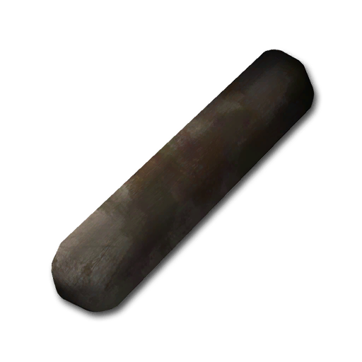
<figcaption>Cat_Tail_Head_icon.png</figcaption>
</figure></td>
<td>
<a href="./Cat%20Tail%20Head.md" class="wikilink" title="Cat Tail Head">Cat Tail Head</a>
</td>
<td>
3.7%
</td>
<td>
Yes
</td>
</tr>
<tr>
<td><figure>

<figcaption>Green_Birch_Sapling_icon.png</figcaption>
</figure></td>
<td>
<a href="./Green%20Birch%20Sapling.md" class="wikilink" title="Green Birch Sapling">Green Birch Sapling</a>
</td>
<td>
3.7%
</td>
<td>
Yes
</td>
</tr>
<tr>
<td><figure>

<figcaption>Fir_Firewood_icon.png</figcaption>
</figure></td>
<td>
<a href="./Fir%20Firewood.md" class="wikilink" title="Fir Firewood">Fir Firewood</a>
</td>
<td>
3.7%
</td>
<td>
Yes
</td>
</tr>
<tr>
<td><figure>

<figcaption>Scrap_Metal_icon.png</figcaption>
</figure></td>
<td>
<a href="./Scrap%20Metal.md" class="wikilink" title="Scrap Metal">Scrap Metal</a>
</td>
<td>
3.7%
</td>
<td>
Yes
</td>
</tr>
<tr>
<td><figure>
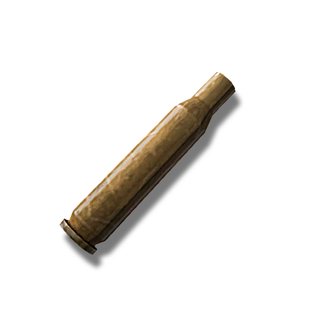
<figcaption>Rifle_Shell_Casing_icon.png</figcaption>
</figure></td>
<td>
<a href="./Rifle%20Shell%20Casing.md" class="wikilink" title="Rifle Shell Casing">Rifle Shell Casing</a>
</td>
<td>
2.96%
</td>
<td>
No
</td>
</tr>
<tr>
<td><figure>

<figcaption>Coho_Salmon_(Raw)_icon.png</figcaption>
</figure></td>
<td>
<a href="./Coho%20Salmon%20%28Raw%29.md" class="wikilink" title="Coho Salmon (Raw)">Coho Salmon (Raw)</a>
</td>
<td>
2.96%
</td>
<td>
Yes
</td>
</tr>
<tr>
<td><figure>

<figcaption>Broken_Arrow_icon.png</figcaption>
</figure></td>
<td>
<a href="./Simple%20Arrow.md" class="wikilink" title="Broken Arrow">Broken Arrow</a>
</td>
<td>
2.22%
</td>
<td>
No
</td>
</tr>
<tr>
<td><figure>
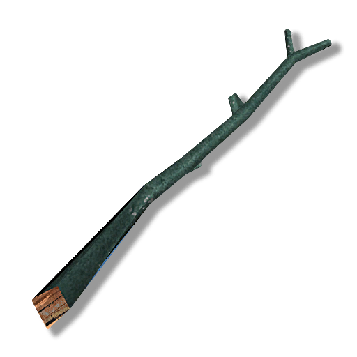
<figcaption>Green_Maple_Sapling_icon.png</figcaption>
</figure></td>
<td>
<a href="./Green%20Maple%20Sapling.md" class="wikilink" title="Green Maple Sapling">Green Maple Sapling</a>
</td>
<td>
1.48%
</td>
<td>
Yes
</td>
</tr>
<tr>
<td><figure>

<figcaption>Old_Man's_Beard_Lichen_icon.png</figcaption>
</figure></td>
<td>
<a href="./Old%20Man%27s%20Beard%20Lichen.md" class="wikilink" title="Old Man&#39;s Beard Lichen">Old Man's Beard Lichen</a>
</td>
<td>
1.48%
</td>
<td>
Yes
</td>
</tr>
<tr>
<td><figure>

<figcaption>Rifle_Cartridge_icon.png</figcaption>
</figure></td>
<td>
<a href="./Rifle%20Ammunition.md" class="wikilink" title="Rifle Cartridge">Rifle Cartridge</a>
</td>
<td>
1.48%
</td>
<td>
No
</td>
</tr>
<tr>
<td><figure>

<figcaption>Flare_Shell_icon.png</figcaption>
</figure></td>
<td>
<a href="./Flare%20Shell.md" class="wikilink" title="Flare Shell">Flare Shell</a>
</td>
<td>
1.48%
</td>
<td>
No
</td>
</tr>
<tr>
<td><figure>

<figcaption>Cotton_Toque_icon.png</figcaption>
</figure></td>
<td>
<a href="./Cotton%20Toque.md" class="wikilink" title="Cotton Toque">Cotton Toque</a>
</td>
<td>
1.48%
</td>
<td>
Yes
</td>
</tr>
<tr>
<td><figure>

<figcaption>Bandage_icon.png</figcaption>
</figure></td>
<td>
<a href="./Bandage.md" class="wikilink" title="Bandage">Bandage</a>
</td>
<td>
1.48%
</td>
<td>
Yes
</td>
</tr>
<tr>
<td><figure>

<figcaption>Painkillers_icon.png</figcaption>
</figure></td>
<td>
<a href="./Painkillers.md" class="wikilink" title="Painkillers">Painkillers</a>
</td>
<td>
1.48%
</td>
<td>
Yes
</td>
</tr>
<tr>
<td><figure>
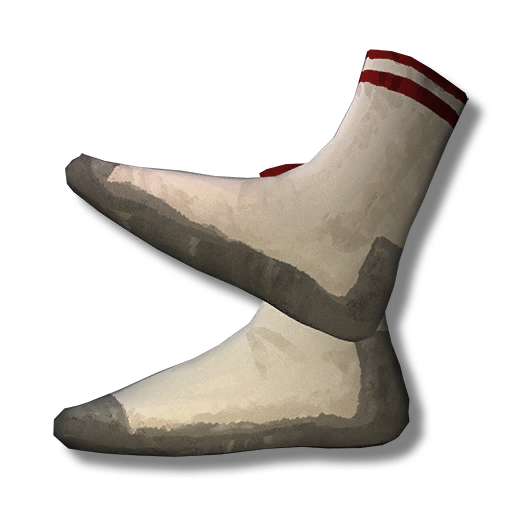
<figcaption>Sports_Socks_icon.png</figcaption>
</figure></td>
<td>
<a href="./Sports%20Socks.md" class="wikilink" title="Sports Socks">Sports Socks</a>
</td>
<td>
1.48%
</td>
<td>
Yes
</td>
</tr>
<tr>
<td><figure>

<figcaption>Baseball_Cap_icon.png</figcaption>
</figure></td>
<td>
<a href="./Baseball%20Cap.md" class="wikilink" title="Baseball Cap">Baseball Cap</a>
</td>
<td>
1.48%
</td>
<td>
Yes
</td>
</tr>
<tr>
<td><figure>

<figcaption>Broken_Fire_Hardened_Arrow_icon.png</figcaption>
</figure></td>
<td>
<a href="./Fire%20Hardened%20Arrow.md" class="wikilink" title="Broken Fire Hardened Arrow">Broken Fire Hardened Arrow</a>
</td>
<td>
1.48%
</td>
<td>
No
</td>
</tr>
<tr>
<td><figure>

<figcaption>Wires_icon.png</figcaption>
</figure></td>
<td>
<a href="./Wires.md" class="wikilink" title="Wires">Wires</a>
</td>
<td>
1.48%
</td>
<td>
Yes
</td>
</tr>
<tr>
<td><figure>

<figcaption>Cured_Leather_icon.png</figcaption>
</figure></td>
<td>
<a href="./Cured%20Leather.md" class="wikilink" title="Cured Leather">Cured Leather</a>
</td>
<td>
1.48%
</td>
<td>
Yes
</td>
</tr>
<tr>
<td><figure>

<figcaption>Improvised_Knife_icon.png</figcaption>
</figure></td>
<td>
<a href="./Improvised%20Knife.md" class="wikilink" title="Improvised Knife">Improvised Knife</a>
</td>
<td>
0.74%
</td>
<td>
No
</td>
</tr>
<tr>
<td><figure>

<figcaption>Tin_of_Sardines_icon.png</figcaption>
</figure></td>
<td>
<a href="./Tin%20of%20Sardines.md" class="wikilink" title="Tin of Sardines">Tin of Sardines</a>
</td>
<td>
0.74%
</td>
<td>
Yes
</td>
</tr>
<tr>
<td><figure>

<figcaption>Running_Shoes_icon.png</figcaption>
</figure></td>
<td>
<a href="./Running%20Shoes.md" class="wikilink" title="Running Shoes">Running Shoes</a>
</td>
<td>
0.74%
</td>
<td>
Yes
</td>
</tr>
<tr>
<td><figure>

<figcaption>Leather_Shoes_icon.png</figcaption>
</figure></td>
<td>
<a href="./Leather%20Shoes.md" class="wikilink" title="Leather Shoes">Leather Shoes</a>
</td>
<td>
0.74%
</td>
<td>
Yes
</td>
</tr>
<tr>
<td><figure>

<figcaption>Recycled_Can_icon.png</figcaption>
</figure></td>
<td>
<a href="./Recycled%20Can.md" class="wikilink" title="Recycled Can">Recycled Can</a>
</td>
<td>
0.74%
</td>
<td>
Yes
</td>
</tr>
<tr>
<td><figure>

<figcaption>Cured_Leather_icon.png</figcaption>
</figure></td>
<td>
<a href="./Cured%20Leather.md" class="wikilink" title="Cured Leather">Cured Leather</a>
</td>
<td>
0.74%
</td>
<td>
Yes
</td>
</tr>
</tbody>
</table>

### Post-blizzard

<table>
<colgroup>
<col style="width: 25%" />
<col style="width: 25%" />
<col style="width: 25%" />
<col style="width: 25%" />
</colgroup>
<thead>
<tr>
<th style="width: 50px"></th>
<th style="width: 250px">
Item
</th>
<th style="width: 75px">
Rarity
</th>
<th style="text-align: center; width: 50px;"><figure>

<figcaption>Misery_icon.png</figcaption>
</figure></th>
</tr>
</thead>
<tbody>
<tr>
<td><figure>

<figcaption>Cat_Tail_Head_icon.png</figcaption>
</figure></td>
<td>
<a href="./Cat%20Tail%20Head.md" class="wikilink" title="Cat Tail Head">Cat Tail Head</a>
</td>
<td>
5.38%
</td>
<td>
Yes
</td>
</tr>
<tr>
<td><figure>

<figcaption>Green_Birch_Sapling_icon.png</figcaption>
</figure></td>
<td>
<a href="./Green%20Birch%20Sapling.md" class="wikilink" title="Green Birch Sapling">Green Birch Sapling</a>
</td>
<td>
5.38%
</td>
<td>
Yes
</td>
</tr>
<tr>
<td><figure>

<figcaption>Fir_Firewood_icon.png</figcaption>
</figure></td>
<td>
<a href="./Fir%20Firewood.md" class="wikilink" title="Fir Firewood">Fir Firewood</a>
</td>
<td>
5.38%
</td>
<td>
Yes
</td>
</tr>
<tr>
<td><figure>

<figcaption>Smallmouth_Bass_(Raw)_icon.png</figcaption>
</figure></td>
<td>
<a href="./Smallmouth%20Bass%20%28Raw%29.md" class="wikilink" title="Smallmouth Bass (Raw)">Smallmouth Bass (Raw)</a>
</td>
<td>
5.38%
</td>
<td>
Yes
</td>
</tr>
<tr>
<td><figure>

<figcaption>Cat_Tail_Stalk_icon.png</figcaption>
</figure></td>
<td>
<a href="./Cat%20Tail%20Stalk.md" class="wikilink" title="Cat Tail Stalk">Cat Tail Stalk</a>
</td>
<td>
5.38%
</td>
<td>
Yes
</td>
</tr>
<tr>
<td><figure>

<figcaption>Birch_Bark_icon.png</figcaption>
</figure></td>
<td>
<a href="./Birch%20Bark.md" class="wikilink" title="Birch Bark">Birch Bark</a>
</td>
<td>
5.38%
</td>
<td>
Yes
</td>
</tr>
<tr>
<td><figure>

<figcaption>Cedar_Firewood_icon.png</figcaption>
</figure></td>
<td>
<a href="./Cedar%20Firewood.md" class="wikilink" title="Cedar Firewood">Cedar Firewood</a>
</td>
<td>
5.38%
</td>
<td>
Yes
</td>
</tr>
<tr>
<td><figure>

<figcaption>Cloth_icon.png</figcaption>
</figure></td>
<td>
<a href="./Cloth.md" class="wikilink" title="Cloth">Cloth</a>
</td>
<td>
5.38%
</td>
<td>
Yes
</td>
</tr>
<tr>
<td><figure>

<figcaption>Reclaimed_Wood_icon.png</figcaption>
</figure></td>
<td>
<a href="./Reclaimed%20Wood.md" class="wikilink" title="Reclaimed Wood">Reclaimed Wood</a>
</td>
<td>
5.38%
</td>
<td>
Yes
</td>
</tr>
<tr>
<td><figure>

<figcaption>Stick_icon.png</figcaption>
</figure></td>
<td>
<a href="./Stick.md" class="wikilink" title="Stick">Stick</a>
</td>
<td>
5.38%
</td>
<td>
Yes
</td>
</tr>
<tr>
<td><figure>

<figcaption>Rifle_Shell_Casing_icon.png</figcaption>
</figure></td>
<td>
<a href="./Rifle%20Shell%20Casing.md" class="wikilink" title="Rifle Shell Casing">Rifle Shell Casing</a>
</td>
<td>
4.3%
</td>
<td>
No
</td>
</tr>
<tr>
<td><figure>

<figcaption>Coho_Salmon_(Raw)_icon.png</figcaption>
</figure></td>
<td>
<a href="./Coho%20Salmon%20%28Raw%29.md" class="wikilink" title="Coho Salmon (Raw)">Coho Salmon (Raw)</a>
</td>
<td>
4.3%
</td>
<td>
Yes
</td>
</tr>
<tr>
<td><figure>

<figcaption>Broken_Arrow_icon.png</figcaption>
</figure></td>
<td>
<a href="./Simple%20Arrow.md" class="wikilink" title="Broken Arrow">Broken Arrow</a>
</td>
<td>
3.23%
</td>
<td>
No
</td>
</tr>
<tr>
<td><figure>

<figcaption>Green_Maple_Sapling_icon.png</figcaption>
</figure></td>
<td>
<a href="./Green%20Maple%20Sapling.md" class="wikilink" title="Green Maple Sapling">Green Maple Sapling</a>
</td>
<td>
2.15%
</td>
<td>
Yes
</td>
</tr>
<tr>
<td><figure>

<figcaption>Old_Man's_Beard_Lichen_icon.png</figcaption>
</figure></td>
<td>
<a href="./Old%20Man%27s%20Beard%20Lichen.md" class="wikilink" title="Old Man&#39;s Beard Lichen">Old Man's Beard Lichen</a>
</td>
<td>
2.15%
</td>
<td>
Yes
</td>
</tr>
<tr>
<td><figure>

<figcaption>Rifle_Cartridge_icon.png</figcaption>
</figure></td>
<td>
<a href="./Rifle%20Ammunition.md" class="wikilink" title="Rifle Cartridge">Rifle Cartridge</a>
</td>
<td>
2.15%
</td>
<td>
No
</td>
</tr>
<tr>
<td><figure>

<figcaption>Flare_Shell_icon.png</figcaption>
</figure></td>
<td>
<a href="./Flare%20Shell.md" class="wikilink" title="Flare Shell">Flare Shell</a>
</td>
<td>
2.15%
</td>
<td>
No
</td>
</tr>
<tr>
<td><figure>

<figcaption>Wool_Toque_icon.png</figcaption>
</figure></td>
<td>
<a href="./Wool%20Toque.md" class="wikilink" title="Wool Toque">Wool Toque</a>
</td>
<td>
2.15%
</td>
<td>
Yes
</td>
</tr>
<tr>
<td><figure>

<figcaption>Painkillers_icon.png</figcaption>
</figure></td>
<td>
<a href="./Painkillers.md" class="wikilink" title="Painkillers">Painkillers</a>
</td>
<td>
2.15%
</td>
<td>
Yes
</td>
</tr>
<tr>
<td><figure>

<figcaption>Climbing_Socks_icon.png</figcaption>
</figure></td>
<td>
<a href="./Climbing%20Socks.md" class="wikilink" title="Climbing Socks">Climbing Socks</a>
</td>
<td>
2.15%
</td>
<td>
No
</td>
</tr>
<tr>
<td><figure>

<figcaption>Cured_Leather_icon.png</figcaption>
</figure></td>
<td>
<a href="./Cured%20Leather.md" class="wikilink" title="Cured Leather">Cured Leather</a>
</td>
<td>
2.15%
</td>
<td>
Yes
</td>
</tr>
<tr>
<td><figure>

<figcaption>Hunting_Knife_icon.png</figcaption>
</figure></td>
<td>
<a href="./Hunting%20Knife.md" class="wikilink" title="Hunting Knife">Hunting Knife</a>
</td>
<td>
1.08%
</td>
<td>
No
</td>
</tr>
<tr>
<td><figure>

<figcaption>Ketchup_Chips_icon.png</figcaption>
</figure></td>
<td>
<a href="./Ketchup%20Chips.md" class="wikilink" title="Ketchup Chips">Ketchup Chips</a>
</td>
<td>
1.08%
</td>
<td>
Yes
</td>
</tr>
<tr>
<td><figure>

<figcaption>Leather_Shoes_icon.png</figcaption>
</figure></td>
<td>
<a href="./Leather%20Shoes.md" class="wikilink" title="Leather Shoes">Leather Shoes</a>
</td>
<td>
1.08%
</td>
<td>
Yes
</td>
</tr>
<tr>
<td><figure>

<figcaption>Hacksaw_icon.png</figcaption>
</figure></td>
<td>
<a href="./Hacksaw.md" class="wikilink" title="Hacksaw">Hacksaw</a>
</td>
<td>
1.08%
</td>
<td>
No
</td>
</tr>
<tr>
<td><figure>

<figcaption>Emergency_Stim_icon.png</figcaption>
</figure></td>
<td>
<a href="./Emergency%20Stim.md" class="wikilink" title="Emergency Stim">Emergency Stim</a>
</td>
<td>
1.08%
</td>
<td>
No
</td>
</tr>
<tr>
<td><figure>

<figcaption>Wool_Longjohns_icon.png</figcaption>
</figure></td>
<td>
<a href="./Wool%20Longjohns.md" class="wikilink" title="Wool Longjohns">Wool Longjohns</a>
</td>
<td>
1.08%
</td>
<td>
No
</td>
</tr>
<tr>
<td><figure>

<figcaption>Simple_Arrow_icon.png</figcaption>
</figure></td>
<td>
<a href="./Simple%20Arrow.md" class="wikilink" title="Simple Arrow">Simple Arrow</a>
</td>
<td>
1.08%
</td>
<td>
No
</td>
</tr>
<tr>
<td><figure>

<figcaption>Fire_Hardened_Arrow_icon.png</figcaption>
</figure></td>
<td>
<a href="./Fire%20Hardened%20Arrow.md" class="wikilink" title="Fire Hardened Arrow">Fire Hardened Arrow</a>
</td>
<td>
1.08%
</td>
<td>
No
</td>
</tr>
<tr>
<td><figure>

<figcaption>Broken_Fire_Hardened_Arrow_icon.png</figcaption>
</figure></td>
<td>
<a href="./Fire%20Hardened%20Arrow.md" class="wikilink" title="Broken Fire Hardened Arrow">Broken Fire Hardened Arrow</a>
</td>
<td>
1.08%
</td>
<td>
No
</td>
</tr>
<tr>
<td><figure>

<figcaption>Quality_Tools_icon.png</figcaption>
</figure></td>
<td>
<a href="./Quality%20Tools.md" class="wikilink" title="Quality Tools">Quality Tools</a>
</td>
<td>
1.08%
</td>
<td>
Yes
</td>
</tr>
<tr>
<td><figure>

<figcaption>Spray_Paint_icon.png</figcaption>
</figure></td>
<td>
<a href="./Spray%20Paint.md" class="wikilink" title="Spray Paint">Spray Paint</a>
</td>
<td>
1.08%
</td>
<td>
Yes
</td>
</tr>
<tr>
<td><figure>
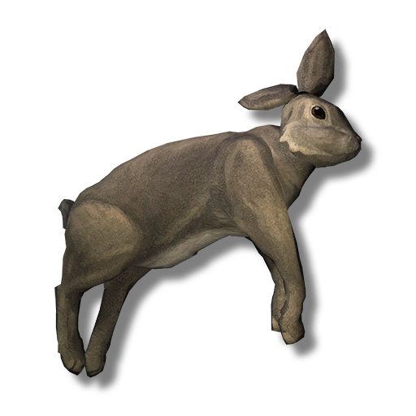
<figcaption>Rabbit_Carcass_icon.png</figcaption>
</figure></td>
<td>
<a href="./Rabbit%20Carcass.md" class="wikilink" title="Rabbit Carcass">Rabbit Carcass</a>
</td>
<td>
1.08%
</td>
<td>
Yes
</td>
</tr>
<tr>
<td><figure>

<figcaption>Military-Grade_MRE_icon.png</figcaption>
</figure></td>
<td>
<a href="./Military-Grade%20MRE.md" class="wikilink" title="Military-Grade MRE">Military-Grade MRE</a>
</td>
<td>
1.08%
</td>
<td>
No
</td>
</tr>
<tr>
<td><figure>

<figcaption>Marine_Flare_icon.png</figcaption>
</figure></td>
<td>
<a href="./Marine%20Flare.md" class="wikilink" title="Marine Flare">Marine Flare</a>
</td>
<td>
1.08%
</td>
<td>
Yes
</td>
</tr>
<tr>
<td><figure>

<figcaption>Cured_Rabbit_Pelt_icon.png</figcaption>
</figure></td>
<td>
<a href="./Cured%20Rabbit%20Pelt.md" class="wikilink" title="Cured Rabbit Pelt">Cured Rabbit Pelt</a>
</td>
<td>
1.08%
</td>
<td>
Yes
</td>
</tr>
<tr>
<td><figure>

<figcaption>The_Frozen_Angler_icon.png</figcaption>
</figure></td>
<td>
<a href="./The%20Frozen%20Angler.md" class="wikilink" title="The Frozen Angler">The Frozen Angler</a>
</td>
<td>
1.08%
</td>
<td>
Yes
</td>
</tr>
</tbody>
</table>

## Container and Large Object Spawns

Each time a <a href="./Weather.md" class="wikilink" title="blizzard">blizzard</a> occurs, several larger objects and containers have a possibility of appearing in specific locations along the ice. These locations are not shared with the other small items or boats.

Harvestable large objects:

- A ravaged <a href="./Deer%20Carcass.md" class="wikilink" title="Deer Carcass">Deer Carcass</a> (and associated <a href="./Crow%20Feather.md" class="wikilink" title="Crow Feather">Crow Feathers</a>)
- A ravaged <a href="./Wolf%20Carcass.md" class="wikilink" title="Wolf Carcass">Wolf Carcass</a> (and associated <a href="./Crow%20Feather.md" class="wikilink" title="Crow Feather">Crow Feathers</a>)
- <a href="./Pallet.md" class="wikilink" title="Pallet">Pallet</a>
- <a href="./Plank.md" class="wikilink" title="Plank">Planks</a>

Containers:

<table>
<caption>style="width:100%; text-align: left;" | <a href="./Frozen%20Corpse.md" class="wikilink" title="Frozen Corpse">Frozen Corpse</a></caption>
<colgroup>
<col style="width: 25%" />
<col style="width: 25%" />
<col style="width: 25%" />
<col style="width: 25%" />
</colgroup>
<thead>
<tr>
<th>
Icon
</th>
<th>
Item
</th>
<th>
Rarity
</th>
<th><figure>

<figcaption>Misery_icon.png</figcaption>
</figure></th>
</tr>
</thead>
<tbody>
<tr>
<td><figure>

<figcaption>Beef_Jerky_icon.png</figcaption>
</figure></td>
<td>
<a href="./Beef%20Jerky.md" class="wikilink" title="Beef Jerky">Beef Jerky</a>
</td>
<td>
5.1%
</td>
<td>
Yes
</td>
</tr>
<tr>
<td><figure>

<figcaption>Tinder_Plug_icon.png</figcaption>
</figure></td>
<td>
<a href="./Tinder%20Plug.md" class="wikilink" title="Tinder Plug">Tinder Plug</a>
</td>
<td>
5.1%
</td>
<td>
Yes
</td>
</tr>
<tr>
<td><figure>

<figcaption>Wood_Matches_icon.png</figcaption>
</figure></td>
<td>
<a href="./Wood%20Matches.md" class="wikilink" title="Wood Matches">Wood Matches</a>
</td>
<td>
5.1%
</td>
<td>
Yes
</td>
</tr>
<tr>
<td><figure>

<figcaption>Wool_Toque_icon.png</figcaption>
</figure></td>
<td>
<a href="./Wool%20Toque.md" class="wikilink" title="Wool Toque">Wool Toque</a>
</td>
<td>
5.1%
</td>
<td>
Yes
</td>
</tr>
<tr>
<td><figure>

<figcaption>Summit_Soda_icon.png</figcaption>
</figure></td>
<td>
<a href="./Summit%20Soda.md" class="wikilink" title="Summit Soda">Summit Soda</a>
</td>
<td>
5.1%
</td>
<td>
Yes
</td>
</tr>
<tr>
<td><figure>

<figcaption>Chocolate_Bar_icon.png</figcaption>
</figure></td>
<td>
<a href="./Chocolate%20Bar.md" class="wikilink" title="Chocolate Bar">Chocolate Bar</a>
</td>
<td>
5.1%
</td>
<td>
Yes
</td>
</tr>
<tr>
<td><figure>

<figcaption>Stacy's_Grape_Soda_icon.png</figcaption>
</figure></td>
<td>
<a href="./Stacy%27s%20Grape%20Soda.md" class="wikilink" title="Stacy&#39;s Grape Soda">Stacy's Grape Soda</a>
</td>
<td>
5.1%
</td>
<td>
No
</td>
</tr>
<tr>
<td><figure>

<figcaption>Trail_Boots_icon.png</figcaption>
</figure></td>
<td>
<a href="./Trail%20Boots.md" class="wikilink" title="Trail Boots">Trail Boots</a>
</td>
<td>
4.1%
</td>
<td>
Yes
</td>
</tr>
<tr>
<td><figure>

<figcaption>Running_Shoes_icon.png</figcaption>
</figure></td>
<td>
<a href="./Running%20Shoes.md" class="wikilink" title="Running Shoes">Running Shoes</a>
</td>
<td>
4.1%
</td>
<td>
Yes
</td>
</tr>
<tr>
<td><figure>

<figcaption>Ketchup_Chips_icon.png</figcaption>
</figure></td>
<td>
<a href="./Ketchup%20Chips.md" class="wikilink" title="Ketchup Chips">Ketchup Chips</a>
</td>
<td>
4.1%
</td>
<td>
Yes
</td>
</tr>
<tr>
<td><figure>

<figcaption>Flare_icon.png</figcaption>
</figure></td>
<td>
<a href="./Flare.md" class="wikilink" title="Flare">Flare</a>
</td>
<td>
3.6%
</td>
<td>
Yes
</td>
</tr>
<tr>
<td><figure>

<figcaption>Tin_of_Sardines_icon.png</figcaption>
</figure></td>
<td>
<a href="./Tin%20of%20Sardines.md" class="wikilink" title="Tin of Sardines">Tin of Sardines</a>
</td>
<td>
3.6%
</td>
<td>
Yes
</td>
</tr>
<tr>
<td><figure>

<figcaption>T-Shirt_icon.png</figcaption>
</figure></td>
<td>
<a href="./T-Shirt.md" class="wikilink" title="T-Shirt">T-Shirt</a>
</td>
<td>
3.6%
</td>
<td>
Yes
</td>
</tr>
<tr>
<td><figure>

<figcaption>Hoodie_icon.png</figcaption>
</figure></td>
<td>
<a href="./Hoodie.md" class="wikilink" title="Hoodie">Hoodie</a>
</td>
<td>
3%
</td>
<td>
Yes
</td>
</tr>
<tr>
<td><figure>

<figcaption>Revolver_Cartridge_icon.png</figcaption>
</figure></td>
<td>
<a href="./Revolver%20Ammunition.md" class="wikilink" title="Revolver Cartridge">Revolver Cartridge</a>
</td>
<td>
2.5%
</td>
<td>
No
</td>
</tr>
<tr>
<td><figure>

<figcaption>Charcoal_icon.png</figcaption>
</figure></td>
<td>
<a href="./Charcoal.md" class="wikilink" title="Charcoal">Charcoal</a>
</td>
<td>
2.5%
</td>
<td>
Yes
</td>
</tr>
<tr>
<td><figure>

<figcaption>Energy_Bar_icon.png</figcaption>
</figure></td>
<td>
<a href="./Energy%20Bar.md" class="wikilink" title="Energy Bar">Energy Bar</a>
</td>
<td>
2.5%
</td>
<td>
No
</td>
</tr>
<tr>
<td><figure>

<figcaption>Lantern_Fuel_icon.png</figcaption>
</figure></td>
<td>
<a href="./Lantern%20Fuel.md" class="wikilink" title="Lantern Fuel">Lantern Fuel</a>
</td>
<td>
2.5%
</td>
<td>
Yes
</td>
</tr>
<tr>
<td><figure>

<figcaption>Rifle_Cartridge_icon.png</figcaption>
</figure></td>
<td>
<a href="./Rifle%20Ammunition.md" class="wikilink" title="Rifle Cartridge">Rifle Cartridge</a>
</td>
<td>
2.5%
</td>
<td>
No
</td>
</tr>
<tr>
<td><figure>

<figcaption>Cotton_Scarf_icon.png</figcaption>
</figure></td>
<td>
<a href="./Cotton%20Scarf.md" class="wikilink" title="Cotton Scarf">Cotton Scarf</a>
</td>
<td>
2.5%
</td>
<td>
Yes
</td>
</tr>
<tr>
<td><figure>

<figcaption>Bandage_icon.png</figcaption>
</figure></td>
<td>
<a href="./Bandage.md" class="wikilink" title="Bandage">Bandage</a>
</td>
<td>
2%
</td>
<td>
Yes
</td>
</tr>
<tr>
<td><figure>
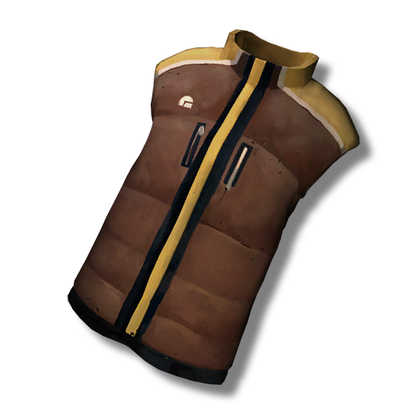
<figcaption>Sport_Vest_icon.png</figcaption>
</figure></td>
<td>
<a href="./Sport%20Vest.md" class="wikilink" title="Sport Vest">Sport Vest</a>
</td>
<td>
2%
</td>
<td>
Yes
</td>
</tr>
<tr>
<td><figure>
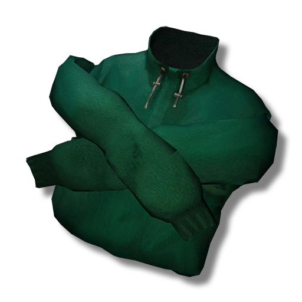
<figcaption>Windbreaker_icon.png</figcaption>
</figure></td>
<td>
<a href="./Windbreaker.md" class="wikilink" title="Windbreaker">Windbreaker</a>
</td>
<td>
2%
</td>
<td>
Yes
</td>
</tr>
<tr>
<td><figure>

<figcaption>Sports_Socks_icon.png</figcaption>
</figure></td>
<td>
<a href="./Sports%20Socks.md" class="wikilink" title="Sports Socks">Sports Socks</a>
</td>
<td>
2%
</td>
<td>
Yes
</td>
</tr>
<tr>
<td><figure>
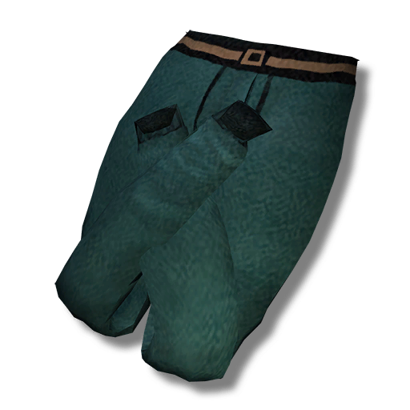
<figcaption>Thermal_Underwear_icon.png</figcaption>
</figure></td>
<td>
<a href="./Thermal%20Underwear.md" class="wikilink" title="Thermal Underwear">Thermal Underwear</a>
</td>
<td>
1.5%
</td>
<td>
Yes
</td>
</tr>
<tr>
<td><figure>

<figcaption>Dog_Food_icon.png</figcaption>
</figure></td>
<td>
<a href="./Dog%20Food.md" class="wikilink" title="Dog Food">Dog Food</a>
</td>
<td>
1.5%
</td>
<td>
Yes
</td>
</tr>
<tr>
<td><figure>

<figcaption>Fishing_Tackle_icon.png</figcaption>
</figure></td>
<td>
<a href="./Fishing%20Tackle.md" class="wikilink" title="Fishing Tackle">Fishing Tackle</a>
</td>
<td>
1.5%
</td>
<td>
No
</td>
</tr>
<tr>
<td><figure>

<figcaption>Marine_Flare_icon.png</figcaption>
</figure></td>
<td>
<a href="./Marine%20Flare.md" class="wikilink" title="Marine Flare">Marine Flare</a>
</td>
<td>
1.5%
</td>
<td>
Yes
</td>
</tr>
<tr>
<td><figure>

<figcaption>Thick_Wool_Sweater_icon.png</figcaption>
</figure></td>
<td>
<a href="./Thick%20Wool%20Sweater.md" class="wikilink" title="Thick Wool Sweater">Thick Wool Sweater</a>
</td>
<td>
1%
</td>
<td>
No
</td>
</tr>
<tr>
<td><figure>
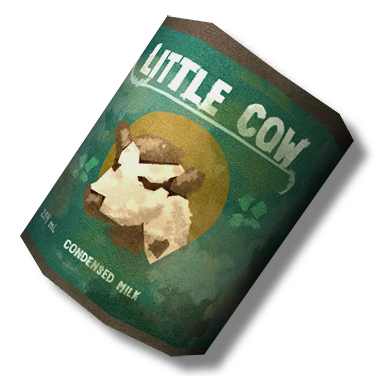
<figcaption>Condensed_Milk_icon.png</figcaption>
</figure></td>
<td>
<a href="./Condensed%20Milk.md" class="wikilink" title="Condensed Milk">Condensed Milk</a>
</td>
<td>
1%
</td>
<td>
No
</td>
</tr>
<tr>
<td><figure>

<figcaption>Spray_Paint_icon.png</figcaption>
</figure></td>
<td>
<a href="./Spray%20Paint.md" class="wikilink" title="Spray Paint">Spray Paint</a>
</td>
<td>
1%
</td>
<td>
Yes
</td>
</tr>
<tr>
<td><figure>

<figcaption>Arrowhead_icon.png</figcaption>
</figure></td>
<td>
<a href="./Arrowhead.md" class="wikilink" title="Arrowhead">Arrowhead</a>
</td>
<td>
1%
</td>
<td>
Yes
</td>
</tr>
<tr>
<td><figure>

<figcaption>Antibiotics_icon.png</figcaption>
</figure></td>
<td>
<a href="./Antibiotics.md" class="wikilink" title="Antibiotics">Antibiotics</a>
</td>
<td>
0.5%
</td>
<td>
Yes
</td>
</tr>
<tr>
<td><figure>

<figcaption>Painkillers_icon.png</figcaption>
</figure></td>
<td>
<a href="./Painkillers.md" class="wikilink" title="Painkillers">Painkillers</a>
</td>
<td>
0.5%
</td>
<td>
Yes
</td>
</tr>
<tr>
<td><figure>

<figcaption>Flare_Shell_icon.png</figcaption>
</figure></td>
<td>
<a href="./Flare%20Shell.md" class="wikilink" title="Flare Shell">Flare Shell</a>
</td>
<td>
0.5%
</td>
<td>
No
</td>
</tr>
<tr>
<td><figure>
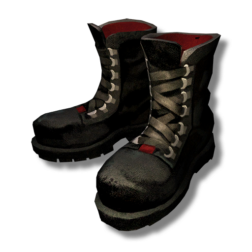
<figcaption>Combat_Boots_icon.png</figcaption>
</figure></td>
<td>
<a href="./Combat%20Boots.md" class="wikilink" title="Combat Boots">Combat Boots</a>
</td>
<td>
0.5%
</td>
<td>
Yes
</td>
</tr>
<tr>
<td><figure>

<figcaption>Recycled_Can_icon.png</figcaption>
</figure></td>
<td>
<a href="./Recycled%20Can.md" class="wikilink" title="Recycled Can">Recycled Can</a>
</td>
<td>
0.5%
</td>
<td>
Yes
</td>
</tr>
<tr>
<td><figure>

<figcaption>Go!_Energy_Drink_icon.png</figcaption>
</figure></td>
<td>
<a href="./Go!%20Energy%20Drink.md" class="wikilink" title="Go! Energy Drink">Go! Energy Drink</a>
</td>
<td>
0.5%
</td>
<td>
No
</td>
</tr>
<tr>
<td><figure>

<figcaption>Maple_Syrup_icon.png</figcaption>
</figure></td>
<td>
<a href="./Maple%20Syrup.md" class="wikilink" title="Maple Syrup">Maple Syrup</a>
</td>
<td>
0.5%
</td>
<td>
Yes
</td>
</tr>
<tr>
<td><figure>
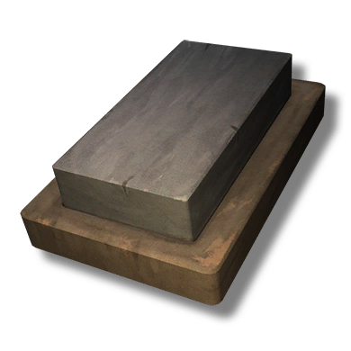
<figcaption>Whetstone_icon.png</figcaption>
</figure></td>
<td>
<a href="./Whetstone.md" class="wikilink" title="Whetstone">Whetstone</a>
</td>
<td>
0.5%
</td>
<td>
Yes
</td>
</tr>
<tr>
<td><figure>

<figcaption>Sewing_Kit_icon.png</figcaption>
</figure></td>
<td>
<a href="./Sewing%20Kit.md" class="wikilink" title="Sewing Kit">Sewing Kit</a>
</td>
<td>
0.5%
</td>
<td>
Yes
</td>
</tr>
<tr>
<td><figure>

<figcaption>Flashlight_icon.png</figcaption>
</figure></td>
<td>
<a href="./Flashlight.md" class="wikilink" title="Flashlight">Flashlight</a>
</td>
<td>
0.5%
</td>
<td>
No
</td>
</tr>
</tbody>
</table>

<table>
<caption>style="width:100%; text-align: left;" | <a href="./Trunk.md" class="wikilink" title="Trunk">Trunk</a></caption>
<colgroup>
<col style="width: 25%" />
<col style="width: 25%" />
<col style="width: 25%" />
<col style="width: 25%" />
</colgroup>
<thead>
<tr>
<th>
Icon
</th>
<th>
Item
</th>
<th>
Rarity
</th>
<th><figure>

<figcaption>Misery_icon.png</figcaption>
</figure></th>
</tr>
</thead>
<tbody>
<tr>
<td><figure>
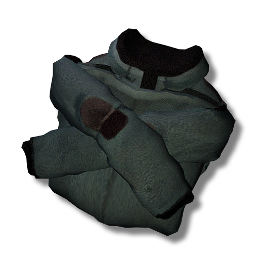
<figcaption>Ski_Jacket_icon.png</figcaption>
</figure></td>
<td>
<a href="./Ski%20Jacket.md" class="wikilink" title="Ski Jacket">Ski Jacket</a>
</td>
<td>
8.57%
</td>
<td>
Yes
</td>
</tr>
<tr>
<td><figure>

<figcaption>Windbreaker_icon.png</figcaption>
</figure></td>
<td>
<a href="./Windbreaker.md" class="wikilink" title="Windbreaker">Windbreaker</a>
</td>
<td>
8.57%
</td>
<td>
Yes
</td>
</tr>
<tr>
<td><figure>

<figcaption>Sport_Vest_icon.png</figcaption>
</figure></td>
<td>
<a href="./Sport%20Vest.md" class="wikilink" title="Sport Vest">Sport Vest</a>
</td>
<td>
8.57%
</td>
<td>
Yes
</td>
</tr>
<tr>
<td><figure>
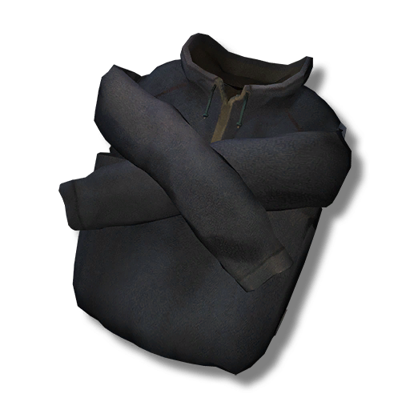
<figcaption>Simple_Parka_icon.png</figcaption>
</figure></td>
<td>
<a href="./Simple%20Parka.md" class="wikilink" title="Simple Parka">Simple Parka</a>
</td>
<td>
8.57%
</td>
<td>
Yes
</td>
</tr>
<tr>
<td><figure>

<figcaption>Light_Shell_icon.png</figcaption>
</figure></td>
<td>
<a href="./Light%20Shell.md" class="wikilink" title="Light Shell">Light Shell</a>
</td>
<td>
8.57%
</td>
<td>
Yes
</td>
</tr>
<tr>
<td><figure>

<figcaption>Cotton_Toque_icon.png</figcaption>
</figure></td>
<td>
<a href="./Cotton%20Toque.md" class="wikilink" title="Cotton Toque">Cotton Toque</a>
</td>
<td>
5.71%
</td>
<td>
Yes
</td>
</tr>
<tr>
<td><figure>

<figcaption>Fleece_Mittens_icon.png</figcaption>
</figure></td>
<td>
<a href="./Fleece%20Mittens.md" class="wikilink" title="Fleece Mittens">Fleece Mittens</a>
</td>
<td>
5.71%
</td>
<td>
Yes
</td>
</tr>
<tr>
<td><figure>

<figcaption>Down_Vest_icon.png</figcaption>
</figure></td>
<td>
<a href="./Down%20Vest.md" class="wikilink" title="Down Vest">Down Vest</a>
</td>
<td>
3.43%
</td>
<td>
Yes
</td>
</tr>
<tr>
<td><figure>
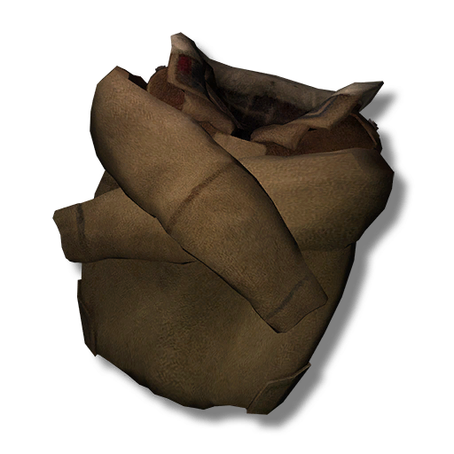
<figcaption>Old_Fashioned_Parka_icon.png</figcaption>
</figure></td>
<td>
<a href="./Old%20Fashioned%20Parka.md" class="wikilink" title="Old Fashioned Parka">Old Fashioned Parka</a>
</td>
<td>
3.43%
</td>
<td>
No
</td>
</tr>
<tr>
<td><figure>

<figcaption>Wool_Scarf_icon.png</figcaption>
</figure></td>
<td>
<a href="./Wool%20Scarf.md" class="wikilink" title="Wool Scarf">Wool Scarf</a>
</td>
<td>
3.43%
</td>
<td>
Yes
</td>
</tr>
<tr>
<td><figure>

<figcaption>Wool_Toque_icon.png</figcaption>
</figure></td>
<td>
<a href="./Wool%20Toque.md" class="wikilink" title="Wool Toque">Wool Toque</a>
</td>
<td>
3.43%
</td>
<td>
Yes
</td>
</tr>
<tr>
<td><figure>

<figcaption>Trail_Boots_icon.png</figcaption>
</figure></td>
<td>
<a href="./Trail%20Boots.md" class="wikilink" title="Trail Boots">Trail Boots</a>
</td>
<td>
3.43%
</td>
<td>
Yes
</td>
</tr>
<tr>
<td><figure>
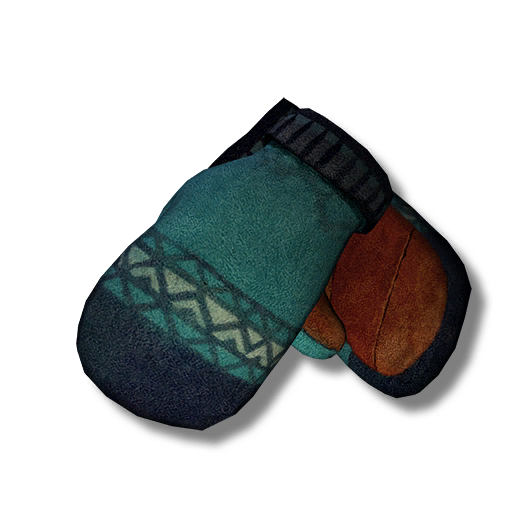
<figcaption>Wool_Mittens_icon.png</figcaption>
</figure></td>
<td>
<a href="./Wool%20Mittens.md" class="wikilink" title="Wool Mittens">Wool Mittens</a>
</td>
<td>
3.43%
</td>
<td>
No
</td>
</tr>
<tr>
<td><figure>

<figcaption>Driving_Gloves_icon.png</figcaption>
</figure></td>
<td>
<a href="./Driving%20Gloves.md" class="wikilink" title="Driving Gloves">Driving Gloves</a>
</td>
<td>
3.43%
</td>
<td>
Yes
</td>
</tr>
<tr>
<td><figure>

<figcaption>Hoodie_icon.png</figcaption>
</figure></td>
<td>
<a href="./Hoodie.md" class="wikilink" title="Hoodie">Hoodie</a>
</td>
<td>
3.43%
</td>
<td>
Yes
</td>
</tr>
<tr>
<td><figure>

<figcaption>Running_Shoes_icon.png</figcaption>
</figure></td>
<td>
<a href="./Running%20Shoes.md" class="wikilink" title="Running Shoes">Running Shoes</a>
</td>
<td>
3.43%
</td>
<td>
Yes
</td>
</tr>
<tr>
<td><figure>
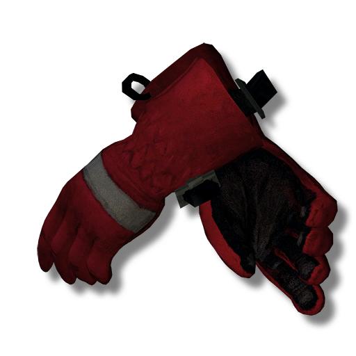
<figcaption>Ski_Gloves_icon.png</figcaption>
</figure></td>
<td>
<a href="./Ski%20Gloves.md" class="wikilink" title="Ski Gloves">Ski Gloves</a>
</td>
<td>
1.71%
</td>
<td>
No
</td>
</tr>
<tr>
<td><figure>

<figcaption>Urban_Parka_icon.png</figcaption>
</figure></td>
<td>
<a href="./Urban%20Parka.md" class="wikilink" title="Urban Parka">Urban Parka</a>
</td>
<td>
1.71%
</td>
<td>
No
</td>
</tr>
<tr>
<td><figure>
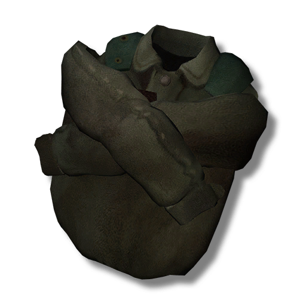
<figcaption>Military_Coat_icon.png</figcaption>
</figure></td>
<td>
<a href="./Military%20Coat.md" class="wikilink" title="Military Coat">Military Coat</a>
</td>
<td>
1.71%
</td>
<td>
No
</td>
</tr>
<tr>
<td><figure>

<figcaption>Newsprint_icon.png</figcaption>
</figure></td>
<td>
<a href="./Newsprint.md" class="wikilink" title="Newsprint">Newsprint</a>
</td>
<td>
1.71%
</td>
<td>
Yes
</td>
</tr>
<tr>
<td><figure>

<figcaption>Cloth_icon.png</figcaption>
</figure></td>
<td>
<a href="./Cloth.md" class="wikilink" title="Cloth">Cloth</a>
</td>
<td>
1.71%
</td>
<td>
Yes
</td>
</tr>
<tr>
<td><figure>

<figcaption>Mackinaw_Jacket_icon.png</figcaption>
</figure></td>
<td>
<a href="./Mackinaw%20Jacket.md" class="wikilink" title="Mackinaw Jacket">Mackinaw Jacket</a>
</td>
<td>
0.57%
</td>
<td>
Yes
</td>
</tr>
<tr>
<td><figure>

<figcaption>Mariner's_Pea_Coat_icon.png</figcaption>
</figure></td>
<td>
<a href="./Mariner%27s%20Pea%20Coat.md" class="wikilink" title="Mariner&#39;s Pea Coat">Mariner's Pea Coat</a>
</td>
<td>
0.57%
</td>
<td>
No
</td>
</tr>
<tr>
<td><figure>
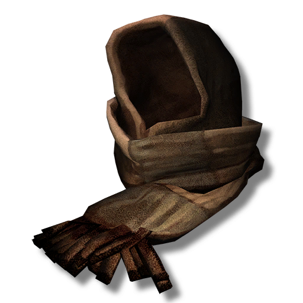
<figcaption>Long_Wool_Scarf_icon.png</figcaption>
</figure></td>
<td>
<a href="./Long%20Wool%20Scarf.md" class="wikilink" title="Long Wool Scarf">Long Wool Scarf</a>
</td>
<td>
0.57%
</td>
<td>
No
</td>
</tr>
<tr>
<td><figure>
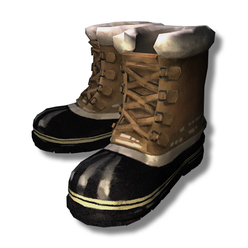
<figcaption>Insulated_Boots_icon.png</figcaption>
</figure></td>
<td>
<a href="./Insulated%20Boots.md" class="wikilink" title="Insulated Boots">Insulated Boots</a>
</td>
<td>
0.57%
</td>
<td>
No
</td>
</tr>
<tr>
<td><figure>

<figcaption>Mukluks_icon.png</figcaption>
</figure></td>
<td>
<a href="./Mukluks.md" class="wikilink" title="Mukluks">Mukluks</a>
</td>
<td>
0.57%
</td>
<td>
No
</td>
</tr>
<tr>
<td><figure>
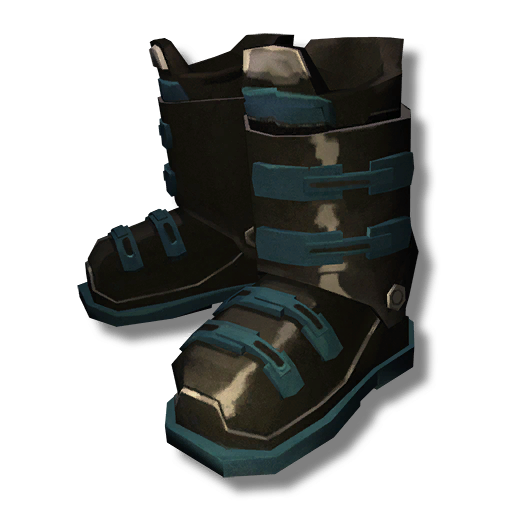
<figcaption>Ski_Boots_icon.png</figcaption>
</figure></td>
<td>
<a href="./Ski%20Boots.md" class="wikilink" title="Ski Boots">Ski Boots</a>
</td>
<td>
0.57%
</td>
<td>
No
</td>
</tr>
<tr>
<td><figure>
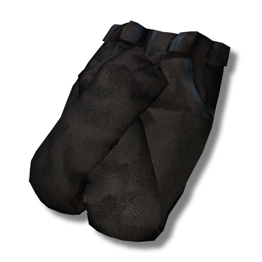
<figcaption>Snow_Pants_icon.png</figcaption>
</figure></td>
<td>
<a href="./Snow%20Pants.md" class="wikilink" title="Snow Pants">Snow Pants</a>
</td>
<td>
0.57%
</td>
<td>
No
</td>
</tr>
<tr>
<td><figure>

<figcaption>Flare_icon.png</figcaption>
</figure></td>
<td>
<a href="./Flare.md" class="wikilink" title="Flare">Flare</a>
</td>
<td>
0.57%
</td>
<td>
Yes
</td>
</tr>
<tr>
<td><figure>
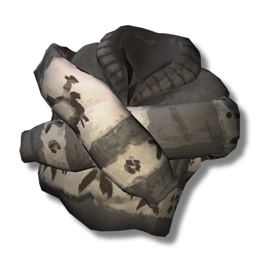
<figcaption>Cowichan_Sweater_icon.png</figcaption>
</figure></td>
<td>
<a href="./Cowichan%20Sweater.md" class="wikilink" title="Cowichan Sweater">Cowichan Sweater</a>
</td>
<td>
0.57%
</td>
<td>
No
</td>
</tr>
<tr>
<td><figure>
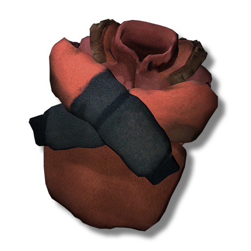
<figcaption>Expedition_Parka_icon.png</figcaption>
</figure></td>
<td>
<a href="./Expedition%20Parka.md" class="wikilink" title="Expedition Parka">Expedition Parka</a>
</td>
<td>
0.57%
</td>
<td>
No
</td>
</tr>
<tr>
<td><figure>
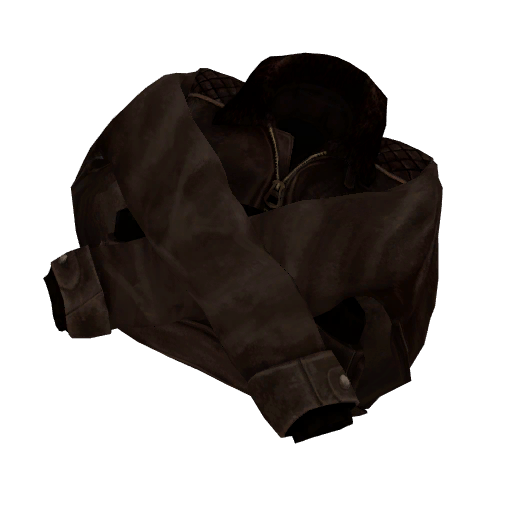
<figcaption>Flight_Jacket_icon.png</figcaption>
</figure></td>
<td>
<a href="./Flight%20Jacket.md" class="wikilink" title="Flight Jacket">Flight Jacket</a>
</td>
<td>
0.57%
</td>
<td>
No
</td>
</tr>
</tbody>
</table>

<table>
<caption>style="width:100%; text-align: left;" | <a href="./Suitcase.md" class="wikilink" title="Suitcase">Suitcase</a></caption>
<colgroup>
<col style="width: 25%" />
<col style="width: 25%" />
<col style="width: 25%" />
<col style="width: 25%" />
</colgroup>
<thead>
<tr>
<th>
Icon
</th>
<th>
Item
</th>
<th>
Rarity
</th>
<th><figure>

<figcaption>Misery_icon.png</figcaption>
</figure></th>
</tr>
</thead>
<tbody>
<tr>
<td><figure>

<figcaption>Sport_Vest_icon.png</figcaption>
</figure></td>
<td>
<a href="./Sport%20Vest.md" class="wikilink" title="Sport Vest">Sport Vest</a>
</td>
<td>
3.26%
</td>
<td>
Yes
</td>
</tr>
<tr>
<td><figure>

<figcaption>Wool_Toque_icon.png</figcaption>
</figure></td>
<td>
<a href="./Wool%20Toque.md" class="wikilink" title="Wool Toque">Wool Toque</a>
</td>
<td>
3.26%
</td>
<td>
Yes
</td>
</tr>
<tr>
<td><figure>

<figcaption>Light_Shell_icon.png</figcaption>
</figure></td>
<td>
<a href="./Light%20Shell.md" class="wikilink" title="Light Shell">Light Shell</a>
</td>
<td>
3.26%
</td>
<td>
Yes
</td>
</tr>
<tr>
<td><figure>

<figcaption>Cotton_Scarf_icon.png</figcaption>
</figure></td>
<td>
<a href="./Cotton%20Scarf.md" class="wikilink" title="Cotton Scarf">Cotton Scarf</a>
</td>
<td>
3.26%
</td>
<td>
Yes
</td>
</tr>
<tr>
<td><figure>

<figcaption>Simple_Parka_icon.png</figcaption>
</figure></td>
<td>
<a href="./Simple%20Parka.md" class="wikilink" title="Simple Parka">Simple Parka</a>
</td>
<td>
3.26%
</td>
<td>
Yes
</td>
</tr>
<tr>
<td><figure>

<figcaption>Running_Shoes_icon.png</figcaption>
</figure></td>
<td>
<a href="./Running%20Shoes.md" class="wikilink" title="Running Shoes">Running Shoes</a>
</td>
<td>
3.26%
</td>
<td>
Yes
</td>
</tr>
<tr>
<td><figure>

<figcaption>Leather_Shoes_icon.png</figcaption>
</figure></td>
<td>
<a href="./Leather%20Shoes.md" class="wikilink" title="Leather Shoes">Leather Shoes</a>
</td>
<td>
3.26%
</td>
<td>
Yes
</td>
</tr>
<tr>
<td><figure>

<figcaption>Fleece_Mittens_icon.png</figcaption>
</figure></td>
<td>
<a href="./Fleece%20Mittens.md" class="wikilink" title="Fleece Mittens">Fleece Mittens</a>
</td>
<td>
3.26%
</td>
<td>
Yes
</td>
</tr>
<tr>
<td><figure>

<figcaption>Wool_Scarf_icon.png</figcaption>
</figure></td>
<td>
<a href="./Wool%20Scarf.md" class="wikilink" title="Wool Scarf">Wool Scarf</a>
</td>
<td>
3.26%
</td>
<td>
Yes
</td>
</tr>
<tr>
<td><figure>

<figcaption>Cotton_Toque_icon.png</figcaption>
</figure></td>
<td>
<a href="./Cotton%20Toque.md" class="wikilink" title="Cotton Toque">Cotton Toque</a>
</td>
<td>
3.26%
</td>
<td>
Yes
</td>
</tr>
<tr>
<td><figure>

<figcaption>Wool_Shirt_icon.png</figcaption>
</figure></td>
<td>
<a href="./Wool%20Shirt.md" class="wikilink" title="Wool Shirt">Wool Shirt</a>
</td>
<td>
3.26%
</td>
<td>
No
</td>
</tr>
<tr>
<td><figure>

<figcaption>Down_Vest_icon.png</figcaption>
</figure></td>
<td>
<a href="./Down%20Vest.md" class="wikilink" title="Down Vest">Down Vest</a>
</td>
<td>
3.26%
</td>
<td>
Yes
</td>
</tr>
<tr>
<td><figure>

<figcaption>Thick_Wool_Sweater_icon.png</figcaption>
</figure></td>
<td>
<a href="./Thick%20Wool%20Sweater.md" class="wikilink" title="Thick Wool Sweater">Thick Wool Sweater</a>
</td>
<td>
3.26%
</td>
<td>
No
</td>
</tr>
<tr>
<td><figure>

<figcaption>Plaid_Shirt_icon.png</figcaption>
</figure></td>
<td>
<a href="./Plaid%20Shirt.md" class="wikilink" title="Plaid Shirt">Plaid Shirt</a>
</td>
<td>
3.26%
</td>
<td>
Yes
</td>
</tr>
<tr>
<td><figure>

<figcaption>Wool_Socks_icon.png</figcaption>
</figure></td>
<td>
<a href="./Wool%20Socks.md" class="wikilink" title="Wool Socks">Wool Socks</a>
</td>
<td>
3.26%
</td>
<td>
Yes
</td>
</tr>
<tr>
<td><figure>

<figcaption>Baseball_Cap_icon.png</figcaption>
</figure></td>
<td>
<a href="./Baseball%20Cap.md" class="wikilink" title="Baseball Cap">Baseball Cap</a>
</td>
<td>
3.26%
</td>
<td>
Yes
</td>
</tr>
<tr>
<td><figure>

<figcaption>Cargo_Pants_icon.png</figcaption>
</figure></td>
<td>
<a href="./Cargo%20Pants.md" class="wikilink" title="Cargo Pants">Cargo Pants</a>
</td>
<td>
3.26%
</td>
<td>
No
</td>
</tr>
<tr>
<td><figure>

<figcaption>Thin_Wool_Sweater_icon.png</figcaption>
</figure></td>
<td>
<a href="./Thin%20Wool%20Sweater.md" class="wikilink" title="Thin Wool Sweater">Thin Wool Sweater</a>
</td>
<td>
3.26%
</td>
<td>
Yes
</td>
</tr>
<tr>
<td><figure>

<figcaption>Hoodie_icon.png</figcaption>
</figure></td>
<td>
<a href="./Hoodie.md" class="wikilink" title="Hoodie">Hoodie</a>
</td>
<td>
3.26%
</td>
<td>
Yes
</td>
</tr>
<tr>
<td><figure>

<figcaption>Dress_Shirt_icon.png</figcaption>
</figure></td>
<td>
<a href="./Dress%20Shirt.md" class="wikilink" title="Dress Shirt">Dress Shirt</a>
</td>
<td>
3.26%
</td>
<td>
Yes
</td>
</tr>
<tr>
<td><figure>

<figcaption>Sweatshirt_icon.png</figcaption>
</figure></td>
<td>
<a href="./Sweatshirt.md" class="wikilink" title="Sweatshirt">Sweatshirt</a>
</td>
<td>
3.26%
</td>
<td>
Yes
</td>
</tr>
<tr>
<td><figure>

<figcaption>Thermal_Underwear_icon.png</figcaption>
</figure></td>
<td>
<a href="./Thermal%20Underwear.md" class="wikilink" title="Thermal Underwear">Thermal Underwear</a>
</td>
<td>
3.26%
</td>
<td>
Yes
</td>
</tr>
<tr>
<td><figure>

<figcaption>T-Shirt_icon.png</figcaption>
</figure></td>
<td>
<a href="./T-Shirt.md" class="wikilink" title="T-Shirt">T-Shirt</a>
</td>
<td>
3.26%
</td>
<td>
Yes
</td>
</tr>
<tr>
<td><figure>

<figcaption>Sports_Socks_icon.png</figcaption>
</figure></td>
<td>
<a href="./Sports%20Socks.md" class="wikilink" title="Sports Socks">Sports Socks</a>
</td>
<td>
3.26%
</td>
<td>
Yes
</td>
</tr>
<tr>
<td><figure>

<figcaption>Jeans_icon.png</figcaption>
</figure></td>
<td>
<a href="./Jeans.md" class="wikilink" title="Jeans">Jeans</a>
</td>
<td>
3.26%
</td>
<td>
Yes
</td>
</tr>
<tr>
<td><figure>

<figcaption>Ski_Jacket_icon.png</figcaption>
</figure></td>
<td>
<a href="./Ski%20Jacket.md" class="wikilink" title="Ski Jacket">Ski Jacket</a>
</td>
<td>
1.63%
</td>
<td>
Yes
</td>
</tr>
<tr>
<td><figure>
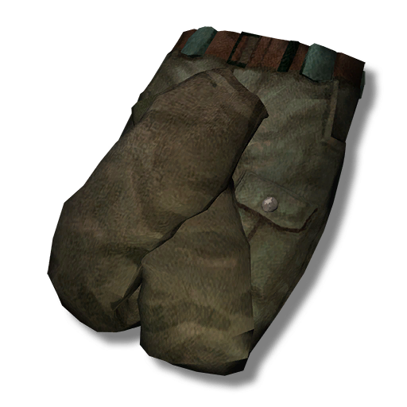
<figcaption>Combat_Pants_icon.png</figcaption>
</figure></td>
<td>
<a href="./Combat%20Pants.md" class="wikilink" title="Combat Pants">Combat Pants</a>
</td>
<td>
1.63%
</td>
<td>
Yes
</td>
</tr>
<tr>
<td><figure>

<figcaption>Climbing_Socks_icon.png</figcaption>
</figure></td>
<td>
<a href="./Climbing%20Socks.md" class="wikilink" title="Climbing Socks">Climbing Socks</a>
</td>
<td>
1.63%
</td>
<td>
No
</td>
</tr>
<tr>
<td><figure>

<figcaption>Wool_Longjohns_icon.png</figcaption>
</figure></td>
<td>
<a href="./Wool%20Longjohns.md" class="wikilink" title="Wool Longjohns">Wool Longjohns</a>
</td>
<td>
1.63%
</td>
<td>
No
</td>
</tr>
<tr>
<td><figure>

<figcaption>Wool_Mittens_icon.png</figcaption>
</figure></td>
<td>
<a href="./Wool%20Mittens.md" class="wikilink" title="Wool Mittens">Wool Mittens</a>
</td>
<td>
1.63%
</td>
<td>
No
</td>
</tr>
<tr>
<td><figure>

<figcaption>Book_icon.png</figcaption>
</figure></td>
<td>
<a href="./Book.md" class="wikilink" title="Book">Book</a>
</td>
<td>
1.63%
</td>
<td>
Yes
</td>
</tr>
<tr>
<td><figure>

<figcaption>Book_icon.png</figcaption>
</figure></td>
<td>
<a href="./Book.md" class="wikilink" title="Book">Book</a>
</td>
<td>
1.63%
</td>
<td>
Yes
</td>
</tr>
<tr>
<td><figure>

<figcaption>Sewing_Kit_icon.png</figcaption>
</figure></td>
<td>
<a href="./Sewing%20Kit.md" class="wikilink" title="Sewing Kit">Sewing Kit</a>
</td>
<td>
1.63%
</td>
<td>
Yes
</td>
</tr>
<tr>
<td><figure>

<figcaption>Book_icon.png</figcaption>
</figure></td>
<td>
<a href="./Book.md" class="wikilink" title="Book">Book</a>
</td>
<td>
1.63%
</td>
<td>
Yes
</td>
</tr>
<tr>
<td><figure>

<figcaption>Hockey_Jersey_icon.png</figcaption>
</figure></td>
<td>
<a href="./Hockey%20Jersey.md" class="wikilink" title="Hockey Jersey">Hockey Jersey</a>
</td>
<td>
1.63%
</td>
<td>
Yes
</td>
</tr>
<tr>
<td><figure>

<figcaption>Antibiotics_icon.png</figcaption>
</figure></td>
<td>
<a href="./Antibiotics.md" class="wikilink" title="Antibiotics">Antibiotics</a>
</td>
<td>
0.82%
</td>
<td>
Yes
</td>
</tr>
<tr>
<td><figure>

<figcaption>Painkillers_icon.png</figcaption>
</figure></td>
<td>
<a href="./Painkillers.md" class="wikilink" title="Painkillers">Painkillers</a>
</td>
<td>
0.82%
</td>
<td>
Yes
</td>
</tr>
<tr>
<td><figure>

<figcaption>Fisherman's_Sweater_icon.png</figcaption>
</figure></td>
<td>
<a href="./Fisherman%27s%20Sweater.md" class="wikilink" title="Fisherman&#39;s Sweater">Fisherman's Sweater</a>
</td>
<td>
0.16%
</td>
<td>
No
</td>
</tr>
<tr>
<td><figure>

<figcaption>Fishing_Tackle_icon.png</figcaption>
</figure></td>
<td>
<a href="./Fishing%20Tackle.md" class="wikilink" title="Fishing Tackle">Fishing Tackle</a>
</td>
<td>
0.16%
</td>
<td>
No
</td>
</tr>
<tr>
<td><figure>

<figcaption>Firearm_Cleaning_Kit_icon.png</figcaption>
</figure></td>
<td>
<a href="./Firearm%20Cleaning%20Kit.md" class="wikilink" title="Firearm Cleaning Kit">Firearm Cleaning Kit</a>
</td>
<td>
0.16%
</td>
<td>
No
</td>
</tr>
</tbody>
</table>

<table>
<caption>style="width:100%; text-align: left;" | <a href="./Backpack.md" class="wikilink" title="Backpack">Backpack</a></caption>
<colgroup>
<col style="width: 25%" />
<col style="width: 25%" />
<col style="width: 25%" />
<col style="width: 25%" />
</colgroup>
<thead>
<tr>
<th>
Icon
</th>
<th>
Item
</th>
<th>
Rarity
</th>
<th><figure>

<figcaption>Misery_icon.png</figcaption>
</figure></th>
</tr>
</thead>
<tbody>
<tr>
<td><figure>

<figcaption>Beef_Jerky_icon.png</figcaption>
</figure></td>
<td>
<a href="./Beef%20Jerky.md" class="wikilink" title="Beef Jerky">Beef Jerky</a>
</td>
<td>
7.46%
</td>
<td>
Yes
</td>
</tr>
<tr>
<td><figure>

<figcaption>Chocolate_Bar_icon.png</figcaption>
</figure></td>
<td>
<a href="./Chocolate%20Bar.md" class="wikilink" title="Chocolate Bar">Chocolate Bar</a>
</td>
<td>
7.46%
</td>
<td>
Yes
</td>
</tr>
<tr>
<td><figure>

<figcaption>Ketchup_Chips_icon.png</figcaption>
</figure></td>
<td>
<a href="./Ketchup%20Chips.md" class="wikilink" title="Ketchup Chips">Ketchup Chips</a>
</td>
<td>
6.72%
</td>
<td>
Yes
</td>
</tr>
<tr>
<td><figure>

<figcaption>Granola_Bar_icon.png</figcaption>
</figure></td>
<td>
<a href="./Granola%20Bar.md" class="wikilink" title="Granola Bar">Granola Bar</a>
</td>
<td>
6.72%
</td>
<td>
Yes
</td>
</tr>
<tr>
<td><figure>

<figcaption>Summit_Soda_icon.png</figcaption>
</figure></td>
<td>
<a href="./Summit%20Soda.md" class="wikilink" title="Summit Soda">Summit Soda</a>
</td>
<td>
5.97%
</td>
<td>
Yes
</td>
</tr>
<tr>
<td><figure>

<figcaption>Stacy's_Grape_Soda_icon.png</figcaption>
</figure></td>
<td>
<a href="./Stacy%27s%20Grape%20Soda.md" class="wikilink" title="Stacy&#39;s Grape Soda">Stacy's Grape Soda</a>
</td>
<td>
5.97%
</td>
<td>
No
</td>
</tr>
<tr>
<td><figure>

<figcaption>Wood_Matches_icon.png</figcaption>
</figure></td>
<td>
<a href="./Wood%20Matches.md" class="wikilink" title="Wood Matches">Wood Matches</a>
</td>
<td>
5.22%
</td>
<td>
Yes
</td>
</tr>
<tr>
<td><figure>

<figcaption>Dog_Food_icon.png</figcaption>
</figure></td>
<td>
<a href="./Dog%20Food.md" class="wikilink" title="Dog Food">Dog Food</a>
</td>
<td>
5.22%
</td>
<td>
Yes
</td>
</tr>
<tr>
<td><figure>

<figcaption>Spray_Paint_icon.png</figcaption>
</figure></td>
<td>
<a href="./Spray%20Paint.md" class="wikilink" title="Spray Paint">Spray Paint</a>
</td>
<td>
5.22%
</td>
<td>
Yes
</td>
</tr>
<tr>
<td><figure>

<figcaption>Water_(Potable)_icon.png</figcaption>
</figure></td>
<td>
<a href="./Water%20%28Potable%29.md" class="wikilink" title="Water (Potable)">Water (Potable)</a>
</td>
<td>
4.48%
</td>
<td>
No
</td>
</tr>
<tr>
<td><figure>

<figcaption>Tin_of_Sardines_icon.png</figcaption>
</figure></td>
<td>
<a href="./Tin%20of%20Sardines.md" class="wikilink" title="Tin of Sardines">Tin of Sardines</a>
</td>
<td>
4.48%
</td>
<td>
Yes
</td>
</tr>
<tr>
<td><figure>

<figcaption>Accelerant_icon.png</figcaption>
</figure></td>
<td>
<a href="./Accelerant.md" class="wikilink" title="Accelerant">Accelerant</a>
</td>
<td>
3.73%
</td>
<td>
Yes
</td>
</tr>
<tr>
<td><figure>
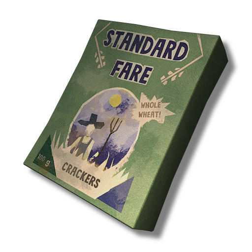
<figcaption>Salty_Crackers_icon.png</figcaption>
</figure></td>
<td>
<a href="./Salty%20Crackers.md" class="wikilink" title="Salty Crackers">Salty Crackers</a>
</td>
<td>
3.73%
</td>
<td>
Yes
</td>
</tr>
<tr>
<td><figure>

<figcaption>Pinnacle_Peaches_icon.png</figcaption>
</figure></td>
<td>
<a href="./Pinnacle%20Peaches.md" class="wikilink" title="Pinnacle Peaches">Pinnacle Peaches</a>
</td>
<td>
2.99%
</td>
<td>
Yes
</td>
</tr>
<tr>
<td><figure>

<figcaption>Energy_Bar_icon.png</figcaption>
</figure></td>
<td>
<a href="./Energy%20Bar.md" class="wikilink" title="Energy Bar">Energy Bar</a>
</td>
<td>
2.99%
</td>
<td>
No
</td>
</tr>
<tr>
<td><figure>

<figcaption>Wool_Toque_icon.png</figcaption>
</figure></td>
<td>
<a href="./Wool%20Toque.md" class="wikilink" title="Wool Toque">Wool Toque</a>
</td>
<td>
2.24%
</td>
<td>
Yes
</td>
</tr>
<tr>
<td><figure>

<figcaption>Wool_Mittens_icon.png</figcaption>
</figure></td>
<td>
<a href="./Wool%20Mittens.md" class="wikilink" title="Wool Mittens">Wool Mittens</a>
</td>
<td>
2.24%
</td>
<td>
No
</td>
</tr>
<tr>
<td><figure>

<figcaption>T-Shirt_icon.png</figcaption>
</figure></td>
<td>
<a href="./T-Shirt.md" class="wikilink" title="T-Shirt">T-Shirt</a>
</td>
<td>
2.24%
</td>
<td>
Yes
</td>
</tr>
<tr>
<td><figure>

<figcaption>Baseball_Cap_icon.png</figcaption>
</figure></td>
<td>
<a href="./Baseball%20Cap.md" class="wikilink" title="Baseball Cap">Baseball Cap</a>
</td>
<td>
2.24%
</td>
<td>
Yes
</td>
</tr>
<tr>
<td><figure>

<figcaption>Wool_Socks_icon.png</figcaption>
</figure></td>
<td>
<a href="./Wool%20Socks.md" class="wikilink" title="Wool Socks">Wool Socks</a>
</td>
<td>
1.49%
</td>
<td>
Yes
</td>
</tr>
<tr>
<td><figure>

<figcaption>Down_Vest_icon.png</figcaption>
</figure></td>
<td>
<a href="./Down%20Vest.md" class="wikilink" title="Down Vest">Down Vest</a>
</td>
<td>
1.49%
</td>
<td>
Yes
</td>
</tr>
<tr>
<td><figure>

<figcaption>Hoodie_icon.png</figcaption>
</figure></td>
<td>
<a href="./Hoodie.md" class="wikilink" title="Hoodie">Hoodie</a>
</td>
<td>
1.49%
</td>
<td>
Yes
</td>
</tr>
<tr>
<td><figure>

<figcaption>Military-Grade_MRE_icon.png</figcaption>
</figure></td>
<td>
<a href="./Military-Grade%20MRE.md" class="wikilink" title="Military-Grade MRE">Military-Grade MRE</a>
</td>
<td>
0.75%
</td>
<td>
No
</td>
</tr>
<tr>
<td><figure>

<figcaption>Thin_Wool_Sweater_icon.png</figcaption>
</figure></td>
<td>
<a href="./Thin%20Wool%20Sweater.md" class="wikilink" title="Thin Wool Sweater">Thin Wool Sweater</a>
</td>
<td>
0.75%
</td>
<td>
Yes
</td>
</tr>
<tr>
<td><figure>

<figcaption>Rifle_Cartridge_icon.png</figcaption>
</figure></td>
<td>
<a href="./Rifle%20Ammunition.md" class="wikilink" title="Rifle Cartridge">Rifle Cartridge</a>
</td>
<td>
0.75%
</td>
<td>
No
</td>
</tr>
<tr>
<td><figure>

<figcaption>Fishing_Tackle_icon.png</figcaption>
</figure></td>
<td>
<a href="./Fishing%20Tackle.md" class="wikilink" title="Fishing Tackle">Fishing Tackle</a>
</td>
<td>
0.75%
</td>
<td>
No
</td>
</tr>
<tr>
<td><figure>

<figcaption>Flare_icon.png</figcaption>
</figure></td>
<td>
<a href="./Flare.md" class="wikilink" title="Flare">Flare</a>
</td>
<td>
0.75%
</td>
<td>
Yes
</td>
</tr>
<tr>
<td><figure>

<figcaption>Climbing_Socks_icon.png</figcaption>
</figure></td>
<td>
<a href="./Climbing%20Socks.md" class="wikilink" title="Climbing Socks">Climbing Socks</a>
</td>
<td>
0.75%
</td>
<td>
No
</td>
</tr>
<tr>
<td><figure>

<figcaption>Recycled_Can_icon.png</figcaption>
</figure></td>
<td>
<a href="./Recycled%20Can.md" class="wikilink" title="Recycled Can">Recycled Can</a>
</td>
<td>
0.75%
</td>
<td>
Yes
</td>
</tr>
<tr>
<td><figure>

<figcaption>Go!_Energy_Drink_icon.png</figcaption>
</figure></td>
<td>
<a href="./Go!%20Energy%20Drink.md" class="wikilink" title="Go! Energy Drink">Go! Energy Drink</a>
</td>
<td>
0.75%
</td>
<td>
No
</td>
</tr>
<tr>
<td><figure>

<figcaption>Revolver_Cartridge_icon.png</figcaption>
</figure></td>
<td>
<a href="./Revolver%20Ammunition.md" class="wikilink" title="Revolver Cartridge">Revolver Cartridge</a>
</td>
<td>
0.75%
</td>
<td>
No
</td>
</tr>
<tr>
<td><figure>

<figcaption>Marine_Flare_icon.png</figcaption>
</figure></td>
<td>
<a href="./Marine%20Flare.md" class="wikilink" title="Marine Flare">Marine Flare</a>
</td>
<td>
0.75%
</td>
<td>
Yes
</td>
</tr>
<tr>
<td><figure>

<figcaption>Maple_Syrup_icon.png</figcaption>
</figure></td>
<td>
<a href="./Maple%20Syrup.md" class="wikilink" title="Maple Syrup">Maple Syrup</a>
</td>
<td>
0.75%
</td>
<td>
Yes
</td>
</tr>
</tbody>
</table>

<table>
<caption>style="width:100%; text-align: left;" | <a href="./Locker.md" class="wikilink" title="Locker">Locker</a> (single or double)</caption>
<colgroup>
<col style="width: 25%" />
<col style="width: 25%" />
<col style="width: 25%" />
<col style="width: 25%" />
</colgroup>
<thead>
<tr>
<th>
Icon
</th>
<th>
Item
</th>
<th>
Rarity
</th>
<th><figure>

<figcaption>Misery_icon.png</figcaption>
</figure></th>
</tr>
</thead>
<tbody>
<tr>
<td><figure>

<figcaption>Trail_Boots_icon.png</figcaption>
</figure></td>
<td>
<a href="./Trail%20Boots.md" class="wikilink" title="Trail Boots">Trail Boots</a>
</td>
<td>
3.45%
</td>
<td>
Yes
</td>
</tr>
<tr>
<td><figure>

<figcaption>Running_Shoes_icon.png</figcaption>
</figure></td>
<td>
<a href="./Running%20Shoes.md" class="wikilink" title="Running Shoes">Running Shoes</a>
</td>
<td>
3.45%
</td>
<td>
Yes
</td>
</tr>
<tr>
<td><figure>

<figcaption>Leather_Shoes_icon.png</figcaption>
</figure></td>
<td>
<a href="./Leather%20Shoes.md" class="wikilink" title="Leather Shoes">Leather Shoes</a>
</td>
<td>
3.45%
</td>
<td>
Yes
</td>
</tr>
<tr>
<td><figure>

<figcaption>Driving_Gloves_icon.png</figcaption>
</figure></td>
<td>
<a href="./Driving%20Gloves.md" class="wikilink" title="Driving Gloves">Driving Gloves</a>
</td>
<td>
2.76%
</td>
<td>
Yes
</td>
</tr>
<tr>
<td><figure>

<figcaption>Windbreaker_icon.png</figcaption>
</figure></td>
<td>
<a href="./Windbreaker.md" class="wikilink" title="Windbreaker">Windbreaker</a>
</td>
<td>
2.76%
</td>
<td>
Yes
</td>
</tr>
<tr>
<td><figure>

<figcaption>Cotton_Toque_icon.png</figcaption>
</figure></td>
<td>
<a href="./Cotton%20Toque.md" class="wikilink" title="Cotton Toque">Cotton Toque</a>
</td>
<td>
2.76%
</td>
<td>
Yes
</td>
</tr>
<tr>
<td><figure>

<figcaption>Hoodie_icon.png</figcaption>
</figure></td>
<td>
<a href="./Hoodie.md" class="wikilink" title="Hoodie">Hoodie</a>
</td>
<td>
2.76%
</td>
<td>
Yes
</td>
</tr>
<tr>
<td><figure>

<figcaption>Sweatshirt_icon.png</figcaption>
</figure></td>
<td>
<a href="./Sweatshirt.md" class="wikilink" title="Sweatshirt">Sweatshirt</a>
</td>
<td>
2.76%
</td>
<td>
Yes
</td>
</tr>
<tr>
<td><figure>

<figcaption>Sport_Vest_icon.png</figcaption>
</figure></td>
<td>
<a href="./Sport%20Vest.md" class="wikilink" title="Sport Vest">Sport Vest</a>
</td>
<td>
2.76%
</td>
<td>
Yes
</td>
</tr>
<tr>
<td><figure>

<figcaption>Jeans_icon.png</figcaption>
</figure></td>
<td>
<a href="./Jeans.md" class="wikilink" title="Jeans">Jeans</a>
</td>
<td>
2.76%
</td>
<td>
Yes
</td>
</tr>
<tr>
<td><figure>

<figcaption>Newsprint_icon.png</figcaption>
</figure></td>
<td>
<a href="./Newsprint.md" class="wikilink" title="Newsprint">Newsprint</a>
</td>
<td>
2.76%
</td>
<td>
Yes
</td>
</tr>
<tr>
<td><figure>

<figcaption>Plaid_Shirt_icon.png</figcaption>
</figure></td>
<td>
<a href="./Plaid%20Shirt.md" class="wikilink" title="Plaid Shirt">Plaid Shirt</a>
</td>
<td>
2.76%
</td>
<td>
Yes
</td>
</tr>
<tr>
<td><figure>

<figcaption>T-Shirt_icon.png</figcaption>
</figure></td>
<td>
<a href="./T-Shirt.md" class="wikilink" title="T-Shirt">T-Shirt</a>
</td>
<td>
2.76%
</td>
<td>
Yes
</td>
</tr>
<tr>
<td><figure>

<figcaption>Wood_Matches_icon.png</figcaption>
</figure></td>
<td>
<a href="./Wood%20Matches.md" class="wikilink" title="Wood Matches">Wood Matches</a>
</td>
<td>
2.76%
</td>
<td>
Yes
</td>
</tr>
<tr>
<td><figure>

<figcaption>Book_icon.png</figcaption>
</figure></td>
<td>
<a href="./Book.md" class="wikilink" title="Book">Book</a>
</td>
<td>
2.07%
</td>
<td>
Yes
</td>
</tr>
<tr>
<td><figure>

<figcaption>Book_icon.png</figcaption>
</figure></td>
<td>
<a href="./Book.md" class="wikilink" title="Book">Book</a>
</td>
<td>
2.07%
</td>
<td>
Yes
</td>
</tr>
<tr>
<td><figure>

<figcaption>Cloth_icon.png</figcaption>
</figure></td>
<td>
<a href="./Cloth.md" class="wikilink" title="Cloth">Cloth</a>
</td>
<td>
2.07%
</td>
<td>
Yes
</td>
</tr>
<tr>
<td><figure>

<figcaption>Cotton_Scarf_icon.png</figcaption>
</figure></td>
<td>
<a href="./Cotton%20Scarf.md" class="wikilink" title="Cotton Scarf">Cotton Scarf</a>
</td>
<td>
2.07%
</td>
<td>
Yes
</td>
</tr>
<tr>
<td><figure>

<figcaption>Ketchup_Chips_icon.png</figcaption>
</figure></td>
<td>
<a href="./Ketchup%20Chips.md" class="wikilink" title="Ketchup Chips">Ketchup Chips</a>
</td>
<td>
2.07%
</td>
<td>
Yes
</td>
</tr>
<tr>
<td><figure>

<figcaption>Lantern_Fuel_icon.png</figcaption>
</figure></td>
<td>
<a href="./Lantern%20Fuel.md" class="wikilink" title="Lantern Fuel">Lantern Fuel</a>
</td>
<td>
2.07%
</td>
<td>
Yes
</td>
</tr>
<tr>
<td><figure>

<figcaption>Simple_Parka_icon.png</figcaption>
</figure></td>
<td>
<a href="./Simple%20Parka.md" class="wikilink" title="Simple Parka">Simple Parka</a>
</td>
<td>
2.07%
</td>
<td>
Yes
</td>
</tr>
<tr>
<td><figure>

<figcaption>Newsprint_Roll_icon.png</figcaption>
</figure></td>
<td>
<a href="./Newsprint%20Roll.md" class="wikilink" title="Newsprint Roll">Newsprint Roll</a>
</td>
<td>
2.07%
</td>
<td>
Yes
</td>
</tr>
<tr>
<td><figure>

<figcaption>Scrap_Metal_icon.png</figcaption>
</figure></td>
<td>
<a href="./Scrap%20Metal.md" class="wikilink" title="Scrap Metal">Scrap Metal</a>
</td>
<td>
2.07%
</td>
<td>
Yes
</td>
</tr>
<tr>
<td><figure>

<figcaption>Light_Shell_icon.png</figcaption>
</figure></td>
<td>
<a href="./Light%20Shell.md" class="wikilink" title="Light Shell">Light Shell</a>
</td>
<td>
2.07%
</td>
<td>
Yes
</td>
</tr>
<tr>
<td><figure>

<figcaption>Accelerant_icon.png</figcaption>
</figure></td>
<td>
<a href="./Accelerant.md" class="wikilink" title="Accelerant">Accelerant</a>
</td>
<td>
1.38%
</td>
<td>
Yes
</td>
</tr>
<tr>
<td><figure>

<figcaption>Wool_Scarf_icon.png</figcaption>
</figure></td>
<td>
<a href="./Wool%20Scarf.md" class="wikilink" title="Wool Scarf">Wool Scarf</a>
</td>
<td>
1.38%
</td>
<td>
Yes
</td>
</tr>
<tr>
<td><figure>

<figcaption>Marine_Flare_icon.png</figcaption>
</figure></td>
<td>
<a href="./Marine%20Flare.md" class="wikilink" title="Marine Flare">Marine Flare</a>
</td>
<td>
1.38%
</td>
<td>
Yes
</td>
</tr>
<tr>
<td><figure>

<figcaption>Antiseptic_icon.png</figcaption>
</figure></td>
<td>
<a href="./Antiseptic.md" class="wikilink" title="Antiseptic">Antiseptic</a>
</td>
<td>
1.38%
</td>
<td>
Yes
</td>
</tr>
<tr>
<td><figure>

<figcaption>Painkillers_icon.png</figcaption>
</figure></td>
<td>
<a href="./Painkillers.md" class="wikilink" title="Painkillers">Painkillers</a>
</td>
<td>
1.38%
</td>
<td>
Yes
</td>
</tr>
<tr>
<td><figure>

<figcaption>Chocolate_Bar_icon.png</figcaption>
</figure></td>
<td>
<a href="./Chocolate%20Bar.md" class="wikilink" title="Chocolate Bar">Chocolate Bar</a>
</td>
<td>
1.38%
</td>
<td>
Yes
</td>
</tr>
<tr>
<td><figure>

<figcaption>Pork_and_Beans_icon.png</figcaption>
</figure></td>
<td>
<a href="./Pork%20and%20Beans.md" class="wikilink" title="Pork and Beans">Pork and Beans</a>
</td>
<td>
1.38%
</td>
<td>
Yes
</td>
</tr>
<tr>
<td><figure>

<figcaption>Down_Vest_icon.png</figcaption>
</figure></td>
<td>
<a href="./Down%20Vest.md" class="wikilink" title="Down Vest">Down Vest</a>
</td>
<td>
1.38%
</td>
<td>
Yes
</td>
</tr>
<tr>
<td><figure>

<figcaption>Flare_icon.png</figcaption>
</figure></td>
<td>
<a href="./Flare.md" class="wikilink" title="Flare">Flare</a>
</td>
<td>
1.38%
</td>
<td>
Yes
</td>
</tr>
<tr>
<td><figure>

<figcaption>Fleece_Mittens_icon.png</figcaption>
</figure></td>
<td>
<a href="./Fleece%20Mittens.md" class="wikilink" title="Fleece Mittens">Fleece Mittens</a>
</td>
<td>
1.38%
</td>
<td>
Yes
</td>
</tr>
<tr>
<td><figure>

<figcaption>Revolver_Cartridge_icon.png</figcaption>
</figure></td>
<td>
<a href="./Revolver%20Ammunition.md" class="wikilink" title="Revolver Cartridge">Revolver Cartridge</a>
</td>
<td>
1.38%
</td>
<td>
No
</td>
</tr>
<tr>
<td><figure>

<figcaption>Summit_Soda_icon.png</figcaption>
</figure></td>
<td>
<a href="./Summit%20Soda.md" class="wikilink" title="Summit Soda">Summit Soda</a>
</td>
<td>
1.38%
</td>
<td>
Yes
</td>
</tr>
<tr>
<td><figure>

<figcaption>Go!_Energy_Drink_icon.png</figcaption>
</figure></td>
<td>
<a href="./Go!%20Energy%20Drink.md" class="wikilink" title="Go! Energy Drink">Go! Energy Drink</a>
</td>
<td>
1.38%
</td>
<td>
No
</td>
</tr>
<tr>
<td><figure>

<figcaption>Stacy's_Grape_Soda_icon.png</figcaption>
</figure></td>
<td>
<a href="./Stacy%27s%20Grape%20Soda.md" class="wikilink" title="Stacy&#39;s Grape Soda">Stacy's Grape Soda</a>
</td>
<td>
1.38%
</td>
<td>
No
</td>
</tr>
<tr>
<td><figure>

<figcaption>Spray_Paint_icon.png</figcaption>
</figure></td>
<td>
<a href="./Spray%20Paint.md" class="wikilink" title="Spray Paint">Spray Paint</a>
</td>
<td>
1.38%
</td>
<td>
Yes
</td>
</tr>
<tr>
<td><figure>

<figcaption>Wool_Toque_icon.png</figcaption>
</figure></td>
<td>
<a href="./Wool%20Toque.md" class="wikilink" title="Wool Toque">Wool Toque</a>
</td>
<td>
1.38%
</td>
<td>
Yes
</td>
</tr>
<tr>
<td><figure>

<figcaption>Water_Purification_Tablets_icon.png</figcaption>
</figure></td>
<td>
<a href="./Water%20Purification%20Tablets.md" class="wikilink" title="Water Purification Tablets">Water Purification Tablets</a>
</td>
<td>
1.38%
</td>
<td>
Yes
</td>
</tr>
<tr>
<td><figure>

<figcaption>Thin_Wool_Sweater_icon.png</figcaption>
</figure></td>
<td>
<a href="./Thin%20Wool%20Sweater.md" class="wikilink" title="Thin Wool Sweater">Thin Wool Sweater</a>
</td>
<td>
1.38%
</td>
<td>
Yes
</td>
</tr>
<tr>
<td><figure>

<figcaption>Work_Boots_icon.png</figcaption>
</figure></td>
<td>
<a href="./Work%20Boots.md" class="wikilink" title="Work Boots">Work Boots</a>
</td>
<td>
1.38%
</td>
<td>
Yes
</td>
</tr>
<tr>
<td><figure>

<figcaption>Work_Gloves_icon.png</figcaption>
</figure></td>
<td>
<a href="./Work%20Gloves.md" class="wikilink" title="Work Gloves">Work Gloves</a>
</td>
<td>
1.38%
</td>
<td>
Yes
</td>
</tr>
<tr>
<td><figure>

<figcaption>Cargo_Pants_icon.png</figcaption>
</figure></td>
<td>
<a href="./Cargo%20Pants.md" class="wikilink" title="Cargo Pants">Cargo Pants</a>
</td>
<td>
0.69%
</td>
<td>
No
</td>
</tr>
<tr>
<td><figure>

<figcaption>Combat_Boots_icon.png</figcaption>
</figure></td>
<td>
<a href="./Combat%20Boots.md" class="wikilink" title="Combat Boots">Combat Boots</a>
</td>
<td>
0.69%
</td>
<td>
Yes
</td>
</tr>
<tr>
<td><figure>

<figcaption>Flare_Shell_icon.png</figcaption>
</figure></td>
<td>
<a href="./Flare%20Shell.md" class="wikilink" title="Flare Shell">Flare Shell</a>
</td>
<td>
0.69%
</td>
<td>
No
</td>
</tr>
<tr>
<td><figure>
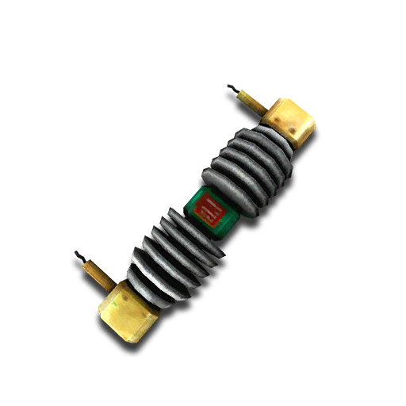
<figcaption>Replacement_Fuse_icon.png</figcaption>
</figure></td>
<td>
<a href="./Replacement%20Fuse.md" class="wikilink" title="Replacement Fuse">Replacement Fuse</a>
</td>
<td>
0.69%
</td>
<td>
Yes
</td>
</tr>
<tr>
<td><figure>

<figcaption>Cured_Leather_icon.png</figcaption>
</figure></td>
<td>
<a href="./Cured%20Leather.md" class="wikilink" title="Cured Leather">Cured Leather</a>
</td>
<td>
0.69%
</td>
<td>
Yes
</td>
</tr>
<tr>
<td><figure>

<figcaption>Line_icon.png</figcaption>
</figure></td>
<td>
<a href="./Line.md" class="wikilink" title="Line">Line</a>
</td>
<td>
0.69%
</td>
<td>
Yes
</td>
</tr>
<tr>
<td><figure>

<figcaption>Thermal_Underwear_icon.png</figcaption>
</figure></td>
<td>
<a href="./Thermal%20Underwear.md" class="wikilink" title="Thermal Underwear">Thermal Underwear</a>
</td>
<td>
0.69%
</td>
<td>
Yes
</td>
</tr>
<tr>
<td><figure>

<figcaption>Wool_Mittens_icon.png</figcaption>
</figure></td>
<td>
<a href="./Wool%20Mittens.md" class="wikilink" title="Wool Mittens">Wool Mittens</a>
</td>
<td>
0.69%
</td>
<td>
No
</td>
</tr>
<tr>
<td><figure>

<figcaption>Stack_of_Papers_icon.png</figcaption>
</figure></td>
<td>
<a href="./Stack%20of%20Papers.md" class="wikilink" title="Stack of Papers">Stack of Papers</a>
</td>
<td>
0.69%
</td>
<td>
Yes
</td>
</tr>
<tr>
<td><figure>

<figcaption>Simple_Tools_icon.png</figcaption>
</figure></td>
<td>
<a href="./Simple%20Tools.md" class="wikilink" title="Simple Tools">Simple Tools</a>
</td>
<td>
0.69%
</td>
<td>
Yes
</td>
</tr>
<tr>
<td><figure>

<figcaption>Tinder_Plug_icon.png</figcaption>
</figure></td>
<td>
<a href="./Tinder%20Plug.md" class="wikilink" title="Tinder Plug">Tinder Plug</a>
</td>
<td>
0.69%
</td>
<td>
Yes
</td>
</tr>
<tr>
<td><figure>

<figcaption>Tomato_Soup_icon.png</figcaption>
</figure></td>
<td>
<a href="./Tomato%20Soup.md" class="wikilink" title="Tomato Soup">Tomato Soup</a>
</td>
<td>
0.69%
</td>
<td>
Yes
</td>
</tr>
<tr>
<td><figure>

<figcaption>Water_(Potable)_icon.png</figcaption>
</figure></td>
<td>
<a href="./Water%20%28Potable%29.md" class="wikilink" title="Water (Potable)">Water (Potable)</a>
</td>
<td>
0.69%
</td>
<td>
No
</td>
</tr>
<tr>
<td><figure>

<figcaption>Wires_icon.png</figcaption>
</figure></td>
<td>
<a href="./Wires.md" class="wikilink" title="Wires">Wires</a>
</td>
<td>
0.69%
</td>
<td>
Yes
</td>
</tr>
<tr>
<td><figure>

<figcaption>Work_Pants_icon.png</figcaption>
</figure></td>
<td>
<a href="./Work%20Pants.md" class="wikilink" title="Work Pants">Work Pants</a>
</td>
<td>
0.69%
</td>
<td>
No
</td>
</tr>
<tr>
<td><figure>

<figcaption>Arrowhead_icon.png</figcaption>
</figure></td>
<td>
<a href="./Arrowhead.md" class="wikilink" title="Arrowhead">Arrowhead</a>
</td>
<td>
0.42%
</td>
<td>
Yes
</td>
</tr>
<tr>
<td><figure>

<figcaption>Rifle_Shell_Casing_icon.png</figcaption>
</figure></td>
<td>
<a href="./Rifle%20Shell%20Casing.md" class="wikilink" title="Rifle Shell Casing">Rifle Shell Casing</a>
</td>
<td>
0.42%
</td>
<td>
No
</td>
</tr>
</tbody>
</table>

## Boat Spawns

\[Missing image: Beachcombing.jpg\] A fishing boat found while beachcombing. Boats may also appear after Blizzards in their own set of specific locations. One or more additional small lootable items can spawn along with them (depending on difficulty setting) and may remain even if the boat later disappears.

- Canoe with <a href="./Simple%20Arrow.md" class="wikilink" title="Simple Arrow">Simple Arrows</a>, <a href="./Broken%20Arrow.md" class="wikilink" title="Broken Arrow">Broken Arrows</a>, or <a href="./Beef%20Jerky.md" class="wikilink" title="Beef Jerky">Beef Jerky</a>
- Rowboat with <a href="./Paddle.md" class="wikilink" title="Paddle">Paddle</a>, <a href="./Hatchet.md" class="wikilink" title="Hatchet">Hatchet</a>, <a href="./Fishing%20Tackle.md" class="wikilink" title="Fishing Tackle">Fishing Tackle</a>, or <a href="./Coho%20Salmon%20%28Raw%29.md" class="wikilink" title="Coho Salmon (Raw)">Coho Salmon (Raw)</a>
- Fishing boat which has 4 containers, <a href="./Smallmouth%20Bass%20%28Raw%29.md" class="wikilink" title="Smallmouth Bass (Raw)">Smallmouth Bass (Raw)</a> in the rear hold, and may also have <a href="./Distress%20Pistol.md" class="wikilink" title="Distress pistol">Distress pistol</a>, <a href="./Flare%20Shell.md" class="wikilink" title="Flare Shell">Flare Shells</a>, <a href="./Marine%20Flare.md" class="wikilink" title="Marine flare">Marine flares</a>, <a href="./Tin%20of%20Sardines.md" class="wikilink" title="Tin of sardines">Tin of sardines</a>

<table>
<caption>style="width:100%; text-align: left;" | Fishing Boat - Large Container</caption>
<colgroup>
<col style="width: 25%" />
<col style="width: 25%" />
<col style="width: 25%" />
<col style="width: 25%" />
</colgroup>
<thead>
<tr>
<th>
Icon
</th>
<th>
Item
</th>
<th>
Rarity
</th>
<th><figure>

<figcaption>Misery_icon.png</figcaption>
</figure></th>
</tr>
</thead>
<tbody>
<tr>
<td><figure>

<figcaption>Newsprint_icon.png</figcaption>
</figure></td>
<td>
<a href="./Newsprint.md" class="wikilink" title="Newsprint">Newsprint</a>
</td>
<td>
9.76%
</td>
<td>
Yes
</td>
</tr>
<tr>
<td><figure>

<figcaption>Running_Shoes_icon.png</figcaption>
</figure></td>
<td>
<a href="./Running%20Shoes.md" class="wikilink" title="Running Shoes">Running Shoes</a>
</td>
<td>
4.88%
</td>
<td>
Yes
</td>
</tr>
<tr>
<td><figure>

<figcaption>Scrap_Metal_icon.png</figcaption>
</figure></td>
<td>
<a href="./Scrap%20Metal.md" class="wikilink" title="Scrap Metal">Scrap Metal</a>
</td>
<td>
4.88%
</td>
<td>
Yes
</td>
</tr>
<tr>
<td><figure>

<figcaption>Light_Shell_icon.png</figcaption>
</figure></td>
<td>
<a href="./Light%20Shell.md" class="wikilink" title="Light Shell">Light Shell</a>
</td>
<td>
4.88%
</td>
<td>
Yes
</td>
</tr>
<tr>
<td><figure>

<figcaption>Windbreaker_icon.png</figcaption>
</figure></td>
<td>
<a href="./Windbreaker.md" class="wikilink" title="Windbreaker">Windbreaker</a>
</td>
<td>
4.88%
</td>
<td>
Yes
</td>
</tr>
<tr>
<td><figure>

<figcaption>Cotton_Scarf_icon.png</figcaption>
</figure></td>
<td>
<a href="./Cotton%20Scarf.md" class="wikilink" title="Cotton Scarf">Cotton Scarf</a>
</td>
<td>
4.88%
</td>
<td>
Yes
</td>
</tr>
<tr>
<td><figure>

<figcaption>Cloth_icon.png</figcaption>
</figure></td>
<td>
<a href="./Cloth.md" class="wikilink" title="Cloth">Cloth</a>
</td>
<td>
4.88%
</td>
<td>
Yes
</td>
</tr>
<tr>
<td><figure>

<figcaption>Beef_Jerky_icon.png</figcaption>
</figure></td>
<td>
<a href="./Beef%20Jerky.md" class="wikilink" title="Beef Jerky">Beef Jerky</a>
</td>
<td>
4.88%
</td>
<td>
Yes
</td>
</tr>
<tr>
<td><figure>

<figcaption>Granola_Bar_icon.png</figcaption>
</figure></td>
<td>
<a href="./Granola%20Bar.md" class="wikilink" title="Granola Bar">Granola Bar</a>
</td>
<td>
3.41%
</td>
<td>
Yes
</td>
</tr>
<tr>
<td><figure>

<figcaption>Marine_Flare_icon.png</figcaption>
</figure></td>
<td>
<a href="./Marine%20Flare.md" class="wikilink" title="Marine Flare">Marine Flare</a>
</td>
<td>
3.41%
</td>
<td>
Yes
</td>
</tr>
<tr>
<td><figure>

<figcaption>Wool_Scarf_icon.png</figcaption>
</figure></td>
<td>
<a href="./Wool%20Scarf.md" class="wikilink" title="Wool Scarf">Wool Scarf</a>
</td>
<td>
2.44%
</td>
<td>
Yes
</td>
</tr>
<tr>
<td><figure>

<figcaption>Baseball_Cap_icon.png</figcaption>
</figure></td>
<td>
<a href="./Baseball%20Cap.md" class="wikilink" title="Baseball Cap">Baseball Cap</a>
</td>
<td>
2.44%
</td>
<td>
Yes
</td>
</tr>
<tr>
<td><figure>

<figcaption>Work_Boots_icon.png</figcaption>
</figure></td>
<td>
<a href="./Work%20Boots.md" class="wikilink" title="Work Boots">Work Boots</a>
</td>
<td>
2.44%
</td>
<td>
Yes
</td>
</tr>
<tr>
<td><figure>

<figcaption>Orange_Soda_icon.png</figcaption>
</figure></td>
<td>
<a href="./Orange%20Soda.md" class="wikilink" title="Orange Soda">Orange Soda</a>
</td>
<td>
2.44%
</td>
<td>
No
</td>
</tr>
<tr>
<td><figure>

<figcaption>Leather_Shoes_icon.png</figcaption>
</figure></td>
<td>
<a href="./Leather%20Shoes.md" class="wikilink" title="Leather Shoes">Leather Shoes</a>
</td>
<td>
2.44%
</td>
<td>
Yes
</td>
</tr>
<tr>
<td><figure>

<figcaption>Fleece_Mittens_icon.png</figcaption>
</figure></td>
<td>
<a href="./Fleece%20Mittens.md" class="wikilink" title="Fleece Mittens">Fleece Mittens</a>
</td>
<td>
2.44%
</td>
<td>
Yes
</td>
</tr>
<tr>
<td><figure>

<figcaption>Cotton_Toque_icon.png</figcaption>
</figure></td>
<td>
<a href="./Cotton%20Toque.md" class="wikilink" title="Cotton Toque">Cotton Toque</a>
</td>
<td>
2.44%
</td>
<td>
Yes
</td>
</tr>
<tr>
<td><figure>

<figcaption>Hoodie_icon.png</figcaption>
</figure></td>
<td>
<a href="./Hoodie.md" class="wikilink" title="Hoodie">Hoodie</a>
</td>
<td>
2.44%
</td>
<td>
Yes
</td>
</tr>
<tr>
<td><figure>

<figcaption>Trail_Boots_icon.png</figcaption>
</figure></td>
<td>
<a href="./Trail%20Boots.md" class="wikilink" title="Trail Boots">Trail Boots</a>
</td>
<td>
2.44%
</td>
<td>
Yes
</td>
</tr>
<tr>
<td><figure>

<figcaption>Down_Vest_icon.png</figcaption>
</figure></td>
<td>
<a href="./Down%20Vest.md" class="wikilink" title="Down Vest">Down Vest</a>
</td>
<td>
2.44%
</td>
<td>
Yes
</td>
</tr>
<tr>
<td><figure>

<figcaption>Spray_Paint_icon.png</figcaption>
</figure></td>
<td>
<a href="./Spray%20Paint.md" class="wikilink" title="Spray Paint">Spray Paint</a>
</td>
<td>
2.44%
</td>
<td>
Yes
</td>
</tr>
<tr>
<td><figure>

<figcaption>Hockey_Jersey_icon.png</figcaption>
</figure></td>
<td>
<a href="./Hockey%20Jersey.md" class="wikilink" title="Hockey Jersey">Hockey Jersey</a>
</td>
<td>
2.44%
</td>
<td>
Yes
</td>
</tr>
<tr>
<td><figure>

<figcaption>Sweatshirt_icon.png</figcaption>
</figure></td>
<td>
<a href="./Sweatshirt.md" class="wikilink" title="Sweatshirt">Sweatshirt</a>
</td>
<td>
2.44%
</td>
<td>
Yes
</td>
</tr>
<tr>
<td><figure>

<figcaption>Wires_icon.png</figcaption>
</figure></td>
<td>
<a href="./Wires.md" class="wikilink" title="Wires">Wires</a>
</td>
<td>
2.44%
</td>
<td>
Yes
</td>
</tr>
<tr>
<td><figure>

<figcaption>Replacement_Fuse_icon.png</figcaption>
</figure></td>
<td>
<a href="./Replacement%20Fuse.md" class="wikilink" title="Replacement Fuse">Replacement Fuse</a>
</td>
<td>
2.44%
</td>
<td>
Yes
</td>
</tr>
<tr>
<td><figure>

<figcaption>Simple_Parka_icon.png</figcaption>
</figure></td>
<td>
<a href="./Simple%20Parka.md" class="wikilink" title="Simple Parka">Simple Parka</a>
</td>
<td>
1.46%
</td>
<td>
Yes
</td>
</tr>
<tr>
<td><figure>

<figcaption>Wool_Toque_icon.png</figcaption>
</figure></td>
<td>
<a href="./Wool%20Toque.md" class="wikilink" title="Wool Toque">Wool Toque</a>
</td>
<td>
1.46%
</td>
<td>
Yes
</td>
</tr>
<tr>
<td><figure>

<figcaption>Chocolate_Bar_icon.png</figcaption>
</figure></td>
<td>
<a href="./Chocolate%20Bar.md" class="wikilink" title="Chocolate Bar">Chocolate Bar</a>
</td>
<td>
1.46%
</td>
<td>
Yes
</td>
</tr>
<tr>
<td><figure>
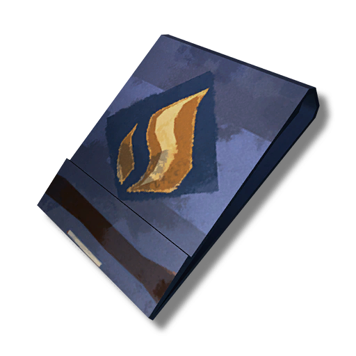
<figcaption>Cardboard_Matches_icon.png</figcaption>
</figure></td>
<td>
<a href="./Cardboard%20Matches.md" class="wikilink" title="Cardboard Matches">Cardboard Matches</a>
</td>
<td>
1.46%
</td>
<td>
No
</td>
</tr>
<tr>
<td><figure>

<figcaption>Plaid_Shirt_icon.png</figcaption>
</figure></td>
<td>
<a href="./Plaid%20Shirt.md" class="wikilink" title="Plaid Shirt">Plaid Shirt</a>
</td>
<td>
1.46%
</td>
<td>
Yes
</td>
</tr>
<tr>
<td><figure>
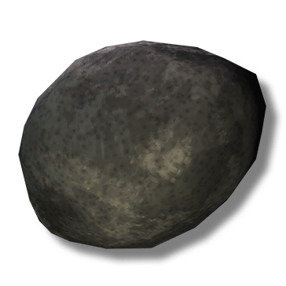
<figcaption>Stone_icon.png</figcaption>
</figure></td>
<td>
<a href="./Stone.md" class="wikilink" title="Stone">Stone</a>
</td>
<td>
1.46%
</td>
<td>
Yes
</td>
</tr>
<tr>
<td><figure>

<figcaption>Wool_Mittens_icon.png</figcaption>
</figure></td>
<td>
<a href="./Wool%20Mittens.md" class="wikilink" title="Wool Mittens">Wool Mittens</a>
</td>
<td>
0.49%
</td>
<td>
No
</td>
</tr>
<tr>
<td><figure>

<figcaption>Rifle_Cartridge_icon.png</figcaption>
</figure></td>
<td>
<a href="./Rifle%20Ammunition.md" class="wikilink" title="Rifle Cartridge">Rifle Cartridge</a>
</td>
<td>
0.49%
</td>
<td>
No
</td>
</tr>
<tr>
<td><figure>

<figcaption>Insulated_Boots_icon.png</figcaption>
</figure></td>
<td>
<a href="./Insulated%20Boots.md" class="wikilink" title="Insulated Boots">Insulated Boots</a>
</td>
<td>
0.49%
</td>
<td>
No
</td>
</tr>
<tr>
<td><figure>

<figcaption>Revolver_Cartridge_icon.png</figcaption>
</figure></td>
<td>
<a href="./Revolver%20Ammunition.md" class="wikilink" title="Revolver Cartridge">Revolver Cartridge</a>
</td>
<td>
0.49%
</td>
<td>
No
</td>
</tr>
<tr>
<td><figure>

<figcaption>Simple_Arrow_icon.png</figcaption>
</figure></td>
<td>
<a href="./Simple%20Arrow.md" class="wikilink" title="Simple Arrow">Simple Arrow</a>
</td>
<td>
0.49%
</td>
<td>
No
</td>
</tr>
<tr>
<td><figure>

<figcaption>Hacksaw_icon.png</figcaption>
</figure></td>
<td>
<a href="./Hacksaw.md" class="wikilink" title="Hacksaw">Hacksaw</a>
</td>
<td>
0.49%
</td>
<td>
No
</td>
</tr>
<tr>
<td><figure>
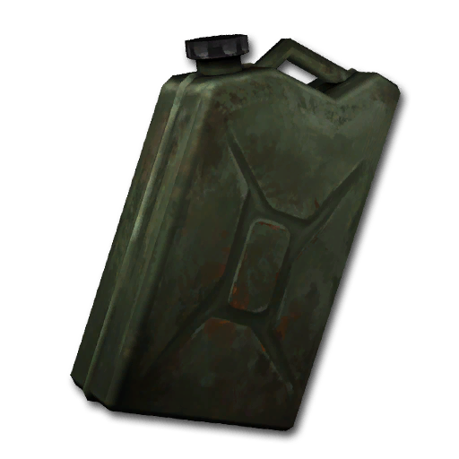
<figcaption>Jerry_Can_icon.png</figcaption>
</figure></td>
<td>
<a href="./Jerry%20Can.md" class="wikilink" title="Jerry Can">Jerry Can</a>
</td>
<td>
0.49%
</td>
<td>
Yes
</td>
</tr>
<tr>
<td><figure>

<figcaption>Flare_Shell_icon.png</figcaption>
</figure></td>
<td>
<a href="./Flare%20Shell.md" class="wikilink" title="Flare Shell">Flare Shell</a>
</td>
<td>
0.49%
</td>
<td>
No
</td>
</tr>
</tbody>
</table>

<table>
<caption>style="width:100%; text-align: left;" | Fishing Boat - Left Small Container</caption>
<colgroup>
<col style="width: 25%" />
<col style="width: 25%" />
<col style="width: 25%" />
<col style="width: 25%" />
</colgroup>
<thead>
<tr>
<th>
Icon
</th>
<th>
Item
</th>
<th>
Rarity
</th>
<th><figure>

<figcaption>Misery_icon.png</figcaption>
</figure></th>
</tr>
</thead>
<tbody>
<tr>
<td><figure>

<figcaption>Scrap_Metal_icon.png</figcaption>
</figure></td>
<td>
<a href="./Scrap%20Metal.md" class="wikilink" title="Scrap Metal">Scrap Metal</a>
</td>
<td>
5.1%
</td>
<td>
Yes
</td>
</tr>
<tr>
<td><figure>

<figcaption>Cloth_icon.png</figcaption>
</figure></td>
<td>
<a href="./Cloth.md" class="wikilink" title="Cloth">Cloth</a>
</td>
<td>
5.1%
</td>
<td>
Yes
</td>
</tr>
<tr>
<td><figure>

<figcaption>Beef_Jerky_icon.png</figcaption>
</figure></td>
<td>
<a href="./Beef%20Jerky.md" class="wikilink" title="Beef Jerky">Beef Jerky</a>
</td>
<td>
5.1%
</td>
<td>
Yes
</td>
</tr>
<tr>
<td><figure>

<figcaption>Cured_Leather_icon.png</figcaption>
</figure></td>
<td>
<a href="./Cured%20Leather.md" class="wikilink" title="Cured Leather">Cured Leather</a>
</td>
<td>
5.1%
</td>
<td>
Yes
</td>
</tr>
<tr>
<td><figure>

<figcaption>Line_icon.png</figcaption>
</figure></td>
<td>
<a href="./Line.md" class="wikilink" title="Line">Line</a>
</td>
<td>
5.1%
</td>
<td>
Yes
</td>
</tr>
<tr>
<td><figure>

<figcaption>Lantern_Fuel_icon.png</figcaption>
</figure></td>
<td>
<a href="./Lantern%20Fuel.md" class="wikilink" title="Lantern Fuel">Lantern Fuel</a>
</td>
<td>
5.1%
</td>
<td>
Yes
</td>
</tr>
<tr>
<td><figure>

<figcaption>Cardboard_Matches_icon.png</figcaption>
</figure></td>
<td>
<a href="./Cardboard%20Matches.md" class="wikilink" title="Cardboard Matches">Cardboard Matches</a>
</td>
<td>
5.1%
</td>
<td>
No
</td>
</tr>
<tr>
<td><figure>

<figcaption>Charcoal_icon.png</figcaption>
</figure></td>
<td>
<a href="./Charcoal.md" class="wikilink" title="Charcoal">Charcoal</a>
</td>
<td>
5.1%
</td>
<td>
Yes
</td>
</tr>
<tr>
<td><figure>

<figcaption>Chocolate_Bar_icon.png</figcaption>
</figure></td>
<td>
<a href="./Chocolate%20Bar.md" class="wikilink" title="Chocolate Bar">Chocolate Bar</a>
</td>
<td>
5.1%
</td>
<td>
Yes
</td>
</tr>
<tr>
<td><figure>

<figcaption>Bandage_icon.png</figcaption>
</figure></td>
<td>
<a href="./Bandage.md" class="wikilink" title="Bandage">Bandage</a>
</td>
<td>
5.1%
</td>
<td>
Yes
</td>
</tr>
<tr>
<td><figure>

<figcaption>Wires_icon.png</figcaption>
</figure></td>
<td>
<a href="./Wires.md" class="wikilink" title="Wires">Wires</a>
</td>
<td>
3.06%
</td>
<td>
Yes
</td>
</tr>
<tr>
<td><figure>

<figcaption>Hook_icon.png</figcaption>
</figure></td>
<td>
<a href="./Hook.md" class="wikilink" title="Hook">Hook</a>
</td>
<td>
3.06%
</td>
<td>
Yes
</td>
</tr>
<tr>
<td><figure>

<figcaption>Newsprint_icon.png</figcaption>
</figure></td>
<td>
<a href="./Newsprint.md" class="wikilink" title="Newsprint">Newsprint</a>
</td>
<td>
3.06%
</td>
<td>
Yes
</td>
</tr>
<tr>
<td><figure>

<figcaption>Arrow_Shaft_icon.png</figcaption>
</figure></td>
<td>
<a href="./Arrow%20Shaft.md" class="wikilink" title="Arrow Shaft">Arrow Shaft</a>
</td>
<td>
3.06%
</td>
<td>
Yes
</td>
</tr>
<tr>
<td><figure>

<figcaption>Crow_Feather_icon.png</figcaption>
</figure></td>
<td>
<a href="./Crow%20Feather.md" class="wikilink" title="Crow Feather">Crow Feather</a>
</td>
<td>
3.06%
</td>
<td>
Yes
</td>
</tr>
<tr>
<td><figure>

<figcaption>Sewing_Kit_icon.png</figcaption>
</figure></td>
<td>
<a href="./Sewing%20Kit.md" class="wikilink" title="Sewing Kit">Sewing Kit</a>
</td>
<td>
3.06%
</td>
<td>
Yes
</td>
</tr>
<tr>
<td><figure>

<figcaption>Painkillers_icon.png</figcaption>
</figure></td>
<td>
<a href="./Painkillers.md" class="wikilink" title="Painkillers">Painkillers</a>
</td>
<td>
3.06%
</td>
<td>
Yes
</td>
</tr>
<tr>
<td><figure>

<figcaption>Flare_icon.png</figcaption>
</figure></td>
<td>
<a href="./Flare.md" class="wikilink" title="Flare">Flare</a>
</td>
<td>
3.06%
</td>
<td>
Yes
</td>
</tr>
<tr>
<td><figure>

<figcaption>Tinder_Plug_icon.png</figcaption>
</figure></td>
<td>
<a href="./Tinder%20Plug.md" class="wikilink" title="Tinder Plug">Tinder Plug</a>
</td>
<td>
3.06%
</td>
<td>
Yes
</td>
</tr>
<tr>
<td><figure>

<figcaption>Replacement_Fuse_icon.png</figcaption>
</figure></td>
<td>
<a href="./Replacement%20Fuse.md" class="wikilink" title="Replacement Fuse">Replacement Fuse</a>
</td>
<td>
3.06%
</td>
<td>
Yes
</td>
</tr>
<tr>
<td><figure>

<figcaption>Rifle_Cartridge_icon.png</figcaption>
</figure></td>
<td>
<a href="./Rifle%20Ammunition.md" class="wikilink" title="Rifle Cartridge">Rifle Cartridge</a>
</td>
<td>
3.06%
</td>
<td>
No
</td>
</tr>
<tr>
<td><figure>
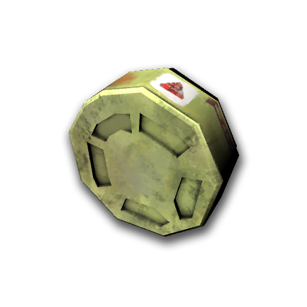
<figcaption>Canister_icon.png</figcaption>
</figure></td>
<td>
<a href="./Canister.md" class="wikilink" title="Canister">Canister</a>
</td>
<td>
3.06%
</td>
<td>
Yes
</td>
</tr>
<tr>
<td><figure>

<figcaption>Work_Gloves_icon.png</figcaption>
</figure></td>
<td>
<a href="./Work%20Gloves.md" class="wikilink" title="Work Gloves">Work Gloves</a>
</td>
<td>
2.04%
</td>
<td>
Yes
</td>
</tr>
<tr>
<td><figure>

<figcaption>Arrowhead_icon.png</figcaption>
</figure></td>
<td>
<a href="./Arrowhead.md" class="wikilink" title="Arrowhead">Arrowhead</a>
</td>
<td>
2.04%
</td>
<td>
Yes
</td>
</tr>
<tr>
<td><figure>

<figcaption>Flare_Shell_icon.png</figcaption>
</figure></td>
<td>
<a href="./Flare%20Shell.md" class="wikilink" title="Flare Shell">Flare Shell</a>
</td>
<td>
2.04%
</td>
<td>
No
</td>
</tr>
<tr>
<td><figure>
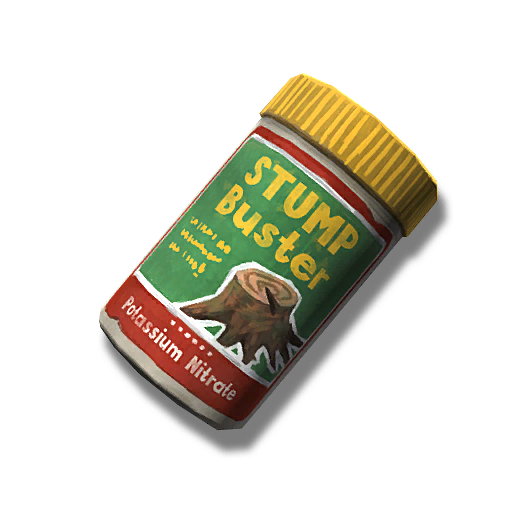
<figcaption>Stump_Remover_icon.png</figcaption>
</figure></td>
<td>
<a href="./Stump%20Remover.md" class="wikilink" title="Stump Remover">Stump Remover</a>
</td>
<td>
2.04%
</td>
<td>
Yes
</td>
</tr>
<tr>
<td><figure>

<figcaption>Birch_Bark_icon.png</figcaption>
</figure></td>
<td>
<a href="./Birch%20Bark.md" class="wikilink" title="Birch Bark">Birch Bark</a>
</td>
<td>
2.04%
</td>
<td>
Yes
</td>
</tr>
<tr>
<td><figure>

<figcaption>Sewing_Kit_icon.png</figcaption>
</figure></td>
<td>
<a href="./Sewing%20Kit.md" class="wikilink" title="Sewing Kit">Sewing Kit</a>
</td>
<td>
2.04%
</td>
<td>
Yes
</td>
</tr>
<tr>
<td><figure>
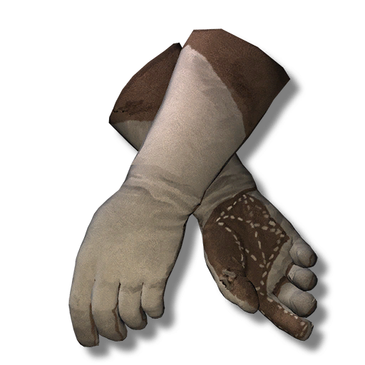
<figcaption>Gauntlets_icon.png</figcaption>
</figure></td>
<td>
<a href="./Gauntlets.md" class="wikilink" title="Gauntlets">Gauntlets</a>
</td>
<td>
1.02%
</td>
<td>
No
</td>
</tr>
<tr>
<td><figure>

<figcaption>Revolver_Cartridge_icon.png</figcaption>
</figure></td>
<td>
<a href="./Revolver%20Ammunition.md" class="wikilink" title="Revolver Cartridge">Revolver Cartridge</a>
</td>
<td>
1.02%
</td>
<td>
No
</td>
</tr>
<tr>
<td><figure>

<figcaption>Rifle_Shell_Casing_icon.png</figcaption>
</figure></td>
<td>
<a href="./Rifle%20Shell%20Casing.md" class="wikilink" title="Rifle Shell Casing">Rifle Shell Casing</a>
</td>
<td>
1.02%
</td>
<td>
No
</td>
</tr>
</tbody>
</table>

<table>
<caption>style="width:100%; text-align: left;" | Fishing Boat - Right Small Container</caption>
<colgroup>
<col style="width: 25%" />
<col style="width: 25%" />
<col style="width: 25%" />
<col style="width: 25%" />
</colgroup>
<thead>
<tr>
<th>
Icon
</th>
<th>
Item
</th>
<th>
Rarity
</th>
<th><figure>

<figcaption>Misery_icon.png</figcaption>
</figure></th>
</tr>
</thead>
<tbody>
<tr>
<td><figure>

<figcaption>Cloth_icon.png</figcaption>
</figure></td>
<td>
<a href="./Cloth.md" class="wikilink" title="Cloth">Cloth</a>
</td>
<td>
11.72%
</td>
<td>
Yes
</td>
</tr>
<tr>
<td><figure>

<figcaption>Newsprint_icon.png</figcaption>
</figure></td>
<td>
<a href="./Newsprint.md" class="wikilink" title="Newsprint">Newsprint</a>
</td>
<td>
11.72%
</td>
<td>
Yes
</td>
</tr>
<tr>
<td><figure>

<figcaption>Scrap_Metal_icon.png</figcaption>
</figure></td>
<td>
<a href="./Scrap%20Metal.md" class="wikilink" title="Scrap Metal">Scrap Metal</a>
</td>
<td>
7.81%
</td>
<td>
Yes
</td>
</tr>
<tr>
<td><figure>

<figcaption>Cardboard_Matches_icon.png</figcaption>
</figure></td>
<td>
<a href="./Cardboard%20Matches.md" class="wikilink" title="Cardboard Matches">Cardboard Matches</a>
</td>
<td>
6.25%
</td>
<td>
No
</td>
</tr>
<tr>
<td><figure>

<figcaption>Line_icon.png</figcaption>
</figure></td>
<td>
<a href="./Line.md" class="wikilink" title="Line">Line</a>
</td>
<td>
4.69%
</td>
<td>
Yes
</td>
</tr>
<tr>
<td><figure>

<figcaption>Recycled_Can_icon.png</figcaption>
</figure></td>
<td>
<a href="./Recycled%20Can.md" class="wikilink" title="Recycled Can">Recycled Can</a>
</td>
<td>
3.91%
</td>
<td>
Yes
</td>
</tr>
<tr>
<td><figure>

<figcaption>Flare_icon.png</figcaption>
</figure></td>
<td>
<a href="./Flare.md" class="wikilink" title="Flare">Flare</a>
</td>
<td>
3.91%
</td>
<td>
Yes
</td>
</tr>
<tr>
<td><figure>

<figcaption>Charcoal_icon.png</figcaption>
</figure></td>
<td>
<a href="./Charcoal.md" class="wikilink" title="Charcoal">Charcoal</a>
</td>
<td>
3.91%
</td>
<td>
Yes
</td>
</tr>
<tr>
<td><figure>

<figcaption>Spray_Paint_icon.png</figcaption>
</figure></td>
<td>
<a href="./Spray%20Paint.md" class="wikilink" title="Spray Paint">Spray Paint</a>
</td>
<td>
2.34%
</td>
<td>
Yes
</td>
</tr>
<tr>
<td><figure>

<figcaption>Work_Gloves_icon.png</figcaption>
</figure></td>
<td>
<a href="./Work%20Gloves.md" class="wikilink" title="Work Gloves">Work Gloves</a>
</td>
<td>
2.34%
</td>
<td>
Yes
</td>
</tr>
<tr>
<td><figure>

<figcaption>Ketchup_Chips_icon.png</figcaption>
</figure></td>
<td>
<a href="./Ketchup%20Chips.md" class="wikilink" title="Ketchup Chips">Ketchup Chips</a>
</td>
<td>
2.34%
</td>
<td>
Yes
</td>
</tr>
<tr>
<td><figure>

<figcaption>Wool_Toque_icon.png</figcaption>
</figure></td>
<td>
<a href="./Wool%20Toque.md" class="wikilink" title="Wool Toque">Wool Toque</a>
</td>
<td>
2.34%
</td>
<td>
Yes
</td>
</tr>
<tr>
<td><figure>

<figcaption>Stone_icon.png</figcaption>
</figure></td>
<td>
<a href="./Stone.md" class="wikilink" title="Stone">Stone</a>
</td>
<td>
2.34%
</td>
<td>
Yes
</td>
</tr>
<tr>
<td><figure>

<figcaption>Rifle_Cartridge_icon.png</figcaption>
</figure></td>
<td>
<a href="./Rifle%20Ammunition.md" class="wikilink" title="Rifle Cartridge">Rifle Cartridge</a>
</td>
<td>
2.34%
</td>
<td>
No
</td>
</tr>
<tr>
<td><figure>

<figcaption>Wool_Scarf_icon.png</figcaption>
</figure></td>
<td>
<a href="./Wool%20Scarf.md" class="wikilink" title="Wool Scarf">Wool Scarf</a>
</td>
<td>
2.34%
</td>
<td>
Yes
</td>
</tr>
<tr>
<td><figure>

<figcaption>Fishing_Tackle_icon.png</figcaption>
</figure></td>
<td>
<a href="./Fishing%20Tackle.md" class="wikilink" title="Fishing Tackle">Fishing Tackle</a>
</td>
<td>
2.34%
</td>
<td>
No
</td>
</tr>
<tr>
<td><figure>

<figcaption>Hook_icon.png</figcaption>
</figure></td>
<td>
<a href="./Hook.md" class="wikilink" title="Hook">Hook</a>
</td>
<td>
2.34%
</td>
<td>
Yes
</td>
</tr>
<tr>
<td><figure>

<figcaption>Fleece_Mittens_icon.png</figcaption>
</figure></td>
<td>
<a href="./Fleece%20Mittens.md" class="wikilink" title="Fleece Mittens">Fleece Mittens</a>
</td>
<td>
2.34%
</td>
<td>
Yes
</td>
</tr>
<tr>
<td><figure>

<figcaption>Tin_of_Sardines_icon.png</figcaption>
</figure></td>
<td>
<a href="./Tin%20of%20Sardines.md" class="wikilink" title="Tin of Sardines">Tin of Sardines</a>
</td>
<td>
2.34%
</td>
<td>
Yes
</td>
</tr>
<tr>
<td><figure>

<figcaption>Revolver_Cartridge_icon.png</figcaption>
</figure></td>
<td>
<a href="./Revolver%20Ammunition.md" class="wikilink" title="Revolver Cartridge">Revolver Cartridge</a>
</td>
<td>
2.34%
</td>
<td>
No
</td>
</tr>
<tr>
<td><figure>

<figcaption>Long_Wool_Scarf_icon.png</figcaption>
</figure></td>
<td>
<a href="./Long%20Wool%20Scarf.md" class="wikilink" title="Long Wool Scarf">Long Wool Scarf</a>
</td>
<td>
1.56%
</td>
<td>
No
</td>
</tr>
<tr>
<td><figure>

<figcaption>Summit_Soda_icon.png</figcaption>
</figure></td>
<td>
<a href="./Summit%20Soda.md" class="wikilink" title="Summit Soda">Summit Soda</a>
</td>
<td>
1.56%
</td>
<td>
Yes
</td>
</tr>
<tr>
<td><figure>
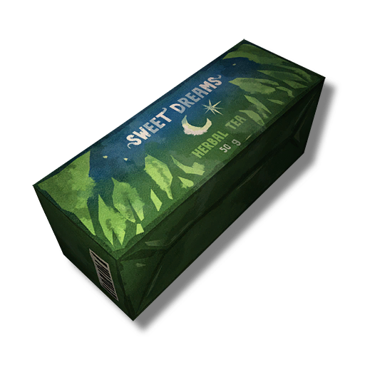
<figcaption>Herbal_Tea_icon.png</figcaption>
</figure></td>
<td>
<a href="./Herbal%20Tea.md" class="wikilink" title="Herbal Tea">Herbal Tea</a>
</td>
<td>
1.56%
</td>
<td>
Yes
</td>
</tr>
<tr>
<td><figure>

<figcaption>Marine_Flare_icon.png</figcaption>
</figure></td>
<td>
<a href="./Marine%20Flare.md" class="wikilink" title="Marine Flare">Marine Flare</a>
</td>
<td>
1.56%
</td>
<td>
Yes
</td>
</tr>
<tr>
<td><figure>

<figcaption>Energy_Bar_icon.png</figcaption>
</figure></td>
<td>
<a href="./Energy%20Bar.md" class="wikilink" title="Energy Bar">Energy Bar</a>
</td>
<td>
1.56%
</td>
<td>
No
</td>
</tr>
<tr>
<td><figure>
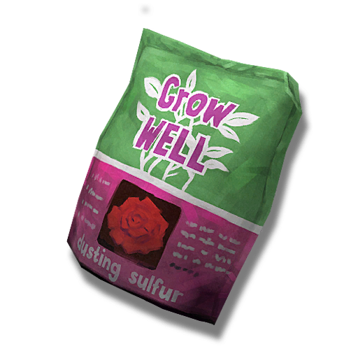
<figcaption>Dusting_Sulfur_icon.png</figcaption>
</figure></td>
<td>
<a href="./Dusting%20Sulfur.md" class="wikilink" title="Dusting Sulfur">Dusting Sulfur</a>
</td>
<td>
1.56%
</td>
<td>
Yes
</td>
</tr>
<tr>
<td><figure>

<figcaption>Tomato_Soup_icon.png</figcaption>
</figure></td>
<td>
<a href="./Tomato%20Soup.md" class="wikilink" title="Tomato Soup">Tomato Soup</a>
</td>
<td>
1.56%
</td>
<td>
Yes
</td>
</tr>
<tr>
<td><figure>

<figcaption>Wires_icon.png</figcaption>
</figure></td>
<td>
<a href="./Wires.md" class="wikilink" title="Wires">Wires</a>
</td>
<td>
1.56%
</td>
<td>
Yes
</td>
</tr>
<tr>
<td><figure>

<figcaption>Balaclava_icon.png</figcaption>
</figure></td>
<td>
<a href="./Balaclava.md" class="wikilink" title="Balaclava">Balaclava</a>
</td>
<td>
0.78%
</td>
<td>
No
</td>
</tr>
<tr>
<td><figure>

<figcaption>Climbing_Socks_icon.png</figcaption>
</figure></td>
<td>
<a href="./Climbing%20Socks.md" class="wikilink" title="Climbing Socks">Climbing Socks</a>
</td>
<td>
0.78%
</td>
<td>
No
</td>
</tr>
<tr>
<td><figure>
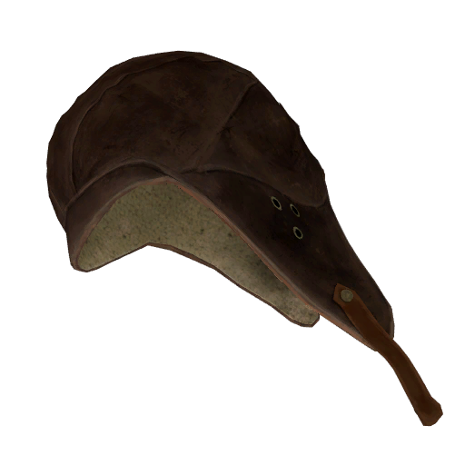
<figcaption>Aviator_Cap_icon.png</figcaption>
</figure></td>
<td>
<a href="./Aviator%20Cap.md" class="wikilink" title="Aviator Cap">Aviator Cap</a>
</td>
<td>
0.78%
</td>
<td>
Yes
</td>
</tr>
<tr>
<td><figure>

<figcaption>Salty_Crackers_icon.png</figcaption>
</figure></td>
<td>
<a href="./Salty%20Crackers.md" class="wikilink" title="Salty Crackers">Salty Crackers</a>
</td>
<td>
0.78%
</td>
<td>
Yes
</td>
</tr>
<tr>
<td><figure>

<figcaption>Flare_Shell_icon.png</figcaption>
</figure></td>
<td>
<a href="./Flare%20Shell.md" class="wikilink" title="Flare Shell">Flare Shell</a>
</td>
<td>
0.78%
</td>
<td>
No
</td>
</tr>
<tr>
<td><figure>

<figcaption>Down_Vest_icon.png</figcaption>
</figure></td>
<td>
<a href="./Down%20Vest.md" class="wikilink" title="Down Vest">Down Vest</a>
</td>
<td>
0.78%
</td>
<td>
Yes
</td>
</tr>
</tbody>
</table>

<table>
<caption>style="width:100%; text-align: left;" | Fishing Boat - Cabin Container</caption>
<colgroup>
<col style="width: 25%" />
<col style="width: 25%" />
<col style="width: 25%" />
<col style="width: 25%" />
</colgroup>
<thead>
<tr>
<th>
Icon
</th>
<th>
Item
</th>
<th>
Rarity
</th>
<th><figure>

<figcaption>Misery_icon.png</figcaption>
</figure></th>
</tr>
</thead>
<tbody>
<tr>
<td><figure>

<figcaption>Trail_Boots_icon.png</figcaption>
</figure></td>
<td>
<a href="./Trail%20Boots.md" class="wikilink" title="Trail Boots">Trail Boots</a>
</td>
<td>
3.45%
</td>
<td>
Yes
</td>
</tr>
<tr>
<td><figure>

<figcaption>Running_Shoes_icon.png</figcaption>
</figure></td>
<td>
<a href="./Running%20Shoes.md" class="wikilink" title="Running Shoes">Running Shoes</a>
</td>
<td>
3.45%
</td>
<td>
Yes
</td>
</tr>
<tr>
<td><figure>

<figcaption>Leather_Shoes_icon.png</figcaption>
</figure></td>
<td>
<a href="./Leather%20Shoes.md" class="wikilink" title="Leather Shoes">Leather Shoes</a>
</td>
<td>
3.45%
</td>
<td>
Yes
</td>
</tr>
<tr>
<td><figure>

<figcaption>Driving_Gloves_icon.png</figcaption>
</figure></td>
<td>
<a href="./Driving%20Gloves.md" class="wikilink" title="Driving Gloves">Driving Gloves</a>
</td>
<td>
2.76%
</td>
<td>
Yes
</td>
</tr>
<tr>
<td><figure>

<figcaption>Windbreaker_icon.png</figcaption>
</figure></td>
<td>
<a href="./Windbreaker.md" class="wikilink" title="Windbreaker">Windbreaker</a>
</td>
<td>
2.76%
</td>
<td>
Yes
</td>
</tr>
<tr>
<td><figure>

<figcaption>Cotton_Toque_icon.png</figcaption>
</figure></td>
<td>
<a href="./Cotton%20Toque.md" class="wikilink" title="Cotton Toque">Cotton Toque</a>
</td>
<td>
2.76%
</td>
<td>
Yes
</td>
</tr>
<tr>
<td><figure>

<figcaption>Hoodie_icon.png</figcaption>
</figure></td>
<td>
<a href="./Hoodie.md" class="wikilink" title="Hoodie">Hoodie</a>
</td>
<td>
2.76%
</td>
<td>
Yes
</td>
</tr>
<tr>
<td><figure>

<figcaption>Sweatshirt_icon.png</figcaption>
</figure></td>
<td>
<a href="./Sweatshirt.md" class="wikilink" title="Sweatshirt">Sweatshirt</a>
</td>
<td>
2.76%
</td>
<td>
Yes
</td>
</tr>
<tr>
<td><figure>

<figcaption>Sport_Vest_icon.png</figcaption>
</figure></td>
<td>
<a href="./Sport%20Vest.md" class="wikilink" title="Sport Vest">Sport Vest</a>
</td>
<td>
2.76%
</td>
<td>
Yes
</td>
</tr>
<tr>
<td><figure>

<figcaption>Jeans_icon.png</figcaption>
</figure></td>
<td>
<a href="./Jeans.md" class="wikilink" title="Jeans">Jeans</a>
</td>
<td>
2.76%
</td>
<td>
Yes
</td>
</tr>
<tr>
<td><figure>

<figcaption>Newsprint_icon.png</figcaption>
</figure></td>
<td>
<a href="./Newsprint.md" class="wikilink" title="Newsprint">Newsprint</a>
</td>
<td>
2.76%
</td>
<td>
Yes
</td>
</tr>
<tr>
<td><figure>

<figcaption>Plaid_Shirt_icon.png</figcaption>
</figure></td>
<td>
<a href="./Plaid%20Shirt.md" class="wikilink" title="Plaid Shirt">Plaid Shirt</a>
</td>
<td>
2.76%
</td>
<td>
Yes
</td>
</tr>
<tr>
<td><figure>

<figcaption>T-Shirt_icon.png</figcaption>
</figure></td>
<td>
<a href="./T-Shirt.md" class="wikilink" title="T-Shirt">T-Shirt</a>
</td>
<td>
2.76%
</td>
<td>
Yes
</td>
</tr>
<tr>
<td><figure>

<figcaption>Wood_Matches_icon.png</figcaption>
</figure></td>
<td>
<a href="./Wood%20Matches.md" class="wikilink" title="Wood Matches">Wood Matches</a>
</td>
<td>
2.76%
</td>
<td>
Yes
</td>
</tr>
<tr>
<td><figure>

<figcaption>Book_icon.png</figcaption>
</figure></td>
<td>
<a href="./Book.md" class="wikilink" title="Book">Book</a>
</td>
<td>
2.07%
</td>
<td>
Yes
</td>
</tr>
<tr>
<td><figure>

<figcaption>Book_icon.png</figcaption>
</figure></td>
<td>
<a href="./Book.md" class="wikilink" title="Book">Book</a>
</td>
<td>
2.07%
</td>
<td>
Yes
</td>
</tr>
<tr>
<td><figure>

<figcaption>Cloth_icon.png</figcaption>
</figure></td>
<td>
<a href="./Cloth.md" class="wikilink" title="Cloth">Cloth</a>
</td>
<td>
2.07%
</td>
<td>
Yes
</td>
</tr>
<tr>
<td><figure>

<figcaption>Cotton_Scarf_icon.png</figcaption>
</figure></td>
<td>
<a href="./Cotton%20Scarf.md" class="wikilink" title="Cotton Scarf">Cotton Scarf</a>
</td>
<td>
2.07%
</td>
<td>
Yes
</td>
</tr>
<tr>
<td><figure>

<figcaption>Ketchup_Chips_icon.png</figcaption>
</figure></td>
<td>
<a href="./Ketchup%20Chips.md" class="wikilink" title="Ketchup Chips">Ketchup Chips</a>
</td>
<td>
2.07%
</td>
<td>
Yes
</td>
</tr>
<tr>
<td><figure>

<figcaption>Lantern_Fuel_icon.png</figcaption>
</figure></td>
<td>
<a href="./Lantern%20Fuel.md" class="wikilink" title="Lantern Fuel">Lantern Fuel</a>
</td>
<td>
2.07%
</td>
<td>
Yes
</td>
</tr>
<tr>
<td><figure>

<figcaption>Simple_Parka_icon.png</figcaption>
</figure></td>
<td>
<a href="./Simple%20Parka.md" class="wikilink" title="Simple Parka">Simple Parka</a>
</td>
<td>
2.07%
</td>
<td>
Yes
</td>
</tr>
<tr>
<td><figure>

<figcaption>Newsprint_Roll_icon.png</figcaption>
</figure></td>
<td>
<a href="./Newsprint%20Roll.md" class="wikilink" title="Newsprint Roll">Newsprint Roll</a>
</td>
<td>
2.07%
</td>
<td>
Yes
</td>
</tr>
<tr>
<td><figure>

<figcaption>Scrap_Metal_icon.png</figcaption>
</figure></td>
<td>
<a href="./Scrap%20Metal.md" class="wikilink" title="Scrap Metal">Scrap Metal</a>
</td>
<td>
2.07%
</td>
<td>
Yes
</td>
</tr>
<tr>
<td><figure>

<figcaption>Light_Shell_icon.png</figcaption>
</figure></td>
<td>
<a href="./Light%20Shell.md" class="wikilink" title="Light Shell">Light Shell</a>
</td>
<td>
2.07%
</td>
<td>
Yes
</td>
</tr>
<tr>
<td><figure>

<figcaption>Accelerant_icon.png</figcaption>
</figure></td>
<td>
<a href="./Accelerant.md" class="wikilink" title="Accelerant">Accelerant</a>
</td>
<td>
1.38%
</td>
<td>
Yes
</td>
</tr>
<tr>
<td><figure>

<figcaption>Wool_Scarf_icon.png</figcaption>
</figure></td>
<td>
<a href="./Wool%20Scarf.md" class="wikilink" title="Wool Scarf">Wool Scarf</a>
</td>
<td>
1.38%
</td>
<td>
Yes
</td>
</tr>
<tr>
<td><figure>

<figcaption>Marine_Flare_icon.png</figcaption>
</figure></td>
<td>
<a href="./Marine%20Flare.md" class="wikilink" title="Marine Flare">Marine Flare</a>
</td>
<td>
1.38%
</td>
<td>
Yes
</td>
</tr>
<tr>
<td><figure>

<figcaption>Antiseptic_icon.png</figcaption>
</figure></td>
<td>
<a href="./Antiseptic.md" class="wikilink" title="Antiseptic">Antiseptic</a>
</td>
<td>
1.38%
</td>
<td>
Yes
</td>
</tr>
<tr>
<td><figure>

<figcaption>Painkillers_icon.png</figcaption>
</figure></td>
<td>
<a href="./Painkillers.md" class="wikilink" title="Painkillers">Painkillers</a>
</td>
<td>
1.38%
</td>
<td>
Yes
</td>
</tr>
<tr>
<td><figure>

<figcaption>Chocolate_Bar_icon.png</figcaption>
</figure></td>
<td>
<a href="./Chocolate%20Bar.md" class="wikilink" title="Chocolate Bar">Chocolate Bar</a>
</td>
<td>
1.38%
</td>
<td>
Yes
</td>
</tr>
<tr>
<td><figure>

<figcaption>Pork_and_Beans_icon.png</figcaption>
</figure></td>
<td>
<a href="./Pork%20and%20Beans.md" class="wikilink" title="Pork and Beans">Pork and Beans</a>
</td>
<td>
1.38%
</td>
<td>
Yes
</td>
</tr>
<tr>
<td><figure>

<figcaption>Down_Vest_icon.png</figcaption>
</figure></td>
<td>
<a href="./Down%20Vest.md" class="wikilink" title="Down Vest">Down Vest</a>
</td>
<td>
1.38%
</td>
<td>
Yes
</td>
</tr>
<tr>
<td><figure>

<figcaption>Flare_icon.png</figcaption>
</figure></td>
<td>
<a href="./Flare.md" class="wikilink" title="Flare">Flare</a>
</td>
<td>
1.38%
</td>
<td>
Yes
</td>
</tr>
<tr>
<td><figure>

<figcaption>Fleece_Mittens_icon.png</figcaption>
</figure></td>
<td>
<a href="./Fleece%20Mittens.md" class="wikilink" title="Fleece Mittens">Fleece Mittens</a>
</td>
<td>
1.38%
</td>
<td>
Yes
</td>
</tr>
<tr>
<td><figure>

<figcaption>Revolver_Cartridge_icon.png</figcaption>
</figure></td>
<td>
<a href="./Revolver%20Ammunition.md" class="wikilink" title="Revolver Cartridge">Revolver Cartridge</a>
</td>
<td>
1.38%
</td>
<td>
No
</td>
</tr>
<tr>
<td><figure>

<figcaption>Summit_Soda_icon.png</figcaption>
</figure></td>
<td>
<a href="./Summit%20Soda.md" class="wikilink" title="Summit Soda">Summit Soda</a>
</td>
<td>
1.38%
</td>
<td>
Yes
</td>
</tr>
<tr>
<td><figure>

<figcaption>Go!_Energy_Drink_icon.png</figcaption>
</figure></td>
<td>
<a href="./Go!%20Energy%20Drink.md" class="wikilink" title="Go! Energy Drink">Go! Energy Drink</a>
</td>
<td>
1.38%
</td>
<td>
No
</td>
</tr>
<tr>
<td><figure>

<figcaption>Stacy's_Grape_Soda_icon.png</figcaption>
</figure></td>
<td>
<a href="./Stacy%27s%20Grape%20Soda.md" class="wikilink" title="Stacy&#39;s Grape Soda">Stacy's Grape Soda</a>
</td>
<td>
1.38%
</td>
<td>
No
</td>
</tr>
<tr>
<td><figure>

<figcaption>Spray_Paint_icon.png</figcaption>
</figure></td>
<td>
<a href="./Spray%20Paint.md" class="wikilink" title="Spray Paint">Spray Paint</a>
</td>
<td>
1.38%
</td>
<td>
Yes
</td>
</tr>
<tr>
<td><figure>

<figcaption>Wool_Toque_icon.png</figcaption>
</figure></td>
<td>
<a href="./Wool%20Toque.md" class="wikilink" title="Wool Toque">Wool Toque</a>
</td>
<td>
1.38%
</td>
<td>
Yes
</td>
</tr>
<tr>
<td><figure>

<figcaption>Water_Purification_Tablets_icon.png</figcaption>
</figure></td>
<td>
<a href="./Water%20Purification%20Tablets.md" class="wikilink" title="Water Purification Tablets">Water Purification Tablets</a>
</td>
<td>
1.38%
</td>
<td>
Yes
</td>
</tr>
<tr>
<td><figure>

<figcaption>Thin_Wool_Sweater_icon.png</figcaption>
</figure></td>
<td>
<a href="./Thin%20Wool%20Sweater.md" class="wikilink" title="Thin Wool Sweater">Thin Wool Sweater</a>
</td>
<td>
1.38%
</td>
<td>
Yes
</td>
</tr>
<tr>
<td><figure>

<figcaption>Work_Boots_icon.png</figcaption>
</figure></td>
<td>
<a href="./Work%20Boots.md" class="wikilink" title="Work Boots">Work Boots</a>
</td>
<td>
1.38%
</td>
<td>
Yes
</td>
</tr>
<tr>
<td><figure>

<figcaption>Work_Gloves_icon.png</figcaption>
</figure></td>
<td>
<a href="./Work%20Gloves.md" class="wikilink" title="Work Gloves">Work Gloves</a>
</td>
<td>
1.38%
</td>
<td>
Yes
</td>
</tr>
<tr>
<td><figure>

<figcaption>Cargo_Pants_icon.png</figcaption>
</figure></td>
<td>
<a href="./Cargo%20Pants.md" class="wikilink" title="Cargo Pants">Cargo Pants</a>
</td>
<td>
0.69%
</td>
<td>
No
</td>
</tr>
<tr>
<td><figure>

<figcaption>Combat_Boots_icon.png</figcaption>
</figure></td>
<td>
<a href="./Combat%20Boots.md" class="wikilink" title="Combat Boots">Combat Boots</a>
</td>
<td>
0.69%
</td>
<td>
Yes
</td>
</tr>
<tr>
<td><figure>

<figcaption>Flare_Shell_icon.png</figcaption>
</figure></td>
<td>
<a href="./Flare%20Shell.md" class="wikilink" title="Flare Shell">Flare Shell</a>
</td>
<td>
0.69%
</td>
<td>
No
</td>
</tr>
<tr>
<td><figure>

<figcaption>Replacement_Fuse_icon.png</figcaption>
</figure></td>
<td>
<a href="./Replacement%20Fuse.md" class="wikilink" title="Replacement Fuse">Replacement Fuse</a>
</td>
<td>
0.69%
</td>
<td>
Yes
</td>
</tr>
<tr>
<td><figure>

<figcaption>Cured_Leather_icon.png</figcaption>
</figure></td>
<td>
<a href="./Cured%20Leather.md" class="wikilink" title="Cured Leather">Cured Leather</a>
</td>
<td>
0.69%
</td>
<td>
Yes
</td>
</tr>
<tr>
<td><figure>

<figcaption>Line_icon.png</figcaption>
</figure></td>
<td>
<a href="./Line.md" class="wikilink" title="Line">Line</a>
</td>
<td>
0.69%
</td>
<td>
Yes
</td>
</tr>
<tr>
<td><figure>

<figcaption>Thermal_Underwear_icon.png</figcaption>
</figure></td>
<td>
<a href="./Thermal%20Underwear.md" class="wikilink" title="Thermal Underwear">Thermal Underwear</a>
</td>
<td>
0.69%
</td>
<td>
Yes
</td>
</tr>
<tr>
<td><figure>

<figcaption>Wool_Mittens_icon.png</figcaption>
</figure></td>
<td>
<a href="./Wool%20Mittens.md" class="wikilink" title="Wool Mittens">Wool Mittens</a>
</td>
<td>
0.69%
</td>
<td>
No
</td>
</tr>
<tr>
<td><figure>

<figcaption>Stack_of_Papers_icon.png</figcaption>
</figure></td>
<td>
<a href="./Stack%20of%20Papers.md" class="wikilink" title="Stack of Papers">Stack of Papers</a>
</td>
<td>
0.69%
</td>
<td>
Yes
</td>
</tr>
<tr>
<td><figure>

<figcaption>Simple_Tools_icon.png</figcaption>
</figure></td>
<td>
<a href="./Simple%20Tools.md" class="wikilink" title="Simple Tools">Simple Tools</a>
</td>
<td>
0.69%
</td>
<td>
Yes
</td>
</tr>
<tr>
<td><figure>

<figcaption>Tinder_Plug_icon.png</figcaption>
</figure></td>
<td>
<a href="./Tinder%20Plug.md" class="wikilink" title="Tinder Plug">Tinder Plug</a>
</td>
<td>
0.69%
</td>
<td>
Yes
</td>
</tr>
<tr>
<td><figure>

<figcaption>Tomato_Soup_icon.png</figcaption>
</figure></td>
<td>
<a href="./Tomato%20Soup.md" class="wikilink" title="Tomato Soup">Tomato Soup</a>
</td>
<td>
0.69%
</td>
<td>
Yes
</td>
</tr>
<tr>
<td><figure>

<figcaption>Water_(Potable)_icon.png</figcaption>
</figure></td>
<td>
<a href="./Water%20%28Potable%29.md" class="wikilink" title="Water (Potable)">Water (Potable)</a>
</td>
<td>
0.69%
</td>
<td>
No
</td>
</tr>
<tr>
<td><figure>

<figcaption>Wires_icon.png</figcaption>
</figure></td>
<td>
<a href="./Wires.md" class="wikilink" title="Wires">Wires</a>
</td>
<td>
0.69%
</td>
<td>
Yes
</td>
</tr>
<tr>
<td><figure>

<figcaption>Work_Pants_icon.png</figcaption>
</figure></td>
<td>
<a href="./Work%20Pants.md" class="wikilink" title="Work Pants">Work Pants</a>
</td>
<td>
0.69%
</td>
<td>
No
</td>
</tr>
<tr>
<td><figure>

<figcaption>Arrowhead_icon.png</figcaption>
</figure></td>
<td>
<a href="./Arrowhead.md" class="wikilink" title="Arrowhead">Arrowhead</a>
</td>
<td>
0.42%
</td>
<td>
Yes
</td>
</tr>
<tr>
<td><figure>

<figcaption>Rifle_Shell_Casing_icon.png</figcaption>
</figure></td>
<td>
<a href="./Rifle%20Shell%20Casing.md" class="wikilink" title="Rifle Shell Casing">Rifle Shell Casing</a>
</td>
<td>
0.42%
</td>
<td>
No
</td>
</tr>
</tbody>
</table>

## Strategy

- Wearing <a href="./Crampons.md" class="wikilink" title="Crampons">Crampons</a> increases the timer of weak ice (from 5 to 6 seconds).
- <a href="./Stamina.md" class="wikilink" title="Sprinting">Sprinting</a> is useful or even necessary to collect beachcombing items without getting wet.
- Not being <a href="./Encumbrance.md" class="wikilink" title="Encumbered">Encumbered</a> or <a href="./Needs.md" class="wikilink" title="Fatigued">Fatigued</a> greatly affects movement. Dropping heavy items before an attempt increases speed.
- Fleeing to the thicker ice and starting over from a failed attempt is often safer than risking getting wet.
- Beachcombing items spawn every few days at finite spawn locations; however, no item will spawn if there is already an item present, regardless of condition or usefulness. Thus, undesirable items should still be gathered to allow new items to spawn.
- Bringing <a href="./Fire%20Starting.md" class="wikilink" title="firestarting">firestarting</a> materials to warm up should one fall in, or removing clothes pre-emptively so they will be dry if the player fails.
- Some of the items found when beachcombing can be heavy. If you have <a href="./Tales%20from%20the%20Far%20Territory.md" class="wikilink" title="Tales from the Far Territory">Tales from the Far Territory</a> installed, consider bringing along a <a href="./Travois.md" class="wikilink" title="Travois">Travois</a> to maximize efficiency.

**Lua execution error in Module:Navbox function navbox** <a href="ru:%D0%91%D0%B5%D1%80%D0%B5%D0%B3%D0%BE%D0%B2%D0%BE%D0%B5_%D1%81%D0%BE%D0%B1%D0%B8%D1%80%D0%B0%D1%82%D0%B5%D0%BB%D1%8C%D1%81%D1%82%D0%B2%D0%BE" class="wikilink" title="ru:Береговое собирательство">ru:Береговое собирательство</a>

