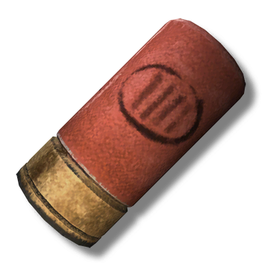
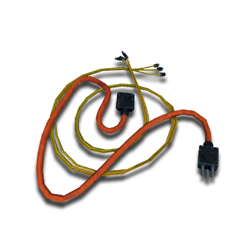
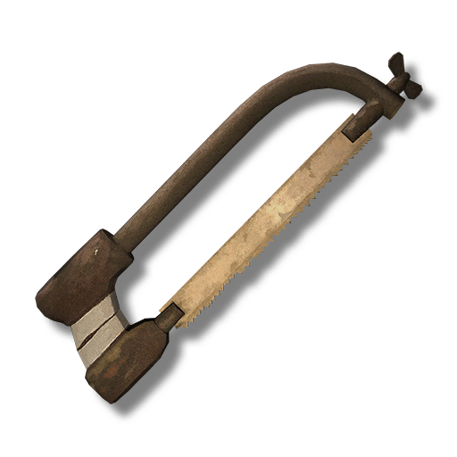
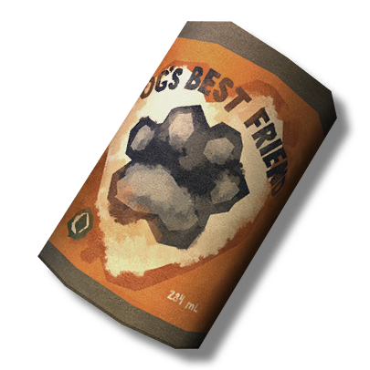
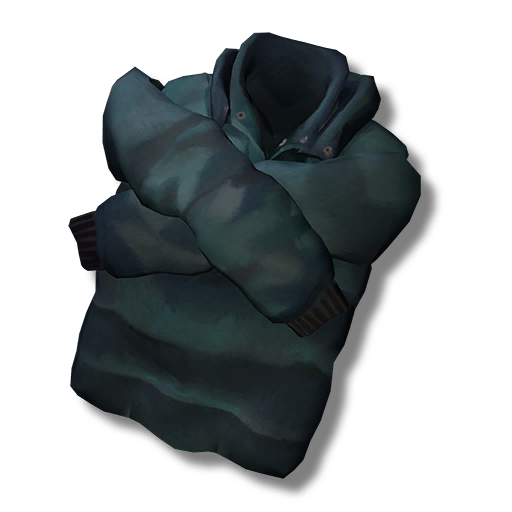
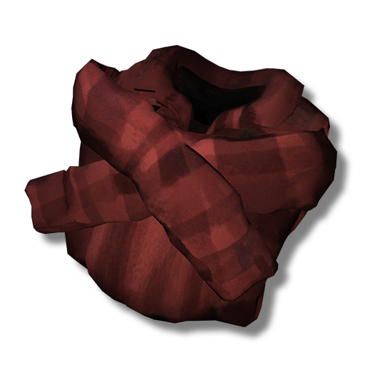
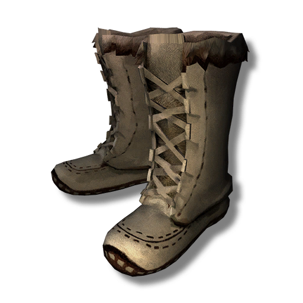
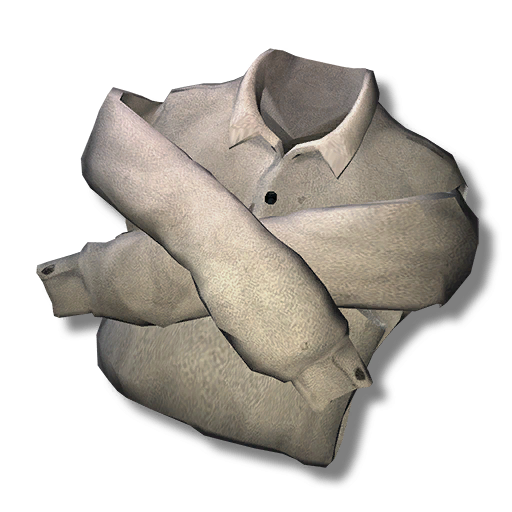

# Beachcombing

**Categories:** Gameplay · **Source:** [Fandom](https://thelongdark.fandom.com/wiki/Beachcombing)

**Contents**

- [Item Spawns](#item-spawns)
- [Standard](#standard)
- [Post-blizzard](#post-blizzard)
- [Container and Large Object Spawns](#container-and-large-object-spawns)
- [Boat Spawns](#boat-spawns)
- [Strategy](#strategy)

_A rowboat and loose items found while beachcombing._ **Beachcombing** is a gameplay mechanic in _[The Long Dark](./The%20Long%20Dark.md),_which allows the player to acquire otherwise non-renewable items.

Items can wash up along the icy shoreline regions of [Great Bear Island](./Great%20Bear%20Island.md) ([Desolation Point](./Desolation%20Point.md), [Coastal Highway](./Coastal%20Highway.md), [Bleak Inlet](./Bleak%20Inlet.md) and [Crumbling Highway](./Crumbling%20Highway.md)). Rarely the player's character must stand atop [Weak Ice](./Weak%20Ice.md) to gather these items, but most of the time a player can safely stay on normal ice or the shore.

## Item Spawns

These small, lootable items can be found in many locations along the water, usually in small clusters. The quality and quantity of items will depend on difficulty setting. These items will respawn progressively (it is not necessary for a blizzard to occur).

### Standard

|  | Item | Rarity |  / _Misery\_icon.png_ |
| --- | --- | --- | --- |
|  / _Stick\_icon.png_ | [Stick](./Stick.md) | 22.22% | Yes |
|  / _Reclaimed\_Wood\_icon.png_ | [Reclaimed Wood](./Reclaimed%20Wood.md) | 7.41% | Yes |
|  / _Cedar\_Firewood\_icon.png_ | [Cedar Firewood](./Cedar%20Firewood.md) | 5.93% | Yes |
|  / _Cloth\_icon.png_ | [Cloth](./Cloth.md) | 5.93% | Yes |
|  / _Smallmouth\_Bass\_(Raw)\_icon.png_ | [Smallmouth Bass (Raw)](./Smallmouth%20Bass%20%28Raw%29.md) | 4.44% | Yes |
|  / _Cat\_Tail\_Stalk\_icon.png_ | [Cat Tail Stalk](./Cat%20Tail%20Stalk.md) | 4.44% | Yes |
|  / _Birch\_Bark\_icon.png_ | [Birch Bark](./Birch%20Bark.md) | 4.44% | Yes |
|  / _Cat\_Tail\_Head\_icon.png_ | [Cat Tail Head](./Cat%20Tail%20Head.md) | 3.7% | Yes |
|  / _Green\_Birch\_Sapling\_icon.png_ | [Green Birch Sapling](./Green%20Birch%20Sapling.md) | 3.7% | Yes |
|  / _Fir\_Firewood\_icon.png_ | [Fir Firewood](./Fir%20Firewood.md) | 3.7% | Yes |
|  / _Scrap\_Metal\_icon.png_ | [Scrap Metal](./Scrap%20Metal.md) | 3.7% | Yes |
|  / _Rifle\_Shell\_Casing\_icon.png_ | [Rifle Shell Casing](./Rifle%20Shell%20Casing.md) | 2.96% | No |
|  / _Coho\_Salmon\_(Raw)\_icon.png_ | [Coho Salmon (Raw)](./Coho%20Salmon%20%28Raw%29.md) | 2.96% | Yes |
|  / _Broken\_Arrow\_icon.png_ | [Broken Arrow](./Simple%20Arrow.md) | 2.22% | No |
|  / _Green\_Maple\_Sapling\_icon.png_ | [Green Maple Sapling](./Green%20Maple%20Sapling.md) | 1.48% | Yes |
|  / _Old\_Man's\_Beard\_Lichen\_icon.png_ | [Old Man's Beard Lichen](./Old%20Man%27s%20Beard%20Lichen.md) | 1.48% | Yes |
|  / _Rifle\_Cartridge\_icon.png_ | [Rifle Cartridge](./Rifle%20Ammunition.md) | 1.48% | No |
|  / _Flare\_Shell\_icon.png_ | [Flare Shell](./Flare%20Shell.md) | 1.48% | No |
|  / _Cotton\_Toque\_icon.png_ | [Cotton Toque](./Cotton%20Toque.md) | 1.48% | Yes |
|  / _Bandage\_icon.png_ | [Bandage](./Bandage.md) | 1.48% | Yes |
|  / _Painkillers\_icon.png_ | [Painkillers](./Painkillers.md) | 1.48% | Yes |
|  / _Sports\_Socks\_icon.png_ | [Sports Socks](./Sports%20Socks.md) | 1.48% | Yes |
|  / _Baseball\_Cap\_icon.png_ | [Baseball Cap](./Baseball%20Cap.md) | 1.48% | Yes |
|  / _Broken\_Fire\_Hardened\_Arrow\_icon.png_ | [Broken Fire Hardened Arrow](./Fire%20Hardened%20Arrow.md) | 1.48% | No |
|  / _Wires\_icon.png_ | [Wires](./Wires.md) | 1.48% | Yes |
|  / _Cured\_Leather\_icon.png_ | [Cured Leather](./Cured%20Leather.md) | 1.48% | Yes |
|  / _Improvised\_Knife\_icon.png_ | [Improvised Knife](./Improvised%20Knife.md) | 0.74% | No |
|  / _Tin\_of\_Sardines\_icon.png_ | [Tin of Sardines](./Tin%20of%20Sardines.md) | 0.74% | Yes |
|  / _Running\_Shoes\_icon.png_ | [Running Shoes](./Running%20Shoes.md) | 0.74% | Yes |
|  / _Leather\_Shoes\_icon.png_ | [Leather Shoes](./Leather%20Shoes.md) | 0.74% | Yes |
|  / _Recycled\_Can\_icon.png_ | [Recycled Can](./Recycled%20Can.md) | 0.74% | Yes |
|  / _Cured\_Leather\_icon.png_ | [Cured Leather](./Cured%20Leather.md) | 0.74% | Yes |

### Post-blizzard

|  | Item | Rarity |  / _Misery\_icon.png_ |
| --- | --- | --- | --- |
|  / _Cat\_Tail\_Head\_icon.png_ | [Cat Tail Head](./Cat%20Tail%20Head.md) | 5.38% | Yes |
|  / _Green\_Birch\_Sapling\_icon.png_ | [Green Birch Sapling](./Green%20Birch%20Sapling.md) | 5.38% | Yes |
|  / _Fir\_Firewood\_icon.png_ | [Fir Firewood](./Fir%20Firewood.md) | 5.38% | Yes |
|  / _Smallmouth\_Bass\_(Raw)\_icon.png_ | [Smallmouth Bass (Raw)](./Smallmouth%20Bass%20%28Raw%29.md) | 5.38% | Yes |
|  / _Cat\_Tail\_Stalk\_icon.png_ | [Cat Tail Stalk](./Cat%20Tail%20Stalk.md) | 5.38% | Yes |
|  / _Birch\_Bark\_icon.png_ | [Birch Bark](./Birch%20Bark.md) | 5.38% | Yes |
|  / _Cedar\_Firewood\_icon.png_ | [Cedar Firewood](./Cedar%20Firewood.md) | 5.38% | Yes |
|  / _Cloth\_icon.png_ | [Cloth](./Cloth.md) | 5.38% | Yes |
|  / _Reclaimed\_Wood\_icon.png_ | [Reclaimed Wood](./Reclaimed%20Wood.md) | 5.38% | Yes |
|  / _Stick\_icon.png_ | [Stick](./Stick.md) | 5.38% | Yes |
|  / _Rifle\_Shell\_Casing\_icon.png_ | [Rifle Shell Casing](./Rifle%20Shell%20Casing.md) | 4.3% | No |
|  / _Coho\_Salmon\_(Raw)\_icon.png_ | [Coho Salmon (Raw)](./Coho%20Salmon%20%28Raw%29.md) | 4.3% | Yes |
|  / _Broken\_Arrow\_icon.png_ | [Broken Arrow](./Simple%20Arrow.md) | 3.23% | No |
|  / _Green\_Maple\_Sapling\_icon.png_ | [Green Maple Sapling](./Green%20Maple%20Sapling.md) | 2.15% | Yes |
|  / _Old\_Man's\_Beard\_Lichen\_icon.png_ | [Old Man's Beard Lichen](./Old%20Man%27s%20Beard%20Lichen.md) | 2.15% | Yes |
|  / _Rifle\_Cartridge\_icon.png_ | [Rifle Cartridge](./Rifle%20Ammunition.md) | 2.15% | No |
|  / _Flare\_Shell\_icon.png_ | [Flare Shell](./Flare%20Shell.md) | 2.15% | No |
|  / _Wool\_Toque\_icon.png_ | [Wool Toque](./Wool%20Toque.md) | 2.15% | Yes |
|  / _Painkillers\_icon.png_ | [Painkillers](./Painkillers.md) | 2.15% | Yes |
|  / _Climbing\_Socks\_icon.png_ | [Climbing Socks](./Climbing%20Socks.md) | 2.15% | No |
|  / _Cured\_Leather\_icon.png_ | [Cured Leather](./Cured%20Leather.md) | 2.15% | Yes |
|  / _Hunting\_Knife\_icon.png_ | [Hunting Knife](./Hunting%20Knife.md) | 1.08% | No |
|  / _Ketchup\_Chips\_icon.png_ | [Ketchup Chips](./Ketchup%20Chips.md) | 1.08% | Yes |
|  / _Leather\_Shoes\_icon.png_ | [Leather Shoes](./Leather%20Shoes.md) | 1.08% | Yes |
|  / _Hacksaw\_icon.png_ | [Hacksaw](./Hacksaw.md) | 1.08% | No |
|  / _Emergency\_Stim\_icon.png_ | [Emergency Stim](./Emergency%20Stim.md) | 1.08% | No |
|  / _Wool\_Longjohns\_icon.png_ | [Wool Longjohns](./Wool%20Longjohns.md) | 1.08% | No |
|  / _Simple\_Arrow\_icon.png_ | [Simple Arrow](./Simple%20Arrow.md) | 1.08% | No |
|  / _Fire\_Hardened\_Arrow\_icon.png_ | [Fire Hardened Arrow](./Fire%20Hardened%20Arrow.md) | 1.08% | No |
|  / _Broken\_Fire\_Hardened\_Arrow\_icon.png_ | [Broken Fire Hardened Arrow](./Fire%20Hardened%20Arrow.md) | 1.08% | No |
|  / _Quality\_Tools\_icon.png_ | [Quality Tools](./Quality%20Tools.md) | 1.08% | Yes |
|  / _Spray\_Paint\_icon.png_ | [Spray Paint](./Spray%20Paint.md) | 1.08% | Yes |
|  / _Rabbit\_Carcass\_icon.png_ | [Rabbit Carcass](./Rabbit%20Carcass.md) | 1.08% | Yes |
|  / _Military-Grade\_MRE\_icon.png_ | [Military-Grade MRE](./Military-Grade%20MRE.md) | 1.08% | No |
|  / _Marine\_Flare\_icon.png_ | [Marine Flare](./Marine%20Flare.md) | 1.08% | Yes |
|  / _Cured\_Rabbit\_Pelt\_icon.png_ | [Cured Rabbit Pelt](./Cured%20Rabbit%20Pelt.md) | 1.08% | Yes |
|  / _The\_Frozen\_Angler\_icon.png_ | [The Frozen Angler](./The%20Frozen%20Angler.md) | 1.08% | Yes |

## Container and Large Object Spawns

Each time a [blizzard](./Weather.md) occurs, several larger objects and containers have a possibility of appearing in specific locations along the ice. These locations are not shared with the other small items or boats.

Harvestable large objects:

- A ravaged [Deer Carcass](./Deer%20Carcass.md) (and associated [Crow Feathers](./Crow%20Feather.md))
- A ravaged [Wolf Carcass](./Wolf%20Carcass.md) (and associated [Crow Feathers](./Crow%20Feather.md))
- [Pallet](./Pallet.md)
- [Planks](./Plank.md)

Containers:

**style="width:100%; text-align: left;" | [Frozen Corpse](./Frozen%20Corpse.md)**

| Icon | Item | Rarity |  / _Misery\_icon.png_ |
| --- | --- | --- | --- |
|  / _Beef\_Jerky\_icon.png_ | [Beef Jerky](./Beef%20Jerky.md) | 5.1% | Yes |
|  / _Tinder\_Plug\_icon.png_ | [Tinder Plug](./Tinder%20Plug.md) | 5.1% | Yes |
|  / _Wood\_Matches\_icon.png_ | [Wood Matches](./Wood%20Matches.md) | 5.1% | Yes |
|  / _Wool\_Toque\_icon.png_ | [Wool Toque](./Wool%20Toque.md) | 5.1% | Yes |
|  / _Summit\_Soda\_icon.png_ | [Summit Soda](./Summit%20Soda.md) | 5.1% | Yes |
|  / _Chocolate\_Bar\_icon.png_ | [Chocolate Bar](./Chocolate%20Bar.md) | 5.1% | Yes |
|  / _Stacy's\_Grape\_Soda\_icon.png_ | [Stacy's Grape Soda](./Stacy%27s%20Grape%20Soda.md) | 5.1% | No |
|  / _Trail\_Boots\_icon.png_ | [Trail Boots](./Trail%20Boots.md) | 4.1% | Yes |
|  / _Running\_Shoes\_icon.png_ | [Running Shoes](./Running%20Shoes.md) | 4.1% | Yes |
|  / _Ketchup\_Chips\_icon.png_ | [Ketchup Chips](./Ketchup%20Chips.md) | 4.1% | Yes |
|  / _Flare\_icon.png_ | [Flare](./Flare.md) | 3.6% | Yes |
|  / _Tin\_of\_Sardines\_icon.png_ | [Tin of Sardines](./Tin%20of%20Sardines.md) | 3.6% | Yes |
|  / _T-Shirt\_icon.png_ | [T-Shirt](./T-Shirt.md) | 3.6% | Yes |
|  / _Hoodie\_icon.png_ | [Hoodie](./Hoodie.md) | 3% | Yes |
|  / _Revolver\_Cartridge\_icon.png_ | [Revolver Cartridge](./Revolver%20Ammunition.md) | 2.5% | No |
|  / _Charcoal\_icon.png_ | [Charcoal](./Charcoal.md) | 2.5% | Yes |
|  / _Energy\_Bar\_icon.png_ | [Energy Bar](./Energy%20Bar.md) | 2.5% | No |
|  / _Lantern\_Fuel\_icon.png_ | [Lantern Fuel](./Lantern%20Fuel.md) | 2.5% | Yes |
|  / _Rifle\_Cartridge\_icon.png_ | [Rifle Cartridge](./Rifle%20Ammunition.md) | 2.5% | No |
|  / _Cotton\_Scarf\_icon.png_ | [Cotton Scarf](./Cotton%20Scarf.md) | 2.5% | Yes |
|  / _Bandage\_icon.png_ | [Bandage](./Bandage.md) | 2% | Yes |
|  / _Sport\_Vest\_icon.png_ | [Sport Vest](./Sport%20Vest.md) | 2% | Yes |
|  / _Windbreaker\_icon.png_ | [Windbreaker](./Windbreaker.md) | 2% | Yes |
|  / _Sports\_Socks\_icon.png_ | [Sports Socks](./Sports%20Socks.md) | 2% | Yes |
|  / _Thermal\_Underwear\_icon.png_ | [Thermal Underwear](./Thermal%20Underwear.md) | 1.5% | Yes |
|  / _Dog\_Food\_icon.png_ | [Dog Food](./Dog%20Food.md) | 1.5% | Yes |
|  / _Fishing\_Tackle\_icon.png_ | [Fishing Tackle](./Fishing%20Tackle.md) | 1.5% | No |
|  / _Marine\_Flare\_icon.png_ | [Marine Flare](./Marine%20Flare.md) | 1.5% | Yes |
|  / _Thick\_Wool\_Sweater\_icon.png_ | [Thick Wool Sweater](./Thick%20Wool%20Sweater.md) | 1% | No |
|  / _Condensed\_Milk\_icon.png_ | [Condensed Milk](./Condensed%20Milk.md) | 1% | No |
|  / _Spray\_Paint\_icon.png_ | [Spray Paint](./Spray%20Paint.md) | 1% | Yes |
|  / _Arrowhead\_icon.png_ | [Arrowhead](./Arrowhead.md) | 1% | Yes |
|  / _Antibiotics\_icon.png_ | [Antibiotics](./Antibiotics.md) | 0.5% | Yes |
|  / _Painkillers\_icon.png_ | [Painkillers](./Painkillers.md) | 0.5% | Yes |
|  / _Flare\_Shell\_icon.png_ | [Flare Shell](./Flare%20Shell.md) | 0.5% | No |
|  / _Combat\_Boots\_icon.png_ | [Combat Boots](./Combat%20Boots.md) | 0.5% | Yes |
|  / _Recycled\_Can\_icon.png_ | [Recycled Can](./Recycled%20Can.md) | 0.5% | Yes |
|  / _Go!\_Energy\_Drink\_icon.png_ | [Go! Energy Drink](./Go!%20Energy%20Drink.md) | 0.5% | No |
|  / _Maple\_Syrup\_icon.png_ | [Maple Syrup](./Maple%20Syrup.md) | 0.5% | Yes |
|  / _Whetstone\_icon.png_ | [Whetstone](./Whetstone.md) | 0.5% | Yes |
|  / _Sewing\_Kit\_icon.png_ | [Sewing Kit](./Sewing%20Kit.md) | 0.5% | Yes |
|  / _Flashlight\_icon.png_ | [Flashlight](./Flashlight.md) | 0.5% | No |

**style="width:100%; text-align: left;" | [Trunk](./Trunk.md)**

| Icon | Item | Rarity |  / _Misery\_icon.png_ |
| --- | --- | --- | --- |
|  / _Ski\_Jacket\_icon.png_ | [Ski Jacket](./Ski%20Jacket.md) | 8.57% | Yes |
|  / _Windbreaker\_icon.png_ | [Windbreaker](./Windbreaker.md) | 8.57% | Yes |
|  / _Sport\_Vest\_icon.png_ | [Sport Vest](./Sport%20Vest.md) | 8.57% | Yes |
|  / _Simple\_Parka\_icon.png_ | [Simple Parka](./Simple%20Parka.md) | 8.57% | Yes |
|  / _Light\_Shell\_icon.png_ | [Light Shell](./Light%20Shell.md) | 8.57% | Yes |
|  / _Cotton\_Toque\_icon.png_ | [Cotton Toque](./Cotton%20Toque.md) | 5.71% | Yes |
|  / _Fleece\_Mittens\_icon.png_ | [Fleece Mittens](./Fleece%20Mittens.md) | 5.71% | Yes |
|  / _Down\_Vest\_icon.png_ | [Down Vest](./Down%20Vest.md) | 3.43% | Yes |
|  / _Old\_Fashioned\_Parka\_icon.png_ | [Old Fashioned Parka](./Old%20Fashioned%20Parka.md) | 3.43% | No |
|  / _Wool\_Scarf\_icon.png_ | [Wool Scarf](./Wool%20Scarf.md) | 3.43% | Yes |
|  / _Wool\_Toque\_icon.png_ | [Wool Toque](./Wool%20Toque.md) | 3.43% | Yes |
|  / _Trail\_Boots\_icon.png_ | [Trail Boots](./Trail%20Boots.md) | 3.43% | Yes |
|  / _Wool\_Mittens\_icon.png_ | [Wool Mittens](./Wool%20Mittens.md) | 3.43% | No |
|  / _Driving\_Gloves\_icon.png_ | [Driving Gloves](./Driving%20Gloves.md) | 3.43% | Yes |
|  / _Hoodie\_icon.png_ | [Hoodie](./Hoodie.md) | 3.43% | Yes |
|  / _Running\_Shoes\_icon.png_ | [Running Shoes](./Running%20Shoes.md) | 3.43% | Yes |
|  / _Ski\_Gloves\_icon.png_ | [Ski Gloves](./Ski%20Gloves.md) | 1.71% | No |
|  / _Urban\_Parka\_icon.png_ | [Urban Parka](./Urban%20Parka.md) | 1.71% | No |
|  / _Military\_Coat\_icon.png_ | [Military Coat](./Military%20Coat.md) | 1.71% | No |
|  / _Newsprint\_icon.png_ | [Newsprint](./Newsprint.md) | 1.71% | Yes |
|  / _Cloth\_icon.png_ | [Cloth](./Cloth.md) | 1.71% | Yes |
|  / _Mackinaw\_Jacket\_icon.png_ | [Mackinaw Jacket](./Mackinaw%20Jacket.md) | 0.57% | Yes |
|  / _Mariner's\_Pea\_Coat\_icon.png_ | [Mariner's Pea Coat](./Mariner%27s%20Pea%20Coat.md) | 0.57% | No |
|  / _Long\_Wool\_Scarf\_icon.png_ | [Long Wool Scarf](./Long%20Wool%20Scarf.md) | 0.57% | No |
|  / _Insulated\_Boots\_icon.png_ | [Insulated Boots](./Insulated%20Boots.md) | 0.57% | No |
|  / _Mukluks\_icon.png_ | [Mukluks](./Mukluks.md) | 0.57% | No |
|  / _Ski\_Boots\_icon.png_ | [Ski Boots](./Ski%20Boots.md) | 0.57% | No |
|  / _Snow\_Pants\_icon.png_ | [Snow Pants](./Snow%20Pants.md) | 0.57% | No |
|  / _Flare\_icon.png_ | [Flare](./Flare.md) | 0.57% | Yes |
|  / _Cowichan\_Sweater\_icon.png_ | [Cowichan Sweater](./Cowichan%20Sweater.md) | 0.57% | No |
|  / _Expedition\_Parka\_icon.png_ | [Expedition Parka](./Expedition%20Parka.md) | 0.57% | No |
|  / _Flight\_Jacket\_icon.png_ | [Flight Jacket](./Flight%20Jacket.md) | 0.57% | No |

**style="width:100%; text-align: left;" | [Suitcase](./Suitcase.md)**

| Icon | Item | Rarity |  / _Misery\_icon.png_ |
| --- | --- | --- | --- |
|  / _Sport\_Vest\_icon.png_ | [Sport Vest](./Sport%20Vest.md) | 3.26% | Yes |
|  / _Wool\_Toque\_icon.png_ | [Wool Toque](./Wool%20Toque.md) | 3.26% | Yes |
|  / _Light\_Shell\_icon.png_ | [Light Shell](./Light%20Shell.md) | 3.26% | Yes |
|  / _Cotton\_Scarf\_icon.png_ | [Cotton Scarf](./Cotton%20Scarf.md) | 3.26% | Yes |
|  / _Simple\_Parka\_icon.png_ | [Simple Parka](./Simple%20Parka.md) | 3.26% | Yes |
|  / _Running\_Shoes\_icon.png_ | [Running Shoes](./Running%20Shoes.md) | 3.26% | Yes |
|  / _Leather\_Shoes\_icon.png_ | [Leather Shoes](./Leather%20Shoes.md) | 3.26% | Yes |
|  / _Fleece\_Mittens\_icon.png_ | [Fleece Mittens](./Fleece%20Mittens.md) | 3.26% | Yes |
|  / _Wool\_Scarf\_icon.png_ | [Wool Scarf](./Wool%20Scarf.md) | 3.26% | Yes |
|  / _Cotton\_Toque\_icon.png_ | [Cotton Toque](./Cotton%20Toque.md) | 3.26% | Yes |
|  / _Wool\_Shirt\_icon.png_ | [Wool Shirt](./Wool%20Shirt.md) | 3.26% | No |
|  / _Down\_Vest\_icon.png_ | [Down Vest](./Down%20Vest.md) | 3.26% | Yes |
|  / _Thick\_Wool\_Sweater\_icon.png_ | [Thick Wool Sweater](./Thick%20Wool%20Sweater.md) | 3.26% | No |
|  / _Plaid\_Shirt\_icon.png_ | [Plaid Shirt](./Plaid%20Shirt.md) | 3.26% | Yes |
|  / _Wool\_Socks\_icon.png_ | [Wool Socks](./Wool%20Socks.md) | 3.26% | Yes |
|  / _Baseball\_Cap\_icon.png_ | [Baseball Cap](./Baseball%20Cap.md) | 3.26% | Yes |
|  / _Cargo\_Pants\_icon.png_ | [Cargo Pants](./Cargo%20Pants.md) | 3.26% | No |
|  / _Thin\_Wool\_Sweater\_icon.png_ | [Thin Wool Sweater](./Thin%20Wool%20Sweater.md) | 3.26% | Yes |
|  / _Hoodie\_icon.png_ | [Hoodie](./Hoodie.md) | 3.26% | Yes |
|  / _Dress\_Shirt\_icon.png_ | [Dress Shirt](./Dress%20Shirt.md) | 3.26% | Yes |
|  / _Sweatshirt\_icon.png_ | [Sweatshirt](./Sweatshirt.md) | 3.26% | Yes |
|  / _Thermal\_Underwear\_icon.png_ | [Thermal Underwear](./Thermal%20Underwear.md) | 3.26% | Yes |
|  / _T-Shirt\_icon.png_ | [T-Shirt](./T-Shirt.md) | 3.26% | Yes |
|  / _Sports\_Socks\_icon.png_ | [Sports Socks](./Sports%20Socks.md) | 3.26% | Yes |
|  / _Jeans\_icon.png_ | [Jeans](./Jeans.md) | 3.26% | Yes |
|  / _Ski\_Jacket\_icon.png_ | [Ski Jacket](./Ski%20Jacket.md) | 1.63% | Yes |
|  / _Combat\_Pants\_icon.png_ | [Combat Pants](./Combat%20Pants.md) | 1.63% | Yes |
|  / _Climbing\_Socks\_icon.png_ | [Climbing Socks](./Climbing%20Socks.md) | 1.63% | No |
|  / _Wool\_Longjohns\_icon.png_ | [Wool Longjohns](./Wool%20Longjohns.md) | 1.63% | No |
|  / _Wool\_Mittens\_icon.png_ | [Wool Mittens](./Wool%20Mittens.md) | 1.63% | No |
|  / _Book\_icon.png_ | [Book](./Book.md) | 1.63% | Yes |
|  / _Book\_icon.png_ | [Book](./Book.md) | 1.63% | Yes |
|  / _Sewing\_Kit\_icon.png_ | [Sewing Kit](./Sewing%20Kit.md) | 1.63% | Yes |
|  / _Book\_icon.png_ | [Book](./Book.md) | 1.63% | Yes |
|  / _Hockey\_Jersey\_icon.png_ | [Hockey Jersey](./Hockey%20Jersey.md) | 1.63% | Yes |
|  / _Antibiotics\_icon.png_ | [Antibiotics](./Antibiotics.md) | 0.82% | Yes |
|  / _Painkillers\_icon.png_ | [Painkillers](./Painkillers.md) | 0.82% | Yes |
|  / _Fisherman's\_Sweater\_icon.png_ | [Fisherman's Sweater](./Fisherman%27s%20Sweater.md) | 0.16% | No |
|  / _Fishing\_Tackle\_icon.png_ | [Fishing Tackle](./Fishing%20Tackle.md) | 0.16% | No |
|  / _Firearm\_Cleaning\_Kit\_icon.png_ | [Firearm Cleaning Kit](./Firearm%20Cleaning%20Kit.md) | 0.16% | No |

**style="width:100%; text-align: left;" | [Backpack](./Backpack.md)**

| Icon | Item | Rarity |  / _Misery\_icon.png_ |
| --- | --- | --- | --- |
|  / _Beef\_Jerky\_icon.png_ | [Beef Jerky](./Beef%20Jerky.md) | 7.46% | Yes |
|  / _Chocolate\_Bar\_icon.png_ | [Chocolate Bar](./Chocolate%20Bar.md) | 7.46% | Yes |
|  / _Ketchup\_Chips\_icon.png_ | [Ketchup Chips](./Ketchup%20Chips.md) | 6.72% | Yes |
|  / _Granola\_Bar\_icon.png_ | [Granola Bar](./Granola%20Bar.md) | 6.72% | Yes |
|  / _Summit\_Soda\_icon.png_ | [Summit Soda](./Summit%20Soda.md) | 5.97% | Yes |
|  / _Stacy's\_Grape\_Soda\_icon.png_ | [Stacy's Grape Soda](./Stacy%27s%20Grape%20Soda.md) | 5.97% | No |
|  / _Wood\_Matches\_icon.png_ | [Wood Matches](./Wood%20Matches.md) | 5.22% | Yes |
|  / _Dog\_Food\_icon.png_ | [Dog Food](./Dog%20Food.md) | 5.22% | Yes |
|  / _Spray\_Paint\_icon.png_ | [Spray Paint](./Spray%20Paint.md) | 5.22% | Yes |
|  / _Water\_(Potable)\_icon.png_ | [Water (Potable)](./Water%20%28Potable%29.md) | 4.48% | No |
|  / _Tin\_of\_Sardines\_icon.png_ | [Tin of Sardines](./Tin%20of%20Sardines.md) | 4.48% | Yes |
|  / _Accelerant\_icon.png_ | [Accelerant](./Accelerant.md) | 3.73% | Yes |
|  / _Salty\_Crackers\_icon.png_ | [Salty Crackers](./Salty%20Crackers.md) | 3.73% | Yes |
|  / _Pinnacle\_Peaches\_icon.png_ | [Pinnacle Peaches](./Pinnacle%20Peaches.md) | 2.99% | Yes |
|  / _Energy\_Bar\_icon.png_ | [Energy Bar](./Energy%20Bar.md) | 2.99% | No |
|  / _Wool\_Toque\_icon.png_ | [Wool Toque](./Wool%20Toque.md) | 2.24% | Yes |
|  / _Wool\_Mittens\_icon.png_ | [Wool Mittens](./Wool%20Mittens.md) | 2.24% | No |
|  / _T-Shirt\_icon.png_ | [T-Shirt](./T-Shirt.md) | 2.24% | Yes |
|  / _Baseball\_Cap\_icon.png_ | [Baseball Cap](./Baseball%20Cap.md) | 2.24% | Yes |
|  / _Wool\_Socks\_icon.png_ | [Wool Socks](./Wool%20Socks.md) | 1.49% | Yes |
|  / _Down\_Vest\_icon.png_ | [Down Vest](./Down%20Vest.md) | 1.49% | Yes |
|  / _Hoodie\_icon.png_ | [Hoodie](./Hoodie.md) | 1.49% | Yes |
|  / _Military-Grade\_MRE\_icon.png_ | [Military-Grade MRE](./Military-Grade%20MRE.md) | 0.75% | No |
|  / _Thin\_Wool\_Sweater\_icon.png_ | [Thin Wool Sweater](./Thin%20Wool%20Sweater.md) | 0.75% | Yes |
|  / _Rifle\_Cartridge\_icon.png_ | [Rifle Cartridge](./Rifle%20Ammunition.md) | 0.75% | No |
|  / _Fishing\_Tackle\_icon.png_ | [Fishing Tackle](./Fishing%20Tackle.md) | 0.75% | No |
|  / _Flare\_icon.png_ | [Flare](./Flare.md) | 0.75% | Yes |
|  / _Climbing\_Socks\_icon.png_ | [Climbing Socks](./Climbing%20Socks.md) | 0.75% | No |
|  / _Recycled\_Can\_icon.png_ | [Recycled Can](./Recycled%20Can.md) | 0.75% | Yes |
|  / _Go!\_Energy\_Drink\_icon.png_ | [Go! Energy Drink](./Go!%20Energy%20Drink.md) | 0.75% | No |
|  / _Revolver\_Cartridge\_icon.png_ | [Revolver Cartridge](./Revolver%20Ammunition.md) | 0.75% | No |
|  / _Marine\_Flare\_icon.png_ | [Marine Flare](./Marine%20Flare.md) | 0.75% | Yes |
|  / _Maple\_Syrup\_icon.png_ | [Maple Syrup](./Maple%20Syrup.md) | 0.75% | Yes |

**style="width:100%; text-align: left;" | [Locker](./Locker.md) (single or double)**

| Icon | Item | Rarity |  / _Misery\_icon.png_ |
| --- | --- | --- | --- |
|  / _Trail\_Boots\_icon.png_ | [Trail Boots](./Trail%20Boots.md) | 3.45% | Yes |
|  / _Running\_Shoes\_icon.png_ | [Running Shoes](./Running%20Shoes.md) | 3.45% | Yes |
|  / _Leather\_Shoes\_icon.png_ | [Leather Shoes](./Leather%20Shoes.md) | 3.45% | Yes |
|  / _Driving\_Gloves\_icon.png_ | [Driving Gloves](./Driving%20Gloves.md) | 2.76% | Yes |
|  / _Windbreaker\_icon.png_ | [Windbreaker](./Windbreaker.md) | 2.76% | Yes |
|  / _Cotton\_Toque\_icon.png_ | [Cotton Toque](./Cotton%20Toque.md) | 2.76% | Yes |
|  / _Hoodie\_icon.png_ | [Hoodie](./Hoodie.md) | 2.76% | Yes |
|  / _Sweatshirt\_icon.png_ | [Sweatshirt](./Sweatshirt.md) | 2.76% | Yes |
|  / _Sport\_Vest\_icon.png_ | [Sport Vest](./Sport%20Vest.md) | 2.76% | Yes |
|  / _Jeans\_icon.png_ | [Jeans](./Jeans.md) | 2.76% | Yes |
|  / _Newsprint\_icon.png_ | [Newsprint](./Newsprint.md) | 2.76% | Yes |
|  / _Plaid\_Shirt\_icon.png_ | [Plaid Shirt](./Plaid%20Shirt.md) | 2.76% | Yes |
|  / _T-Shirt\_icon.png_ | [T-Shirt](./T-Shirt.md) | 2.76% | Yes |
|  / _Wood\_Matches\_icon.png_ | [Wood Matches](./Wood%20Matches.md) | 2.76% | Yes |
|  / _Book\_icon.png_ | [Book](./Book.md) | 2.07% | Yes |
|  / _Book\_icon.png_ | [Book](./Book.md) | 2.07% | Yes |
|  / _Cloth\_icon.png_ | [Cloth](./Cloth.md) | 2.07% | Yes |
|  / _Cotton\_Scarf\_icon.png_ | [Cotton Scarf](./Cotton%20Scarf.md) | 2.07% | Yes |
|  / _Ketchup\_Chips\_icon.png_ | [Ketchup Chips](./Ketchup%20Chips.md) | 2.07% | Yes |
|  / _Lantern\_Fuel\_icon.png_ | [Lantern Fuel](./Lantern%20Fuel.md) | 2.07% | Yes |
|  / _Simple\_Parka\_icon.png_ | [Simple Parka](./Simple%20Parka.md) | 2.07% | Yes |
|  / _Newsprint\_Roll\_icon.png_ | [Newsprint Roll](./Newsprint%20Roll.md) | 2.07% | Yes |
|  / _Scrap\_Metal\_icon.png_ | [Scrap Metal](./Scrap%20Metal.md) | 2.07% | Yes |
|  / _Light\_Shell\_icon.png_ | [Light Shell](./Light%20Shell.md) | 2.07% | Yes |
|  / _Accelerant\_icon.png_ | [Accelerant](./Accelerant.md) | 1.38% | Yes |
|  / _Wool\_Scarf\_icon.png_ | [Wool Scarf](./Wool%20Scarf.md) | 1.38% | Yes |
|  / _Marine\_Flare\_icon.png_ | [Marine Flare](./Marine%20Flare.md) | 1.38% | Yes |
|  / _Antiseptic\_icon.png_ | [Antiseptic](./Antiseptic.md) | 1.38% | Yes |
|  / _Painkillers\_icon.png_ | [Painkillers](./Painkillers.md) | 1.38% | Yes |
|  / _Chocolate\_Bar\_icon.png_ | [Chocolate Bar](./Chocolate%20Bar.md) | 1.38% | Yes |
|  / _Pork\_and\_Beans\_icon.png_ | [Pork and Beans](./Pork%20and%20Beans.md) | 1.38% | Yes |
|  / _Down\_Vest\_icon.png_ | [Down Vest](./Down%20Vest.md) | 1.38% | Yes |
|  / _Flare\_icon.png_ | [Flare](./Flare.md) | 1.38% | Yes |
|  / _Fleece\_Mittens\_icon.png_ | [Fleece Mittens](./Fleece%20Mittens.md) | 1.38% | Yes |
|  / _Revolver\_Cartridge\_icon.png_ | [Revolver Cartridge](./Revolver%20Ammunition.md) | 1.38% | No |
|  / _Summit\_Soda\_icon.png_ | [Summit Soda](./Summit%20Soda.md) | 1.38% | Yes |
|  / _Go!\_Energy\_Drink\_icon.png_ | [Go! Energy Drink](./Go!%20Energy%20Drink.md) | 1.38% | No |
|  / _Stacy's\_Grape\_Soda\_icon.png_ | [Stacy's Grape Soda](./Stacy%27s%20Grape%20Soda.md) | 1.38% | No |
|  / _Spray\_Paint\_icon.png_ | [Spray Paint](./Spray%20Paint.md) | 1.38% | Yes |
|  / _Wool\_Toque\_icon.png_ | [Wool Toque](./Wool%20Toque.md) | 1.38% | Yes |
|  / _Water\_Purification\_Tablets\_icon.png_ | [Water Purification Tablets](./Water%20Purification%20Tablets.md) | 1.38% | Yes |
|  / _Thin\_Wool\_Sweater\_icon.png_ | [Thin Wool Sweater](./Thin%20Wool%20Sweater.md) | 1.38% | Yes |
|  / _Work\_Boots\_icon.png_ | [Work Boots](./Work%20Boots.md) | 1.38% | Yes |
|  / _Work\_Gloves\_icon.png_ | [Work Gloves](./Work%20Gloves.md) | 1.38% | Yes |
|  / _Cargo\_Pants\_icon.png_ | [Cargo Pants](./Cargo%20Pants.md) | 0.69% | No |
|  / _Combat\_Boots\_icon.png_ | [Combat Boots](./Combat%20Boots.md) | 0.69% | Yes |
|  / _Flare\_Shell\_icon.png_ | [Flare Shell](./Flare%20Shell.md) | 0.69% | No |
|  / _Replacement\_Fuse\_icon.png_ | [Replacement Fuse](./Replacement%20Fuse.md) | 0.69% | Yes |
|  / _Cured\_Leather\_icon.png_ | [Cured Leather](./Cured%20Leather.md) | 0.69% | Yes |
|  / _Line\_icon.png_ | [Line](./Line.md) | 0.69% | Yes |
|  / _Thermal\_Underwear\_icon.png_ | [Thermal Underwear](./Thermal%20Underwear.md) | 0.69% | Yes |
|  / _Wool\_Mittens\_icon.png_ | [Wool Mittens](./Wool%20Mittens.md) | 0.69% | No |
|  / _Stack\_of\_Papers\_icon.png_ | [Stack of Papers](./Stack%20of%20Papers.md) | 0.69% | Yes |
|  / _Simple\_Tools\_icon.png_ | [Simple Tools](./Simple%20Tools.md) | 0.69% | Yes |
|  / _Tinder\_Plug\_icon.png_ | [Tinder Plug](./Tinder%20Plug.md) | 0.69% | Yes |
|  / _Tomato\_Soup\_icon.png_ | [Tomato Soup](./Tomato%20Soup.md) | 0.69% | Yes |
|  / _Water\_(Potable)\_icon.png_ | [Water (Potable)](./Water%20%28Potable%29.md) | 0.69% | No |
|  / _Wires\_icon.png_ | [Wires](./Wires.md) | 0.69% | Yes |
|  / _Work\_Pants\_icon.png_ | [Work Pants](./Work%20Pants.md) | 0.69% | No |
|  / _Arrowhead\_icon.png_ | [Arrowhead](./Arrowhead.md) | 0.42% | Yes |
|  / _Rifle\_Shell\_Casing\_icon.png_ | [Rifle Shell Casing](./Rifle%20Shell%20Casing.md) | 0.42% | No |

## Boat Spawns

_A fishing boat found while beachcombing._ Boats may also appear after Blizzards in their own set of specific locations. One or more additional small lootable items can spawn along with them (depending on difficulty setting) and may remain even if the boat later disappears.

- Canoe with [Simple Arrows](./Simple%20Arrow.md), [Broken Arrows](./Broken%20Arrow.md), or [Beef Jerky](./Beef%20Jerky.md)
- Rowboat with [Paddle](./Paddle.md), [Hatchet](./Hatchet.md), [Fishing Tackle](./Fishing%20Tackle.md), or [Coho Salmon (Raw)](./Coho%20Salmon%20%28Raw%29.md)
- Fishing boat which has 4 containers, [Smallmouth Bass (Raw)](./Smallmouth%20Bass%20%28Raw%29.md) in the rear hold, and may also have [Distress pistol](./Distress%20Pistol.md), [Flare Shells](./Flare%20Shell.md), [Marine flares](./Marine%20Flare.md), [Tin of sardines](./Tin%20of%20Sardines.md)

**style="width:100%; text-align: left;" | Fishing Boat - Large Container**

| Icon | Item | Rarity |  / _Misery\_icon.png_ |
| --- | --- | --- | --- |
|  / _Newsprint\_icon.png_ | [Newsprint](./Newsprint.md) | 9.76% | Yes |
|  / _Running\_Shoes\_icon.png_ | [Running Shoes](./Running%20Shoes.md) | 4.88% | Yes |
|  / _Scrap\_Metal\_icon.png_ | [Scrap Metal](./Scrap%20Metal.md) | 4.88% | Yes |
|  / _Light\_Shell\_icon.png_ | [Light Shell](./Light%20Shell.md) | 4.88% | Yes |
|  / _Windbreaker\_icon.png_ | [Windbreaker](./Windbreaker.md) | 4.88% | Yes |
|  / _Cotton\_Scarf\_icon.png_ | [Cotton Scarf](./Cotton%20Scarf.md) | 4.88% | Yes |
|  / _Cloth\_icon.png_ | [Cloth](./Cloth.md) | 4.88% | Yes |
|  / _Beef\_Jerky\_icon.png_ | [Beef Jerky](./Beef%20Jerky.md) | 4.88% | Yes |
|  / _Granola\_Bar\_icon.png_ | [Granola Bar](./Granola%20Bar.md) | 3.41% | Yes |
|  / _Marine\_Flare\_icon.png_ | [Marine Flare](./Marine%20Flare.md) | 3.41% | Yes |
|  / _Wool\_Scarf\_icon.png_ | [Wool Scarf](./Wool%20Scarf.md) | 2.44% | Yes |
|  / _Baseball\_Cap\_icon.png_ | [Baseball Cap](./Baseball%20Cap.md) | 2.44% | Yes |
|  / _Work\_Boots\_icon.png_ | [Work Boots](./Work%20Boots.md) | 2.44% | Yes |
|  / _Orange\_Soda\_icon.png_ | [Orange Soda](./Orange%20Soda.md) | 2.44% | No |
|  / _Leather\_Shoes\_icon.png_ | [Leather Shoes](./Leather%20Shoes.md) | 2.44% | Yes |
|  / _Fleece\_Mittens\_icon.png_ | [Fleece Mittens](./Fleece%20Mittens.md) | 2.44% | Yes |
|  / _Cotton\_Toque\_icon.png_ | [Cotton Toque](./Cotton%20Toque.md) | 2.44% | Yes |
|  / _Hoodie\_icon.png_ | [Hoodie](./Hoodie.md) | 2.44% | Yes |
|  / _Trail\_Boots\_icon.png_ | [Trail Boots](./Trail%20Boots.md) | 2.44% | Yes |
|  / _Down\_Vest\_icon.png_ | [Down Vest](./Down%20Vest.md) | 2.44% | Yes |
|  / _Spray\_Paint\_icon.png_ | [Spray Paint](./Spray%20Paint.md) | 2.44% | Yes |
|  / _Hockey\_Jersey\_icon.png_ | [Hockey Jersey](./Hockey%20Jersey.md) | 2.44% | Yes |
|  / _Sweatshirt\_icon.png_ | [Sweatshirt](./Sweatshirt.md) | 2.44% | Yes |
|  / _Wires\_icon.png_ | [Wires](./Wires.md) | 2.44% | Yes |
|  / _Replacement\_Fuse\_icon.png_ | [Replacement Fuse](./Replacement%20Fuse.md) | 2.44% | Yes |
|  / _Simple\_Parka\_icon.png_ | [Simple Parka](./Simple%20Parka.md) | 1.46% | Yes |
|  / _Wool\_Toque\_icon.png_ | [Wool Toque](./Wool%20Toque.md) | 1.46% | Yes |
|  / _Chocolate\_Bar\_icon.png_ | [Chocolate Bar](./Chocolate%20Bar.md) | 1.46% | Yes |
|  / _Cardboard\_Matches\_icon.png_ | [Cardboard Matches](./Cardboard%20Matches.md) | 1.46% | No |
|  / _Plaid\_Shirt\_icon.png_ | [Plaid Shirt](./Plaid%20Shirt.md) | 1.46% | Yes |
|  / _Stone\_icon.png_ | [Stone](./Stone.md) | 1.46% | Yes |
|  / _Wool\_Mittens\_icon.png_ | [Wool Mittens](./Wool%20Mittens.md) | 0.49% | No |
|  / _Rifle\_Cartridge\_icon.png_ | [Rifle Cartridge](./Rifle%20Ammunition.md) | 0.49% | No |
|  / _Insulated\_Boots\_icon.png_ | [Insulated Boots](./Insulated%20Boots.md) | 0.49% | No |
|  / _Revolver\_Cartridge\_icon.png_ | [Revolver Cartridge](./Revolver%20Ammunition.md) | 0.49% | No |
|  / _Simple\_Arrow\_icon.png_ | [Simple Arrow](./Simple%20Arrow.md) | 0.49% | No |
|  / _Hacksaw\_icon.png_ | [Hacksaw](./Hacksaw.md) | 0.49% | No |
|  / _Jerry\_Can\_icon.png_ | [Jerry Can](./Jerry%20Can.md) | 0.49% | Yes |
|  / _Flare\_Shell\_icon.png_ | [Flare Shell](./Flare%20Shell.md) | 0.49% | No |

**style="width:100%; text-align: left;" | Fishing Boat - Left Small Container**

| Icon | Item | Rarity |  / _Misery\_icon.png_ |
| --- | --- | --- | --- |
|  / _Scrap\_Metal\_icon.png_ | [Scrap Metal](./Scrap%20Metal.md) | 5.1% | Yes |
|  / _Cloth\_icon.png_ | [Cloth](./Cloth.md) | 5.1% | Yes |
|  / _Beef\_Jerky\_icon.png_ | [Beef Jerky](./Beef%20Jerky.md) | 5.1% | Yes |
|  / _Cured\_Leather\_icon.png_ | [Cured Leather](./Cured%20Leather.md) | 5.1% | Yes |
|  / _Line\_icon.png_ | [Line](./Line.md) | 5.1% | Yes |
|  / _Lantern\_Fuel\_icon.png_ | [Lantern Fuel](./Lantern%20Fuel.md) | 5.1% | Yes |
|  / _Cardboard\_Matches\_icon.png_ | [Cardboard Matches](./Cardboard%20Matches.md) | 5.1% | No |
|  / _Charcoal\_icon.png_ | [Charcoal](./Charcoal.md) | 5.1% | Yes |
|  / _Chocolate\_Bar\_icon.png_ | [Chocolate Bar](./Chocolate%20Bar.md) | 5.1% | Yes |
|  / _Bandage\_icon.png_ | [Bandage](./Bandage.md) | 5.1% | Yes |
|  / _Wires\_icon.png_ | [Wires](./Wires.md) | 3.06% | Yes |
|  / _Hook\_icon.png_ | [Hook](./Hook.md) | 3.06% | Yes |
|  / _Newsprint\_icon.png_ | [Newsprint](./Newsprint.md) | 3.06% | Yes |
|  / _Arrow\_Shaft\_icon.png_ | [Arrow Shaft](./Arrow%20Shaft.md) | 3.06% | Yes |
|  / _Crow\_Feather\_icon.png_ | [Crow Feather](./Crow%20Feather.md) | 3.06% | Yes |
|  / _Sewing\_Kit\_icon.png_ | [Sewing Kit](./Sewing%20Kit.md) | 3.06% | Yes |
|  / _Painkillers\_icon.png_ | [Painkillers](./Painkillers.md) | 3.06% | Yes |
|  / _Flare\_icon.png_ | [Flare](./Flare.md) | 3.06% | Yes |
|  / _Tinder\_Plug\_icon.png_ | [Tinder Plug](./Tinder%20Plug.md) | 3.06% | Yes |
|  / _Replacement\_Fuse\_icon.png_ | [Replacement Fuse](./Replacement%20Fuse.md) | 3.06% | Yes |
|  / _Rifle\_Cartridge\_icon.png_ | [Rifle Cartridge](./Rifle%20Ammunition.md) | 3.06% | No |
|  / _Canister\_icon.png_ | [Canister](./Canister.md) | 3.06% | Yes |
|  / _Work\_Gloves\_icon.png_ | [Work Gloves](./Work%20Gloves.md) | 2.04% | Yes |
|  / _Arrowhead\_icon.png_ | [Arrowhead](./Arrowhead.md) | 2.04% | Yes |
|  / _Flare\_Shell\_icon.png_ | [Flare Shell](./Flare%20Shell.md) | 2.04% | No |
|  / _Stump\_Remover\_icon.png_ | [Stump Remover](./Stump%20Remover.md) | 2.04% | Yes |
|  / _Birch\_Bark\_icon.png_ | [Birch Bark](./Birch%20Bark.md) | 2.04% | Yes |
|  / _Sewing\_Kit\_icon.png_ | [Sewing Kit](./Sewing%20Kit.md) | 2.04% | Yes |
|  / _Gauntlets\_icon.png_ | [Gauntlets](./Gauntlets.md) | 1.02% | No |
|  / _Revolver\_Cartridge\_icon.png_ | [Revolver Cartridge](./Revolver%20Ammunition.md) | 1.02% | No |
|  / _Rifle\_Shell\_Casing\_icon.png_ | [Rifle Shell Casing](./Rifle%20Shell%20Casing.md) | 1.02% | No |

**style="width:100%; text-align: left;" | Fishing Boat - Right Small Container**

| Icon | Item | Rarity |  / _Misery\_icon.png_ |
| --- | --- | --- | --- |
|  / _Cloth\_icon.png_ | [Cloth](./Cloth.md) | 11.72% | Yes |
|  / _Newsprint\_icon.png_ | [Newsprint](./Newsprint.md) | 11.72% | Yes |
|  / _Scrap\_Metal\_icon.png_ | [Scrap Metal](./Scrap%20Metal.md) | 7.81% | Yes |
|  / _Cardboard\_Matches\_icon.png_ | [Cardboard Matches](./Cardboard%20Matches.md) | 6.25% | No |
|  / _Line\_icon.png_ | [Line](./Line.md) | 4.69% | Yes |
|  / _Recycled\_Can\_icon.png_ | [Recycled Can](./Recycled%20Can.md) | 3.91% | Yes |
|  / _Flare\_icon.png_ | [Flare](./Flare.md) | 3.91% | Yes |
|  / _Charcoal\_icon.png_ | [Charcoal](./Charcoal.md) | 3.91% | Yes |
|  / _Spray\_Paint\_icon.png_ | [Spray Paint](./Spray%20Paint.md) | 2.34% | Yes |
|  / _Work\_Gloves\_icon.png_ | [Work Gloves](./Work%20Gloves.md) | 2.34% | Yes |
|  / _Ketchup\_Chips\_icon.png_ | [Ketchup Chips](./Ketchup%20Chips.md) | 2.34% | Yes |
|  / _Wool\_Toque\_icon.png_ | [Wool Toque](./Wool%20Toque.md) | 2.34% | Yes |
|  / _Stone\_icon.png_ | [Stone](./Stone.md) | 2.34% | Yes |
|  / _Rifle\_Cartridge\_icon.png_ | [Rifle Cartridge](./Rifle%20Ammunition.md) | 2.34% | No |
|  / _Wool\_Scarf\_icon.png_ | [Wool Scarf](./Wool%20Scarf.md) | 2.34% | Yes |
|  / _Fishing\_Tackle\_icon.png_ | [Fishing Tackle](./Fishing%20Tackle.md) | 2.34% | No |
|  / _Hook\_icon.png_ | [Hook](./Hook.md) | 2.34% | Yes |
|  / _Fleece\_Mittens\_icon.png_ | [Fleece Mittens](./Fleece%20Mittens.md) | 2.34% | Yes |
|  / _Tin\_of\_Sardines\_icon.png_ | [Tin of Sardines](./Tin%20of%20Sardines.md) | 2.34% | Yes |
|  / _Revolver\_Cartridge\_icon.png_ | [Revolver Cartridge](./Revolver%20Ammunition.md) | 2.34% | No |
|  / _Long\_Wool\_Scarf\_icon.png_ | [Long Wool Scarf](./Long%20Wool%20Scarf.md) | 1.56% | No |
|  / _Summit\_Soda\_icon.png_ | [Summit Soda](./Summit%20Soda.md) | 1.56% | Yes |
|  / _Herbal\_Tea\_icon.png_ | [Herbal Tea](./Herbal%20Tea.md) | 1.56% | Yes |
|  / _Marine\_Flare\_icon.png_ | [Marine Flare](./Marine%20Flare.md) | 1.56% | Yes |
|  / _Energy\_Bar\_icon.png_ | [Energy Bar](./Energy%20Bar.md) | 1.56% | No |
|  / _Dusting\_Sulfur\_icon.png_ | [Dusting Sulfur](./Dusting%20Sulfur.md) | 1.56% | Yes |
|  / _Tomato\_Soup\_icon.png_ | [Tomato Soup](./Tomato%20Soup.md) | 1.56% | Yes |
|  / _Wires\_icon.png_ | [Wires](./Wires.md) | 1.56% | Yes |
|  / _Balaclava\_icon.png_ | [Balaclava](./Balaclava.md) | 0.78% | No |
|  / _Climbing\_Socks\_icon.png_ | [Climbing Socks](./Climbing%20Socks.md) | 0.78% | No |
|  / _Aviator\_Cap\_icon.png_ | [Aviator Cap](./Aviator%20Cap.md) | 0.78% | Yes |
|  / _Salty\_Crackers\_icon.png_ | [Salty Crackers](./Salty%20Crackers.md) | 0.78% | Yes |
|  / _Flare\_Shell\_icon.png_ | [Flare Shell](./Flare%20Shell.md) | 0.78% | No |
|  / _Down\_Vest\_icon.png_ | [Down Vest](./Down%20Vest.md) | 0.78% | Yes |

**style="width:100%; text-align: left;" | Fishing Boat - Cabin Container**

| Icon | Item | Rarity |  / _Misery\_icon.png_ |
| --- | --- | --- | --- |
|  / _Trail\_Boots\_icon.png_ | [Trail Boots](./Trail%20Boots.md) | 3.45% | Yes |
|  / _Running\_Shoes\_icon.png_ | [Running Shoes](./Running%20Shoes.md) | 3.45% | Yes |
|  / _Leather\_Shoes\_icon.png_ | [Leather Shoes](./Leather%20Shoes.md) | 3.45% | Yes |
|  / _Driving\_Gloves\_icon.png_ | [Driving Gloves](./Driving%20Gloves.md) | 2.76% | Yes |
|  / _Windbreaker\_icon.png_ | [Windbreaker](./Windbreaker.md) | 2.76% | Yes |
|  / _Cotton\_Toque\_icon.png_ | [Cotton Toque](./Cotton%20Toque.md) | 2.76% | Yes |
|  / _Hoodie\_icon.png_ | [Hoodie](./Hoodie.md) | 2.76% | Yes |
|  / _Sweatshirt\_icon.png_ | [Sweatshirt](./Sweatshirt.md) | 2.76% | Yes |
|  / _Sport\_Vest\_icon.png_ | [Sport Vest](./Sport%20Vest.md) | 2.76% | Yes |
|  / _Jeans\_icon.png_ | [Jeans](./Jeans.md) | 2.76% | Yes |
|  / _Newsprint\_icon.png_ | [Newsprint](./Newsprint.md) | 2.76% | Yes |
|  / _Plaid\_Shirt\_icon.png_ | [Plaid Shirt](./Plaid%20Shirt.md) | 2.76% | Yes |
|  / _T-Shirt\_icon.png_ | [T-Shirt](./T-Shirt.md) | 2.76% | Yes |
|  / _Wood\_Matches\_icon.png_ | [Wood Matches](./Wood%20Matches.md) | 2.76% | Yes |
|  / _Book\_icon.png_ | [Book](./Book.md) | 2.07% | Yes |
|  / _Book\_icon.png_ | [Book](./Book.md) | 2.07% | Yes |
|  / _Cloth\_icon.png_ | [Cloth](./Cloth.md) | 2.07% | Yes |
|  / _Cotton\_Scarf\_icon.png_ | [Cotton Scarf](./Cotton%20Scarf.md) | 2.07% | Yes |
|  / _Ketchup\_Chips\_icon.png_ | [Ketchup Chips](./Ketchup%20Chips.md) | 2.07% | Yes |
|  / _Lantern\_Fuel\_icon.png_ | [Lantern Fuel](./Lantern%20Fuel.md) | 2.07% | Yes |
|  / _Simple\_Parka\_icon.png_ | [Simple Parka](./Simple%20Parka.md) | 2.07% | Yes |
|  / _Newsprint\_Roll\_icon.png_ | [Newsprint Roll](./Newsprint%20Roll.md) | 2.07% | Yes |
|  / _Scrap\_Metal\_icon.png_ | [Scrap Metal](./Scrap%20Metal.md) | 2.07% | Yes |
|  / _Light\_Shell\_icon.png_ | [Light Shell](./Light%20Shell.md) | 2.07% | Yes |
|  / _Accelerant\_icon.png_ | [Accelerant](./Accelerant.md) | 1.38% | Yes |
|  / _Wool\_Scarf\_icon.png_ | [Wool Scarf](./Wool%20Scarf.md) | 1.38% | Yes |
|  / _Marine\_Flare\_icon.png_ | [Marine Flare](./Marine%20Flare.md) | 1.38% | Yes |
|  / _Antiseptic\_icon.png_ | [Antiseptic](./Antiseptic.md) | 1.38% | Yes |
|  / _Painkillers\_icon.png_ | [Painkillers](./Painkillers.md) | 1.38% | Yes |
|  / _Chocolate\_Bar\_icon.png_ | [Chocolate Bar](./Chocolate%20Bar.md) | 1.38% | Yes |
|  / _Pork\_and\_Beans\_icon.png_ | [Pork and Beans](./Pork%20and%20Beans.md) | 1.38% | Yes |
|  / _Down\_Vest\_icon.png_ | [Down Vest](./Down%20Vest.md) | 1.38% | Yes |
|  / _Flare\_icon.png_ | [Flare](./Flare.md) | 1.38% | Yes |
|  / _Fleece\_Mittens\_icon.png_ | [Fleece Mittens](./Fleece%20Mittens.md) | 1.38% | Yes |
|  / _Revolver\_Cartridge\_icon.png_ | [Revolver Cartridge](./Revolver%20Ammunition.md) | 1.38% | No |
|  / _Summit\_Soda\_icon.png_ | [Summit Soda](./Summit%20Soda.md) | 1.38% | Yes |
|  / _Go!\_Energy\_Drink\_icon.png_ | [Go! Energy Drink](./Go!%20Energy%20Drink.md) | 1.38% | No |
|  / _Stacy's\_Grape\_Soda\_icon.png_ | [Stacy's Grape Soda](./Stacy%27s%20Grape%20Soda.md) | 1.38% | No |
|  / _Spray\_Paint\_icon.png_ | [Spray Paint](./Spray%20Paint.md) | 1.38% | Yes |
|  / _Wool\_Toque\_icon.png_ | [Wool Toque](./Wool%20Toque.md) | 1.38% | Yes |
|  / _Water\_Purification\_Tablets\_icon.png_ | [Water Purification Tablets](./Water%20Purification%20Tablets.md) | 1.38% | Yes |
|  / _Thin\_Wool\_Sweater\_icon.png_ | [Thin Wool Sweater](./Thin%20Wool%20Sweater.md) | 1.38% | Yes |
|  / _Work\_Boots\_icon.png_ | [Work Boots](./Work%20Boots.md) | 1.38% | Yes |
|  / _Work\_Gloves\_icon.png_ | [Work Gloves](./Work%20Gloves.md) | 1.38% | Yes |
|  / _Cargo\_Pants\_icon.png_ | [Cargo Pants](./Cargo%20Pants.md) | 0.69% | No |
|  / _Combat\_Boots\_icon.png_ | [Combat Boots](./Combat%20Boots.md) | 0.69% | Yes |
|  / _Flare\_Shell\_icon.png_ | [Flare Shell](./Flare%20Shell.md) | 0.69% | No |
|  / _Replacement\_Fuse\_icon.png_ | [Replacement Fuse](./Replacement%20Fuse.md) | 0.69% | Yes |
|  / _Cured\_Leather\_icon.png_ | [Cured Leather](./Cured%20Leather.md) | 0.69% | Yes |
|  / _Line\_icon.png_ | [Line](./Line.md) | 0.69% | Yes |
|  / _Thermal\_Underwear\_icon.png_ | [Thermal Underwear](./Thermal%20Underwear.md) | 0.69% | Yes |
|  / _Wool\_Mittens\_icon.png_ | [Wool Mittens](./Wool%20Mittens.md) | 0.69% | No |
|  / _Stack\_of\_Papers\_icon.png_ | [Stack of Papers](./Stack%20of%20Papers.md) | 0.69% | Yes |
|  / _Simple\_Tools\_icon.png_ | [Simple Tools](./Simple%20Tools.md) | 0.69% | Yes |
|  / _Tinder\_Plug\_icon.png_ | [Tinder Plug](./Tinder%20Plug.md) | 0.69% | Yes |
|  / _Tomato\_Soup\_icon.png_ | [Tomato Soup](./Tomato%20Soup.md) | 0.69% | Yes |
|  / _Water\_(Potable)\_icon.png_ | [Water (Potable)](./Water%20%28Potable%29.md) | 0.69% | No |
|  / _Wires\_icon.png_ | [Wires](./Wires.md) | 0.69% | Yes |
|  / _Work\_Pants\_icon.png_ | [Work Pants](./Work%20Pants.md) | 0.69% | No |
|  / _Arrowhead\_icon.png_ | [Arrowhead](./Arrowhead.md) | 0.42% | Yes |
|  / _Rifle\_Shell\_Casing\_icon.png_ | [Rifle Shell Casing](./Rifle%20Shell%20Casing.md) | 0.42% | No |

## Strategy

- Wearing [Crampons](./Crampons.md) increases the timer of weak ice (from 5 to 6 seconds).
- [Sprinting](./Stamina.md) is useful or even necessary to collect beachcombing items without getting wet.
- Not being [Encumbered](./Encumbrance.md) or [Fatigued](./Needs.md) greatly affects movement. Dropping heavy items before an attempt increases speed.
- Fleeing to the thicker ice and starting over from a failed attempt is often safer than risking getting wet.
- Beachcombing items spawn every few days at finite spawn locations; however, no item will spawn if there is already an item present, regardless of condition or usefulness. Thus, undesirable items should still be gathered to allow new items to spawn.
- Bringing [firestarting](./Fire%20Starting.md) materials to warm up should one fall in, or removing clothes pre-emptively so they will be dry if the player fails.
- Some of the items found when beachcombing can be heavy. If you have [Tales from the Far Territory](./Tales%20from%20the%20Far%20Territory.md) installed, consider bringing along a [Travois](./Travois.md) to maximize efficiency.
