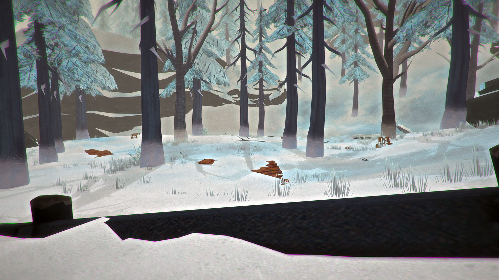
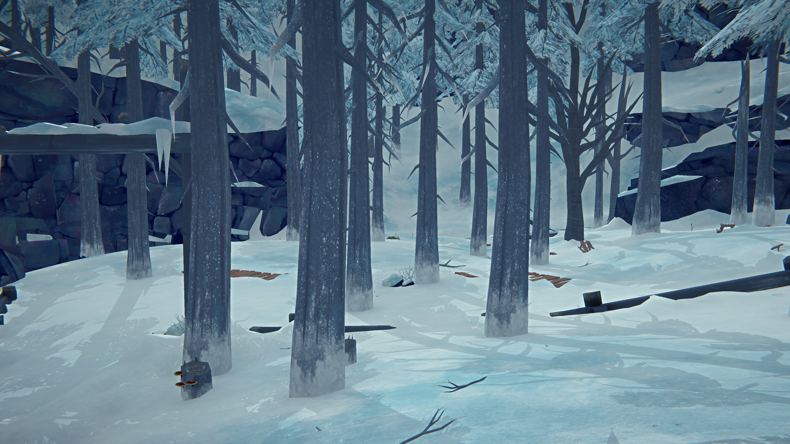

# Bear Creek Campground

**Categories:** Locations, Locations in Coastal Highway, Outdoor locations · **Source:** [Fandom](https://thelongdark.fandom.com/wiki/Bear_Creek_Campground)

**Bear Creek Campground**

\[\[File: /  / _Bear\_Creek\_Campground\_01.jpg_

250px\]\]

**Location**

_Bear\_Creek\_Campground\_map.png_

Region

[Coastal Highway](./Coastal%20Highway.md)

**General**

**Type:** Outdoors

## Overview

Bear Creek Campground is a campsite by a small creek that runs from the north, down to the ocean at the south.

There is a small cabin on a hill nearby, but otherwise, there is no real shelter at the campground. [Cat tails](./Cat%20Tail.md) and [Reishi Mushroom](./Reishi%20Mushroom.md) can be found in the area, as can a [Bear](./Bear.md). A corpse or [Deer](./Deer.md) carcass may also spawn in the campground.

## Gallery

_An alternative view of Bear Creek Campground._

_Another view of the campground._

_TLD-SS-CH-Bear\_Creek\_Campground.jpg_
