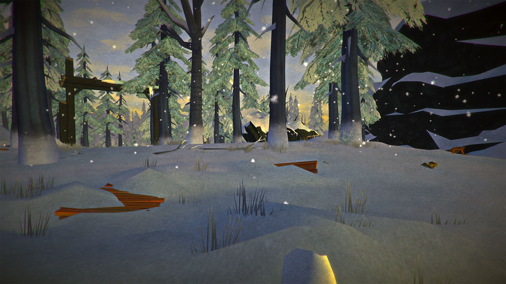

# Bear Creek Campground

**Bear Creek Campground**

| Property | Details |
| --- | --- |
| \[\[File: / \| Column 1 \| / \| --- \| / \|  / *Bear\_Creek\_Campground\_01.jpg* \| | 250px\]\] |
|  |  / *Bear\_Creek\_Campground\_01.jpg* |
| **Location** |  |
|  / *Bear\_Creek\_Campground\_map.png* |  |
| Region | [Coastal Highway](./Coastal%20Highway.md)\|- / **General** |
| Type | Outdoors\|- |
