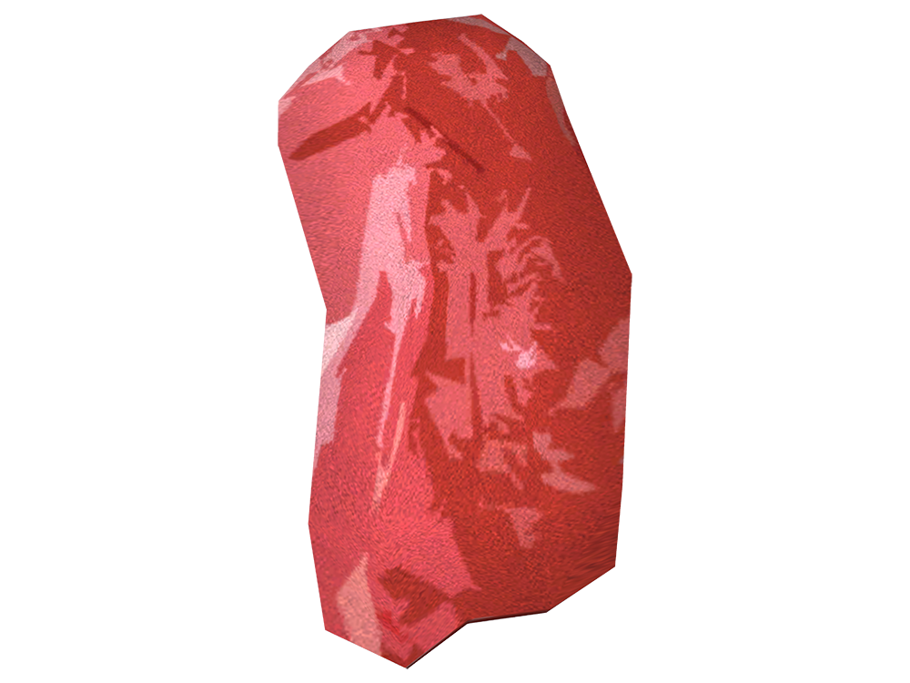

# Bear Meat \(Raw\)

**Categories:** Food And Drink, Pages with update history · **Source:** [Fandom](https://thelongdark.fandom.com/wiki/Bear_Meat_%28Raw%29)

**Contents**

- [Overview](#overview)
- [Products](#products)
- [Gallery](#gallery)
- [Update history](#update-history)

**Bear Meat**

_Bear\_Meat\_(Raw)\_icon.png_

**Release:** [7 February 2015](./The%20Long%20Dark%20%E2%80%94%20Changelog.md#0.192)

**Wintermute:** No

**Renewable:** Yes

**Properties**

**Item type:** [Food And Drink](./Food%20And%20Drink.md)

**Stackable:** No

**Examine:** Black bear Meat. Dark and dense. Tends to taste like whatever the bear was eating.

**Values**

**Calories:** 900 kcal

**Hydration:** -5%

**Weight:** 1.00 kg (2.2 lbs)

**Advanced data**

**Item key:** GAMEPLAY\_BearMeatRaw

_For the cooked version, see [Bear Meat (Cooked)](./Bear%20Meat%20%28Cooked%29.md)._

**Bear Meat** is a raw [food](./Food%20And%20Drink.md) item in _The Long Dark_.

## Overview

Bear Meat is harvested from [Bear](./Bear.md) carcasses, which contain between 25.0 and 40.0 kg of raw meat. Consuming raw meat carries a high chance of contracting [Food Poisoning](./Food%20Poisoning.md).

- On Stalker and Interloper mode, consuming predator meat has a chance of contracting [Intestinal Parasites](./Intestinal%20Parasites.md).
  - This risk can be avoided by [curing](./Cured%20Meat.md) the meat inside a [Meat Curing Box](./Meat%20Curing%20Box.md), instead of cooking it.
- At 0% condition food disappears if inside of a container, but not outside of containers or in the player's inventory.
- Meat decays slower outdoors than indoors.
- Bear Meat is very energy dense for its weight.

## Products

| Item | Skills | Materials |
| --- | --- | --- |
| &lt;a href="Bear Meat (Cooked)"&gt;Bear Meat (Cooked)&lt;/a&gt; | None | - 1.00 kg × &lt;a href="Bear Meat (Raw)"&gt;Bear Meat (Raw)&lt;/a&gt; |
| &lt;a href="Stalker's Pie"&gt;Stalker's Pie&lt;/a&gt; | None | - 0.50 kg × &lt;a href="Bear Meat (Raw)"&gt;Bear Meat (Raw)&lt;/a&gt; / - 0.50 kg × &lt;a href="Wolf Meat (Raw)"&gt;Wolf Meat (Raw)&lt;/a&gt; / - 1 × &lt;a href="Acorn Grounds"&gt;Acorn Grounds&lt;/a&gt; / - 0.15 L × &lt;a href="Water (Potable)"&gt;Water (Potable)&lt;/a&gt; / - 0.05 L × &lt;a href="Cooking Oil"&gt;Cooking Oil&lt;/a&gt; / - 0.01 kg × &lt;a href="Salt"&gt;Salt&lt;/a&gt; |

## Gallery

_Fresh_

_Gamey_

_Mouldy_

_Rancid_

_Ruined_

_Old model._

## Update history

- UPDATE **7 February 2015 ([Update](./The%20Long%20Dark%20%E2%80%94%20Early%20Access%20Changelog.md#0.192)):**
  - Added to game.
