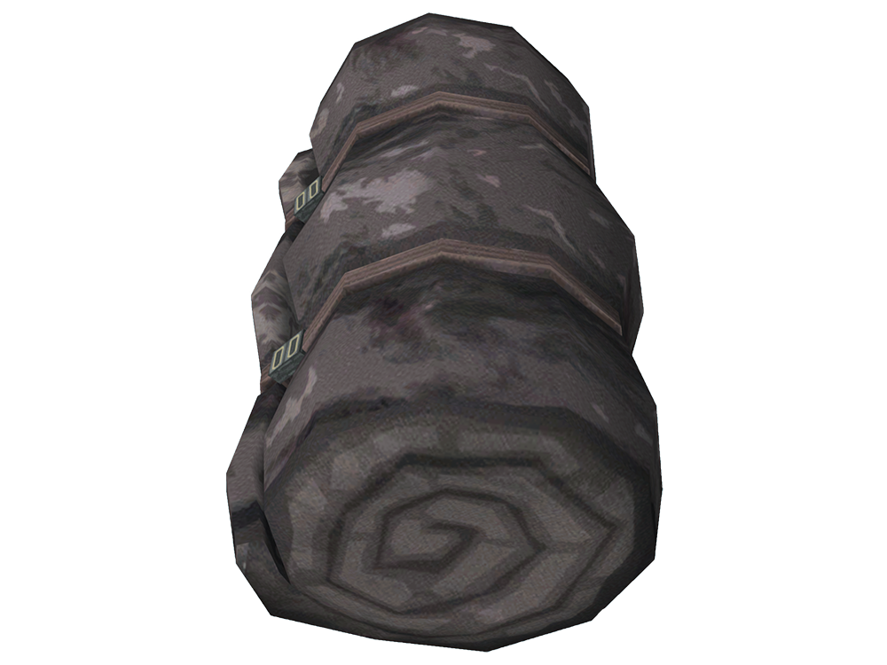

# Bear Skin Bedroll

**Categories:** Bedrolls, Beds, Tools · **Source:** [Fandom](https://thelongdark.fandom.com/wiki/Bear_Skin_Bedroll)

**Contents**

- [Overview](#overview)
- [Features](#features)
- [Tips](#tips)
- [Possible Locations](#possible-locations)
- [Crafting](#crafting)
- [Gallery](#gallery)

**Bear Skin Bedroll**

[Bear Skin Bedroll icon](../assets/Bear_Skin_Bedroll_icon.png)

**General**

**Item Type:** Tool

**Statistics**

**Weight:** [Weight icon](../assets/Weight_icon.png)3.00 kg(6.6 lbs)

**Warmth bonus:** [Temp icon](../assets/Temp_icon.png)12.0 °C(21.6 °F)

**Harvest:** 1 × [Cloth](./Cloth.md) 1 × [Cured Black Bear Hide](./Cured%20Black%20Bear%20Hide.md)

**Repair:** 1 × [Cloth](./Cloth.md) 1 × [Cured Black Bear Hide](./Cured%20Black%20Bear%20Hide.md) 50% Condition (62.5% Mending Lv.5)

> “**Bedroll crafted from Bear Skin. Heavy, but very warm. The smell might scare animals away.**”
>
> — In-game description

The **Bear Skin Bedroll** is a tool for sleeping without a bed in _The Long Dark_.

## Overview

The Bear Skin Bedroll is a variant of the [Bedroll](./Bedroll.md), and is crafted from 2 [Cured Black Bear Hide](./Cured%20Black%20Bear%20Hide.md) at a [Work Bench](./Work%20Bench.md). It fulfils the same role as bedrolls: allowing [sleep](./Sleep.md) at any location indoors or outside. Bear Skin Bedrolls are much warmer than normal bedrolls, have a chance of scaring nearby [wolves](./Wolf.md) when carried, reduces the chances of [Wildlife](./Wildlife.md) attacks when sleeping, and heals condition faster than a bedroll.

## Features

Bear Skin Bedrolls like the bedroll must be deployed to use ("use" in the inventory, or via the [Radial Menu](./Radial%20Menu.md)). When deployed they may be slept in indoors or outside, restoring fatigue and also condition if all 4 needs are met. The rate of Condition restored when using a Bear Skin Bedroll is the same with beds (1% per hour faster compared to the bedroll) (see [Sleep](./Sleep.md)). Bear Skin bedrolls are much warmer than bedrolls (12 °C (21.6 °F) vs 5 °C(9 °F) and even many beds. It now takes 35 hours to craft.

When carried the Bear Skin Bedroll provides a chance to scare [wolves](./Wolf.md) when they detect the player, causing the wolf to flee. It also provides a reduced chance of wildlife attacks when sleeping (on Stalker and Interloper).

However it is heavier (3 kg vs 1 kg) than a bedroll, and requires cured black bear hides to repair. Bear Skin Bedrolls decay slowly over time, and quickly while being used. When used Bedrolls provide warmth based on the bedroll's current condition (similar to [Clothes](./Clothing.md)).

## Tips

- The Bear Skin Bedroll is useful or even life-saving in cold or remote regions ([Hushed River Valley](./Hushed%20River%20Valley.md), [Ash Canyon](./Ash%20Canyon.md), [Timberwolf Mountain](./Timberwolf%20Mountain.md), [Bleak Inlet](./Bleak%20Inlet.md), [Forlorn Muskeg](./Forlorn%20Muskeg.md), and [Pleasant Valley](./Pleasant%20Valley.md)), and on harder survival modes (with colder world temperatures and faster [Condition](./Condition.md) damage from [freezing](./Needs.md)).
- Care should be taken not to freeze to death (Stalker and Interloper) while sleeping with a bedroll, especially outside. This includes checking the current temperature, weather conditions, fire duration, and not sleeping for many hours at a time.
- Sleeping near wildlife can be dangerous, and lead to an [attack](./Struggle.md).
- Bedrolls are useful for overcoming [Cabin Fever](./Cabin%20Fever.md).
- Sleeping without a bedroll is possible inside [cars and trucks](./Vehicle.md) by entering the vehicle and selecting "sleep" from the Radial Menu (campcraft).
- Thanks to the high warmth bonus it gives, one can carry less firewood when travelling. They can also sleep outdoors with a lowly-heated campfire on higher difficulty without the fear of freezing to death.
- Bear Skin Bedroll is best used when huddled inside a vehicle. Any vehicle will offer windproof protection as well as +5 degree of ambient temperature. With the bedroll equipped, one can effectively get a bonus of +17 degree inside a vehicle. This is extremely useful to get through a sudden [blizzard](./Weather.md) when there is no immediate shelter nearby.

## Possible Locations

A possible spawn location can be found on [Bleak Inlet](./Bleak%20Inlet.md) inside the [Pensive Lookout](./Pensive%20Lookout.md) below a corkboard on Pilgrim, Voyageur and Stalker difficulties.

Additionally, in the Tales from the Far Territory DLC, a crafted bear skin bedroll can spawn inside the Coal Tower of the [Transfer Pass](./Transfer%20Pass.md) region on all difficulties.

## Crafting

**Bear Skin Bedroll**

1050 minutes (17 hour 30 minutes)

[Cloth](./Cloth.md)

5

[Cured Gut](./Cured%20Gut.md)

6

**Requirements**

**Item:** [Cured Black Bear Hide](./Cured%20Black%20Bear%20Hide.md)

**Quantity:** 2

## Gallery

