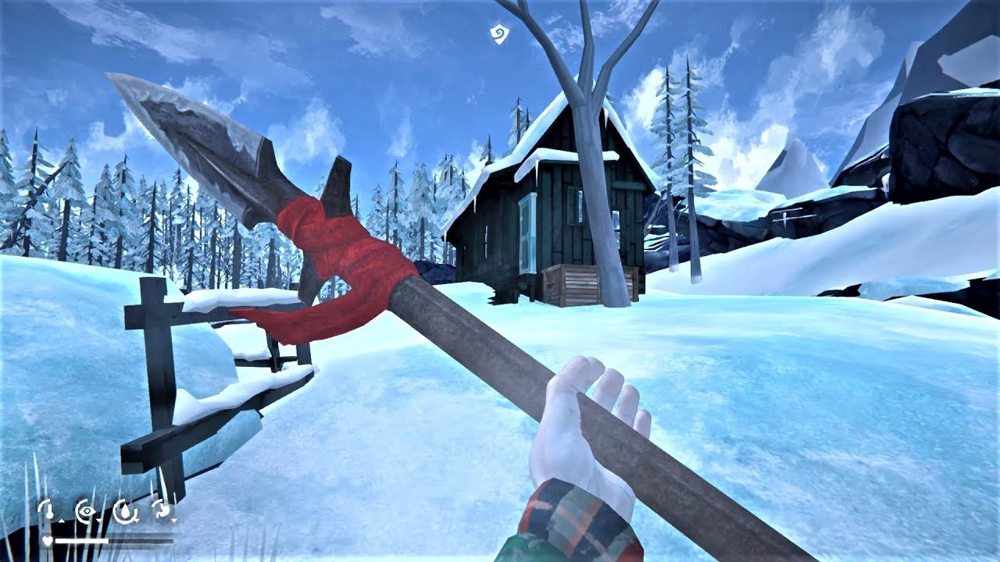
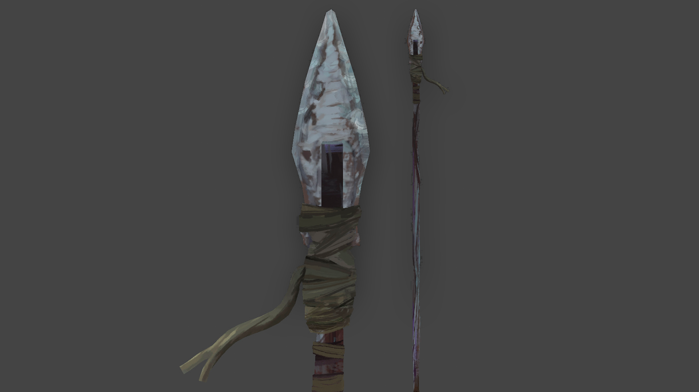

# Bear Spear

**Categories:** Pages with update history, Tools, Wintermute · **Source:** [Fandom](https://thelongdark.fandom.com/wiki/Bear_Spear)

**Contents**

- [Overview](#overview)
- [Episode 2](#episode-2)
- [The Wounded Trapper](#the-wounded-trapper)
- [The Best Defense](#the-best-defense)
- [Signal to Noise](#signal-to-noise)
- [What One Man Can Do](#what-one-man-can-do)
- [Survival Mode](#survival-mode)
- [Trivia](#trivia)
- [Gallery](#gallery)
- [Game History](#game-history)

**Wintermute-Exclusive content.**

This content only appears in [Wintermute](./Wintermute.md).

**Bear Spear**

[Bear Spear icon](../assets/Bear_Spear_icon.png)

**Release:** [17 December 2018](./The%20Long%20Dark%20%E2%80%94%20Changelog%20%E2%80%94%20Archive%201.md#1.00)

**Wintermute:** [Episode 2](./Episode%202%20-%20Luminance%20Fugue.md) - [The Best Defense](./The%20Best%20Defense.md)

**Properties**

**Item type:** [Tools](./Tools.md)

**Stackable:** No

**Examine:** A large defensive weapon, designed to pierce the thick hides of charging predators. For those with the heart to wield it.

**Values**

**Weight:** 4.00 kg (8.8 lbs)

**Actions**

**Backpack:** Examine

**On ground:** Take It, Leave It

> “**Ten inches of cold hard steel might do what a bullet can't. I'm convinced– a spear's the way to kill that bear.**”
>
> — -Jeremiah

The **Bear Spear** is a weapon only available in [Episode 2: Luminance Fugue](./Episode%202%20-%20Luminance%20Fugue.md) in [Wintermute](./Wintermute.md).

<!-- #Overview -->
​

<!-- #overview -->
## Overview

The Bear Spear weighs 4.00kg, cannot be harvested, and disappears after completing [What One Man Can Do](./What%20One%20Man%20Can%20Do.md). It is treated as a Collectibles, but this is to prevent it from being dropped and lost. The red ribbon on the Spear is one of the few items in the game to have dynamic ragdoll physics, moving in the wind as the player turns.

The player uses the spear by creating a defensive posture and then bracing for a bear charge, then thrusting the spear into the bear. To brace for the attack, hold LMB on PC to "Set Spear", which will deplete stamina and restrict the player from moving and pivoting approximately 30 degrees to either side. It takes about half a second between starting to brace, and the spear to become active.

If the spear is active when the Old Bear collides with them, a special "spear struggle" will ensue in which the player buries the spearhead into the beast's chest and can click repeatedly to fill the bar and win the struggle. Struggling for too long will result in the Old Bear scratching the player with its claws halfway through the struggle, resulting in [Laceration](./Laceration.md), [Sprained Ankle](./Sprained%20Ankle.md), and [Blood Loss](./Blood%20Loss.md) Afflictions. Failing to fill the bar after 9 seconds will result in the bear breaking from the spear, and "punching" the player with his right paw, knocking them out.

Successfully defeating a bear in a Spear Struggle will use a large portion of the player's stamina, so it is advisable to wait a few moments after a struggle before beginning a new Spear Struggle. If the spear is not yet active when a bear attacks the player, or if the player's stamina is too low to set the spear, the bear will attack the player normally and they will be defenseless in the [Struggle](./Struggle.md).

Wolves fear the bear spear. And it can be used as an effective deterrent against them. Provided the player sets the spear just as the wolf charges.

The spear cannot damage wolves; only scare them.

<!-- #the_wounded_trapper -->
​

<!-- #The_Wounded_Trapper -->
​

<!-- #The_wounded_trapper -->
​

<!-- #the-wounded-trapper -->
### [The Wounded Trapper](./The%20Wounded%20Trapper.md)

The Bear Spear is rumored by [Jeremiah](./Jeremiah.md) to be the only weapon that can kill the [Old Bear](./Old%20Bear.md). Jeremiah tells [Will Mackenzie](./Will%20Mackenzie.md) the story of the Old Demon Bear and a magical spear forged to kill it long ago, and the trapper tasks the pilot to find it in the [Hunting Lodge](./Hunting%20Lodge.md) in [Broken Railroad](./Broken%20Railroad.md).

<!-- #the_best_defense -->
​

<!-- #The_Best_Defense -->
​

<!-- #The_best_defense -->
​

<!-- #the-best-defense -->
### [The Best Defense](./The%20Best%20Defense.md)

Mackenzie makes his way to the Hunting Lodge but finds a [Broken Bear Spear](./Broken%20Bear%20Spear.md) instead, and is forced to repair the Broken Bear Spear in the [Forge](./Forge.md) in the [Maintenance Yard](./Maintenance%20Yard.md) by crafting a [Spear Head](./Spear%20Head.md). By the end of the mission, Mackenzie fully repairs the Spear to its original glory and returns to Jeremiah.

<!-- #signal_to_noise -->
​

<!-- #Signal_to_Noise -->
​

<!-- #Signal_to_noise -->
​

<!-- #Signal_To_Noise -->
​

<!-- #signal-to-noise -->
### [Signal to Noise](./Signal%20to%20Noise.md)

Mackenzie is tasked with finding [Transponder Parts](./Transponder%20Parts.md) in [Forlorn Muskeg](./Forlorn%20Muskeg.md) and encounters the Old Bear, using the Bear Spear several times to defend himself from the beast. After acquiring 3 Transponder Parts, Mackenzie is ambushed by the Old Bear and unconsciously dragged away.

<!-- #what_one_man_can_do -->
​

<!-- #What_One_Man_Can_Do -->
​

<!-- #What_one_man_can_do -->
​

<!-- #what-one-man-can-do -->
### [What One Man Can Do](./What%20One%20Man%20Can%20Do.md)

Mackenzie awakens inside the [Old Bear's Den](./Old%20Bear%27s%20Den.md) unarmed, and is forced to sneak and crawl his way through the caves until he finds the Bear Spear. After successfully completing a Bear Struggle 3 times with the Spear, Mackenzie kills the Old Bear by impaling it in the neck. Mackenzie leaves the Spear impaled into the Old Bear and leaves the cave, and the Spear is never used again afterwards.

<!-- #survival_mode -->
​

<!-- #Survival_Mode -->
​

<!-- #Survival_mode -->
​

<!-- #survival-mode -->
## Survival Mode

This weapon cannot be crafted in [Survival Mode](./Survival%20Mode.md), but has been hinted in a Dev's Diary that it will be implemented into the sandbox in the future ([Source](https://www.thelongdark.com/news/episodes-one-and-two-redux-survival-mode-update/)).

It can currently be found and spawned in Survival Mode via console commands, but cannot be used properly against Bears. Despite being unable to be broken down in Wintermute, a harvest option is present. Harvesting the Bear Spear generates 1 [Spear Head](./Spear%20Head.md) and 1 [Cured Maple Sapling](./Cured%20Maple%20Sapling.md).

<!-- #Trivia -->
​

<!-- #trivia -->
## Trivia

- The Bear Spear and the story of the "[Demon Bear](./Old%20Bear.md)" told by [Jeremiah](./Jeremiah.md) are references to "The Beast Spear" from the fantasy manga ["Ushio &amp; Tora" (うしおととら)](https://en.wikipedia.org/wiki/Ushio_%26_Tora) written and illustrated by Kazuhiro Fujita. Both stories feature a supernatural weapon forged by a character driven mad for revenge to kill 'evil spirits', including a red cloth tied around the spear's neck.

<!-- #Gallery -->
​

<!-- #gallery -->
## Gallery

_The [Old Bear](./Old%20Bear.md) defending a shortwave tower, with the Bear Spear in hand_

<!-- #game_history -->
​

<!-- #Game_History -->
​

<!-- #Game_history -->
​

<!-- #game-history -->
## Game History

\* UPDATE **17 December 2018 ([Update](./The%20Long%20Dark%20%E2%80%94%20Changelog%20%E2%80%94%20Archive%201.md#1.41)):**

  - Added to game.

[ru:Копье для охоты на медведя](https://ru.wikipedia.org/wiki/%D0%9A%D0%BE%D0%BF%D1%8C%D0%B5_%D0%B4%D0%BB%D1%8F_%D0%BE%D1%85%D0%BE%D1%82%D1%8B_%D0%BD%D0%B0_%D0%BC%D0%B5%D0%B4%D0%B2%D0%B5%D0%B4%D1%8F)
