# Bear

**Categories:** Pages with update history, Wildlife · **Source:** [Fandom](https://thelongdark.fandom.com/wiki/Bear)

**Contents**

- [Overview](#overview)
- [Drops](#drops)
- [Behaviour](#behaviour)
- [Sounds](#sounds)
- [Dens](#dens)
- [Scent](#scent)
- [Sleeping](#sleeping)
- [Interaction](#interaction)
- [Baiting](#baiting)
- [Limited Fear of Fire](#limited-fear-of-fire)
- [Scaring Away A Bear](#scaring-away-a-bear)
- [Stones](#stones)
- [Aurora](#aurora)
- [Wildlife Interactions](#wildlife-interactions)
- [Mauling](#mauling)
- [Hunting](#hunting)
- [Critical hits](#critical-hits)
- [Bleeding wounds](#bleeding-wounds)
- [Bleed Out](#bleed-out)
- [Strategies](#strategies)
- [Population](#population)
- [Trivia](#trivia)
- [Gallery](#gallery)
- [Update history](#update-history)

**Bear**

[Bear](../assets/Bear.png)

**Basic Information**

**Release:** [7 February 2015](./The%20Long%20Dark%20%E2%80%94%20Early%20Access%20Changelog.md#0.192)

**Role:** Predator

**Physical Information**

**Color:** Black

**Size:** Large

**Eyes:** Brown

_For the unique bear found in [Episode 2](./Episode%202%20-%20Luminance%20Fugue.md), [The Hunted, Part One](./The%20Hunted%2C%20Part%20One.md) and [The Hunted, Part Two](./The%20Hunted%2C%20Part%20Two.md), see [Old Bear](./Old%20Bear.md)._

> “**He'll come for you when you're not expecting it. But you won't miss it. It won't be subtle. It'll sound like a ton of muscle and bone bearing down on you like a freight train of hate and hunger.**”
>
> — [Jeremiah](./Jeremiah.md) describing a charging Bear

**Bears** (also known as **Black Bears**) are large, dangerous [Wildlife](./Wildlife.md) predators in _[The Long Dark](./The%20Long%20Dark.md)_.

## Overview

Bears are large solitary predatory [Wildlife](./Wildlife.md). Bears normally hibernate throughout the winter, but the [First Flare](./First%20Flare.md) and subsequent aurora has awoken them from their slumber. They are now regularly found exiting their bear cave (often with bones inside), or roaming the area near them in search of food, attacking human survivors if they are spotted.

They are among the toughest and most dangerous animals on [Great Bear Island](./Great%20Bear%20Island.md), easily overpowering any human survivor with just their sheer size. While not as aggressive as [Wolves](./Wolf.md), Bears are highly territorial and will charge and [maul](./Struggle.md) their victims. They are significantly harder to avoid/kill compared to the common Wolf, requiring the player to be alert and prepared should they come across one.

## Drops

A [Black Bear Carcass](./Black%20Bear%20Carcass.md) may be harvested for 25.00-40.00 kg of [raw meat](./Bear%20Meat%20%28Raw%29.md), 1 [Fresh Black Bear Hide](./Fresh%20Black%20Bear%20Hide.md), and 10 guts. Bear hides can be cured to craft [Bearskin Coat](./Bearskin%20Coat.md) or [Bear Skin Bedroll](./Bear%20Skin%20Bedroll.md).

|  | Item | Quantity | Rarity |
| --- | --- | --- | --- |
| [Bear Meat (Raw) icon](../assets/Bear_Meat_%28Raw%29_icon.png) | [Bear Meat (Raw)](./Bear%20Meat%20%28Raw%29.md)* | 25 - 40 | Always  [^1] |
| [Bear Quarter icon](../assets/Bear_Quarter_icon.png) | [Bear Quarter](./Bear%20Quarter.md) | 5 - 8 | Always  [^2] |
| [Fresh Black Bear Hide icon](../assets/Fresh_Black_Bear_Hide_icon.png) | [Fresh Black Bear Hide](./Fresh%20Black%20Bear%20Hide.md) | 1 | Always |
| [Fresh Gut icon](../assets/Fresh_Gut_icon.png) | [Fresh Gut](./Fresh%20Gut.md) | 10 | Always |

*Note: Bear Meat has a [Risk of Intestinal Parasites](./Risk%20of%20Intestinal%20Parasites.md) on higher difficulties.

Animal Fat is produced automatically when harvesting raw meat. It cannot be harvested separately and does not appear when Harvesting a Carcass.

|  | Item | Quantity | Rarity |
| --- | --- | --- | --- |
| [Animal Fat icon](../assets/Animal_Fat_icon.png) | [Animal Fat](./Animal%20Fat.md) | 0.10 per kg of meat | Always |

## Behaviour

Bears have three paces: walking, charging, and fleeing. Typically they wander near their bear caves at a slow walking pace, with little interest in their surroundings, but occasionally stop to forage or look around. Bears do not hunt other animals, unlike Wolves. Bears are the only animal whose breath is seen as they wander around.

### Sounds

Bears are relatively quiet, but their soft-padded footsteps can be heard from a distance. At closer distances their grunts and snorts may be heard, and if the bear detects the player they will bellow, growl, and begin to follow them. Crows have a unique "bear call" which can be heard when a bear is stalking the player, and the standard "dangerous wildlife" music will start playing.

Charging bears usually stand on their hind legs and roar, with their heavy breath "huffing and puffing" as they rapidly charge after the player.

A fleeing bear will whine, moan, and "scream" as it rapidly runs away from the player if they successfully drive/scare it off.

### Dens

All Bears have a specific den as their home, usually a dedicated [Warm Bear Cave](./Warm%20Cave.md) or a rocky outcropping in the side of a rockface. Each den is immediately identifiable by the remains of yellowing skeletons near their entrances (normally of deer, but sometimes of human). A bear will often return from roaming to their den after dusk, taking the most direct path (even if it is kilometers away) to try and sleep inside for the night. A frightened bear often flees for a time before attempting to return to their den.

- Sleeping or spending time in bear caves is dangerous, as a Bear can return and attack the player during their sleep if they spot the player.
- Not all dens are inhabited in at all times, as a Bear will often take many in game hours to return to their cave, even after dusk.
- Sleeping in a cave with very high [Scent](./Scent.md) is generally a very bad idea, as the Bear will often leave its normal patrol to come to you

### Scent

> “**Bears can smell blood from over 20 clicks away. You get out there, you cut yourself enough that you bleed, and he'll come to you. I'm sure of it.**”
>
> — [Jeremiah](./Jeremiah.md)

Bears have the most sensitive noses of any predator wildlife animal, and will travel great lengths (up to over half of the game map) to find the player if their Scent is too high, far outside of their normal patrol pathways. This can make sleeping in a [Bedroll](./Bedroll.md) in the snow, buildings, or caves (even non-bear den caves) very dangerous if the Bear finds them, as they will attack the player in their sleep. This can be used to the player's advantage when hunting them, as long as the player is prepared to wait very long periods of time for the Bear to come to them, as the Bear will still walk at its normal slow walking speed upon detecting the player's Scent (unlike Wolves who walk quickly to the player's location).

### Sleeping

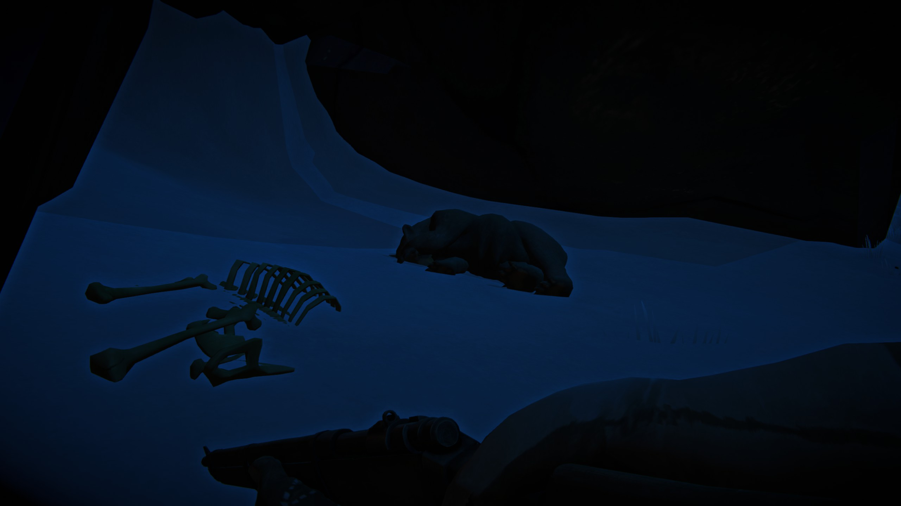_A sleeping bear._ Bears occasionally return to their den to sleep for the night when dusk falls, in which they lie down to try and continue hibernating, often snoring quite loudly. In this state, a bear can be awoken by normal stimuli such as gun reports, lit flares, or simply being too close.

## Interaction

Bears will follow any player they detect and attack the player at close distances. If the player moves far enough away, the bear will give up its pursuit. Bears will also charge if they detect the player and the player shoots at them; shots from undetected players usually cause bear to flee, even if not struck by the round.

### Baiting

Bears are attracted by [Scent](./Scent.md). Baiting with dropped scent items while being pursued by a bear will distract them (unless charging). See: [Baiting](./Scent.md#Baiting/Decoys). 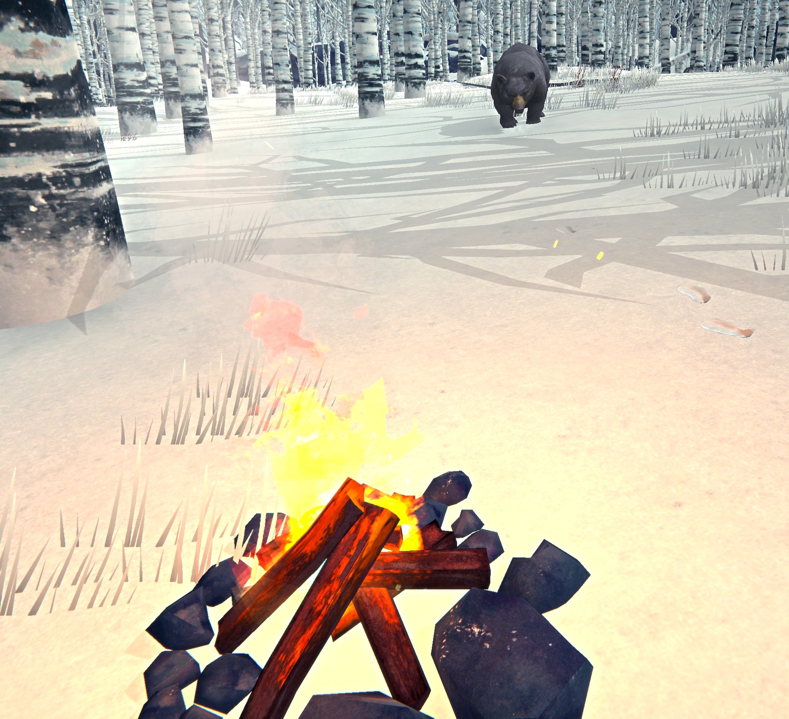_A bear held at bay by a campfire._

### Limited Fear of Fire

Bears are only held at bay by certain fires. [Campfires](./Campfire.md) and [flares](./Flare.md) (held in hand) will prevent a bear from charging the player unless it is already within a certain distance. It will wait outside the radius of the fire until the player leaves the safety of the fire or it is scared away. While being held at bay, bears can be scared away by hitting it with a thrown burning torch (short flee), weapon shot that misses (long flee), weapon shot that hits (longest flee). Approaching a bear while it is held at bay will cause it to overcome its fear and charge. They will walk or charge around a lone lit torch on the ground, but it will not stop them, nor will throwing torches or flares at them cause them to flee while they are not held at bay.

### Scaring Away A Bear

Bears flee from [Distress Pistol](./Distress%20Pistol.md) reports and from the landing site of flare rounds; the Distress Pistol can prevent a charging bear from attacking even at very close distance. Bears are also frightened of bullets and arrows striking near them, but only from undetected players; they will charge attackers if they can detect them (barring Distress Pistol fire).

Bears will flee from [bow shots](./Survival%20Bow.md) only under certain conditions  [^3]. If a bear is shot from outside the range from which it can detect the player, the bear will flee  ⁴. If a bear has detected the player, shooting the ground beside the bear (rather than shooting the bear) can cause the bear to flee  ⁵.

Hunting Bears with a [Revolver](./Revolver.md) is not advised, as the sheer body weight will absorb any damage from the shot (though they will still bleed to death, even from 1 gunshot wound).

An exploding [Noisemaker](./Noisemaker.md) will scare off a charging bear, as long as the [Aurora](./Aurora.md) isn't active.

### Stones

[Stones](./Stone.md) deal no damage if striking a Bear, and a Bear will chase those who throw stones at them (if detected). Stones thrown by undetected players will distract nearby bears to investigate for a few seconds.

### Aurora

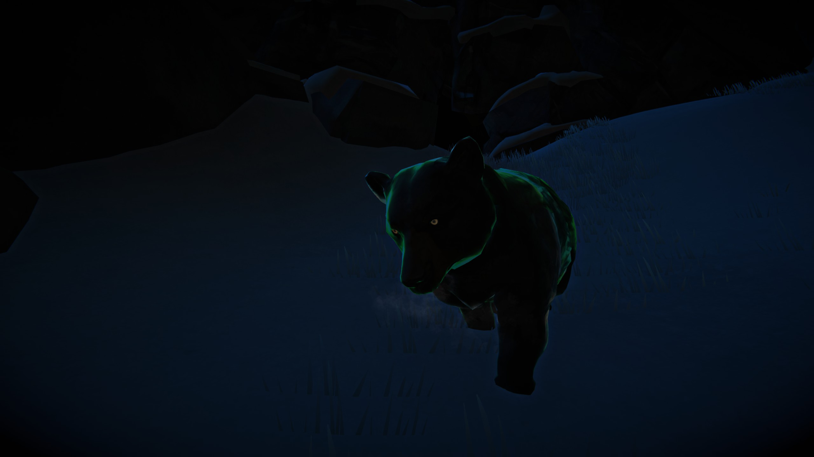 Like all predators, the [Aurora](./Aurora.md) will produce an Aurora Bear, a much tankier, less fear prone version of the Bear. It also becomes more perceptive and can detect the player from further away. Extreme caution is advised while the Aurora is out and a Bear is nearby. It can often take up to 6 well placed headshots on an Aurora Bear to fell them. Getting mauled by an aurora bear is extremely dangerous. Due to its heightened senses, it can detect and charge the player before any action can be taken, leading to consecutive maulings until death.

- Aurora Bears do not fear [Flares](./Flare.md), [Marine Flares](./Marine%20Flare.md), or lit [Torches](./Torch.md).
  - They also do not fear [Noisemakers](./Noisemaker.md), and will turn towards the player's direction and most likely charge them if one explodes.
- They do not fear street lights, unlike Aurora Wolves.
- They fear [Flashlight](./Flashlight.md) high beams and will temporarily stop a charge as long as they are on (unlike charging wolves, they do not stop in their tracks for a few moments once the light is turned on. Turning the light off will make them immediately resume their charge).
- They will stay away from lit [Campfires](./Campfire.md), but will still stay close by and stalk the player. They will eventually overcome their fear of the fire and attack the player if they do not attack the bear or leave the area.
- Gunshots are not effective at frightening Aurora Bears, as they will instantly charge the player unless they cannot see where the shot came from.

## Wildlife Interactions

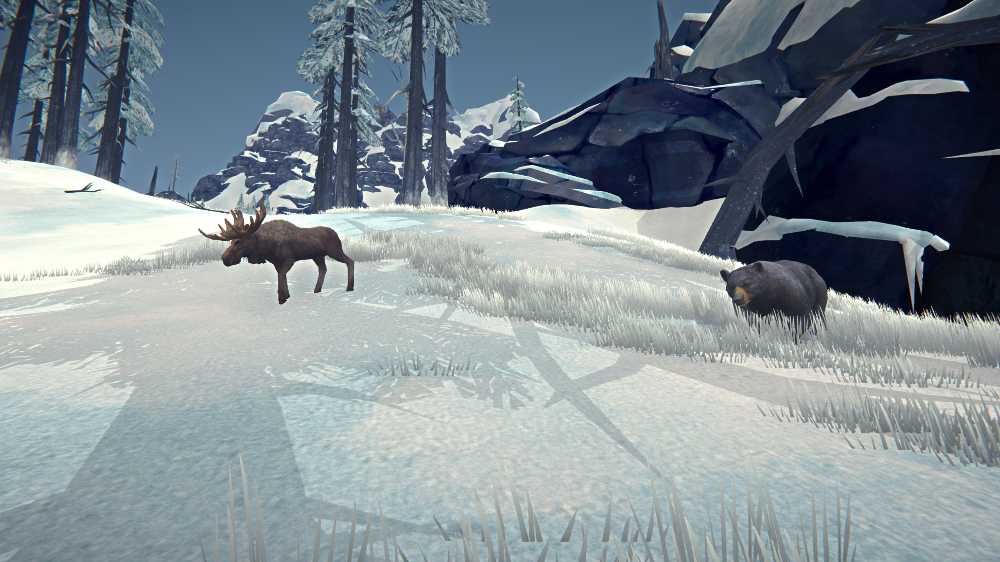_A Bear and Moose ignoring one another._ Bears will ignore all other forms of Wildlife:

- [Rabbit](./Rabbit.md), [Ptarmigan](./Ptarmigan.md), and [Deer](./Deer.md) will flee from Bears. Bears do not attack these animals despite being carnivorous.
- [Wolves](./Wolf.md), [Timberwolves](./Timberwolf.md), and [Poisoned Wolves](./Poisoned%20Wolf.md) will also flee from the presence of Bears. Bears do not attack these animals.
- [Moose](./Moose.md) and Bears will ignore one another.
- [Cougar](./Cougar.md) and Bears will ignore one another.
- Bears run away when the [Darkwalker](./Escape%20the%20Darkwalker.md) is close to them, and will die once [Toxic Fog](./Toxic%20Fog.md) reaches 100%.

## Mauling

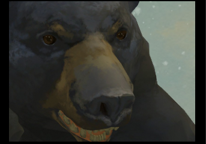_Player's view of a bear mauling._ If provoked with weapons or approached too close, a bear will charge and maul the player. Bear struggles are different from [Wolf](./Wolf.md) struggles in that the player will always lose, getting mauled and eventually passing out. After mauling the player, the bear will walk away but may maul the player again if they do not flee immediately.

Bear attacks cause massive [Condition](./Condition.md) loss, [Blood Loss](./Blood%20Loss.md), [Infection Risk](./Infection%20Risk.md), and usually ruins a worn [Clothing](./Clothing.md) item (typically one worn on the head, accessory or shoes). Attacks from Bears are usually not fatal at high Condition.

- After a struggle, move a safe distance from the bear before applying [First Aid](./First%20Aid.md); staying too close to the bear may cause it to maul the player again.
- Bears require physical contact to begin a struggle, so attacks can avoided by using terrain blockers, doors, narrow spaces, cliff sides, and the interiors of [Vehicles](./Vehicle.md) and structures.
- Bear attacks typically are non-lethal at high Condition, but cause 90% Condition loss (reduced by clothing protection) (e.g. pre-struggle: 72% Condition, post-struggle: ~7% with no protective clothes).
- After a struggle, random items from the player's inventory will usually fall onto the ground—typically their weapon or held item at the start of the struggle.
- Significant condition damage is usually inflicted on some of the clothing item(s), often ruining one.
- Bear struggles cannot be won (except in [Wintermute](./Wintermute.md) with the [Bear Spear](./Bear%20Spear.md) against the [Old Bear](./Old%20Bear.md)).

## [Hunting](./Hunting.md)

Bears may be hunted with any ranged weapon (except Stones) and suffer from blood loss, so a single round is lethal (but may take many hours for the animal to bleed out). A single rifle shot may even kill a bear instantly if it strikes their head and is a "critical hit", but usually bears survive multiple rounds and will immediately charge or flee depending if the player was detected.

Before going on a bear hunt, it's generally a good idea to pare down the pack or to bring along a [Travois](./Travois.md), as there is a lot of [meat](./Bear%20Meat%20%28Raw%29.md) on a bear, which will almost certainly [overload](./Encumbrance.md) a player carrying a full set of gear.

### Critical hits

Critical hits cause the animal to instantly die after being hit by a shot. The following table contains the critical hit chance based on the location that was shot on the animal.

The critical-% for flare gun seem to be currently bugged (i.e. defaulting to rifle bleed-out numbers)

| Weapon — Head | Weapon — Neck | Critical Hit Chance — Torso | Critical Hit Chance — Hips | Critical Hit Chance — Limb | Critical Hit Chance | Critical Hit Chance |
| --- | --- | --- | --- | --- | --- | --- |
| [Hunting Rifle icon](../assets/Hunting_Rifle_icon.png) | [Hunting Rifle](./Hunting%20Rifle.md) | 15% | 10% | 5% | 3% | 3% |
| [Distress Pistol icon](../assets/Distress_Pistol_icon.png) | [Distress Pistol](./Distress%20Pistol.md) | 60% | 90% | Guaranteed | Guaranteed | Guaranteed |
| [Survival Bow icon](../assets/Survival_Bow_icon.png) | [Survival Bow](./Survival%20Bow.md) | 15% | 10% | 5% | 3% | 3% |
| [Revolver icon](../assets/Revolver_icon.png) | [Revolver](./Revolver.md) | 3% | 2% | 1% | 0% | 0% |

### Bleeding wounds

All shots that cause blood loss are lethal, but may take many hours based on which body part was struck. Multiple shots do not stack blood loss. A shot that hits a higher blood loss area will override blood loss from a shot in a lower blood loss area. Conversely, if shot in an area of lower blood loss after being shot in area of higher blood loss, the shot that hit the area of lower blood loss will override the blood loss from the first shot. Therefore, if you land a head shot which causes a bear to flee, shooting it in the hindquarters or limbs will cause the bear to bleed out more slowly. As such, you should not fire a second shot in that scenario and instead simply follow the bear until it bleeds out from the head wound.

### Bleed Out

| Weapon — Head | Weapon — Neck | Bleed Out — Torso | Bleed Out — Hips | Bleed Out — Limb | Bleed Out | Bleed Out |
| --- | --- | --- | --- | --- | --- | --- |
| [Revolver icon](../assets/Revolver_icon.png) | [Revolver](./Revolver.md) | 80 min | 120 min | 320 min | 480 min | 640 min |
| [Hunting Rifle icon](../assets/Hunting_Rifle_icon.png) | [Hunting Rifle](./Hunting%20Rifle.md) | 60 min | 90 min | 240 min | 360 min | 480 min |
| [Survival Bow icon](../assets/Survival_Bow_icon.png) | [Survival Bow](./Survival%20Bow.md) | 45 min | 60 min | 375 min | 240 min | 240 min |
| [Distress Pistol icon](../assets/Distress_Pistol_icon.png) | [Distress Pistol](./Distress%20Pistol.md) | 30 min | 45 min | 50 min | 140 min | 140 min |

### Strategies

- Bull-Fight: Shoot from close to a position that bears cannot attack, perhaps luring or baiting the bear into range first. Shoot the bear, enter cover. Let it charge and fail. Follow until it bleeds out.
- [Hunter's Blinds](./Hunter%27s%20Blinds.md): Some bears wander near hunter's blinds like [Unnamed Pond](./Unnamed%20Pond.md) in [Mystery Lake](./Mystery%20Lake%20%28disambiguation%29.md). These structures provide protection against predators while allowing the use of ranged weapons.
- Stealth: Shoot from a hidden location, ideally with the survival bow and track until dead.
- Unwise: Shoot repeatedly as it charges hoping for first or second shot critical hit to drop the bear before it reaches you.
- Decoys: Drop decoys to distract the bear and fire on the bear when it is distracted.
- Stall with Fire: Get close enough to the bear for it to follow you (but not charge, do not shoot yet), make a quick fire (best with accelerator) then wait behind the fire for the bear to approach. About midway, the bear will go on its hind legs and roar, then charge but stops in front of the fire and stays in a waiting stance. This will provide a significant amount of time to shoot the bear in the head (choose your favorite weapon), the bear then runs away. Follow until it bleeds out.
- Goading: Agitate the bear into following (but not charging) and lead it to a more advantageous location for hunting, or even back to a [safe house](./Safehouse.md). You can also shoot and retreat to safety, such as inside a vehicle. Avoid loading screens (inside a mine or building interior), since that may cause the bear to de-spawn. As the bear starts to wander off, exit your hiding spot and agitate it again to draw it back. After a few hours (in-game) the bear should die relatively close by. This process can be time consuming depending on distance and bleed out time, but is relatively safe, minimizes risk of losing the wounded bear, and makes harvesting convenient.

It is worth noting that after killing the bear, it is more time-efficient to Quarter the bear than to harvest the hide and guts individually. However, the body of the bear that would be destroyed by quartering is also large enough to grant protection from the wind (Wind Shield) to campfires and crouching players, which can be useful for players looking to harvest the bear's meat on the spot.

## Population

Bear spawns vary by region and Survival Mode. In some regions (Coastal Highway and Desolation Point) bears always spawn in the same location(s); in other regions (Mystery Lake and Pleasant Valley), bears have multiple possible spawning locations which only some may be be occupied in a given save file. The following list is a list of possible bear locations:

**[Ash Canyon](./Ash%20Canyon.md): 2 bears**

- A cave leading to [Miner's Folly](./Miner%27s%20Folly.md).
- A cave west of [Angler's Den](./Angler%27s%20Den.md), below [Runaway Bridge](./Runaway%20Bridge.md) (refresh).

**[Blackrock Region](./Blackrock.md): 3 bears**

- [Cliff Cave](./Cliff%20Cave.md), to the northwest of [Bricklayer's Retreat](./Bricklayer%27s%20Retreat.md) and due west from [Whistling Perch](./Whistling%20Perch.md).
- In the west part of [Blackrock Prison](./Blackrock%20Prison.md), inside the courtyard the player escapes into from the prison in [Episode 4.](./Episode%204%20-%20Fury%2C%20Then%20Silence.md)
- Around the [Lineworker's hideout](./Lineworker%27s%20Hideout.md) cave (refresh).
- Around [Wedge Cave](./Wedge%20Cave.md) (refresh).

**[Bleak Inlet](./Bleak%20Inlet.md): 1-2 bears (+1 possible extra bear)**

- A cave just east of [Cannery Worker Residences](./Cannery%20Worker%20Residences.md).
- A den just west of the westernmost Hunter's Blind (refresh).
- A rare spawn at the three cars on the plateau near [Echo One Radio Tower](./Echo%20One%20Radio%20Tower.md) (refresh). Note: This is not a permanent bear spawn, but is rolled every three days between a rabbit, a deer or a bear.

**[Broken Railroad](./Broken%20Railroad.md): 1 bear**

- At the base of the cliff below [Hunting Lodge](./Hunting%20Lodge.md).

**[Coastal Highway](./Coastal%20Highway.md): 2-3 bears**

- A cave slightly east of [Misanthrope's Homestead](./Misanthrope%27s%20Homestead.md), on the island.
- North of the [Coastal Townsite](./Coastal%20Townsite.md).
- Downstream from [Bear Creek Campground](./Bear%20Creek%20Campground.md).

**[Desolation Point](./Desolation%20Point.md): 1 bear**

- Next to [Broken Bridge](./Broken%20Bridge%20%28disambiguation%29.md), along the highway.

**[Forlorn Muskeg](./Forlorn%20Muskeg.md): 2 bears**

- [Poacher's Camp](./Poacher%27s%20Camp.md).
- Northwest of the [Old Spence Family Homestead](./Old%20Spence%20Family%20Homestead.md).

**[Forsaken Airfield](./Forsaken%20Airfield.md): 2 bears**

- West of [Final Approach](./Final%20Approach.md).
- On and around [Shoulder Lake](./Shoulder%20Lake.md), with the den at [Fallow Dugout](./Fallow%20Dugout.md).

**[Hushed River Valley](./Hushed%20River%20Valley.md): 2 bears**

- Northwest corner, north of the [Hushed River](./Hushed%20River.md) and [Offset Falls](./Offset%20Falls.md).
- East of [Stairsteps Lake](./Stairsteps%20Lake.md).

**[Mountain Town](./Mountain%20Town.md): 1 bear**

- [Spruce Falls Bridge](./Spruce%20Falls%20Bridge.md)

**[Mystery Lake](./Mystery%20Lake%20%28region%29.md): 1-2 bears**

- [Unnamed Pond](./Unnamed%20Pond.md)
- Near the [Lone Lake Cabin](./Lone%20Lake%20Cabin.md)
- [Clearcut](./Clearcut.md)
- Near [Trapper's Homestead](./Trapper%27s%20Homestead.md) in a little cave

**[Pleasant Valley](./Pleasant%20Valley.md): 3-7 bears**

- In a cave near [Three Strikes Farmstead](./Three%20Strikes%20Farmstead.md) (this spawn seems to be currently bugged).
- To the east of the cave leading to [Winding River](./Winding%20River.md).
- Beneath the placed rope leading up to [Signal Hill](./Signal%20Hill.md).
- North of [Burned Ridge Cave](./Burned%20Ridge%20Cave.md) and the [Crash Site (Pleasant Valley)](./Crash%20Site%20%28Pleasant%20Valley%29.md).
- Near the bridge to the southeast of [Point of Disagreement](./Point%20of%20Disagreement.md).
- Along the snow path underneath the path up to [Cinder Hills Coal Mine.](./Cinder%20Hills%20Coal%20Mine.md)
- At the [Lonely Homestead](./Lonely%20Homestead.md).

**[Sundered Pass](./Sundered%20Pass.md): 1 Bear**

- Found near [Final Refuge.](./Final%20Refuge.md)

**[Timberwolf Mountain](./Timberwolf%20Mountain.md): 3 bears**

- East of [Crystal Lake](./Crystal%20Lake.md), in front of the trail down to [Echo Ravine](./Echo%20Ravine.md).
- A cave in a bend on the path west of [Deer Clearing](./Deer%20Clearing.md).
- In an unnamed cave near the cargo container east of [Andre's Peak](./Andre%27s%20Peak.md) between the two rope climbs.

**[Zone of Contamination](./Zone%20of%20Contamination.md): 1 bear**

- North of [Smoker's Cave](./Smoker%27s%20Cave.md), South of [Unquenched Extraction](./Unquenched%20Extraction.md).

## Trivia

- Bears base their appearance off of the [American Black Bear](https://en.wikipedia.org/wiki/American_black_bear) (**_Ursus americanus_**), a species of Ursidae found in North America. Their sizes vary, but they are typically half the size of the Bears founds in game until they reach adulthood. The American black bear is also known for being timid. Often scared off by loud noises or just the sight of a human, however the Aurora has made the local bear population far more aggressive.

## Gallery

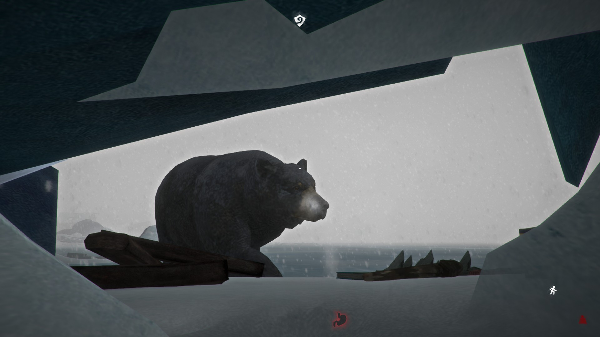

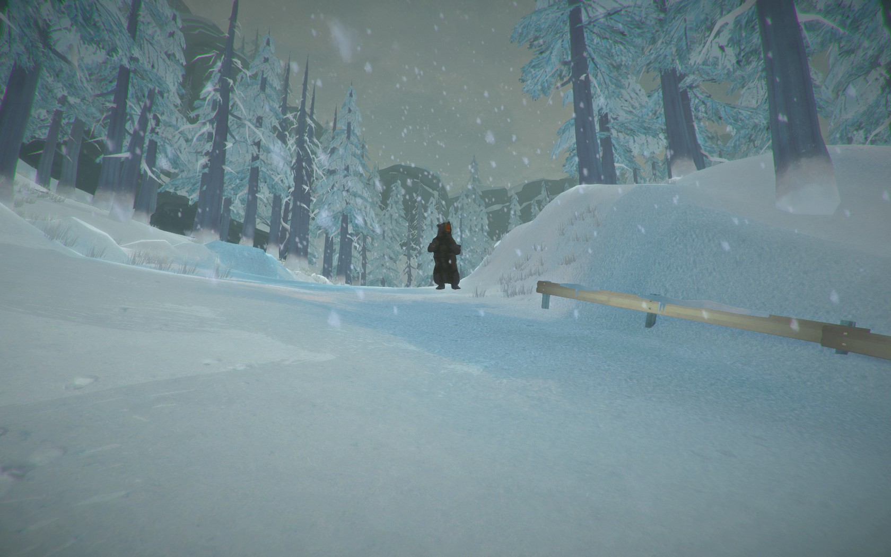

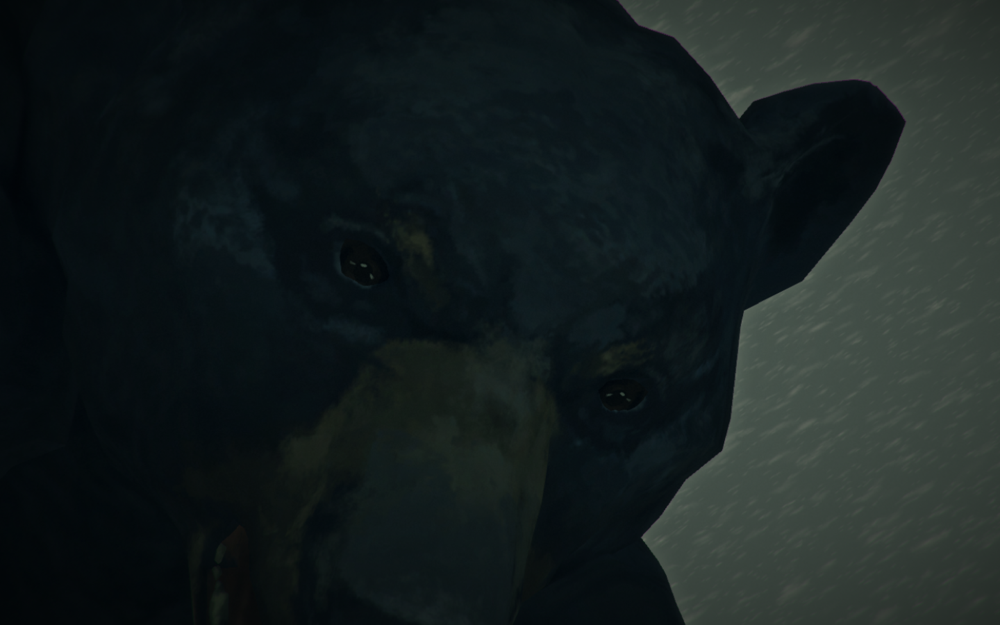

_A bear during an [aurora](./Aurora.md)_

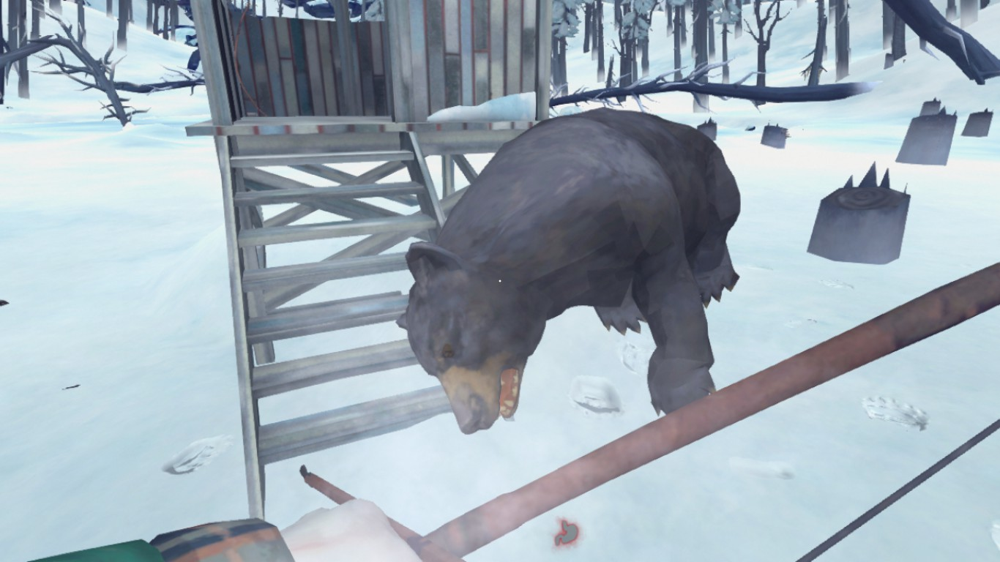

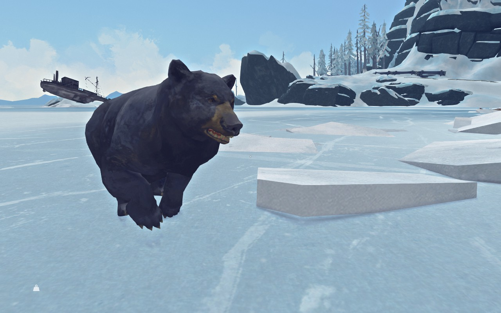

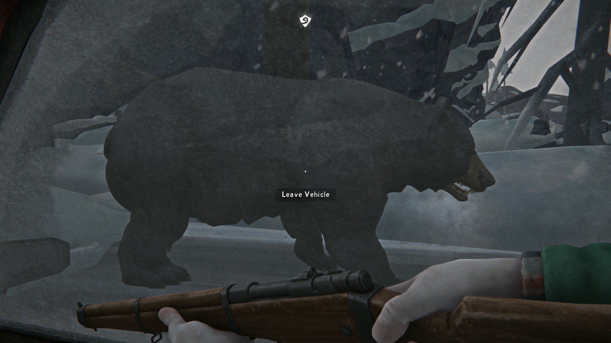

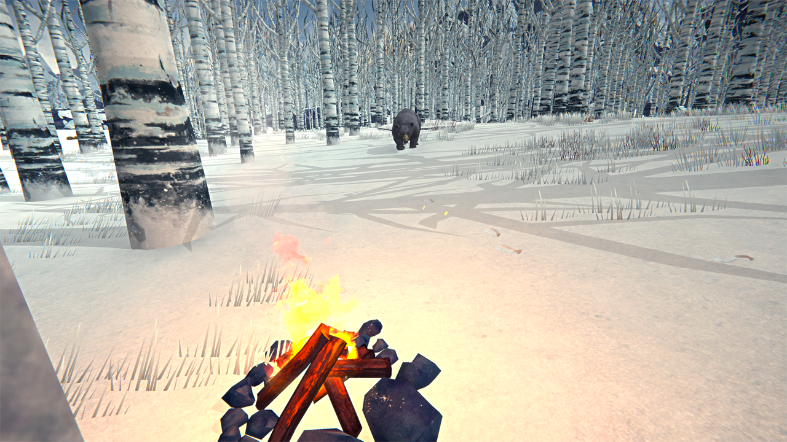

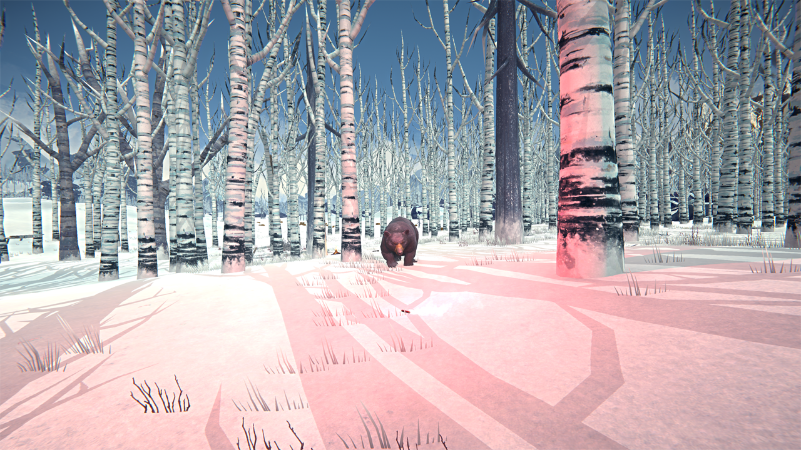

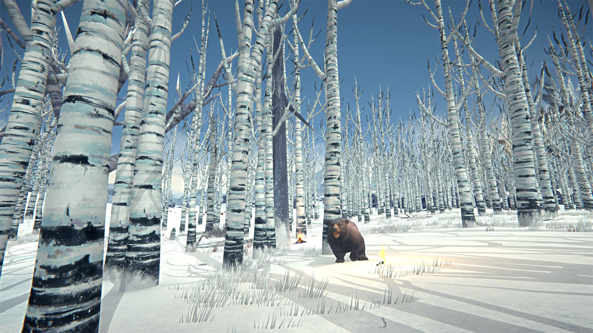

## Update history

- UPDATE **19 May 2020 ([Update](./The%20Long%20Dark%20%E2%80%94%20Changelog%20%E2%80%94%20Archive%202.md#1.76)):**
  - [General] Bear sound effects no longer play when a carcass is removed from the world.

- HOTFIX **1 November 2019 ([Update](./The%20Long%20Dark%20%E2%80%94%20Changelog%20%E2%80%94%20Archive%202.md#1.62)):**
  - Fixed Bears resetting to their dens after loading a save.

- HOTFIX **28 October 2019 ([Update](./The%20Long%20Dark%20%E2%80%94%20Changelog%20%E2%80%94%20Archive%202.md#1.61)):**
  - Fixed issue that caused Bears to sometimes spawn under the map.

- HOTFIX **27 May 2019 ([Update](./The%20Long%20Dark%20%E2%80%94%20Changelog%20%E2%80%94%20Archive%202.md#1.52)):**
  - [Survival Mode] Tuned damage dealt to Bears and Moose when using the Revolver.

- HOTFIX **8 May 2019 ([Update](./The%20Long%20Dark%20%E2%80%94%20Changelog%20%E2%80%94%20Archive%201.md#1.49)):**
  - Tuned Revolver effectiveness when used against Moose (reduced) and reduced critical chance against Bears.

- UPDATE **17 December 2018 ([Update](./The%20Long%20Dark%20%E2%80%94%20Changelog%20%E2%80%94%20Archive%201.md#1.41)):**
  - [Survival Mode] Fixed Bear spawning in terrain in Mystery Lake
  - [All] Bear breath effect optimization
  - [PS4] Fixed missing Bear breath

- HOTFIX **27 August 2018 ([Update](./The%20Long%20Dark%20%E2%80%94%20Changelog%20%E2%80%94%20Archive%201.md#1.36)):**
  - [ALL] Fixed issue where injured Bears reset their status when players enter an interior or Pass Time.

- UPDATE **14 June 2018 ([Update](./The%20Long%20Dark%20%E2%80%94%20Changelog%20%E2%80%94%20Archive%201.md#1.33)):**
  - [All] Fixed Bear becoming stuck in animation when not in player’s view.

- HOTFIX **20 March 2018 ([Update](./The%20Long%20Dark%20%E2%80%94%20Changelog%20%E2%80%94%20Archive%201.md#1.27)):**
  - [Survival Mode] Fixed issue where Bears could be stuck on broken ice in Desolation Point.
  - [Both] Crouching close to Bears no longer lets players move inside the carcass.

- UPDATE **7 December 2017 ([Update](./The%20Long%20Dark%20%E2%80%94%20Changelog%20%E2%80%94%20Archive%201.md#1.16)):**
  - [Both] Fixed issue where player camera would be inside the Bear mesh during carcass harvesting.

- HOTFIX **16 August 2017 ([Update](./The%20Long%20Dark%20%E2%80%94%20Changelog%20%E2%80%94%20Archive%201.md#1.10)):**
  - Fixed issue with a series of multiple exertion sounds being played after a Bear struggle.

- HOTFIX **3 August 2017 ([Update](./The%20Long%20Dark%20%E2%80%94%20Changelog%20%E2%80%94%20Archive%201.md#1.02)):**
  - Fixed the Bear struggle.

- HOTFIX **12 January 2017 ([Update](./The%20Long%20Dark%20%E2%80%94%20Early%20Access%20Changelog.md#0.392)):**
  - Fixed issue with drawn Survival Bow movement speed retained after Wolf or Bear struggle

- HOTFIX **21 December 2016 ([Update](./The%20Long%20Dark%20%E2%80%94%20Early%20Access%20Changelog.md#0.388)):**
  - Fixed bear getting stuck inside rail car in Forlorn Muskeg region

- HOTFIX **25 May 2016 ([Update](./The%20Long%20Dark%20%E2%80%94%20Early%20Access%20Changelog.md#0.338)):**
  - Fixed issue with Bears running too slowly.

- HOTFIX **30 April 2016 ([Update](./The%20Long%20Dark%20%E2%80%94%20Early%20Access%20Changelog.md#0.332)):**
  - [BUG] Fixed issue with bears not respawning.

- UPDATE **21 April 2016 ([Update](./The%20Long%20Dark%20%E2%80%94%20Early%20Access%20Changelog.md#0.321)):**
  - Delay condition-loss from Bear struggle until the struggle animation is complete. (This does not apply to Wolf struggles.)
  - Improved the Bear model and texture.
  - Improved the Bear animations.
  - Overhauled struggle audio for both Wolves (to account for new first-person presence) and for the Bear struggle (to make it more impressive).
  - Bears are now spawned facing outwards from Dens. This helps fix some pathing issues when the bear attempts to leave the Den.
  - Fixed issue with Bear playing sleep animations after leaving the sleep AI state.

- UPDATE **14 April 2015 ([Update](./The%20Long%20Dark%20%E2%80%94%20Early%20Access%20Changelog.md#0.226)):**
  - Bears have now migrated to all regions of the game world.

- UPDATE **1 April 2015 ([Update](./The%20Long%20Dark%20%E2%80%94%20Early%20Access%20Changelog.md#0.212)):**
  - Added new Bear "smelling" and "standing" animations.
  - Wolves and Bears will stop attacking when the player falls through the ice.
  - Fixed issue with player health being reset to 100% if loading a save after a Bear attack.

- HOTFIX **10 February 2015 ([Update](./The%20Long%20Dark%20%E2%80%94%20Early%20Access%20Changelog.md#0.193)):**
  - Fixed some bear AI detection and reaction issues.
  - Re-balanced harvestable meat and gut yield for Bear, as well as Caloric value of Bear meat.

- UPDATE **7 February 2015 ([Update](./The%20Long%20Dark%20%E2%80%94%20Early%20Access%20Changelog.md#0.192)):**
  - Added to game.

## Notes

[^1]: If carcass is harvested
[^2]: If carcass is quartered.
[^3]: BladesTLD, 2023. EVERYTHING you need to know about BEARS (spawning, stats, hunting strategies) [The Long Dark]. YouTube. [https://www.youtube.com/watch?v=3fuvFGDRtiE](https://www.youtube.com/watch?v=3fuvFGDRtiE)
