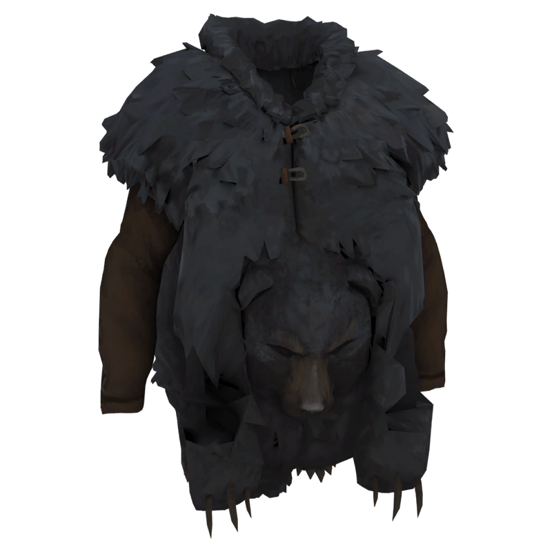
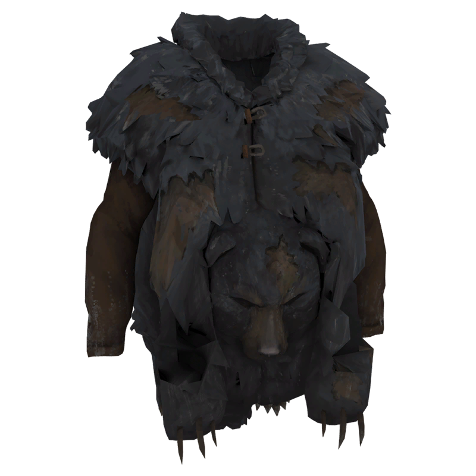

# Bearskin Coat

**Categories:** Clothing, Craftable clothing, Pages with update history · **Source:** [Fandom](https://thelongdark.fandom.com/wiki/Bearskin_Coat)

**Contents**

- [Overview](#overview)
- [Crafting](#crafting)
- [Location](#location)
- [Gallery](#gallery)
- [Update history](#update-history)

**Bearskin Coat**

_Bearskin\_Coat\_icon.png_

**General**

**Item Type:** Clothing

**Clothing Slot:** Outer torso

**Statistics**

**Weight:** 5.00 kg(11 lbs)

**Warmth bonus:** 6.0 °C(10.8 °F)

**Windproof bonus:** 5.0 °C(9 °F)

**Waterproof bonus:** 80%

**Protection:** 15%

**Mobility:** -20%

**Harvest:** 1 × [Cured Black Bear Hide](./Cured%20Black%20Bear%20Hide.md) / 120 minutes

**Repair:** 1 × [Cured Black Bear Hide](./Cured%20Black%20Bear%20Hide.md), / 2 × [Cured Gut](./Cured%20Gut.md) / 120 minutes / 40% condition

> “**If it's good enough for the Bear, it's good enough for you. Heavy, bulky, but very warm and one of the toughest things around. You may not run from much, but you may not need to either.**”
>
> — In-game description

The **Bearskin Coat** is a type of craftable clothing in _The Long Dark_.

## Overview

The Bearskin Coat is an extremely warm, but also heavy crafted torso clothing produced from 2 [Cured Black Bear Hide](./Cured%20Black%20Bear%20Hide.md). When worn it has a chance to frighten nearby [wolves](./Wolf.md) which detect the player.

Bearskin Coats provides two more degrees of warmth than the rare [Expedition Parka](./Expedition%20Parka.md), but one less windproof; however the bearskin coat is more than three times heavier. In [Interloper](./Interloper.md) where the Expedition Parka cannot spawn, the Bearskin Coat is the warmest torso clothing available.

## Crafting

**Bearskin Coat**

| Property | Details |
| --- | --- |
|  | 1800 minutes (30 hour 0 minutes) |
| **Requirements** |  |
| Facility |  |
| Tool |  |
| **Materials** |  |
| Item | [Cured Black Bear Hide](./Cured%20Black%20Bear%20Hide.md) |
| Quantity | 2 |
|  | [Cured Gut](./Cured%20Gut.md) |
|  | 4 |

## Location

As of the [Hesitant Prospect Update](./The%20Long%20Dark%20%E2%80%94%20Changelog%20%E2%80%94%20Archive%202.md), a Bearskin Coat may spawn in [Ash Canyon](./Ash%20Canyon.md), along the path from [Wolf's Jaw Overlook](./Wolf%27s%20Jaw%20Overlook.md) to the [Mining Camp](./Mining%20Camp.md). Does not spawn on Interloper.

## Gallery

_Clothing model_

_Clothing model damaged_

## Update history

- UPDATE **26 September 2023 ([Update](./The%20Long%20Dark%20%E2%80%94%20Changelog.md#2.23)):**
  - Fixed an issue where Bearskin Coats only required 1 hide to craft instead of the intended 2.
