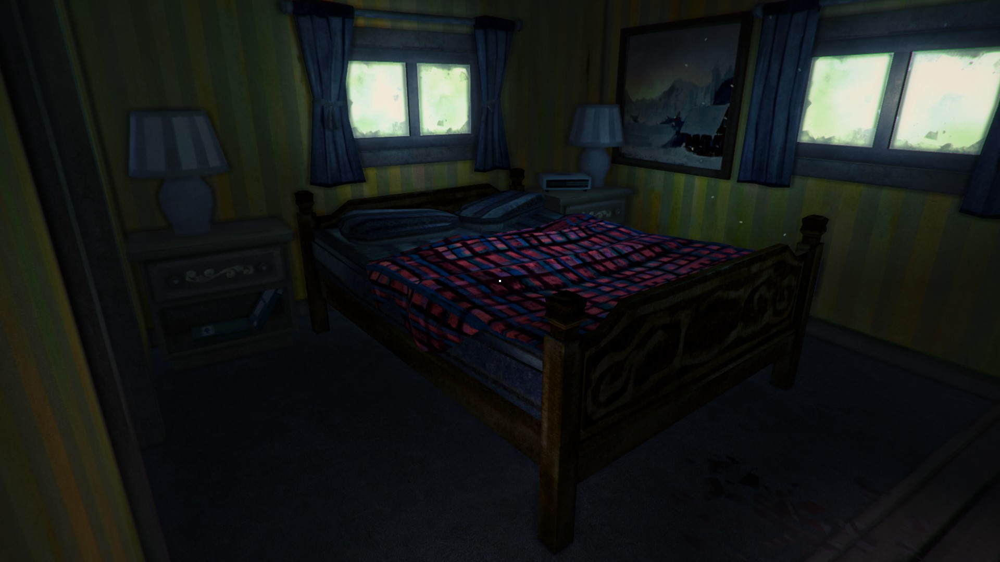
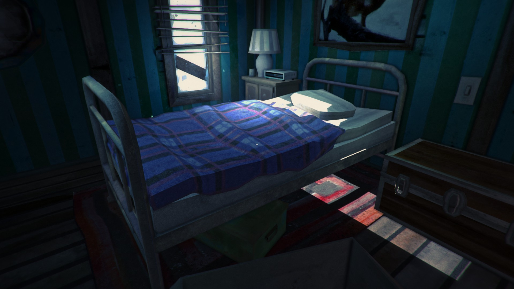
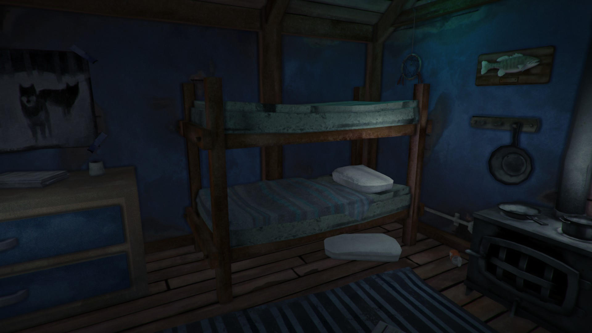

# Bed

**Categories:** Beds, Interactable Objects, Interactable objects, Story items · **Source:** [Fandom](https://thelongdark.fandom.com/wiki/Bed)

**Contents**

- [Overview](#overview)
- [Variants](#variants)
- [Health recovery](#health-recovery)
- [Trivia](#trivia)
- [Gallery](#gallery)

**Bed**

\[\[File: /  / _Full_ /  / _Twin_ /  / _Cot_ /  / _Bunk bed_ /  / _Mattress_ /  / _Hay_ /  / _Tuffet_ /  / _Medical Cot_ /  / _Blanket_

250px\]\]

_Full_

_Twin_

_Cot_

_Bunk bed_

_Mattress_

_Hay_

_Tuffet_

_Medical Cot_

_Blanket_

**General**

**Item Type:** Item

Bed type

Region

Condition restoration (%)

Note

[Hunting Lodge](./Hunting%20Lodge.md) bunkbed

[Broken Railroad](./Broken%20Railroad.md)

37

Other beds have regular restoration (32%)

All trailers

[Coastal Highway](./Coastal%20Highway.md)

37

The cabins and lookout have regular restoration (32%)

[Hibernia Processing](./Hibernia%20Processing.md)

[Desolation Point](./Desolation%20Point.md)

37

The Lighthouse has regular restoration (32%)

[The Riken](./The%20Riken.md) bed in frame

[Desolation Point](./Desolation%20Point.md)

37

Trailer near cave to [Hushed River Valley](./Hushed%20River%20Valley.md)

[Mountain Town](./Mountain%20Town.md)

37

Trailers

[Mystery Lake](./Mystery%20Lake%20%28disambiguation%29.md)

37

The cabins and lookout have the regular restoration (32%)

[Trapper's Homestead](./Trapper%27s%20Homestead.md)

[Mystery Lake](./Mystery%20Lake%20%28disambiguation%29.md)

41

Regular bed

32

Examples include: all beds in [Pleasant Valley](./Pleasant%20Valley.md), [Timberwolf Mountain](./Timberwolf%20Mountain.md), the beds in [Maintenance Yard](./Maintenance%20Yard.md)

Regular bedroll

_Craftable_

27

Bearskin bedroll

_Craftable_

32

[Bear Hide Bed](./Bear%20Hide%20Bed.md)

_Craftable_

64

Has best restoration of all the beds

[Quilted Bed](./Quilted%20Bed.md)

_Craftable_

32

Equivalent to a regular bed

[Rustic Bed](./Rustic%20Bed.md)

_Craftable_

32

Equivalent to a regular bed

_Tuffet\_Bed\_Cave.jpg_

_Tuffet.png_
