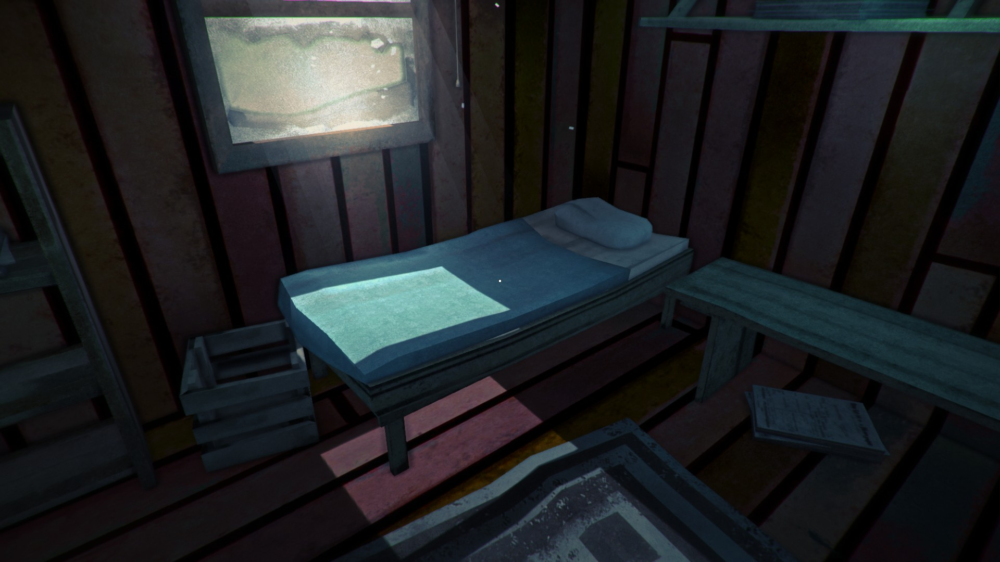
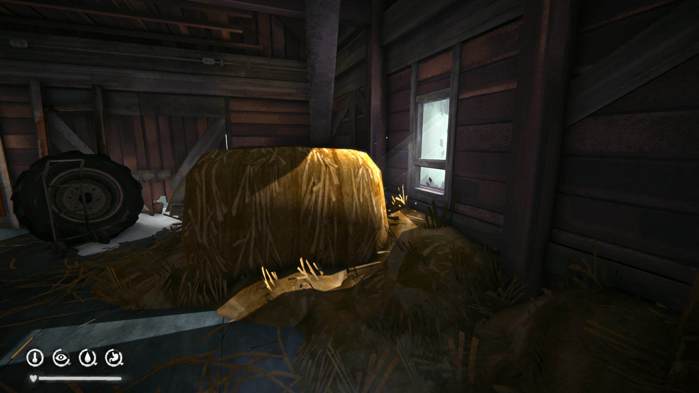
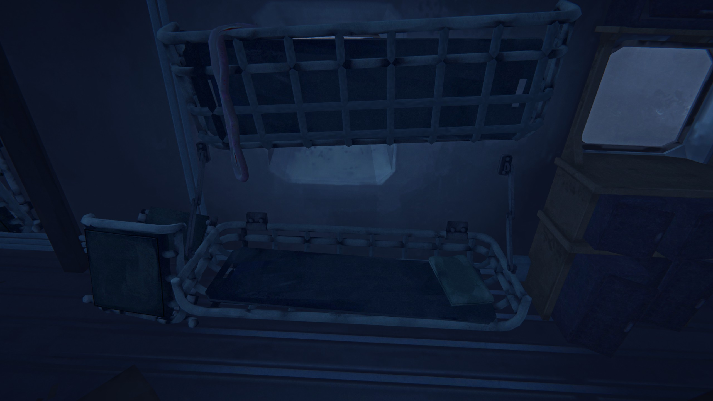
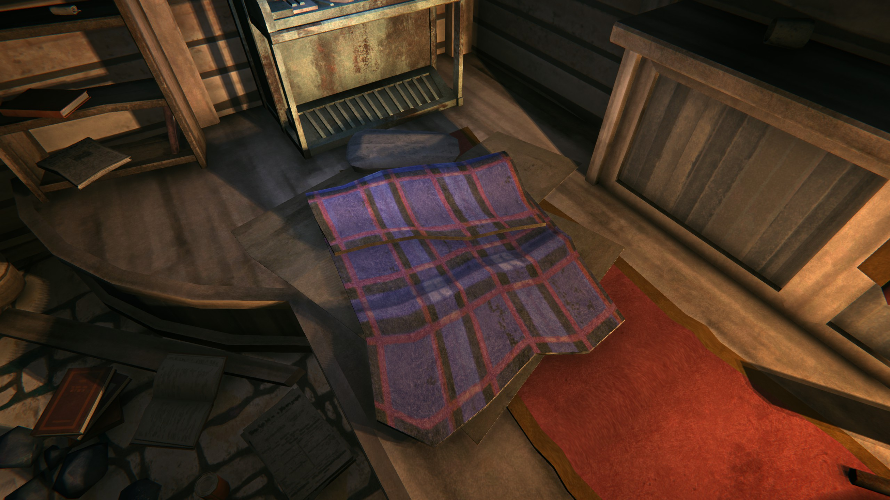
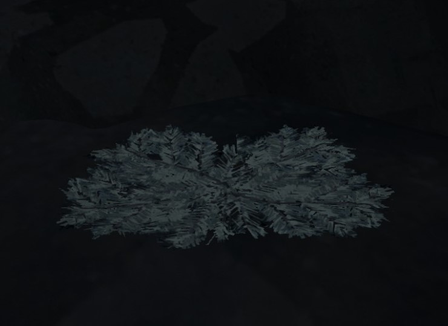

# Bed

**Categories:** Beds, Interactable Objects, Interactable objects, Story items · **Source:** [Fandom](https://thelongdark.fandom.com/wiki/Bed)

**Contents**

- [Overview](#overview)
- [Variants](#variants)
- [Health recovery](#health-recovery)
- [Trivia](#trivia)
- [Gallery](#gallery)

**Bed**

|

**General**

Item Type

Item

Wintermute

Yes

A **Bed** is a type of furniture or a small, pre-built construction that frequently appears in houses and cabins, with some variants appearing in other buildings and even in some caves. Beds can be used to restore [Fatigue](./Fatigue.md) by [Sleeping](./Sleep.md) and grant a [Warmth](./Warmth.md) bonus while being used.

## Overview

Planning exploratory travel, especially if the player chooses not to bring along a [Bedroll](./Bedroll.md), requires careful consideration of bed locations (especially higher-level [Survival Mode](./Survival%20Mode.md) difficulties) since not all houses/caves have beds, and no bed variants can be broken down, moved, or crafted. Additionally, sleeping is one of the only ways to restore fatigue and recover significant amounts of [Condition](./Condition.md), and, no matter how tired, the player cannot sleep directly on the floor or on non-bed furniture such as couches or chairs.

While the player may sleep in a Bedroll, [Snow Shelter](./Snow%20Shelter.md), or certain [Vehicle](./Vehicle.md) interiors instead of a bed, these other options may not be available, or may be impossible to craft early in game. Using any of these alternatives also often comes with a higher risk of freezing or being attacked by predators.

## Variants

There are several variants of bed, some found only in specific types of locations, and each providing a different amount of [Warmth](./Warmth.md) when slept in.

- Full (most often found in houses) provides + 8°C ( +14.4°F )
- Twin (most often found in houses) provides + 5°C ( +9°F )
- Cot (often found in cabins or remote buildings) provides + 5°C ( +9°F )
- Bunk Bed (usually in cabins or other remote structures. Only the lower bed can be used) provides + 3-6°C ( +5.4-10.8°F )
- Mattress (found on the floor in some large industrial or community buildings/trailers) provides + 3-5°C ( +5.4-9°F )
- Hay (found in some barns/outbuildings) provides + 2°C ( +3.6°F )
- Sticks and Leaves (a makeshift bed made of conifer branches and leaves often found in a [Warm Cave](./Warm%20Cave.md)) will provide + 2°C ( +3.6°F )
- Medical Cot (found inside the crashed [Final Approach](./Final%20Approach.md) helicopter) provides + 2°C ( +3.6°F )
- Blanket (a blanket and pillow thrown over a cardboard box, found in abandoned [Prepper Caches](./Prepper%20Cache.md) and trailers) provides + 2°C ( +3.6°F )

Additionally, the inside of [Car](./Car.md), [Truck](./Truck.md), [Tractor](./Tractor.md), [Airplane](./Airplane.md), [Helicopter](./Helicopter.md), and [Earth Mover](./Haul%20Truck.md) interiors can be used as beds with or without a bedroll by opening the [Radial Menu](./Radial%20Menu.md), selecting "campcraft", and selecting "sleep". Sleeping in a Vehicle provides a + 3°C (+5. °F) Warmth bonus. Sleeping with a Bedroll will raise the Warmth temperature to whatever the Warmth of the Bedroll is.

The player also has the ability to create beds via [Safehouse Customization](./Safehouse%20Customization.md) ([Rustic Bed](./Rustic%20Bed.md), [Quilted Bed](./Quilted%20Bed.md), [Bear Hide Bed](./Bear%20Hide%20Bed.md)).

## Health recovery

Some beds confer greater restoration of [Condition](./Condition.md) than others. On [Interloper](./Interloper.md), sleeping 10 hours with no afflictions or teas yields the following recoveries:

| Bed type | Region | Condition restoration (%) | Note |
| --- | --- | --- | --- |
| [Hunting Lodge](./Hunting%20Lodge.md) bunkbed | [Broken Railroad](./Broken%20Railroad.md) | 37 | Other beds have regular restoration (32%) |
| All trailers | [Coastal Highway](./Coastal%20Highway.md) | 37 | The cabins and lookout have regular restoration (32%) |
| [Hibernia Processing](./Hibernia%20Processing.md) | [Desolation Point](./Desolation%20Point.md) | 37 | The Lighthouse has regular restoration (32%) |
| [The Riken](./The%20Riken.md) bed in frame | [Desolation Point](./Desolation%20Point.md) | 37 |  |
| Trailer near cave to [Hushed River Valley](./Hushed%20River%20Valley.md) | [Mountain Town](./Mountain%20Town.md) | 37 |  |
| Trailers | [Mystery Lake](./Mystery%20Lake%20%28disambiguation%29.md) | 37 | The cabins and lookout have the regular restoration (32%) |
| [Trapper's Homestead](./Trapper%27s%20Homestead.md) | [Mystery Lake](./Mystery%20Lake%20%28disambiguation%29.md) | 41 |  |
| Regular bed |  | 32 | Examples include: all beds in [Pleasant Valley](./Pleasant%20Valley.md), [Timberwolf Mountain](./Timberwolf%20Mountain.md), the beds in [Maintenance Yard](./Maintenance%20Yard.md) |
| Regular bedroll | _Craftable_ | 27 |  |
| Bearskin bedroll | _Craftable_ | 32 |  |
| [Bear Hide Bed](./Bear%20Hide%20Bed.md) | _Craftable_ | 64 | Has best restoration of all the beds |
| [Quilted Bed](./Quilted%20Bed.md) | _Craftable_ | 32 | Equivalent to a regular bed |
| [Rustic Bed](./Rustic%20Bed.md) | _Craftable_ | 32 | Equivalent to a regular bed |

Although there is a general pattern that warmer beds provide more [Condition](./Condition.md) recovery, the two are not strictly linked. For example, the [Quilted Bed](./Quilted%20Bed.md) has a better Warmth bonus than the [Rustic Bed](./Rustic%20Bed.md), but the same [Condition](./Condition.md) recovery.

## Trivia

- The region with the fewest beds is the [Hushed River Valley](./Hushed%20River%20Valley.md), where pre-built beds can only be found in [Bunker Gamma](./Bunker%20Gamma.md) and the [Prepper Cache](./Prepper%20Cache.md).

## Gallery

